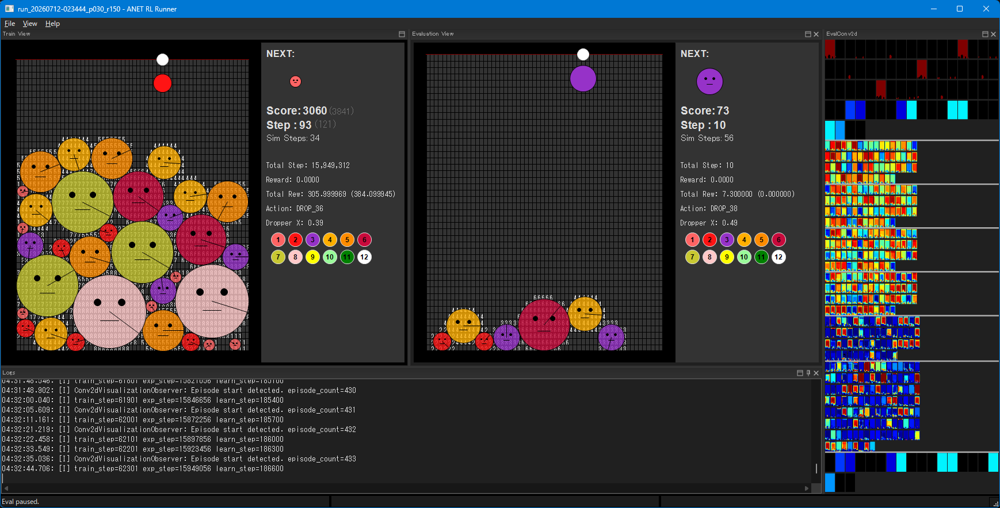
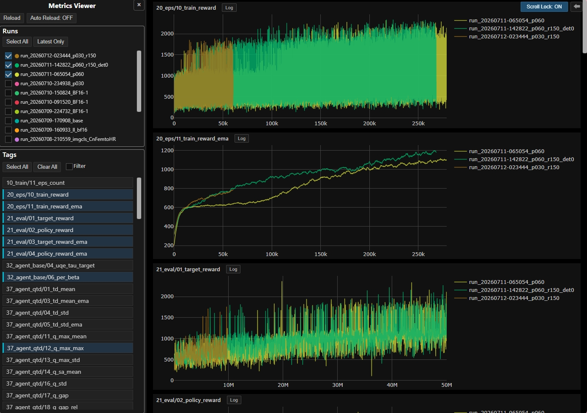

# anet-lab

## 概要

anet-labは、libtorchを基盤とするC++20の強化学習実験プロジェクトです。
Agent、Env、ニューラルネットワーク、メトリクスを設定から組み立て、
学習・評価・Runの記録と比較までを一つの環境で試せることを目指しています。

学習と評価はwxWidgets製のRunnerで実行し、記録したメトリクスは
Java/Spring製のMetrics Viewerで可視化・比較できます。
Windows 11 x64とNVIDIA CUDAを主な実行環境とする、個人の学習・実験用途のプロジェクトです。

## 主な構成

- C++20 / libtorchによるAgent、Env、学習基盤
- 設定ファイルによるニューラルネットワークと実験構成
- wxWidgets製Runnerによる学習、評価、実行状態の可視化
- Java/Spring製Metrics Viewerによるメトリクスのリアルタイム表示とRun比較
- メトリクス、動画、プロファイルを含むRun成果物の記録

基盤と Env、Runner、Metrics Viewer のソースは `src/` にあります。実行体・設定・起動用の道具は `apps/`、ビルドの中間物と C++ のテスト実行体は `out/` に置きます。

## ガイド

- 開発環境とビルド・テスト手順: [開発環境構築ガイド](docs/design/040_development_environment.jp.md)
- 設定ファイルの選択とRunnerの操作: [Run実行ユーザーガイド](docs/design/020_user_guide_run.jp.md)
- メトリクスの確認とRun比較: [Run分析ユーザーガイド](docs/design/030_user_guide_analysis.jp.md)

主な実行環境はWindows/MSVC、libtorch、wxWidgets、CUDAです。
環境要件と具体的な検証コマンドは、開発環境構築ガイドを参照してください。

## ドキュメント

日本語ドキュメントの入口は[docs/design/README.jp.md](docs/design/README.jp.md)です。
フレームワーク全体像、ユーザーガイド、開発環境、機能カテゴリ別・具象Agent別の設計ガイドを参照できます。
全体像を先につかむには、[概要紹介スライド（PDF）](docs/anet_overview_ja.pdf)と[アーキテクチャ図](docs/archify/README.md)を見てください。
実験の知見（題材・手法・測り方・現象）、ハーネスの知見、実装の部分ごとの成立の経緯は、[wikiの目録](docs/wiki/index.md)から引けます。

### 構成と使い方

| 場所 | 役割 |
|---|---|
| [docs/design/](docs/design/README.jp.md) | 現在の構成、利用方法、実装上のcontract |
| [docs/anet_overview_ja.pdf](docs/anet_overview_ja.pdf) | 強化学習の背景、ANETの概要、開発プロセス、動作例を紹介するスライド |
| [docs/archify/](docs/archify/README.md) | システム構成、Runの流れ、学習ステップ、実験データの流れ、状態遷移を表した5枚の図（ブラウザで表示） |
| [apps/](apps/README.md) | 実行アプリケーションの構成と、起動用batの一覧 |
| [CONTEXT.md](CONTEXT.md) | プロジェクト内で使うドメイン用語の正本 |
| [CHANGELOG.md](CHANGELOG.md) | リリースごとの変更点 |

### 課題と設計判断

| 場所 | 役割 |
|---|---|
| [docs/management/issues/](docs/management/issues/INDEX.md) | 課題（Issue）の一覧。1課題1ファイルで、状態、優先度の目安、関連するRFDを管理 |
| [docs/memo/](docs/memo/README.md) | 変更ごとのRFD（Request for Discussion）と実装計画 |
| [docs/adr/](docs/adr/) | 採用した設計判断と理由 |

### 実験と調査

| 場所 | 役割 |
|---|---|
| [docs/experiments/](docs/experiments/README.md) | 実験記録。Env別の一覧は[DefaultDQNAgent](docs/experiments/default-dqn/README.md)と[ImageClsAgent](docs/experiments/image-cls/README.md) |
| [docs/wiki/](docs/wiki/index.md) | 実験記録・RFD・設計文書などを資料ごとのサマリと、知見の問い・コードの区分ごとに束ねたまとめ（正本は各出典） |
| [reports/](reports/INDEX.md) | サーベイ、論文解説の索引と[作業ノート](reports/notes/INDEX.md) |
| [reports/stats/](reports/stats/summary.md) | コード、テスト、RFD、Runなどの統計 |

現行動作の最終的な根拠はコード、設定、テストとします。
残っている課題は`docs/management/issues/`、変更ごとの計画は`docs/memo/`、採用後も残す判断理由は`docs/adr/`に記録します。

## ギャラリー

### Runnerによる学習・評価と可視化

### Metrics Viewerによる分析

## AIを活用した開発

OpenAIのChatGPT / CodexとAnthropicのClaude Codeを使い分けながら、
設計、実装、レビュー、テスト、ドキュメント整備を進めています。

開発フロー、AIツールの使い分け、利用しているSKILL、チャットセッションの使い分け、開発の推移について、
詳しくは[概要紹介スライド（PDF）](docs/anet_overview_ja.pdf)の「3. 開発プロセス」
（[15〜22ページ](https://kazukin123.github.io/anet-lab/docs/anet_overview_ja.pdf#page=15)）を参照してください。

| 場所 | 役割 |
|---|---|
| [AGENTS.md](AGENTS.md) | AIエージェント向けの作業規約 |
| [.agents/skills/](.agents/skills/README.md) | プロジェクト固有と汎用のSKILLの一覧（Codex / Claude Code共通） |
| [docs/agents/](docs/agents/README.md) | AIエージェントがどの文書をいつ読むかを表した動線マップ（ブラウザで表示できる図を含む） |

## ライセンス

特記のない本リポジトリのファーストパーティ部分は、[Apache License 2.0](LICENSE)で提供します。
著作権表示は[NOTICE](NOTICE)を参照してください。

`third_party/`、`licenses/`、およびファイル内で別のライセンスが明記された部分には、
それぞれのライセンス条件が適用されます。
