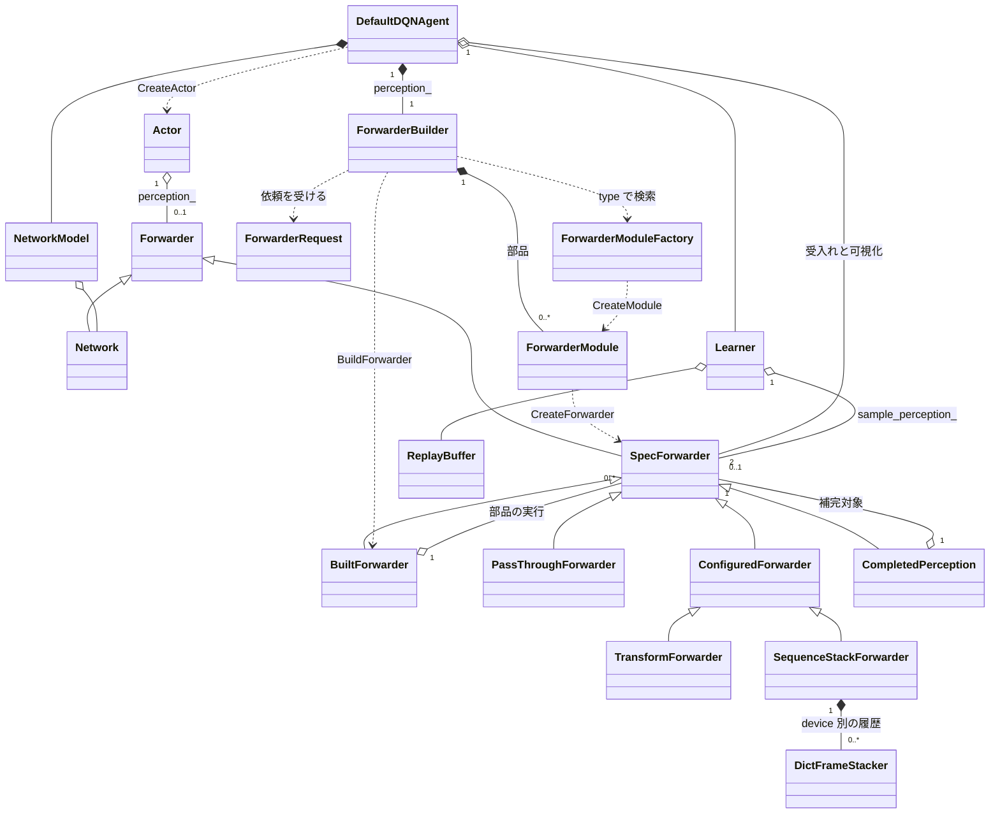
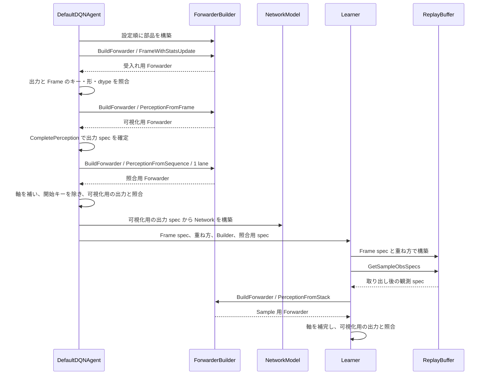
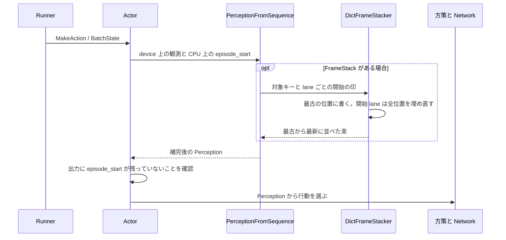
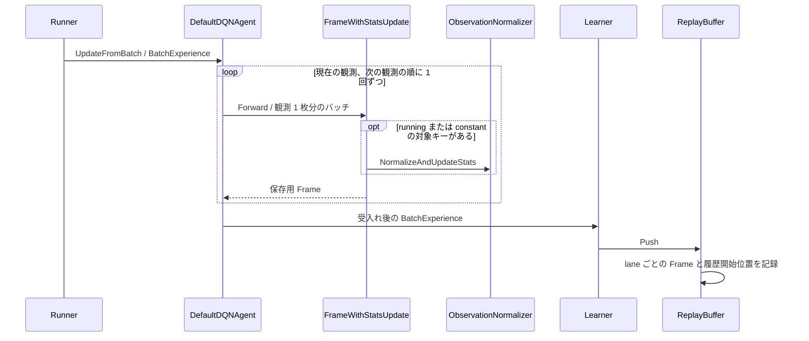
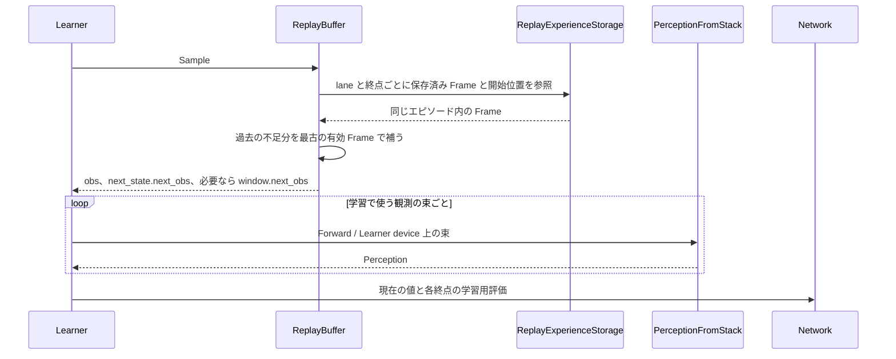
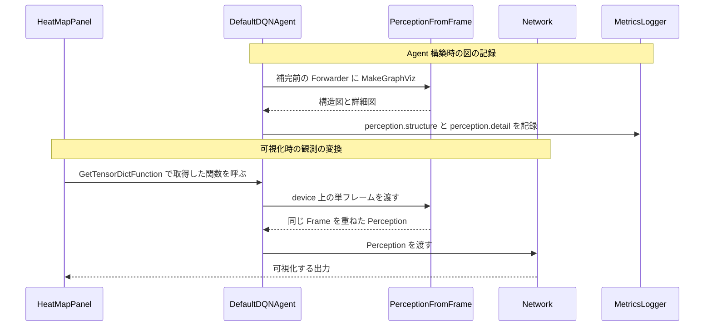

# Forwarder と Perception

> 主たる観点: Forwarder の構築と実行、DefaultDQN の観測の流れと履歴の所有

## 1. はじめに

### 1.1 目的

本書は、設定された部品の並びから Forwarder を構築し、DefaultDQN が観測を Frame と Q Network の Perception に加工する仕組みを説明する。行動選択で直近の観測を重ねる処理と、学習で保存済みの Frame を重ね直す処理を、データとその持ち主の両方から追えることを目的とする。

### 1.2 対象読者

- DefaultDQN の観測、履歴、ReplayBuffer との境界を変更する開発者
- Forwarder の部品や設定を追加し、shape、dtype、device の整合を確認する開発者

### 1.3 記載範囲

Agent、Actor、Learner の共通契約は [110 Agentと学習](110_agents_and_learning.jp.md)、Network 内部の入力と実行は [130 ニューラルネットワーク](130_neural_networks.jp.md)、保存・抽選・取り出しの詳細は [150 ReplayBuffer](150_replay_buffer.jp.md)、方策・学習更新・TempoRL は [200 DQN系Agent](200_dqn_agents.jp.md) を参照する。

製品コードで `BuildForwarder` を呼ぶのは、[DefaultDQNAgent](../../src/algo/dqn/src/default_dqn_agent.cpp) の経験受入れ・可視化・Actor 向けの構築と、[dqn::Learner](../../src/algo/dqn/src/dqn_learner.cpp) の Sample 向けの構築である。DefaultDQN の Learner は、学習、Replay 当てはまり診断、`SampleProbeObservation` を使う可塑性・方策変化・Noisy・Attention エントロピーの probe で、同じ Sample 用 Forwarder を再利用する。

[RainbowAgent](../../src/algo/dqn/src/rainbow_agent.cpp) は Actor に Perception 用 Forwarder を渡さず、Learner にも構築用の情報を渡さない。Actor は観測を device に移し、Learner は Sample の観測を使う。MuZero と ImageCls もこの Builder を使用しない。これらの Agent が使う `Network` は共通の `Forwarder` を実装する。DefaultDQN の RND は経験の観測を直接選び、byte 観測の変換や正規化を [RND 側の実装](../../src/core/base/src/intrinsic_rnd.cpp) で行う。

## 2. 基本概念と外部contract

### 2.1 Forwarder と依頼

[Forwarder](../../src/core/base/include/anet/forwarder.hpp) の `Forward` は `TensorDict` を受け、変換した `TensorDict` を返す。Network もこのインターフェースを実装し、任意の `ForwardCapture` で同期呼び出し中の値を取得できる。取得できる値は実装が決める。[130 の forward capture](130_neural_networks.jp.md#76-forward-captureと部分forward) を参照する。

`ForwarderBuilder` は設定順に部品を保持する。呼び出し側は `BuildForwarder` に `ForwarderRequest` と、実際に渡すデータの `TensorSpecMap` を渡す。依頼は文字列の別名 `ForwardKind` と付帯情報の `ConfigData` を持つ。Builder は使える種類を各部品の工場から得る。以下の種類と依頼を作る関数は `anet::rl` が定義する。

| ForwardKind | Forward に渡すもの | 得るもの | 依頼の付帯情報 |
|---|---|---|---|
| `FrameWithStatsUpdate` | 現在または次の観測 1 枚分のバッチ | 統計の更新と、保存用の Frame | なし |
| `PerceptionFromSequence` | 観測 1 枚分のバッチと各 lane の開始の印 | その Actor の履歴から得た Perception | 行数、seed、開始キー、枚数、対象キー |
| `PerceptionFromStack` | ReplayBuffer が取り出した観測の束 | 学習・診断用の Perception | 枚数、対象キー |
| `PerceptionFromFrame` | 可視化用の Frame 1 枚分のバッチ | 同じ Frame から得た Perception | 枚数、対象キー |

作られた `SpecForwarder` の `GetInputSpecs` と `GetOutputSpecs` は、その依頼で決まった入出力の spec を返す。Builder と部品は Forwarder を作り、実際の変換は受け取った Forwarder に対して呼ぶ。[ADR 0094](../adr/0094-forwarders-are-built-per-request-and-builders-are-not-forwarders.md) を参照する。

### 2.2 観測の spec

[TensorSpec](../../src/core/base/include/anet/common.hpp) の `shape` は batch 軸を除いた形である。`ToJson` は値の尺度と stack 軸の有無を `scale` と `stack_axis` に出す。[ADR 0085](../adr/0085-tensorspec-carries-value-scale-and-stack-axis-attributes.md) を参照する。

| 属性 | 意味 |
|---|---|
| `scale = Scaled` | 値を作る側または正規化が尺度を決めている。byte 画像や離散値の番号も含む。 |
| `scale = Unscaled` | 正規化で尺度をそろえる連続値である。整数 dtype と離散のキーには指定できない。 |
| `has_stack_axis = true` | batch 軸を除いた形の先頭が stack 軸であり、各位置が 1 枚の Frame に対応する。 |

### 2.3 Frame、Perception、開始の印

Frame は ReplayBuffer に保存する観測側の 1 step 分である。現行 DefaultDQN では Env の観測と同じキー・形・dtype を持つ。Perception は、Forwarder の加工を経て Q Network に渡す観測入力である。IQN の `taus` は Network の入力 spec に加え、Network を呼ぶ側で用意する。

開始の印は、その lane の観測がエピソードの最初であることを示す。Env の `BatchState::episode_start` を Actor が観測の辞書に `episode_start` として一時的に足す。依頼の入力 spec では各行が stack 軸なしのスカラー `bool`、実データでは CPU 上の `bool[N]` である。ReplayBuffer は経験の `BatchState` から印を受け、保存位置の付帯情報にする。

Perception の出力に残る対象キーの spec は stack 軸を持つ。実データは `[B, S, *frame_shape]`、spec は `[S, *frame_shape]` で、最古から最新の順である。対象外のキーには重ねる処理による軸の追加がない。1 枚の場合も Perception では `S=1` とする。DefaultDQN は、並びの最終 spec で対象キーに軸がなければ長さ 1 の軸を補う。[ADR 0086](../adr/0086-perception-stack-target-keys-always-carry-stack-axis.md)・[ADR 0096](../adr/0096-stack-axis-and-chain-validity-are-ensured-by-the-caller-not-the-forwarder-mechanism.md) を参照する。

## 3. コンポーネント定義

| コンポーネント | 責務 |
|---|---|
| `Forwarder`、`SpecForwarder` | TensorDict の変換を提供する。後者は入出力 spec を公開し、実装に応じて図を返す。 |
| `ForwarderRequest`、`ForwardKind` | 何を受けて何を作る Forwarder かと、その構築に必要な値を伝える。 |
| `ForwarderModuleFactory` | 設定の `type` ごとに登録され、対応する種類を宣言し、設定から部品を作る。 |
| `ForwarderBuilder`、`ForwarderModule` | Builder は設定順に部品を持つ。部品は依頼と、その位置に届く入力 spec に合った Forwarder を作る。 |
| `BuiltForwarder` | 依頼 1 件分の部品の Forwarder を保持し、spec とデータを同じ順で通す。順序と部品名から図を作る。 |
| `ConfiguredForwarder`、`TransformForwarder` | 部品の Forwarder が入出力 spec と図の詳細を保持するための基底と、関数で変換する具象型である。 |
| `SequenceStackForwarder`、`DictFrameStacker` | Actor 向けの部品の Forwarder と、その device 別の履歴を保持して lane ごとに重ねる処理である。 |
| `CompletedPerception` | DefaultDQN 側で必要に応じて作る Forwarder である。出力の stack 軸を補い、Actor 用では spec に残った開始の印も取り除く。 |
| `DefaultDQNAgent`、`Actor`、`Learner` | Agent が並びと Agent 共通の重ね方を持つ。Actor は行動選択用、Learner は Sample 用の Forwarder をそれぞれ持つ。 |
| `ReplayBuffer`、`Network` | ReplayBuffer は Frame と開始位置を保存して Sample の束を作る。Network は Perception を受けて Q 値などを返す。 |

## 4. コードマップ

| 役割 | ファイル |
|---|---|
| Forwarder の公開インターフェース、部品登録、依頼 | [forwarder.hpp](../../src/core/base/include/anet/forwarder.hpp) |
| Builder、図、標準部品とその Forwarder | [forwarder.cpp](../../src/core/base/src/forwarder.cpp) |
| 観測の spec、JSON、開始の印 | [common.hpp](../../src/core/base/include/anet/common.hpp)、[common.cpp](../../src/core/base/src/common.cpp)、[rl.hpp](../../src/core/base/include/anet/rl.hpp)、[env.cpp](../../src/core/base/src/env.cpp) |
| lane ごとのリングバッファ | [stacker.hpp](../../src/core/base/include/anet/stacker.hpp)、[stacker.cpp](../../src/core/base/src/stacker.cpp) |
| 正規化と統計 | [scaler.hpp](../../src/core/base/include/anet/scaler.hpp)、[scaler_impl.cpp](../../src/core/base/src/scaler_impl.cpp) |
| Agent の組み立て、経験受入れ、可視化 | [default_dqn_agent.hpp](../../src/algo/dqn/src/default_dqn_agent.hpp)、[default_dqn_agent.cpp](../../src/algo/dqn/src/default_dqn_agent.cpp) |
| 行動選択と Learner での利用 | [dqn_actor.hpp](../../src/algo/dqn/src/dqn_actor.hpp)、[dqn_actor.cpp](../../src/algo/dqn/src/dqn_actor.cpp)、[dqn_learner.hpp](../../src/algo/dqn/src/dqn_learner.hpp)、[dqn_learner.cpp](../../src/algo/dqn/src/dqn_learner.cpp) |
| ReplayBuffer の公開 contract、prefetch、保存と抽出 | [rl.hpp](../../src/core/base/include/anet/rl.hpp)、[replay_buffer.hpp](../../src/core/base/include/anet/replay_buffer.hpp)、[replay_buffer_impl.hpp](../../src/core/base/src/replay_buffer_impl.hpp)、[replay_buffer_impl.cpp](../../src/core/base/src/replay_buffer_impl.cpp) |
| Network と状態スイープの呼び出し元 | [nn.hpp](../../src/core/base/include/anet/nn.hpp)、[HeatMapPanel.cpp](../../src/apps/runner/src/HeatMapPanel.cpp) |
| 基盤・Replay・DQN のテスト | [forwarder_test.cpp](../../src/core/base/src/forwarder_test.cpp)、[replay_buffer_test.cpp](../../src/core/base/src/replay_buffer_test.cpp)、[dqn_concrete_test.cpp](../../src/algo/dqn/src/dqn_concrete_test.cpp)、[dqn_learner_test.cpp](../../src/algo/dqn/src/dqn_learner_test.cpp) |
| 基準プロファイルと設定例 | [agent.txt](../../apps/runner/config/agent.txt)、[GridMaze.txt](../../apps/runner/config/GridMaze.txt)、[LunarLander.txt](../../apps/runner/config/LunarLander.txt) |

### 4.1 標準の部品

| 種類 | 動作 |
|---|---|
| `FrameStack` | 枚数とキーを依頼から取り、自分の位置に届いた対象キーを重ねる。経験受入れでは通す。Actor では履歴を使い、可視化では同じ Frame を繰り返す。Sample では既に stack 軸があるキーを通し、1 枚で軸がなければ長さ 1 の軸を足す。 |
| `Normalize` | `none` は値を通す。`constant` は定数、`running` は観測統計を使う。対象は届いた `Unscaled` の浮動小数点かつ連続のキーである。Perception を作る依頼では正規化したキーを `Scaled` と宣言し、経験受入れでは保存する値を保つ。 |
| `DropKeys` | Perception のデータと spec から `keys` を取り除く。経験受入れでは通す。 |
| `SetSpec` | `keys` の `scale`、`min_values`、`max_values`、`labels` のうち指定した宣言を変え、値を通す。対象の ForwardKind を設定で絞れる。 |

`SetSpec` は変更する属性だけを検査し、stack 軸があれば除いた 1 枚分の形を使う。範囲値は全要素共通の 1 値か 1 枚の全要素分を指定する。ラベルは `Vector` では全要素分、`Grid` と `Sequence` では 1 枚の先頭次元分を指定する。`Normalize` より前で尺度を変えると、その位置で正規化の対象が変わる。ForwardKind を絞ると、最終 spec が一致していても各依頼の正規化対象が異なることがある。

## 5. 静的構造

部品の工場は登録表にあり、Builder は構築時に工場から部品を得る。Builder と部品は `ModuleBase` を継承する。`SequenceStackForwarder` は、各 device の対象キーをまとめる内部のグループを介して `DictFrameStacker` を保持する。図の Actor・Learner の Forwarder は DefaultDQN では各 1 個である。Network は加工済みの Perception を受け取る。

## 6. 処理フロー

### 6.1 構築

Agent は Env の観測 spec から重ねる対象を確定する。Frame spec は ReplayBuffer の構築、経験受入れと可視化に使い、行動選択用の入力 spec には開始キーを足す。Sample 用の入力 spec は ReplayBuffer から得る。`BuildForwarder` は、各部品に直前の出力 spec を渡して依頼ごとの `BuiltForwarder` を作る。経験受入れ用を最初に作ることで、`running` の統計を使う部品が後続の依頼に統計を渡せる。

`CompletePerception` は最終 spec を基に軸の補完と開始キーの除去を必要に応じて実行する。行動選択用と Sample 用は補完後の spec を可視化用と照合する。Network を作るとき、IQN では可視化用の出力 spec に `taus` の spec を加える。Sample 用の照合は Network 構築後の Learner 構築中に行う。実際の Actor の Forwarder は `CreateActor` がその Actor の lane 数と seed を使って作る。

### 6.2 行動選択

`Actor::MakeAction` は毎 step、観測を自分の device に移してから `episode_start` を足し、`PerceptionFromSequence` の Forwarder に渡す。`FrameStack` があるとき、各キーの入力 device ごとに `DictFrameStacker` を初回に作る。履歴の最初の割当てでは、各 lane の現在の値で全位置を埋める。以降は最古の位置に現在の値を書き、印が真の lane だけを現在の値で埋め直す。例えば 4 枚で、新しいエピソードの最初が A、次が B なら、その lane の束は `[A,A,A,A]`、次に `[A,A,A,B]` となる。対象外のキーは現在の値が後続の部品へ進む。

開始キーは `FrameStack` の出力で除かれる。Env のリセット直後の観測や、自動リセット後に次の行動選択に使う観測では、対応する lane の印が真になる。最終 spec に残っていれば `CompletePerception` の処理が除く。実データで出力に残っていれば Actor がエラーにする。開始の印は Network の `NetworkForwardCallInfo` にも別に渡る。TempoRL の継続 step でもこの履歴は進み、主方策と skip 方策は同じ Perception を使う。

### 6.3 経験の受入れ

`DefaultDQNAgent::UpdateFromBatch` は排他ロック下で、現在と次の観測を順に通す。終端側の観測も統計更新の対象である。標準部品はこの依頼で Frame の値を保つ。`running` は観測統計と `obs_norm.clip_ratio` を更新し、`constant` はクリップ率を更新する。RND を使う場合、その内的報酬と補助学習は元の経験からこの変換の前に処理する。

Learner は ReplayBuffer に加工後の経験を渡す。ReplayBuffer は、書き込み前に現在の `state.episode_start` が lane ごとの期待値と一致することを確認する。期待値は最初が真で、その後は直前の `done` または `truncated` に従う。Frame と同じ lane の保存位置に履歴開始を記録する。打ち切り時の終端観測はダミー slot に格納される。[150 の Frame stacking](150_replay_buffer.jp.md#23-frame-stacking) を参照する。

### 6.4 Sample

ReplayBuffer は開始の印を記録した位置まで、抽選した lane の保存済み Frame を後ろ向きに探す。必要な枚数に達するか、履歴開始に到達した位置で止め、足りない分を最古の有効 Frame で左側に補う。新しいエピソードの A、B が保存され、B で終わる 4 枚なら `[A,A,A,B]` となる。対象外のキーは終点の値を取り出す。`obs` は抽選位置、`next_state.next_obs` は実際の n-step 先、TempoRL の `window.next_obs` は同じ抽選位置から選んだ窓の終点をそれぞれ基準に取り出す。

`GetSampleObsSpecs` はこの取り出し後の観測 spec を返し、prefetch を使う場合は内部の ReplayBuffer に委譲する。複数枚の対象キーは `[B, S, *frame_shape]`、1 枚は ReplayBuffer では `[B, *frame_shape]` である。Learner は device 上の `obs` と `next_state.next_obs` を `MakeSamplePerception` で変換する。TempoRL では窓の終点にも同じ Forwarder を適用して、通常の終点と組にして評価する。`SampleProbeObservation` では一様・非復元抽選で得た現在の観測の束だけを同じ Forwarder に通す。

### 6.5 可視化

可視化用の関数は、Agent の共有ロック下で観測を Agent の device に移し、補完後の Forwarder を通す。`FrameStack` は各入力行の同じ Frame を依頼の枚数分に広げる。この Forwarder には lane の履歴がない。

Run の `dot/` に `perception.structure.dot` と `perception.detail.dot` を記録する。図は補完前の `PerceptionFromFrame` のものであり、ForwardKind を題に、入力、設定順の部品、出力を結ぶ。詳細図には各位置の spec の shape、dtype、尺度、stack 軸と、部品の seed・設定など `GetGraphVizDetails` が返す値が載る。

## 7. 設定・lifetime・エラー・性能特性

### 7.1 設定キー

Agent は `frame_stack.*` から枚数とキーを決め、ReplayBuffer と各 Perception の依頼に配る。`FrameStack` の設定は `type` で、その位置で重ねることを指定する。[ADR 0095](../adr/0095-frame-stack-setting-is-agent-wide-and-replay-buffer-answers-sample-spec.md) を参照する。

| 設定キー | 値と既定 |
|---|---|
| `frame_stack.count` | 1 以上。コード既定は 1、出荷の `DefaultDQNAgent.@baseline` は 4。 |
| `frame_stack.keys.mode` | `all` は Frame の全キー、`listed` は明示したキー。既定は `all`。 |
| `frame_stack.keys.listed.names` | `listed` で重ねる Frame キーの一覧。既定は空で、`listed` で使う場合は 1 件以上が必要である。 |
| `perception.structure` | `stack > norm` のように並べる。コード既定は空。出荷の基準プロファイルは `stack > norm`。 |
| `perception.block.[名前].type` | 選ばれた部品の型。標準の型は [4.1 標準の部品](#41-標準の部品) を参照する。 |

各部品の設定は `perception.block.[名前]` の下に置く。

| 部品 | 相対キー |
|---|---|
| `Normalize` | `mode` は `none`・`constant`・`running`。コードの既定は `running`、出荷の基準プロファイルは `none`。 |
| `Normalize` の定数 | `constant.mean`、`constant.std`、`constant.use_clipping`、`constant.clip_range`。平均と標準偏差を指定する場合、各キーの 1 枚分の要素数と一致させる。 |
| `Normalize` の観測統計 | `running.use_clipping`、`running.clip_range`、`running.use_centering`、`running.epsilon`、`running.use_robust_update`、`running.robust_warmup_count`、`running.robust_std_threshold`、`running.post_process_type`、`running.post_process_threshold`。 |
| `DropKeys`・`SetSpec` | `keys` は加工するキーの一覧。 |
| `SetSpec` の尺度 | `scale` は `keep`・`Scaled`・`Unscaled`。 |
| `SetSpec` の範囲とラベル | `min_values.mode`、`max_values.mode`、`labels.mode` は `keep`・`set`。`set` の値は `min_values.set.values`、`max_values.set.values`、`labels.set.names` で指定する。 |
| `SetSpec` の対象の種類 | `forward_kinds.mode` は `all`・`listed`。`listed` では `forward_kinds.listed.names` に適用する ForwardKind を指定する。 |

### 7.2 所有と寿命

| 作る側 | 保持するもの・個数 | 寿命 |
|---|---|---|
| `DefaultDQNAgent` の構築 | Builder 1 個、経験受入れ用 1 個、可視化用 1 個。照合専用の 1 lane の Forwarder も一時的に 1 個作る。 | 照合用は構築中だけ使い、履歴を割り当てずに破棄する。Builder と受入れ・可視化用は Agent が保持する。取得済みの可視化関数は Agent と可視化用 Forwarder を共有参照で保持する。 |
| `DefaultDQNAgent::CreateActor` | Actor 1 個につき行動選択用 1 個。学習用・評価用とも各 Actor の lane 数に合わせて作る。 | Actor が保持し、Actor の破棄時にその履歴も破棄される。Network の clone や同期と履歴の寿命は独立している。 |
| `dqn::Learner` の構築 | Sample 用 1 個と ReplayBuffer。 | Learner が保持する。Sample や probe ごとに Forwarder を作り直す処理はない。Replay の各 Frame と開始位置は保存領域にあり、その slot の上書きまで使われる。 |

Actor の直近の観測は、その Actor の `SequenceStackForwarder` 内で device ごとの `DictFrameStacker` が所有する。履歴は対象キーごとの `[N, S, *frame_shape]` のリングバッファであり、`FrameStack` に届いた値を保持する。開始の印は毎回受け取る入力で、履歴には入らない。初回または新しいエピソードの開始時に、その lane の現在の値で履歴を埋め直す。評価の Actor にも独立の履歴があり、既存の Actor で次のエピソードを始めるときも開始の印で埋め直す。`Normalize` を `FrameStack` より前に置いた構成では、その時点で正規化された値が Actor の履歴に入る。

Sample 側では ReplayBuffer の lane ごとの保存領域が単フレームと履歴開始位置を持つ。抽選した各位置から過去を取り出して束を作り、Sample 用 Forwarder に渡す。Sample 用 Forwarder に Actor の履歴は渡らない。重ね方と開始位置の扱いは [6.2 行動選択](#62-行動選択) と [6.4 Sample](#64-sample) を参照する。

`running` の `Normalize` 部品は、最初の経験受入れ用の構築で、届いた対象キーごとに 1 枚分の形に対応する統計を用意する。その部品と、対象キーを加工する各 Forwarder が同じ `ObservationNormalizer` を共有参照で保持する。経験受入れが書き、学習・probe・可視化・学習用および評価用 Actor が読む。`DropKeys` で後から落とすキーにも統計を持つ。統計が不要なキーは前に置く `SetSpec` で `Scaled` にできる。`constant` の正規化器は依頼ごとに作り、Builder 経由の統計・診断の取得には経験受入れ用の正規化器を使う。Agent の checkpoint に Perception の履歴や正規化器の状態は含まれない。Agent の排他ロックは経験受入れと学習更新を囲み、可視化関数は共有ロック下で Perception を作る。Actor は行動選択用の Perception を Network 共有時のロックより前に作る。

### 7.3 構築時の検証とエラー

| 時機 | 検査 |
|---|---|
| 部品登録と並びの構築 | `type` の二重登録、未登録の型、選んだ block の定義不足と未読キーを拒む。全 block のキーを読んで未読を検査したあと、設定値を型・値域で検査して部品を作る。最後に各部品の `ValidateForwardKinds` を呼ぶ。 |
| Agent の重ね方の確定 | 枚数 1 未満、選び方の値域、`listed` の空の一覧・未知のキー、Frame キーと `episode_start` の衝突を検査する。 |
| `BuildForwarder` | 空の入力 spec や、並びの各工場が宣言する種類の共通部分に含まれない種類を拒む。部品は、その位置に届いた spec と依頼を検査する。 |
| 部品ごとの検査 | `FrameStack` は開始の印の spec と行数、重ねる対象の stack 軸を検査する。`DropKeys` は未知のキーと全キーの削除を拒む。`Normalize` は定数の要素数、`running` の統計に対象キーがあることと 1 枚分の形を検査する。受入れ用を再構築する場合は統計対象のキー集合も照合する。`SetSpec` は適用時の対象キーと変更属性を検査する。 |
| DefaultDQN の照合 | `RequirePerceptionSpecs` は受入れ用の出力を Frame とキー・形・dtype で照合する。照合用の行動選択と Sample の出力は、可視化用の補完済み出力と `ToJson` の属性も含めて照合する。可視化用の構造図・詳細図のいずれかが空ならエラーにする。 |

部品が成り立つ順序は、部品自身の検査と DefaultDQN の出力照合で決まる。例えば同じ対象キーが 2 つの `FrameStack` に届くと、行動選択と可視化で 2 回目に既にある軸を検出する。実行時は `SequenceStackForwarder` が開始の印の device・dtype・形を履歴更新前に検査し、Actor は変換後の辞書に開始の印が残っていれば行動選択を止める。

### 7.4 device・dtype・性能

- Actor は観測の device 転送を `non_blocking` で要求し、開始の印を CPU に残す。これにより開始 lane の有無を調べる際の GPU 同期を避ける。`DictFrameStacker` は最古位置への書き込みで履歴を進め、リセット lane だけをまとめて書き換える。返す束は `clone` または `cat` で履歴から独立させる。
- DefaultDQN の ReplayBuffer は CPU に Frame を保存する。prefetch を使う場合は Sample の転送を prefetch 側で行う。Sample 用 Forwarder は Learner device 上の束を加工し、既存の stack 軸を利用する。[150 の prefetch](150_replay_buffer.jp.md#62-1-deep-prefetchとcuda転送) を参照する。
- 可視化の反復は `unsqueeze` と `expand` で表し、反復枚数分の実体をその場で複製する処理を省く。重ねる処理は dtype を保つ。正規化は入力 device で 1 枚分の統計を stack 軸にブロードキャストし、同じ device に統計更新時の平均・標準偏差の単精度の写しがあれば使う。読み取り時はクリップ率を数えない。

## 8. テストと拡張時の確認事項

| 確認先 | 主な確認内容 |
|---|---|
| [forwarder_test.cpp](../../src/core/base/src/forwarder_test.cpp) | `[forwarder]` で登録と公開インターフェース、`[perception]` で 4 種類の入出力、lane 履歴、統計、設定検査、図を確認する。 |
| [replay_buffer_test.cpp](../../src/core/base/src/replay_buffer_test.cpp) | `[perception]` で Actor と Replay の観測の往復、窓の終点、Sample spec を確認する。 |
| [dqn_concrete_test.cpp](../../src/algo/dqn/src/dqn_concrete_test.cpp) | `[perception]` で通常の行動選択、長さ 1 の軸の補完、統計の診断、登録部品が残した開始の印の拒否を確認する。 |
| [env_test.cpp](../../src/core/base/src/env_test.cpp)、[nn_test.cpp](../../src/core/base/src/nn_test.cpp) | `[forwarder]` で尺度・stack 軸の JSON、観測 spec の検査、Network の出力と capture を確認する。`[perception]` で Network の stack 軸の扱いを確認する。 |

固定設定の比較資材は [RFD0072 検証資材](../../src/core/base/testdata/rfd0072/README.md)、Run のメトリクス比較ツールは [RFD0097 検証資材](../../src/core/base/testdata/rfd0097/README.md) を参照する。

部品を足すときは、[公開ヘッダ](../../src/core/base/include/anet/forwarder.hpp) の `ForwarderModuleFactory` で対応する ForwardKind を宣言し、`RegisterForwarderModuleFactory` で設定の `type` の名前を登録する。`ReadConfigKeys` は受け付けるキーを読み、`CreateModule` で型・値域を検査して部品を作る。並びで使える種類と設定の組み合わせは `ValidateForwardKinds` で検査できる。`CreateForwarder` は依頼と届いた spec に対応する実行体を返す。素通しの依頼には `MakePassThroughForwarder` を使える。

追加後は、宣言した spec と実データが一致し、対象外の種類で意図した扱いになることを確かめる。DefaultDQN で使う部品は、4 種類の変換、1 枚と複数枚、複数 lane のうち一部が開始した step、Replay の窓の終点、図の出力を確認する。状態を持つ部品は、依頼ごとの実行体に置く状態と、部品から共有する状態の寿命を確認する。

## 9. 関連文書

- [110 Agentと学習](110_agents_and_learning.jp.md)・[130 ニューラルネットワーク](130_neural_networks.jp.md)・[150 ReplayBuffer](150_replay_buffer.jp.md)・[200 DQN系Agent](200_dqn_agents.jp.md)
- [ADR 0084 Forwarder の共通インターフェース](../adr/0084-forwarder-is-common-interface-and-chain-serves-requests-named-by-input-and-product.md)・[ADR 0085 値の尺度と stack 軸](../adr/0085-tensorspec-carries-value-scale-and-stack-axis-attributes.md)・[ADR 0086 Perception の stack 軸](../adr/0086-perception-stack-target-keys-always-carry-stack-axis.md)
- [ADR 0094 依頼ごとの Forwarder](../adr/0094-forwarders-are-built-per-request-and-builders-are-not-forwarders.md)・[ADR 0095 重ね方と Sample spec](../adr/0095-frame-stack-setting-is-agent-wide-and-replay-buffer-answers-sample-spec.md)・[ADR 0096 stack 軸と照合の責務](../adr/0096-stack-axis-and-chain-validity-are-ensured-by-the-caller-not-the-forwarder-mechanism.md)
- [Agent の基準プロファイル](../../apps/runner/config/agent.txt)・[GridMaze の設定](../../apps/runner/config/GridMaze.txt)・[LunarLander の設定](../../apps/runner/config/LunarLander.txt)
