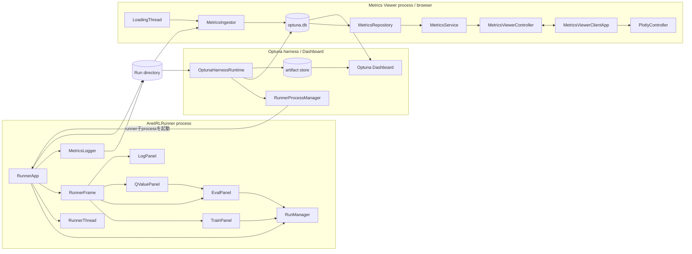
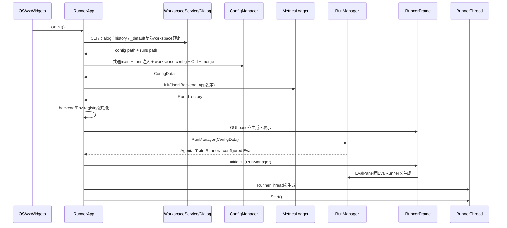
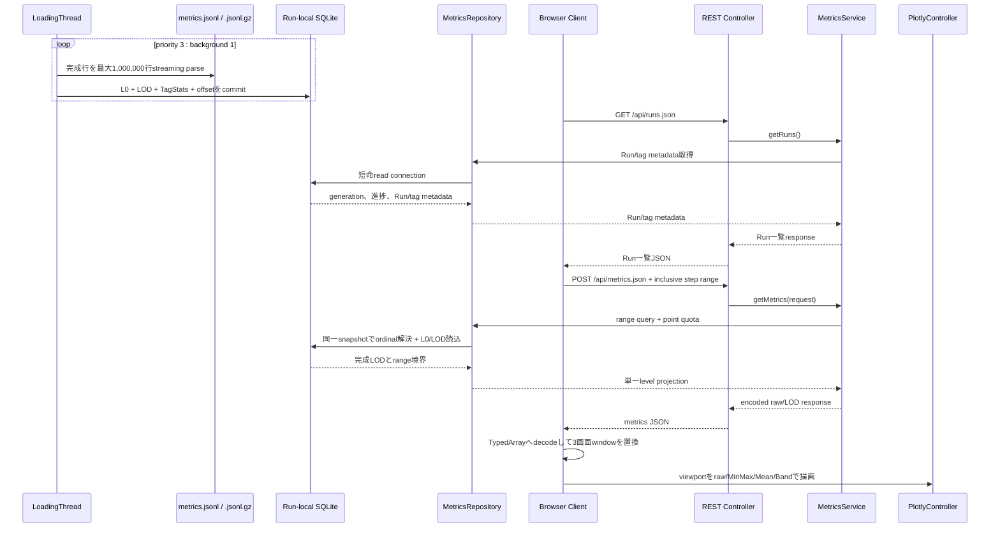
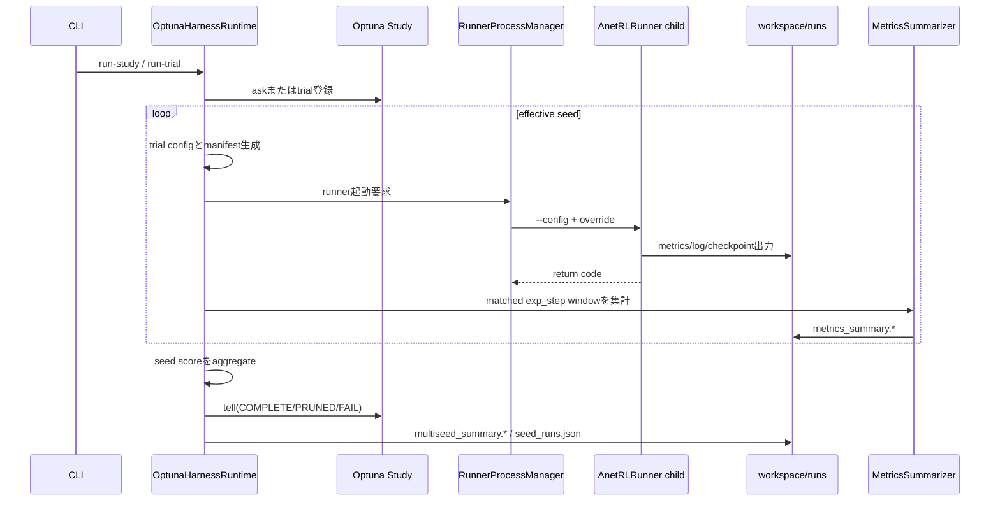

# アプリケーションとツール

> 主たる観点: 機能単位（Runner GUI、Metrics Viewer、Optuna harness）

## 1. はじめに

### 1.1 目的

本書は、ANETの共通runtimeを人間または外部processから利用するapplicationとtoolの責務、接続、process境界を説明する。Runner、Metrics Viewer、OptunaがRun directoryを介して疎結合に連携する構造を明確にする。

### 1.2 対象読者

- Runner GUI、分析tool、実験harnessを変更する開発者
- UI thread、Trainer thread、background loader、runner子processのlifetimeを確認する開発者
- Run artifactを介したapplication間contractをレビューする担当者

### 1.3 記載範囲

現行の`apps/runner`、`apps/metrics-viewer`、`apps/runner/tools`と起動launcherを扱う。Agent、Env、学習loop、metric生成の内部は各設計文書を参照する。
Metrics Viewerの内部仕様（cache schema、設定一覧、HTTP API、依存ライブラリ）は[Metrics Viewer](210_metrics_viewer.jp.md)を正本とし、本書ではprocess境界と接続だけを扱う。

## 2. コンポーネント定義

### 2.1 ANET RL Runner

| コンポーネント | 定義 |
|---|---|
| `RunnerApp` | wxWidgets application entry。config、RunManager、RunnerThread、GUI、loggingのlifecycleを統括する。Run directory自体は`MetricsLogger`が保持する |
| `WorkspaceService` | coreのapplication共通基盤。workspace pathと新規名の検証・解決・新規生成、MRU、`last_workspace.txt`、config合成、`app.runs_dir`不変条件を管理する |
| workspace選択dialog | Runner固有GUI。履歴、`workspaces/`直下一覧、任意path参照、新規名、`workspace.dialog_skip`選好を起動前に選択する。新規名は`WorkspaceService`の検証結果を入力欄の下へ即時表示し、不正な間はOKを無効化する |
| `RunnerFrame` | menu、status bar、4本のtoolbar pane、close順序を管理するmain window。Train eventから生成したstatus snapshotを`UIDataStore`で受け取り、`wxUpdateUIEvent`で操作状態と表示値を同期する。wxAUIの制約吸収（dockサイズ往復・遷移時同期・pane⇄メニュー連動）は基底`anet::rl::gui::AuiLayoutFrame`（gui.hpp）が担い、本クラスはpane定義とレイアウトポリシー（50:50）を持つ。paneの表示切り替えでwindow sizeは変更しない |
| `TrainPanel` | Train eventからEnv固有Viewを更新し、GUI timerで断面を描画する |
| `EvalPanel` | 専用`EvalRunner`をtimerまたは強制行動で駆動し、clone modelの同期を管理する |
| `QValuePanel` | Eval ActorのAction候補を可視化し、選択Actionを`EvalPanel`へ渡す。`full_q_quantiles`があれば優先し、なければ`q_quantiles`、`q_values`へfallbackする |
| `LogPanel` | wxLogの画面表示とlevel filterを提供する。WARN以上とVERBOSEの色分け、薄い時刻、未確認のWARN/ERRORの件数、Auto-scroll・Wrap・Indent・全体コピー・クリア・検索の操作帯を持つ |
| `DefaultViewFactory` | Env class IDからTrain/Eval用Viewを生成する |
| `ImageProviderManager` | configで定義された画像Provider/Observerを生成・登録する |
| `RunnerThread` | Train RunnerをUI threadから分離し、pause、resume、stopを提供する |

### 2.2 Metrics Viewer

| コンポーネント | 定義 |
|---|---|
| `MetricsViewerApplication` | Spring Boot application entry |
| `RunScanner` | runs directory直下から`metrics.jsonl`または`metrics.jsonl.gz`を持つRunを列挙する |
| `MetricsCacheDatabase` | RunごとのSQLite cache、source fingerprint、generation、短命connectionを管理する |
| `MetricsIngestor` / `LodIngestWriter` | JSONL/gzipをstreaming parseし、L0、factor 4 LOD、`TagStats`を同一transactionで更新する |
| `IngestScheduler` / `LoadingThread` | actionable Runへpriority 3 : background 1で1 blockずつ単一writerへ配分し、terminal/no-op Runは同一cycleで再検査しない |
| `MetricsRepository` | Runごとの短命read snapshotでrange解決、点数quota、単一LOD projectionを組み立てる |
| `MetricsService` | Run metadata、range query semaphore、priority集合を提供するapplication service |
| `MetricsViewerController` | `/api/runs.json`、`/api/metrics.json`、`/api/runs/prioritize`を公開するREST controller |
| `MetricsViewerClientApp` | browser側のRun/tag選択、viewport、Reload、取り込みpoll、描画世代を所有する |
| `DataFetcher` / `DataCache` | viewport単位のrange取得、binary projection decode、3画面window置換を担当する |
| `PlotlyController` | raw/MinMax/Mean/Band、`TagStats`、signed-log、zoom/pan、scroll lockを描画する |

### 2.3 Optuna harnessとlauncher

| コンポーネント | 定義 |
|---|---|
| `dropmerge_optuna.py` | DropMerge domain、CLI、探索parameterを定義するentry script |
| `DropMergeDomain` | 探索空間、generated config、cost、score tagをまとめるdomain adapter |
| `OptunaHarnessRuntime` | dry-run、run-trial、run-study、summary、cleanupを実行する共通runtime |
| `RunnerProcessManager` | runner子processの起動、timeout、中断、終了を管理する |
| `MetricsSummarizer` | `metrics.jsonl`または`metrics.jsonl.gz`を指定`exp_step` windowで集計する |
| Optuna storage/artifact store | trial state/attributesとDashboard用artifactを永続化する |
| `compress_workspace_metrics.py` | workspaceの完了Runを検査し、検証済みgzipへRun単位で移行する |
| `.bat` launcher | Runner、通常/Optuna Metrics Viewer、Optuna Dashboard、workspace metrics圧縮の入口を提供する |

## 3. コードマップ

### 3.1 Runner

| 領域 | 主なファイル |
|---|---|
| application entry、config、logging | [RunnerApp.hpp](../../apps/runner/src/RunnerApp.hpp)、[RunnerApp.cpp](../../apps/runner/src/RunnerApp.cpp) |
| workspace共通基盤 | [app_util.hpp](../../core/anet-core/include/anet/app_util.hpp)、[app_util.cpp](../../core/anet-core/src/app_util.cpp) |
| workspace選択GUI | [WorkspaceDialog.hpp](../../apps/runner/src/WorkspaceDialog.hpp)、[WorkspaceDialog.cpp](../../apps/runner/src/WorkspaceDialog.cpp) |
| main frame、pane、入力操作 | [RunnerFrame.hpp](../../apps/runner/src/RunnerFrame.hpp)、[RunnerFrame.cpp](../../apps/runner/src/RunnerFrame.cpp) |
| Train View | [TrainPanel.hpp](../../apps/runner/src/TrainPanel.hpp)、[TrainPanel.cpp](../../apps/runner/src/TrainPanel.cpp) |
| Eval View、model同期 | [EvalPanel.hpp](../../apps/runner/src/EvalPanel.hpp)、[EvalPanel.cpp](../../apps/runner/src/EvalPanel.cpp) |
| Q値・ログ・補助pane | [QValuePanel.cpp](../../apps/runner/src/QValuePanel.cpp)、[LogPanel.cpp](../../apps/runner/src/LogPanel.cpp) |
| runtime接続 | [trainer.hpp](../../core/anet-core/include/anet/trainer.hpp)、[trainer.cpp](../../core/anet-core/src/trainer.cpp) |
| default config | [apps/runner/config](../../apps/runner/config) |

離散の強制行動は、EvalPanelが初期化時に保持したActionSpecで有効範囲を確認する。範囲外なら指定値と有効範囲をstatus field 0へ英語で表示し、Runログには出さない。Live復帰・model同期より前に戻るため、環境、step数、Trace選択は変わらない。EvalRunnerも両コンストラクタで対象環境のActionSpecを保持し、直接渡された範囲外の強制行動はReset・Actor実行・Stepより前にfail-fastする。判定時にEnvSpecを再取得しない。

### 3.2 Metrics Viewer

| 領域 | 主なファイル |
|---|---|
| Spring entry/config | [MetricsViewerApplication.java](../../apps/metrics-viewer/src/main/java/io/github/kazukin123/anetlab/metricsviewer/MetricsViewerApplication.java)、[application.properties](../../apps/metrics-viewer/src/main/resources/application.properties) |
| scan/source identity | [RunScanner.java](../../apps/metrics-viewer/src/main/java/io/github/kazukin123/anetlab/metricsviewer/infra/RunScanner.java)、[MetricsSource.java](../../apps/metrics-viewer/src/main/java/io/github/kazukin123/anetlab/metricsviewer/infra/MetricsSource.java) |
| SQLite cache | [MetricsCacheDatabase.java](../../apps/metrics-viewer/src/main/java/io/github/kazukin123/anetlab/metricsviewer/infra/MetricsCacheDatabase.java)、[MetricsIngestor.java](../../apps/metrics-viewer/src/main/java/io/github/kazukin123/anetlab/metricsviewer/service/MetricsIngestor.java)、[LodIngestWriter.java](../../apps/metrics-viewer/src/main/java/io/github/kazukin123/anetlab/metricsviewer/service/LodIngestWriter.java) |
| scheduling/query | [IngestScheduler.java](../../apps/metrics-viewer/src/main/java/io/github/kazukin123/anetlab/metricsviewer/service/IngestScheduler.java)、[LoadingThread.java](../../apps/metrics-viewer/src/main/java/io/github/kazukin123/anetlab/metricsviewer/service/LoadingThread.java)、[MetricsRepository.java](../../apps/metrics-viewer/src/main/java/io/github/kazukin123/anetlab/metricsviewer/service/MetricsRepository.java)、[MetricsService.java](../../apps/metrics-viewer/src/main/java/io/github/kazukin123/anetlab/metricsviewer/service/MetricsService.java) |
| REST API | [MetricsViewerController.java](../../apps/metrics-viewer/src/main/java/io/github/kazukin123/anetlab/metricsviewer/view/MetricsViewerController.java) |
| browser UI | [index.html](../../apps/metrics-viewer/src/main/resources/static/index.html)、[metrics-viewer.js](../../apps/metrics-viewer/src/main/resources/static/metrics-viewer.js)、[metrics-viewer.css](../../apps/metrics-viewer/src/main/resources/static/metrics-viewer.css) |

### 3.3 Optunaとlauncher

| 領域 | 主なファイル |
|---|---|
| DropMerge CLI/domain | [dropmerge_optuna.py](../../apps/runner/tools/dropmerge_optuna.py) |
| harness共通runtime | [optuna_common.py](../../apps/runner/tools/optuna_common.py) |
| Runner launcher | [10_run.bat](../../apps/10_run.bat) |
| workspace対応補助launcher | [resolve_workspace.bat](../../apps/runner/tools/resolve_workspace.bat)、[31_tb_bridge.bat](../../apps/31_tb_bridge.bat)、[41_mlflow_bridge.bat](../../apps/41_mlflow_bridge.bat) |
| Metrics Viewer launcher | [22_metrics_viewer_java.bat](../../apps/22_metrics_viewer_java.bat) |
| Dashboard launcher | [23_optuna_dashboard.bat](../../apps/23_optuna_dashboard.bat) |
| 詳細運用仕様 | [optuna.md](../optuna.md) |

### 3.4 Evaluation Trace

`EvalTracePanel`は右端の列に一つだけ置く常設paneで、ViewメニューとPanelツールバーから表示する。既定は非表示。既定はstepの降順で新しい行を上に並べ、列見出しのクリックで数値の降順・昇順を切り替える。報酬が非ゼロの行と終端行に色を付ける。`max_rows`は既定1000、`pct_window`は既定10000で、ともに1以上の整数とする。明示的に閉じた間は購読を付けたまま生成をskipし、再表示では履歴・百分位・診断の窓をすべて空にする。最大化による一時非表示は`IsPaneOpen`が`savedHiddenState`を参照して開いたままと判定し、Trace本体と追従paneのsnapshot取得・選択・診断を継続する。メニューのcheckも同じ判定に従い、最大化中の明示開閉は復元用フラグと同期する。

列幅は見出しと標準余白から始め、新規行の表示値と遅延確定した列だけを計測して拡張する。保持中の全行は毎step走査せず、短い値への入替えや古い行の削除でも縮めない。手動調整列はその表示中の自動変更を止め、明示的な開き直しで幅と履歴を初期化する。テーマ・フォント・DPI変更には追従し、最小幅は操作バー全体と左端から最初の行動列までの現在の合計幅（余白・縦スクロールバーを含む）の大きい方とする。行動列が無ければ操作バーだけを基準とし、連続行動は最初の次元別行動列までとする。列幅・外観変更時に更新し、ドック／フロートとRunnerの幅縮小処理でも守る。残りの列は横スクロールとする。通常セル・見出し・罫線・選択はシステム色を使う。非ゼロ報酬には緑、終端には橙の薄い色を標準背景へ重ね、終端を優先する。選択背景と選択文字色は行の強調より優先する。行選択の強調を列見出しへ波及させず、見出しのシステム配色はLive／Traceで変えない。色付けの設定は持たない。

操作バーは、Play/Pauseのトグル・Stop・Step back・Step forward・Slower・Fasterの順の6アイコンと、slider・速度表示を持つ。16 DIPの記号とシステム文字色をメインツールバーと共有し、無効表示はwxに委ねる。コマ送りは縦棒の右に右三角、コマ戻しは左三角の右に縦棒で、メインのEval Stepも同じ送り記号を使う。Trace中は操作バー全体を2 DIPの赤枠で囲み、再生・一時停止・行選択の間も維持する。枠の領域を常に予約して配置を動かさず、Live復帰ですべて消す。captionのTrace表示と通常のactive/inactive配色も維持する。

`TraceFollower`は`CreateTraceSnapshot`によるsnapshot生成・snapshot表示・Live復帰の共通interfaceで、EvalPanelのView、QValuePanel、Conv2dが実装する。interfaceと再生・表示補助はcoreのgui.hpp/cppに置き、行の生成はmetrics機能群へ依存する。履歴は開いていたpaneの不変snapshotに加え、ダンプ用に遷移前状態のTensor参照、action_infoとstep_resultの共有参照、counts、Runner・Env・Agent名、通知時点のforcedを保持する。行削除とpane閉鎖で解放する。Conv2dはCPU活性を保持し、選択時に画像化する。paneを開く前の行は`no data for this step`となる。SweepHeatMapは追従しない。

行を選ぶとTraceモードとなりEvalPanelを停止する。行tではEval Viewが遷移後、Q/Conv2dが判断時点を表示し、captionに`Trace: step`を出す。`gui::TracePlayer`はwxの実機操作に依存しない再生制御を担当する。`gui::AppendTracePercentile`と`gui::FormatTraceValue`も同じ機能群に置く。書式は列定義のメソッドにせず、列定義・値・行動情報を受け取るGUI関数で算出する。TracePlayerへは表の下端から上端の再生順で行IDを渡す。再生はLiveなら下端から、Traceなら選択行から上へ進み、上端で止まる。上端で停止中の再生だけは下端へ戻る。コマ送りと戻るは端で止まる。Liveでコマ送りを押すと表の上端でTraceに入り`Trace: end`を出す。Liveでコマ戻しを押すと表の上から2行目で`Trace: step back`、1行だけならその行で`Trace: start`を出す。速度は1/8〜8倍、1xはEvalのfps×step_per_frameである。速度ラベルとstatus通知はx0.125・x0.25・x0.5・x1・x2・x4・x8とする。

停止、表でのEsc、手動行動、Eval Resume、Trace paneを明示的に閉じる操作（✕・メニュー・ツールバー・Reset Layout）でLiveに戻る。Liveに戻すだけではEvalを再開しない。手動行動はLiveへ戻してから実行する。空履歴では操作列とsliderを無効にする。FPS 0では`CanPlay`によって再生ボタンだけを無効にし、次のUI timerで変更を反映する。既に再生中ならPause操作を有効に保ち、速度0では進めず、FPS復帰後に続行する。操作結果はstatus field 0へ英語で表示し、Runログへは出さない。

`manager.Update()`はTrace開始・Live復帰・追従paneの表示変更と、列幅または外観の変更で最小幅が変わり実際のpane幅が不足した場合に行う。最小幅が変わらない通常の行追加・行選択・tickでは、最小幅処理による再配置を行わない。行移動はcaptionを更新しframeへ再描画を要求する。浮動paneのframeタイトルも直接揃える。計測は`EvalTracePanel::ApplySelection.layout` / `ReturnToLive.layout`と`RefreshCaptions`、最小幅の変更は`UpdateMinimumSize`で分ける。

数値は整数なら整数、それ以外は有効数字4桁、非有限値は空欄。`display:pct`は自身を含む有限値の直近窓で`100*(小さい件数+同値件数/2)/件数`を列の確定時に一度だけ算出して保持する。全件同値は50%である。即時列は行追加時、遅延列は`StepTrace.value_ready`がtrueになった時点で処理し、NaNでの確定でも待機を終える。表示上限を超えて消えた行は更新通知が指定する列だけを窓へ反映する。複数列の部分更新で以前に確定した値を二重投入しない。GUIはAgent固有のキーを判定しない。既定の`Q_sa`・`V_s`・`trunc`は設定の`label:`で指定し、取得キーと値は変えない。既定列はstep、ep_step、action、reward、forced、done、trunc、Q_sa、V_s、prio、prio_pctの順で、行動と報酬を隣接させる。

並べ替えはgui.hpp/cppの`TraceRowSorter`が担当し、表示値の数値で比較する。百分位列は保持した百分位、行動列は行動番号を使い、pendingと非有限値は向きによらず下端、同値はstep降順とする。既定は実step降順。新規行と遅延値が確定した行を位置へ入れ直すが、保持対象は常にstepの新しい順にmax_rows件で、百分位窓は並べ替えで変えない。選択行IDと再生状態を維持し、選択行を可視範囲へ出す。Liveは上端を表示し続ける。列幅のドラッグは並べ替えず、見出しのダブルクリックは並べ替え2回として扱う。開き直しでは並べ替えも初期化する。

TraceモードはTracePlayerの選択の有無で判定する。RunnerFrameはanetのPanelから転送された↑↓をEvalTracePanelの行移動へ回し、←→は消費する。移動の通知は出さない。表・ログ欄・スライダーが自分で使う矢印は奪わない。Liveの転送矢印と、モードによらないテンキー・QValueのクリック・Ctrl・Spaceの進み方は維持する。EvalPanelは有効な強制stepの成功後、status field 0へ`Forced action: 番号:名前`を出す。行動指定なしのStepでは出さず、Runログにも出さない。EvalRunnerのlane指定の`forced`は初期値0、強制stepは1、通常stepは0で、通知前に確定する。

行のダブルクリックは行選択と通知内容のダンプを行う。`TraceDumpFormatter`はGUIに依らず、`Trace dump step=... lane=...:`で始まるINFOの1行とVERBOSEの複数行1件を作る。INFOには全列（表の書式、未確定はpending）と、名前・countsの全欄・実行行動・forced・報酬・終端・action_infoのinfo/aux・step_resultのauxを出す。通知項目は列の構成によらず出す。単一要素Tensorは値、複数要素と空Tensorは形・型・元deviceのみ、未定義はundefinedとする。VERBOSEは状態・行動情報・Step結果の既存の文字列化にinfoと不透明なReplay初期優先度ヒントを加える。転送と文字列化はダンプ時だけ行い、GPUの内容はCPUへ写して書く。追従paneのsnapshotは出さない。ログ欄の既存のlevel処理を維持する。

[PRD094検証資材](../../core/anet-core/testdata/prd094/README.md)に、pane同期・プレイヤー・速度とメモリの受入手順を置く。[PRD105検証資材](../../core/anet-core/testdata/prd105/README.md)に、矢印・forced・並べ替え・再生順・ダンプと4環境の学習値比較の手順を置く。

### 3.5 Logs

`LogPanel`は下段のLogs paneで、上部の操作帯とRichEdit（`wxTE_RICH2`）のログ欄を持つ。Logsの設定は`app.log_panel.*`に置く。表示levelの初期値は`app.log_panel.level`（Runのログファイルには効かない）、Auto-scroll・Wrap・Indentの既定は`app.log_panel.auto_scroll`・`app.log_panel.wrap`・`app.log_panel.indent`（共通設定でいずれも`true`）から読み、構築時に押したときと同じ経路で反映する。View menuのLog Levelのチェックは、LogPanelが読んだlevelに合わせる。操作帯は左から、未確認の警告・Auto-scroll・Wrap・Indent・Copy all・未読の行数・伸びる検索欄・Older/Newer match・Clear logの順に並ぶ。未確認の警告と未読の行数は0件の間は欄ごと隠す。未確認の警告は左端に置いて残りを左へ詰め、未読の行数は検索欄の左に置いて、出入りで検索欄の幅だけが変わるようにする（Auto-scrollなどのボタンの位置を動かさない）。Clear logは誤操作を避けるため右端に置き、wxの標準アイコンにゴミ箱が無いため、再生ボタンと同じくシステム文字色のSVGで描く。操作の結果にステータスバーは使わない。

ログの受け口`LogPanel::Target`はwxLogを継承し、表示levelで絞ってから、時刻と本文（`[I] 本文`）を分けて`AppendRecord`へ渡す。時刻はwxの`TimeStampMS`と同じ書式から後ろの`: `だけを除いたもので、パネルでは半角スペース1つで本文へ続ける（Runログファイルの形は変えない）。Debug・Traceは基底の整形を通してデバッグ出力へ回す。Runログの`wxLogChain`がこの受け口を前の受け口として保持するため、受け口は差し替えない。区切りの改行は次の記録の前に置き、末尾に空行を残さない。

色はFATAL/ERROR・WARN・VERBOSEの本文に付け、行の頭の時刻はlevelによらず本文より一段薄い青みの灰色にして、折り返したときも記録の境目が分かるようにする。ライト・ダークはログ欄の背景の明るさで選び、テーマ変更の通知で全行を塗り直す（色付きの行、時刻の順）。

追記は利用者の選択を保つ。Auto-scroll（既定ON）がOFFの間は、表示の先頭の文字と横位置も保つ。ONに戻すと末尾へ飛ぶ。状態は保存しない。

`+N`は、Auto-scrollを止めている間に届き、まだ画面に映っていない行の数で、止めている間に自分のペースで続きを読むための入り口である。行の頭の位置を古い順に控え、表示の下端の行までに頭が映った行を既読にする（スクロールバーで飛ばした行も既読とし、上へ戻っても未読に戻さない）。既読は追記・スクロールが止まったとき・ジャンプ・検索・`+N`・折り返しや字下げの切替・大きさの変化・paneの再表示で進め、paneが隠れている間は進めない。映る位置に届いた行はすぐ既読になる。`+N`を押すと、次の未読の行を直前の3行と一緒に表示の上の方へ出し、映った分だけを既読にする。押すたびに続きへ進み、押した後に届いた行も未読に足す。最下まで映っても、Auto-scrollはOFFのままにする（追従を始めると、行がまとまって届いたときに読む前に押し出されるため）。ONに戻すかClearで0にする。未確認の警告は画面に映っただけでは減らさないが、`+N`は流れの目安なので映れば既読とする。

利用者のスクロール（ホイール・キー・スクロールバー・選択のドラッグ）で最下が見えなくなると、Auto-scrollは自動でOFFになる。通知はnativeの処理の前に来て、RichEditはホイールのスクロールを通知の後も続けることがあるため、一続きの操作の最初に最下が見えていたかを控え、表示の先頭が100 ms動かなくなってから決める。通知の来ないスクロールに備えて、追記の前にも最下が見えているかを確かめる。OFFの間に、操作の前は見えていなかった最下がスクロールで見えたら、自動でONに戻す。判定を待っている間に行が届いたときは、追記で最下が外れる前に決める。操作の前から最下が見えていたとき（最下にいるままのクリックやキー）は戻らない。最下へのスクロール（`SB_BOTTOM`）と横の通知は自ら送るため見ない。ログ欄の大きさが変わったときは、ONの間は最下を見せ続ける。ジャンプ・検索・`+N`はスクロールの通知を出さないので、OFFのままになる。

Wrap（既定ON）はログ欄を作り直さずに切り替え、MSWは`EM_SETTARGETDEVICE`、それ以外は`wxTE_DONTWRAP`の付け外しで行う。ログ欄はOFFへ戻せるよう`wxHSCROLL`付きで作ってから折り返す。wxはRICH2に`ES_DISABLENOSCROLL`を付けるため、MSWでは折り返している間だけ`EM_SHOWSCROLLBAR`で横スクロールバーを隠す。Indent（既定ON）は折り返した2行目以降を本文の頭（時刻と種類の後ろ）にそろえる段落の字下げで、既にある行は全体への1回の指定、これから足す行は追記ごとの既定の書式でそろえる。wxは既定の書式を合成するときに2行目以降の字下げを引き継がないため、追記ごとに字下げを含めて渡す。幅は時刻と種類の文字数を等幅フォントで測り、1/10 mmに直す。記録の中の改行で始まる続きの行は別の段落なので字下げしない。折り返さない間は効果がないので、Indentは押せなくする。

未確認の警告は、表示したWARN以上の記録を古い順に数える。ボタンは一番古い未確認の行を選び、その3行上から表示する。▾の`Mark all as viewed`は全件を見たことにする。画面に映っただけでは数を減らさず、表示しないlevelの記録とClearした記録は数えない。RunnerFrameは`GetUnviewedAlerts`をUpdate UIで読み、Panels toolbarのLogsに印と件数のtooltipを出す。印は未確認があるときだけ幅を取り、印の有無が変わったときはtoolbarの大きさを測り直してpaneを並べ直す（toolbarのidle更新の外で行う）。

検索は大文字小文字を区別しない部分一致で、Enterと▲で古い方へ、Shift+Enterと▼で新しい方へ進む。語が空の間は▲▼を押せない。起点は選択、選択が無ければ末尾で、端まで行ったら反対の端から続ける。一致が無ければ検索欄の背景を薄い赤にする。Ctrl+FはLogs paneにフォーカスがあるときだけ検索欄へ移り、検索欄のEscはログ欄へ戻る。警告へのジャンプと検索はAuto-scrollをOFFにする。

Copy allは表示中の全行をOSの改行で渡す。ClearはRunログファイルに触れない。

## 4. 静的構造

RunnerはviewerやDashboardへ直接接続しない。Run directory、Optuna DB、artifact storeがprocess間contractである。この境界により、学習中でも別processから追記済みmetricsを閲覧できる。

## 5. 処理フロー

### 5.1 Runner起動

GUIはmain thread、Train Runnerは`RunnerThread`で動く。TrainPanelはTrain eventでView dataを更新し、GUI timerで描画断面を取得する。EvalPanelはGUI timer上で通常の`BatchEnv`を持つ独立EvalRunnerをstep単位で進めるため、`EvalSessionEnv`を使うconfigured background evalとは別用途である。強制行動と既存のmodel同期方式もEvalPanel側に維持する。全Agentで`app.eval_panel.eval_config_tag`に参照するEval tagを明示し、その`run_mode`、`env.*`、`actor`参照を別instanceへ適用する。`actor`省略時はタグ名を使う。共通既定は`eval_panel`タグと同名の専用Actorを参照し、DQN系はtarget netのGreedy（Rainbowはε=0）、MuZeroは温度0・探索noiseなし、ImageClsは最大スコア選択とする。表示用Env設定は標準評価タグから継承し、環境別のEnv上書きを適用する。定期評価の方策とは独立に変更できる。未定義のEval tagまたはActor参照はfail-fastする。

RunnerFrameのRun制御 / Step表示 / Run操作 / Panel表示toolbarはwxAUI paneとして上端に配置し、Reset LayoutでRow 0へ回収する。gripperは`AddPane()`が有効化する`wxAuiToolBar`内蔵の標準描画だけを使う。Reset Layoutで`ToolbarPane()`を再適用した後はpane側を`Gripper(false)`に戻し、内蔵gripperと重複させない。buttonの背景・hover・checked色はwxWidgets標準art/system colourへ委ねる。Train toggle直後とexp/train間は標準separatorで区切り、step数は選択・コピー可能なread-only text controlへ分ける。操作状態は200ms周期の`wxUpdateUIEvent`で実状態から再構成するため、shortcut、自動pause、menu、paneのcloseを別経路として扱っても表示が収束する。status snapshot更新はRunnerFrame自身のupdate eventへBindし、Train toggle toolのenable/check更新から分離する。Step、SPS、経過時間はTrainer threadのTrain observer callback内で1つのsnapshotにまとめ、強制更新間隔0のrequest-driven `UIDataStore`を介してmain threadへ渡す。main threadから`TrainRunner`の可変count、EMA、開始時刻を直接読まない。observerのdetachではNotifierが保持する`RunnerScopedTrainObserver` wrapper自体を保持・指定する。

補助launcherは第1引数、`GetAppDataDir()/last_workspace.txt`、`_default`の順でworkspaceを解決し、選択済み`runs/`だけをDOT/MP4/TensorBoard/MLflowへ渡す。既存workspace rootと`runs/`だけを解決条件とし、`config/_main.txt`は要求しない。launcherはworkspaceや`runs/`を生成しない。MLflow DBはADR 0022の限定例外として`<workspace>/runs/mlflow.db`に置く。

### 5.2 Metrics Viewerの取り込みとviewport range更新

HTTP requestはMetricsマスタを直接読まず、background writerがcommitしたSQLite snapshotを読む。
各rangeは前回応答へ依存せず、clientはviewport左右1画面を含む3画面windowを置換する。
完全検証済みの`ready` / `error` Runはsource/cache属性が不変なら本文・fingerprint・SQLiteへ入らず、
即時処理可能な`converting` backlogがないcycleは10秒sleepする。
取り込み中Runがある間はRun metadataを4秒pollして進捗表示だけを更新し、Auto Reloadは30秒ごとにmetadataを取り直して最新stepへfollow中の系列だけrangeを更新する。

### 5.3 Optunaのmulti-seed trial

`run-study`は各trialで`run-trial`子processを起動せず、自身がrunner子processを管理する。multi-seedは1 trial内で逐次実行され、`--n-jobs > 1`では複数params候補が並列に進む。

## 6. Entry pointと運用境界

| 用途 | Entry point | 既定出力・URL |
|---|---|---|
| GUI Run | `apps/10_run.bat [--workspace <path>]` | `<workspace>/runs` |
| 通常Runの可視化 | `apps/22_metrics_viewer_java.bat` | `http://localhost:8082` |
| Optuna study/artifact | `apps/23_optuna_dashboard.bat <workspace_path>` | `<workspace>/optuna`、`http://127.0.0.1:8088` |
| DropMerge探索 | `.venv\Scripts\python.exe apps\runner\tools\dropmerge_optuna.py run-study --workspace <path> ...` | `<workspace>/runs`、`<workspace>/optuna` |

- 通常Runnerはworkspaceを選び、実験差分は末尾の`key=value` overrideで渡す。`--config`はworkspaceを使わない完全自己記述起動に限定する。
- Viewerは`apps/runner/workspaces`を既定の親directoryとし、画面のselectorでcurrent workspaceを切り替える。親directoryは`--metricsviewer.workspaces-dir`で差し替える。
- Optuna harnessは既存workspaceと`config/_main.txt`をpreflightし、Runを`runs/`、SQLite storage・artifact store・harness logを`optuna/`へ固定する。run系の出力overrideは選択workspaceの`optuna/`配下だけを許可する。
- Optuna harnessのPythonはrepository rootの`.venv`を使う。
- Viewer frontendはbuild工程を持たず、外部依存はCDNのPlotlyだけを読む。完全offline環境ではasset取得方法を別途用意する必要がある。

## 7. Lifetime・エラー・性能特性

### 7.1 Runner

- `RunnerApp`が`RunManager`、`RunnerThread`、Frameを保持し、loggerの初期化・flush・停止順序を統括する。Run directoryと`run_dir_`は`MetricsLogger`が所有する。`app.show_error_dialog`は未指定時`true`で、online構成は`true`、batchrun構成は`false`へ解決する。構成名はコードで推測しない。
- batchrun構成では、`ConfigData`解決直後から既定GUI loggerをapp所有の`wxLogStderr`へ切り替える。Run成立前は親stderr、standard stream開始後は`stderr.log`、通常logger構築後は既存Run logへ出し、部分初期化と終了時もactive targetをdanglingさせない。online構成では従来どおりエラーダイアログを表示する。
- close時はTrain停止、`agent_close.anet`保存、log/metrics flush、EvalPanel detach、AUI破棄の順序を維持する。`app.save_agent_on_close=false`では保存段階だけをskipする。close時Saveが失敗しても共通error reporterで通知した後に後続cleanupを続行する。Save/Open Run Folderの失敗はnon-fatalであり、Run継続とprocess終了コードを変えない。
- GUI callbackで発生した契約違反の例外は共通error reporterで英語のerror logをflushしてmain loopを終了し、Trainer threadの例外は現在例外をmain threadへ転送する。両例外callbackはmain thread所有のfatal latchを設定する。`RunnerApp::OnRun()`はwxWidgetsの元の非ゼロ値を保ち、元が0でもfatal済みなら1を返す。`OnExit()`はcleanup専用である。
- Train panelのFPSは描画頻度だけを制御し、0では描画timerを停止しても学習は継続する。Eval panelのFPSはEvalRunnerを進めるGUI timer周期であり、Evalの実行速度そのものも変える。実行時のFPS選択はconfig dumpへ書き戻さない。
- Evalの`app.eval_panel.step_per_frame`は1以上のint値を起動時に検証する。`EvalPanel`は起動時configと独立した実行時値を持ち、`View > Eval Steps per Frame`のConfig・固定値（1・2・4・10・20・50・100）・Customから変更する。Custom入力は現在値から始め、1〜2,147,483,647の整数だけを確定する。キャンセルでは値・選択を維持し、固定値と同じ数を入力してもCustomの選択を保持する。実行時変更は次の自動評価更新とTraceの基準速度（現在のFPS×現在のstep数）へ反映し、起動時configとconfig dump、一時停止・Trace状態、手動Stepの1 step動作は変えない。初期選択はConfigで、初期化前は操作できない。
- `DefaultDQNAgent::Save`はAgentのshared mutexをserialization全体で保持する。runtime SaveはLearnerのunique lockと排他し、UI側でTrainをpauseしない。`RunnerApp::SaveAgent`はopen、serialization、flush、closeの失敗段階をpath付き例外として通知し、RunnerFrameがUI継続可否を決める。不完全fileは自動削除しない。

### 7.2 Metrics Viewer

- `MetricsService`の`@PostConstruct`でLoadingThreadを開始し、`@PreDestroy`で最大30秒待って停止する。
- `WorkspaceManager`はcurrent workspaceをepoch付きsnapshotとして保持し、APIとingest cycleへleaseを渡す。切替はingest gateで直列化し、旧snapshotのgzip sessionは最終lease解放時に閉じる。
- source kind、size、mtime、先頭/commit直前hashが一致しない場合はSQLite cacheを破棄して新しいgenerationで再構築する。
- `TagStats`はcommit済みL0全点、LODは完成した16子だけから作り、viewport queryから独立して保持する。
- Reload/Auto ReloadはPlotly DOMを再構築するため、選択tag、LOD表示mode、signed-log、scroll lockなどのpage stateはclient appが所有する。
- 既定系列予算、request全体予算、LOD page cache容量、query同時実行数は`application.properties`で制御する。
- activeなgzip取り込み中だけはsource streamをblock間で保持するため、そのRun folderの移動をサポートしない。

### 7.3 Optuna

- 中断時はまず`Ctrl+C`を1回送り、harnessへrunner停止とtrial state更新を行わせる。
- SQLiteで`--n-jobs > 1`を使うとlock競合とGPU性能干渉が起こり得る。
- DB recordとRun folderは別lifetimeである。Run folderを削除してもOptuna trialは残り、保存pathがstaleになる。
- summary studyは閲覧用であり、source studyを変更しない。

### 7.4 wikiと監査台帳の保守

- wikiは外の正本を束ねたまとめで、取り込みが書く部分を、点検がファイル・PRD一覧を更新する。材料、blob記録、更新手順は[wikiの規約](../wiki/README.md)を正本とする。
- `reports/tools/registry.py list --category` は分類定義に従う。`build` は台帳の派生一覧と、地図の目印の間だけを更新する。全地図の目印を検査してから書き、区画外とwikiログは変更しない。
- `reports/tools/wiki_support.py` は材料・blob・リンク候補の読み取りと地図の機械的な2節の再生成を補助する。知見の意味や裁定はエージェントが正本を読んで判断する。台帳の正本は `reports/registry/findings.jsonl`、CLIとレコード形式はregistry.pyの冒頭を参照する。

## 8. テストと変更時の確認事項

- [PRD105検証資材](../../core/anet-core/testdata/prd105/README.md): Traceモードの転送矢印、forcedの通知時点、並べ替えと再生順、ダンプの書式と実画面での表示時間、4環境の数値等価性。

- [PRD095検証資材](../../core/anet-core/testdata/prd095/README.md): 一時台帳での分類・地図の派生区画・不正な目印での無変更と、取り込み・点検・housekeepingの試走を確認する。

- [PRD094検証資材](../../core/anet-core/testdata/prd094/README.md): 列、時点、診断、再生、snapshot、5構成の数値等価性。表示・操作の変更では実wxWidgetの`AnetRLRunner-gui-test`で幅・配色・toggle・赤枠を確認し、UI処理の計測と実Runの速度を区別する。

- Runner UI変更: Frame close順序、toolbarのdock/float/reset、pane/menu/toolbar連動、Train/Eval入力、model sync、FPS、status snapshot、theme変更時のSVG差し替えを確認する。 step数の変更は`AnetRLRunner-gui-test "[eval_steps]"`で設定検証・Trace保持を確認し、実RunnerAppのメニュー・Custom入力・キャンセル・自動評価・手動Stepは`AnetRLRunner-gui-test "[eval_steps_menu]"`を単独processで実行する。後者は通常スイートには含めない。Logs paneは`AnetRLRunner-gui-test "[log_panel]"`で末尾の空行・時刻の形と色・選択と表示位置・未読の行数と`+N`の読み進め・Auto-scrollの自動解除と再開・設定からの既定・Wrap・Indent・検索・未確認の警告を確認する。Copy allは利用者のクリップボードを書き換えるため、`"[log_panel_clipboard]"`を明示したときだけ実行する。`"[log_panel_demo]"`はRunを起こさずに各levelの行を1秒ごとに足す窓を開き、閉じるまで手で操作を試せる（Panels toolbarの印はRunnerで確かめる）。
- Metrics Viewer backend変更: SQLite/source identity、ingest/LOD、range API、scheduler、query concurrencyの各integration testを実行する。
- Metrics Viewer UI変更: `RunListPlaywrightTest`、`TagListPlaywrightTest`、`MetricsPlotPlaywrightTest`、`GraphInteractionPlaywrightTest`、`SignedLogPlaywrightTest`で、Run/Tag操作、viewport精細化、LOD mode、stale response、Reload、Plotly state、mobile gestureを関心別に確認する。
- Optuna変更: dry-run、短いrun-trial、artifact/DB state、interrupt cleanupを確認する。
- process間contract変更: 旧Run artifactを読めるか、または明示的なmigration/non-goalを記録する。

## 9. 関連文書

- [Run実行ユーザーガイド](020_user_guide_run.jp.md)
- [Run分析ユーザーガイド](030_user_guide_analysis.jp.md)
- [開発環境](040_development_environment.jp.md)
- [実行基盤と設定](100_runtime_and_configuration.jp.md)
- [Agentと学習](110_agents_and_learning.jp.md)
- [環境](120_environments.jp.md)
- [可観測性](140_observability.jp.md)
- [DQN系Agent](200_dqn_agents.jp.md)
- [Metrics Viewer](210_metrics_viewer.jp.md)
- [DropMerge Optuna利用ガイド](../optuna.md)
