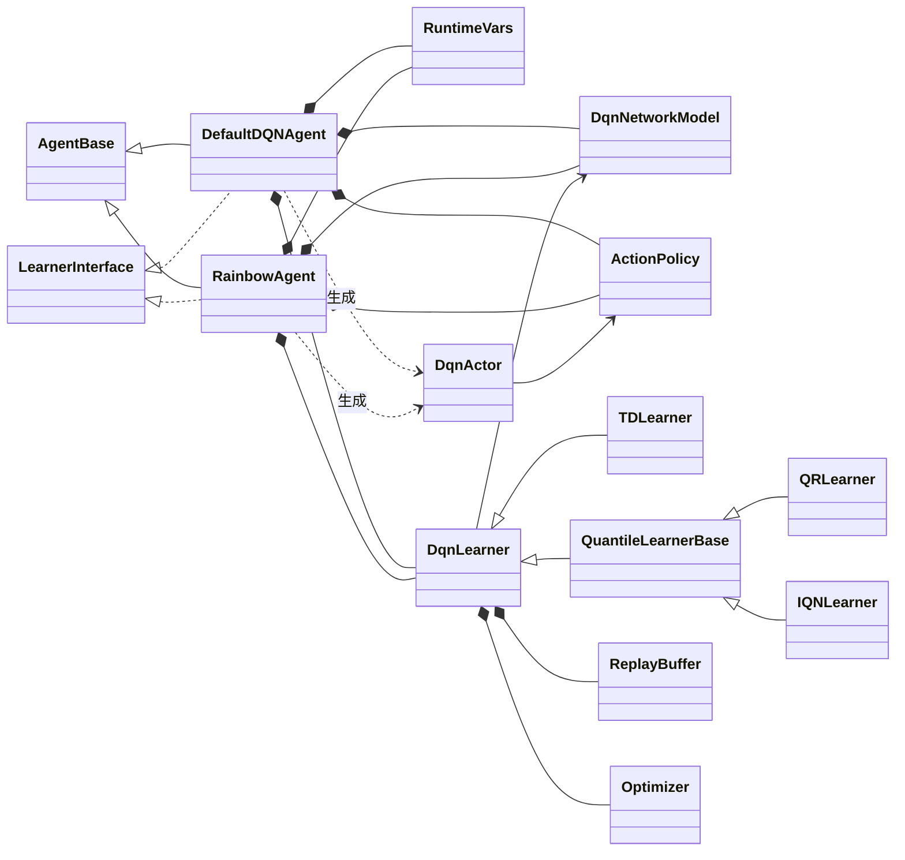
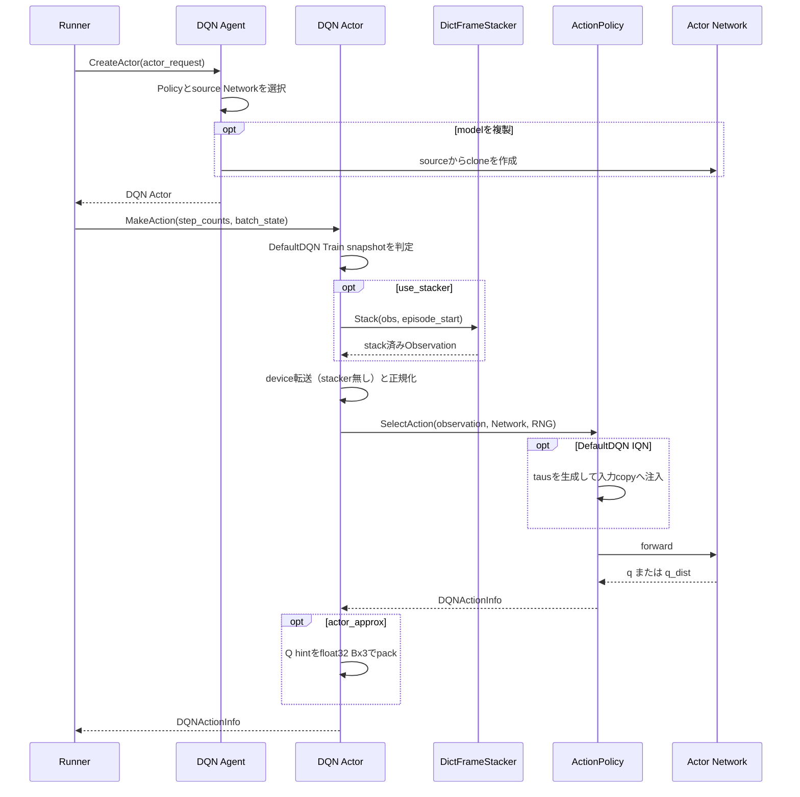
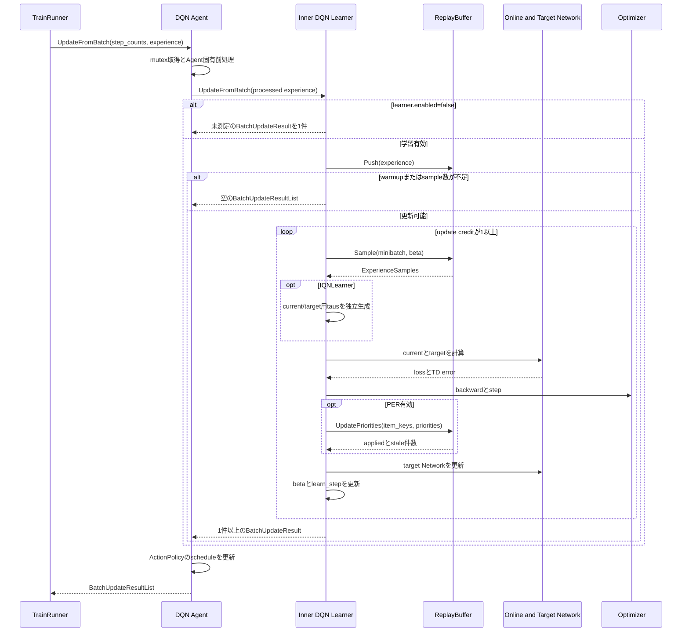
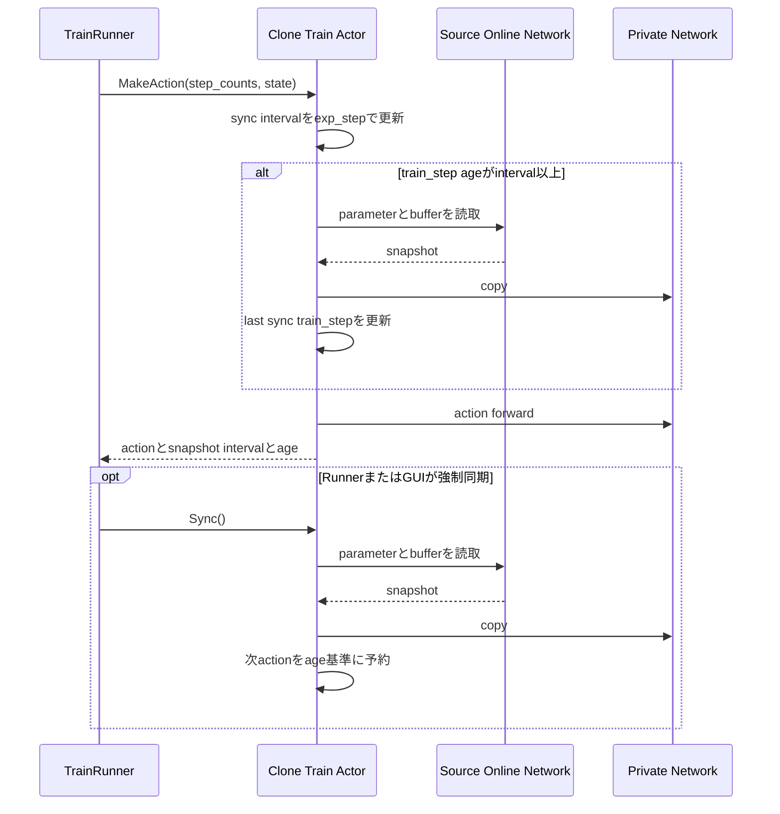

<!-- translated-from: 200_dqn_agents.jp.md blob:71b8e423ca9be9100d445a642faadd40331220dd date:2026-11-04 progress:done -->
# DQN Agents

> Primary perspective: concrete functionality (DefaultDQN and Rainbow, with action selection, learning, and synchronization in chronological order)

## 1. Introduction

### 1.1 Purpose

This document explains the structure, action selection, learning updates, model synchronization, and persistence contracts of ANET's DQN Agents, `DefaultDQNAgent` and `RainbowAgent`.
It separates shared Agent contracts from DQN-specific implementations and identifies changes needed when adding a DQN Agent or learning method.

### 1.2 Audience

- Developers changing DefaultDQN or Rainbow configuration/implementation
- Developers adding DQN Actors, Policies, Learners, or Network Heads
- Reviewers checking snapshot synchronization, PER, checkpoints, and metrics consistency

### 1.3 Scope

This document covers current `DefaultDQNAgent`, `RainbowAgent`, and their composed internal `anet::rl::dqn` components.
See [Agents and Learning](110_agents_and_learning.en.md) for shared Agent contracts, [ReplayBuffer](150_replay_buffer.en.md) for shared ReplayBuffer internals, and [Neural Networks](130_neural_networks.en.md) for Network modules.

## 2. DQN Overview and Basic Concepts

### 2.1 Implementation Layers

`DefaultDQNAgent` and `RainbowAgent` both implement `AgentBase` and the shared `rl::Learner`. `CreateLearner()` returns the outer Agent itself, which manages shared mutexes and pre/post-processing before delegating updates to an inner `dqn::Learner`.

`dqn_based_agent.*` provides internal components including `NetworkModel`, `ActionPolicy`, `Actor`, `Learner`, `TDLearner`, `QRLearner`, and `IQNLearner`. Both concrete Agents compose these components; neither inherits the inner `dqn::Learner`.

### 2.2 Online and Target Networks

`dqn::NetworkModel` holds online and target Networks. Actor selects actions using the source chosen by its catalog item's `network` setting. Learner computes current values with online and bootstrap values with target. Target updates follow learning according to `soft_update_tau` or `hard_update_interval`.

Heads and Learners combine as follows:

| Configuration | Output | Learner |
|---|---|---|
| Ordinary Q | Per-Action `q` | `TDLearner` |
| QR-DQN | Per-Action/quantile `q_dist` and mean `q` | `QRLearner` |
| IQN | `q_dist` for injected taus and sample-mean `q` | `IQNLearner` |
| Dueling | Q combining value and advantage | Can combine with TD, QR, or IQN |

Learner settings combine Double DQN, N-step, PER, gradient clipping, AMP, and more. Do not infer every combination from the name Rainbow alone; inspect each Run's resolved configuration.

### 2.3 ActionPolicy and DQNActionInfo

`ActionPolicy` performs Network forward and Action selection, combining Actions, Q values, quantiles, and related data into `DQNActionInfo`. Shared implementations include epsilon-greedy, UQE, and Thompson Sampling. DefaultDQN separates Train, Eval, and target Policies; Rainbow configures an action Policy and a greedy learning-target Policy.

For DefaultDQN IQN, each Policy generates taus according to `tau_rule` (`num_taus` and `random|fixed|stratified|systematic|antithetic`), injecting them into a shallow Observation copy before forward. `stratified` independently samples one point per equal-width stratum; `systematic` uses equally spaced points sharing one phase per row; `antithetic` generates pairs mirrored around the range midpoint, with one final independent point for odd counts. `fixed` deterministically uses interval midpoints without consuming RNG. Defaults are random×32 for Train and fixed×32 for Eval/target. UQE uses the decayed effective tau as its lower bound: `uqe.use_tail_mean=true` scores actions by the mean from that bound to 1; `false` fixes all points at the bound and uses `Zτ`. Non-spatial Thompson uses `[0,1]`; spatial Thompson uses per-lane lower bounds. Tau placement mode and the time-varying value `uqe.tau` are separate settings. Thompson's `uqe_tau` metric is always NaN.

IQN+UQE supports optional `full_distribution_query`, disabled by default. When enabled, risk taus and full `[0,1]` taus are concatenated for one forward. `q_values`/`uqe_values`/`q_quantiles` represent risk outputs; `full_q_values`/`full_q_quantiles` represent full outputs. The Head's mean `q` over the combined set is not used. Point-UQE risk queries collapse to one equivalent α. Non-IQN modes retain the enabled setting dormant and ignore it, so changing quantile mode requires no simultaneous change. With IQN enabled, choosing a non-UQE Policy while full queries remain enabled is a configuration error.

Depending on configuration, Actor uses `DictFrameStacker` for frame stacking and device transfer (device transfer only without a stacker), then normalizes Observations, invokes Policy, and adds auxiliary information. Policy depends only on Network and RNG for Action selection, never on Learner.

For `DefaultDQNAgent` frame stacks with `use_stacker=true` and `stack_count=S>1`, stacked Observation input specs are constructed as `[S, *original_shape]` rather than multiplying EnvSpec feature dimensions. This aligns dummy-forward, Actor, and Replay-sample axes. Specs outside `stack_keys` remain unchanged; `stack_count==1` adds no Network-spec stack axis. This transformation is DefaultDQN-specific and does not change EnvSpec, ObservationNormalizer, ReplayBuffer, `NetworkBuilder`, or `RainbowAgent` contracts. See [Neural Networks](130_neural_networks.en.md#22-frame-stack-input-axis-contract) for module shape transformations and discrete-Grid one-hot boundaries.

ProfiledValue root constants use a bare value such as `epsilon = 0.05`; `type` defaults to `constant`. With a nonconstant effective type, the bare value is retained in `value` but is not used for evaluation or typed dumps. A bare value alone cannot switch the type to constant: specify both `epsilon.type = constant` and the intended bare value. Phase constants use `phase.[name].value`.

Time-varying values are ProfiledValues at `epsilon`, `uqe.epsilon`, and `uqe.tau`. Select spatial exploration with `spatial.enabled`; set lane endpoints with `spatial.scale=linear|log`, `spatial.epsilon.first/last`, `spatial.uqe.epsilon.first/last`, and `spatial.uqe.tau.first/last`. Endpoints are also ProfiledValues. `SpatialLadderSchedule` evaluates them and constructs the ladder, reusing Tensors for constant endpoints. Existing lane assignment is retained; a single lane uses first.

Log ladders linearly rescale the sequence generated from `max(endpoint, 1e-4)` to the requested endpoints. If clamped endpoints are equal, they use linear interpolation between the requested endpoints. If both are at least the floor, the existing generation path is retained. DropMerge and LunarLander last=0 remain exactly zero, with intermediate lanes also changing from the old sequence. `epsilon`, `uqe_epsilon`, and `uqe_tau` return the active lane mean; each also exposes `_lane_min` and `_lane_max`. Recognized metrics unused by the policy return NaN.

### 2.4 DQN and ReplayBuffer

Inner `dqn::Learner` owns the shared CPU ReplayBuffer, Pushes Experiences, then checks warmup, sampleable count, and update credit. While updates are possible, it samples minibatches, transfers them to the learning device, and computes TD or quantile losses. [ReplayBuffer](150_replay_buffer.en.md) is authoritative for N-step, frame-stack, generation-aware item-key, PER, and prefetch contracts.

Only with initial PER priority mode `actor_approx`, Train Actor builds a DQN-specific `float32[B,3]` hint from the existing forward. Columns are:

| Column | Value |
|---:|---|
| 0 | Action score of the Action actually selected |
| 1 | `max_a` action score when OFF; soft state value with Munchausen ON (h-space with TBO) |
| 2 | Munchausen bonus in real space; 0 when OFF |

Shared ReplayBuffer transports opaque rows; only DQN's `InitialPriorityEstimator` validates and decodes `K = 3`. After N-step finalization, it adds the starting hint's bonus once to finalized returns and estimates pre-Learner raw priority using the bootstrap hint's state value and discount. True terminals retain the bonus and omit only bootstrap. With TBO, state values are converted back to real space for composition, then the completed target is transformed to h-space.

Ordinary Q/QR hints use existing mean Q. IQN+UQE hints use the same risk-biased action score as action selection: upper-tail mean with `uqe.use_tail_mean=true`, or `Zτ` otherwise. Full queries do not substitute the full-distribution mean into Actor Q hints. Munchausen ON adds no forward; it approximates by softening the existing scores. `WithAction` regathers action Q and bonus from aux while retaining state value. `ActorQHintConfig` contains shared `MunchausenConfig` as `munchausen`, plus TBO settings. `munchausen.enabled` controls only Munchausen computation; `emit_actor_q_hint` controls hint output as a whole. Shared `log_policy_mode` is Learner-only and ignored by Actor. Rainbow uses the same K3 transport with Munchausen OFF.

Learning-side `learning_rate`, `weight_decay`, `gamma`, `munchausen.alpha`, `munchausen.entropy_tau`, and `model.soft_update_tau` are evaluated from `exp_step` at the start of `UpdateFromBatch`, including during warmup. They update lr in all optimizer groups and decay in ordinary groups; σ groups retain fixed `noisy_weight_decay`. Soft updates receive the current τ. Only `per_beta` starts with its step-0 value and is evaluated at the end of each update for the next sampling request. Sampling-request order, including prefetch, is unchanged.

`MunchausenConfig` declares time-varying values; `MunchausenValues` holds evaluated values. Actor also evaluates γ, α, and entropy_tau at its own `exp_step`, retaining them in `DQNActionInfo`; `To` and `WithAction` carry them forward. Step diagnostics obtain them through existing `GetScalar` calls to compute current hints, returns, and bootstrap discounts. Scheduled γ also retains reward sequences pending completion and matches the γ at bootstrapping.

`$agent` exposes `learning_rate`, `weight_decay`, `soft_update_tau`, `gamma`, `munchausen_alpha`, and `munchausen_entropy_tau`. Checkpoint optimizer-option comparison/override, RewardScaler initialization, and initial-horizon logging use step-0 values. ProfiledValue bounds validate endpoints. Soft updates with spectral normalization allow a constant 1, while all scheduled endpoints must remain in [0,0.1].

## 3. Component Definitions

| Component | Definition |
|---|---|
| `DefaultDQNAgent` | Configurable DQN Agent combining scalers, multiple Policies, Train Actor snapshots, and more |
| `RainbowAgent` | DQN Agent centered on QR, Dueling, Double DQN, N-step, and PER |
| `RuntimeVars` | Mutable DQN-learning State such as `learn_step` and PER beta |
| `NetworkModel` | Resource combining online/target Networks, target updates, and save/load |
| `DQNActionInfo` | ActionInfo carrying Actions, Q auxiliaries, Replay initial-priority hints, evaluated γ/Munchausen values, and snapshot diagnostics |
| `SpatialLadderSchedule` | Owns time-varying endpoints and spacing, retaining lane Tensors and statistics |
| `ActionPolicy` | Base component selecting Actions from Network outputs |
| `dqn::Actor` | Actor implementation combining the frame stacker, normalization, Policy, Network, RNG, and synchronization State |
| `dqn::Learner` | Internal Learner combining ReplayBuffer, optimizer, update credit, target synchronization, and PER updates |
| `TDLearner` | Computes scalar TD targets and losses |
| `QuantileLearnerBase` / `QRLearner` / `IQNLearner` | Compute target quantiles and method-specific quantile Huber losses |
| `TauGenerator` | Stateless component generating five IQN tau placement modes on the specified device |
| `RewardScaler` / `ObservationNormalizer` | DefaultDQN Experience preprocessing and Network-input normalization |

## 4. Code Map

| Area | Main files |
|---|---|
| Shared DQN components | [dqn_based_agent.hpp](../../core/anet-core/src/dqn_based_agent.hpp), [dqn_based_agent.cpp](../../core/anet-core/src/dqn_based_agent.cpp) |
| DQN Head | [dqn_based_heads.hpp](../../core/anet-core/src/dqn_based_heads.hpp), [dqn_based_heads.cpp](../../core/anet-core/src/dqn_based_heads.cpp) |
| DefaultDQN | [default_dqn_agent.hpp](../../core/anet-core/include/anet/default_dqn_agent.hpp), [default_dqn_agent.cpp](../../core/anet-core/src/default_dqn_agent.cpp) |
| Rainbow | [rainbow_agent.hpp](../../core/anet-core/include/anet/rainbow_agent.hpp), [rainbow_agent.cpp](../../core/anet-core/src/rainbow_agent.cpp) |
| ReplayBuffer | [replay_buffer.hpp](../../core/anet-core/include/anet/replay_buffer.hpp), [replay_buffer_impl.hpp](../../core/anet-core/src/replay_buffer_impl.hpp), [replay_buffer_impl.cpp](../../core/anet-core/src/replay_buffer_impl.cpp) |
| Runner configuration examples | [apps/runner/config](../../apps/runner/config) |
| DQN test | [dqn_based_agent_test.cpp](../../core/anet-core/src/dqn_based_agent_test.cpp), [dqn_based_test.cpp](../../core/anet-core/src/dqn_based_test.cpp) |


## 5. Static Structure



`LearnerInterface` denotes shared `anet::rl::Learner`; `DqnLearner` denotes internal `anet::rl::dqn::Learner`. The outer Agent is the Run-facing Learner facade, acquiring the shared mutex before invoking inner Learner.

## 6. Main Flows

### 6.1 Actor Creation and Action Selection



Actors using shared Networks invoke Policy under a shared lock to avoid conflicts with Learner updates. Cloned Actors use private Networks and do not access source Networks during forward.

### 6.2 Experience Acceptance and Learning Updates



DefaultDQN scales Rewards and updates ObservationNormalizer statistics in the outer Agent, then passes raw Observations and scaled Rewards inward. Rainbow has no such preprocessing and delegates directly to the same inner Learner contract.

`learner.enabled=false` is for evaluation-only Runs with learning completely stopped; the default is `true`. When false, no ReplayBuffer is constructed, and Push, Sample, forward, backward, and optimizer step are never called. Optimizer remains constructed for checkpoint payload compatibility. **Rather than an empty list, it returns one `BatchUpdateResult` whose diagnostic keys are all unavailable (`NaN`).** LEARN events do not fire for empty `update_results`, and evaluation is driven only by `EpisodeEvalObserver::OnLearn`. This makes one train step equal one learn step, allowing `eval_schedule` `interval` to serve directly as train-step periods. Outer-Agent preprocessing (Reward scaling, ObservationNormalizer statistics, and ActionPolicy schedules) still operates; freeze statistics through `obs_norm` and `reward_scaler` settings if needed. `learner.enabled=false` without `auto_load_file` evaluates initial weights, so it warns once rather than causing construction failure.

### 6.3 Munchausen RL

DefaultDQN TD/QR/IQN defaults to `learner.munchausen.enabled=false`, with `log_policy_mode=target`, `alpha=0.9`, `entropy_tau=0.03`, and `clip_value_min=-1`. Modes and ranges are validated even when OFF. Enabling it with Double DQN or a resolved Thompson target is a construction error, checked after Policy copying through `use_optimistic_target`.

| Mode | Current output for bonus | Output for next value/policy |
|---|---|---|
| `target` | First B rows of a target forward concatenating normalized current/next inputs | Remaining endpoint rows from the same forward: total 2B without skip, or 3B including window endpoints with skip |
| `online` | Fresh NoGrad/eval online forward after current-train and target-value forwards | B target forward without skip, or 2B including window endpoints with skip |
| `online_reuse` | Detached existing current-train output | B target forward without skip, or 2B including window endpoints with skip |

When ON, hard action selection is not called. IQN generates current N taus, target M taus, then fresh-online N taus if required. Target-mode bonuses use M; other modes use N. OFF preserves forward order and RNG consumption. Target-mode plasticity capture validates `[2B,F]` without skip or `[3B,F]` with skip, returning rows B through 2B corresponding to ordinary next states.

Policy, bonus, and soft bootstrap are computed in NoGrad FP32 real space. With TBO, each quantile is inverse-transformed separately. The initial state's clipped bonus is added once to N-step return; the terminal mask applies only to bootstrap. TD uses soft state values; QR/IQN mix all action distributions by policy probabilities, applying h-transform only to the completed target.

When `target_policy->GetRiskScoreSpec()` supplies UQE's current tau and tail-mean setting, `MakeRiskBiasedScore` sorts real-space quantiles to compute policy scores. Other supported Policies use quantile means. QR hard paths share this extraction, but IQN soft uses empirical-quantile approximation from existing taus and does not guarantee exact agreement with hard IQN. The helper accepts next mean Q separately from current/next scores and always computes `soft_gap` relative to mean Q. Policy owns UQE tau-decay State.

`forward_target`, `forward_munchausen_online`, and `munchausen_target` are measured separately; the last covers real-space conversion through target assembly. Initialization logs identify mode and mean/risk score source. Agent profile `@munchausen` enables target mode and disables Double DQN; Atari `run.@munchausen` combines IQN configuration and diagnostic subscriptions.

### 6.4 DefaultDQN Train Actor Snapshots

Actors with `DefaultDQNAgent.actor.[key].clone_model=true` and declared `sync_interval.*` maintain periodic private-Network snapshots. Synchronization-interval profiles advance by `exp_step`; current age is measured in `train_step`. Checks and copying occur immediately before forward in `MakeAction()`, producing the same action boundary for Serial and Pipeline Runners.



Since `Sync()` takes no step, the first action's `train_step` after forced synchronization becomes the age-zero reference. Shared Actors and Actors without `sync_interval.*` declarations have no periodic snapshots.

DefaultDQN selects its primary Head with bool `head.use_dueling`; the default true computes V + A − mean(A). Agent reads initialization from `head.init.*` and projections from `head.projection.*`. Config DTOs mirror the `head.init`, `head.projection`, and `head.use_dueling` hierarchy, using `ANET_READ_CONFIG` for fixed-key reads. Skip settings likewise use `skip.head.*`.

### 6.5 DefaultDQN Skip Policy

Each Actor selects its length range with `actor.[key].skip.max_length_mode`: `full` (default, 1..J), `single` (always 1), or `variable` (1..the integer ProfiledValue `max_length`). Variable evaluates its limit at exp_step and restricts only the values passed to selection; lowering the limit does not interrupt an existing continuation. Single keeps no continuation state, uses the primary policy proposal every step, and skips only the skip policy's j selection. All modes retain skip forward, τ queries, and J-wide skip_q_values. `skip_max_length` returns the current variable limit and NaN for other modes or disabled skip.

`learner.skip.target_window` selects `decision` (default), `action_change`, or `episode_end`. The latter two are for auxiliary-only learning: with skip and Learner enabled, construction requires every declared Actor to use single or variable with all active values equal to 1. It does not infer training Actors from role names and reports all offending Actors. feature_gradient=stop is allowed as a control condition, with one WARN explaining that gradients do not reach shared features and that priority_lambda may affect priorities. Disabled Learner skips combination checks.

An explicit max_length receives shared ProfiledValue validation in every mode: lower bound 1, and upper bound J when skip is enabled. Enabled variable requires a value. Full/single ignore a supplied value and warn once per Actor when skip is enabled. Disabled skip performs neither required-value/J checks nor WARNs. See [PRD104 validation assets](../../core/anet-core/testdata/prd104/README.md) for default equivalence, all three modes, windows, shortened Runs, and experiments.

Shared skip settings remain disabled under `DefaultDQNAgent.@baseline` in agent.txt, using `?=`. The shared network uses `SkipFC1 > SkipReLU > SkipFC2 > SkipReLU` in nn.txt, with the branch bound to `skip_context`. Each Env supplies `skip.max_length ?= J` and IQN's fused `skip_context`. `run.@skip` selects enabled, metrics, Trace columns, and greedy evaluation without replacing the Agent chain. GridMaze also selects a separate skip epsilon-greedy policy (0.60→0.05). feature_gradient, Dueling, action_in, and layer widths are selected through CLI leaves.

`skip.enabled=false` is the default and constructs no skip network. Types, enums, and ranges are validated even when disabled. J's implementation default 0 means unspecified; enabled skip requires J. Explicit values of 0 or less are rejected even when disabled, while explicit 1 is allowed. Enabled skip adds online/target skip Networks to the primary online/target pair and synchronizes both pairs together. Only Actors based on target use the skip target; Learner bootstraps from primary.

`skip.net.*` uses the same branch, block, bind, and body.output syntax as ordinary Networks. Input specs include only referenced keys from public primary Body outputs, Observations, inclusive-mode `action`, and IQN `taus`; primary dummy outputs determine shapes. IQN may use primary fused features ([B,K,F]) or features fused with taus inside the skip network. A taus bind itself is not required: Head requires rank 3 for IQN and rank 2 otherwise. `skip.network_mode=action_out` (default) prohibits action binds; `action_in` requires them. Both are checked during Agent construction when skip is enabled. Inclusive-mode actions are one-hot encoded using the discrete spec. Separate GraphViz outputs use `skip.net.structure` and `skip.net.detail`, distinguishing mean `skip_q` from `skip_q_dist` with fixed QR K or variable IQN K (-1). Startup logs list skip parameter shapes with a `skip.` prefix, and online/target Tensor counts include skip.

Head reads `features`, returning `skip_q` for TD or both `skip_q_dist` and its quantile mean `skip_q` for QR/IQN. The default separate-output form predicts every action×J; inclusive `skip.network_mode=action_in` predicts only J values. `skip.head.use_dueling=true` (default false) detaches the primary selected action value and constructs `Q(s,a) + advantage(j) - advantage(1)` per quantile. Override projection and initialization with `skip.head.projection.*` and `skip.head.init.*`; omitted fields inherit primary settings.

Actor runs primary on every lane every step. Only decision lanes adopt the selected action and length j; the remaining j−1 steps return the same action. Episode start discards the remaining count. Skip forward runs once including continuing lanes, with a policy RNG separate from primary. The default skip policy uses the same ActionPolicy's current ε, τ, and spatial layout. Specifying `actor.[key].skip.policy.*` creates an independent Policy. Greedy evaluation makes skip greedy too.

Actor `skip.nn_forward_mode=shared` (default) uses the same NN execution setting selected by the Q side's `nn_forward_key`. `dedicated` selects a declared setting through `skip.nn_forward_key`. Sharing settings does not share purpose-specific execution objects, noise, or RNG state. Both modes retain the same skip seed, clock, forward count, and order; even `single` performs skip forward. Learner skip continues using `learner.current.nn_forward_key`.

ActionPolicy temporarily retains primary features and the used taus through Actor. Default IQN skip uses the same risk query, excluding any optional full-query portion from scoring. A dedicated skip policy constructs queries from its own tau rule, current tau, and spatial layout, appending them to the primary query. Primary and skip each evaluate these same taus in one forward; primary selects only from the original region, skip only from the appended region. Mean policies query the full range; UQE directly queries its selected quantile or tail. Returned Actor info contains `decision`; aux contains `skip_decision`, `skip_length`, and `skip_q_values`. Actor-approximate PER Q hints use the executed action after continuation overrides.

Learner creates Q's n-step target and the window's skip target from the same Replay sample. Skip targets add γ^k times primary bootstrap to discounted window rewards, omitting bootstrap on done. The initial Munchausen bonus is added once; TBO computations first return to real space. Target-mode Munchausen forward batches current B, ordinary endpoint B, and window endpoint B as 3B; other endpoint evaluation batches 2B.

`learner.skip.feature_gradient=stop` detaches skip-current input features; `merge` sends gradients into primary. Both modes backpropagate Q loss plus `learner.skip.loss_weight` times skip loss once, then clip primary and skip separately with the same threshold.

`split` computes Q and weighted-skip gradients separately from the same forward and pre-update parameters. It independently clips primary Q gradients, primary skip gradients, and skip Network gradients with the same threshold, applying the sum of updates from separate Adam states to primary. Learner owns the additional optimizer over both ordinary and sigma primary parameters, using primary lr, eps, betas, and lr schedule with zero weight decay; decay is applied once on the Q side. In every mode, `loss_weight` multiplies skip loss, not update magnitude. Policy churn measures before and after both steps together. GNS receives only Q loss and primary parameters. FP16 AMP with enabled skip is rejected at construction; use BF16 or no AMP.

`learner.skip.sample_weight=uniform` is the default. `kmax` multiplies each row's skip loss by `max_lengths / mean(max_lengths)`; weights sum to B and multiply IS weights. TD values themselves are unchanged. PER uses `|δQ| + learner.skip.priority_lambda * |δskip| + ε`, with the coefficient defaulting to 0. Both losses receive the same IS weight.

Actor accumulates decision-length counts on device and clears them on `Sync()`, including periodic snapshot synchronization. `GetScalar()` exposes `skip_session_decision_rate` as decisions/lane steps, `skip_session_length_mean` as mean selected length, and `skip_session_length_rate.[j]` as the proportion of decisions selecting j. Only first access transfers to CPU, adding no per-step synchronization. Disabled/unavailable values are NaN; invalid indices fail fast. A session without decisions has rate 0 and NaN length means/proportions. `$eval.[greedy] $actor @session_end` subscriptions use training-side coordinates.

See [PRD103 validation assets](../../core/anet-core/testdata/prd103/README.md) for independent profiles comparing sharing through convolution against fully separate networks, numerical examples, checkpoints, configuration migration, and Run equivalence. These profiles do not change the default Network topology and are incompatible with its checkpoints.

## 7. DefaultDQN and Rainbow Composition and Configuration

### 7.1 Main Differences

| Aspect | `DefaultDQNAgent` | `RainbowAgent` |
|---|---|---|
| Policy | Actor catalog and Learner target configured separately; epsilon-greedy, UQE, Thompson Sampling | Per-Actor epsilon-greedy and greedy for the Learner target |
| Preprocessing | RewardScaler, ObservationNormalizer, frame stack | No frame stack (device transfer only); no dedicated scaler/normalizer configuration |
| Head/Learner | TD/QR/IQN with optional Dueling | TD/QR with optional Dueling |
| Replay extensions | N-step, PER, prefetch, replay ratio, TBO, etc. | N-step and PER; current Config disables prefetch, TBO, and fused optimizer |
| Actor clone | Catalog `clone_model` and optional `sync_interval.*` | Catalog `clone_model`; no periodic snapshot |
| Spatial exploration | Available per Actor | Shared-policy spatial settings available per Actor |
| Save/load | Custom archive payload and `auto_load_file` | No custom Save/Load override |

### 7.2 Configuration Groups

| Group | Main responsibilities |
|---|---|
| Network/Head | `quantile_mode=none|qr|iqn`, QR quantile count, Dueling, initialization, online/target synchronization |
| ActionPolicy | Policy type, epsilon, UQE tau decay, IQN tau placement mode, Train/Eval/target selection |
| Train Actor | Shared/clone, snapshot synchronization interval |
| Learner | Learning enablement (`enabled`), optimizer, update interval/ratio, AMP, Double DQN, N-step, PER, TBO |
| Replay | Capacity, batch size, warmup, prefetch, priority mode |
| Preprocessing | Frame stack, reward scaling, observation normalization |

The authoritative definitions of all keys and defaults are `DefaultDQNAgentConfig`, `RainbowAgentConfig`, `LearnerConfig`, `ActionPolicyConfig`, and [apps/runner/config](../../apps/runner/config). Rather than duplicating the configuration list here, inspect the resolved results in the Run's `config/config_data.txt` and `config/<tag>.txt`.

DefaultDQN defaults to `quantile_mode` set to `qr` and `qr.num_quantiles` set to 51. The IQN learner independently configures gradient-side `learner.iqn.current_taus` and target-distribution-side `learner.iqn.target_taus`; both default to random x 64 and allow N≠M. Target action selection uses `target_policy.tau_rule` separately from these two sets. The old DefaultDQN keys `use_qr` and the direct child `num_quantiles` are outside the current contract; Rainbow retains `use_qr` and `num_quantiles`.

The IQN-specific loss sums over current-side N, averages over target-side M, and divides the Huber term by `kappa`. For `N = 1`, it does not use an unbiased variance estimate and explicitly sets `q_std` to 0. With `quantile_mode=none`, there are no quantiles, so `q_std` is unavailable and returns `NaN`, without disguising it as 0.

`per_initial_priority_mode` accepts `fixed`, `max`, and `actor_approx`. `max` and `actor_approx` require PER. Priority, epsilon, clip values, and profile structure are validated during Config construction. Invalid combinations do not silently revert to defaults.

### 7.3 DefaultDQN Noisy Execution Settings

`nn_forward.[key]` is an immutable opaque catalog. `actor.[key].nn_forward_key` and `learner.current.nn_forward_key` / `learner.target.nn_forward_key` resolve references, rejecting missing and unknown keys during configuration loading. Actor skip selects `skip.nn_forward_mode=shared|dedicated` (default shared). With dedicated and enabled skip, a missing `skip.nn_forward_key` is rejected for every Actor. Explicit unknown references and invalid mode enums are rejected regardless of skip enablement or shared mode. Shared ignores an explicit key, warning once per Actor only when skip is enabled. Disabled skip performs no required-key check or WARN. Consuming preparation validates contents; unreferenced entries and settings unused by a component remain dormant. Shared `act_sample` selects sample/call/batch and `mu_only` selects evaluation. Concrete types, interpretation, and validation remain inside each consuming Body Linear or Head; Actor/Learner pass opaque settings during initialization and call information during execution without interpretation.

TD, QR, IQN, and Dueling final projections use `head.projection.noisy.enabled=false` / `head.projection.noisy.sigma0=0.5` by default. Actor owns one dedicated box and advances its action-selection clock. Learner owns one current box, one target-purpose online box, and one target-purpose target box, using actual-update learn_step. Named seeds remain independent of existing acting, learning, and τ RNGs. Every target forward preserves its configuration, box, and clock. Munchausen target mode uses NetworkForwardRowMapping `[0..B-1,0..B-1]` for `[2B]` input without skip or `[0..B-1,0..B-1,0..B-1]` for `[3B]` with skip, validated on CPU and transferred once. Thus each transition's current, n-step endpoint, and window endpoint share ε. Each computation component validates online_reuse sample/sample or μ-only/μ-only compatibility.

Config DTOs contain only values and nn_forward_key; catalogs hold ConfigData. Agent resources retain selected carriers and initialize purpose-specific NetworkForwardExecutor objects. Actor has a dedicated execution; Learner has current/target executions. Target-purpose online and target calls use the same settings and clock kind but independent State, with network_forward.target_online and network_forward.target named seeds. The probe mean uses default Forward; only sample owns a dedicated execution. CallInfo is constructed in a separate statement; Actor/Learner retain clock advancement. Learner owns the current executor and target/diagnostic executor pairs; target capture applies only to ordinary updates. ActionPolicy borrows its executor by reference. A common base handles preparation, reuse validation, and parameter enumeration for the six projection Heads while preserving value-before-adv order and Head-specific computation. Independent boxes change draw assignment for Double DQN and Munchausen online sample paths, preserving the distribution.

Learner forward_resources is a required initialization argument. Before preparation, an enabled Learner validates each current/target Resource against its selection key. Direct construction with an empty selection requires an explicit default Resource; disabled Learners preserve dormant settings.

Ordinary and Fused AdamW use a separate σ group when enabled, defaulting to `learner.noisy_weight_decay=0`. OFF retains the previous single group and ordering. μ-only current evaluation creates no σ gradient and performs no σ update/decay. Defined sample σ gradients join the existing global norm/clip. Checkpoints and snapshots include σ parameters but exclude ε, clocks, and RNGs. When loading a checkpoint into a new Run, the σ group also uses the current optimizer settings, with weight_decay determined by learner.noisy_weight_decay.

Atari `nz_learning` inherits existing μ initialization and AMP. `nz_reference` / `nz_reference_off` use four default-initialized projections with σ0=0.5, force_fp32=true for both Body FCs, inherited AMP, and standard call/batch; only Noisy enabled differs. Episode/sample is an Actor override for the integration run. Append these profiles to the specified chain; see the [validation guide](../../core/anet-core/testdata/prd084/README.md).

## 8. Lifetime, Synchronization, and Save/Load

### 8.1 Resources and State

- The outer Agent owns the lifetimes of `RuntimeVars`, `NetworkModel`, Policies, the inner Learner, scalers, and RNG Resources for plasticity/policy churn probes.
- The inner Learner references the outer `NetworkModel` and `RuntimeVars` and directly owns the Optimizer and ReplayBuffer.
- A shared Actor references the Agent-owned Network; a clone Actor owns a private Network. Neither references the Learner itself.
- Epsilon and the UQE tau decay schedule are State updated and owned by ActionPolicy; update credit, the warmup latch, and per-update policy churn requests/probes/Q are owned by the inner Learner; snapshot interval and last sync step are owned by the clone Actor. IQN tau placement mode is configuration, while each forward's taus are temporary inputs generated from a Policy- or Learner-owned RNG. Policy churn's fixed midpoint taus consume no randomness and are shared across up to three forwards in the same update.
- The outer Agent's shared mutex serializes Learner updates, shared Actor forwards, and clone/sync copies.

### 8.2 Checkpoints

The `split` optimizer adds `primary_skip` to the ordinary four roles, saving the additional optimizer's moments and step. Loading a four-role checkpoint into split initializes the added state and warns once; loading five roles into stop/merge is rejected. After restoration, the additional optimizer also receives current lr, eps, and betas, retaining zero weight decay. Stop/merge save formats are unchanged.

DefaultDQNAgent save formats are identified by version-1 `DefaultDQNAgent` and version-2 `DefaultDQNAgent-2`. Their identifiers are centralized as `kCheckpointFormatV1` and `kCheckpointFormatV2` in default_dqn_agent.cpp, shared by writing, reading, and diagnostics. Disabled skip saves existing version 1; enabled skip saves version 2 containing primary and skip online/target Networks. Byte layout beyond the identifier is unchanged. Optimizers save role names and state for primary ordinary, primary σ, skip ordinary, and skip σ groups. Loading matches groups by saved roles, restores moments and steps, then applies current options by role. Empty σ groups retain their roles.

Skip-disabled checkpoints retain the existing header, two Networks, and optimizer format. Loading one with skip enabled transfers primary and its optimizer state, freshly initializes skip, and warns once. This branch is a current contract for moving from a baseline Run into skip learning. Loading a skip-enabled checkpoint with skip disabled fails fast. Actor continuation and replay are not saved.

Current `DefaultDQNAgent::Save()` saves the archive header, Config string, NetworkModel, and inner Learner. NetworkModel follows the enabled/disabled formats above; inner `dqn::Learner::Save()` saves Optimizer state and group roles when enabled. `auto_load_file` restores the payload into Network and Optimizer during Agent construction.

The current DefaultDQN checkpoint does not save or restore:

- ReplayBuffer contents, generations, priorities, normal sample RNG, or prefetch state
- Plasticity/policy churn probe RNGs and policy churn measurement State during an update
- Learning progress State such as `RuntimeVars`, update credit, warmup latch, and PER beta
- RewardScaler and ObservationNormalizer statistics
- Run StepCounts and metric series
- Actor-private snapshots, synchronization interval runtime, last sync step, or Actor RNGs

Checkpoint loading therefore transfers the Networks and Optimizer into a new Run rather than fully resuming the old Run. The Config string is read from the archive and logged, but does not replace the current Agent Config. Optimizer moments and step are transferred from the checkpoint, while all options (lr, weight_decay, eps, betas, and amsgrad) for each parameter group are replaced with values built from the current configuration. Each differing option produces a WARN with its group, corresponding configuration key, saved value, and configured value; betas and amsgrad have no configuration key, so that field is omitted. Each group also logs the applied lr, weight_decay, and eps at INFO level. Identical settings produce no difference WARN. The same rule applies with learner.enabled=false. Network composition and the Optimizer payload must be compatible.

`RainbowAgent` currently does not override `Save()` / `Load()` and uses the base Agent's no-op. Do not assume it has the same checkpoint support as DefaultDQN.

Rainbow also reads the six `head.init.*` initialization leaves through nested DTOs and `ANET_READ_CONFIG`, aligning recorded keys with member paths. `ValidateWeightInitConfig` validates them before construction. Rainbow Dueling retains `use_dueling_net`.

Actor and Replay share the decision info key through `BatchActionInfo::kKeyDecision`. DQN-owned types hold skip-output, action-input, auxiliary, and GetScalar keys and distribution modes; constants local to consuming cpp files hold optimizer roles, Torch archive keys, and GraphViz tags. Writing, reading, comparison, display, and diagnostics refer to the same definitions, without changing external string values or save order.

Network SN u/v are named buffers and are saved/restored with the online/target Networks in DefaultDQN checkpoints. `Clone()` reuses the construction seed to reconstruct the same structure, then fully copies parameters and buffers.

## 9. Observability, Performance, and Errors

### 9.1 Metrics

- `DQNActionInfo` carries the Action, auxiliary Q/quantile information, and an optional replay initial-priority hint.
- `episode_start_action_uqe_margin.[i]` and `episode_start_action_q_margin.[i]` average the difference between action `i` and the best other action over episode-start lanes in the batch. The UQE version uses UQE values; the Q version uses Q-related scores from the network output, remaining in h-space even with TBO. With IQN+UQE, both use the same risk-biased action score, not full-distribution `E[Z]`. Steps without episode-start lanes return `NaN` and skip scalar output.
- DefaultDQN exposes `train_actor_snapshot_interval` and `train_actor_snapshot_age` through ActionInfo. Actors without periodic snapshots return `NaN` for both; a synchronized action has age 0.
- Rainbow does not configure snapshot diagnostics, so retrieving the same keys returns `std::nullopt`.
- `BatchUpdateResult` exposes loss, TD error, Q statistics, gradients, and PER update results. The inner Learner delegates `replaybuffer.*` keys to ReplayBuffer.

IQN exploration diagnostics reuse Tensors already used for action selection and loss calculation. With Policy-side risk quantile count `K` and the top two UQE actions `a1,a2`, `iqn_policy_margin_mc_ratio` is defined below. Standard deviations are unbiased float32 estimates.

```text
s[b,a] = std_k(risk_quantiles[b,a,k]) / sqrt(K)
ratio[b] = (uqe[b,a1] - uqe[b,a2]) / (sqrt(s[b,a1]^2 + s[b,a2]^2) + 1e-6)
```

`iqn_uqe_full_q_argmax_disagreement` is the argmax disagreement rate between UQE and full Q; `action_full_q_margin.[i]` is `mean_b(full_q[b,i] - max_{a != i}(full_q[b,a]))`. Without a full query, full-dependent values are `NaN`; outside IQN+UQE or when `K < 2`, the margin ratio is `NaN`. An invalid action index fails fast with its valid range. Diagnostics are passed to ActionInfo as one detached packed Tensor, materialized on CPU only once across multiple key accesses. No diagnostic forward or tau generation is added.

On the Learner side, with current quantiles `z[b,i]`, target quantiles `y[b,j]`, `delta=y-z`, and counts `N,M`, use:

```text
current_scale[b] = std_i(z[b,i]) / sqrt(N)
target_scale[b]  = std_j(y[b,j]) / sqrt(M)
priority_ratio[b] = abs(mean_i(z[b,i]) - mean_j(y[b,j]))
                    / (sqrt(current_scale[b]^2 + target_scale[b]^2) + 1e-6)
pair_abs_td[b] = mean_ij(abs(delta[b,i,j]))
cancellation[b] = clamp(1 - abs(mean_ij(delta[b,i,j])) / (pair_abs_td[b] + 1e-6), 0, 1)
```

`iqn_current_mc_scale`, `iqn_target_mc_scale`, and `iqn_priority_mc_ratio` are batch means. `iqn_first_*` averages only rows undergoing their first Learner priority update, whose priority source is `fixed_initial|max_initial|actor_initial`; `iqn_first_quantile_loss_norm` divides the current sample loss by `N`. Without first-update rows, `per_sample_initial_count=0` and `iqn_first_*=NaN`. The same first-update contract applies with PER disabled, while general scale/ratio values are still calculated. For `N < 2` or `M < 2`, the corresponding scale and dependent ratio are `NaN`. With TBO, measurements use the same h-space as priorities. Learner diagnostics accompany the existing priority readback; with PER disabled, they are still retrieved in one fixed-length pack.

Tail diagnostics shared by QR / IQN use the tau-ordered quantile sequence `z[0..K-1]` without sorting it again by value. Let `h=floor(K/2)`; the median is `(z[h-1]+z[h])/2` for even K and `z[h]` for odd K. For odd K, exclude the center element from both tails and use these widths in Q-value units:

```text
upper_std = sqrt(mean_{i=K-h..K-1}((z[i] - median)^2))
lower_std = sqrt(mean_{i=0..h-1}((median - z[i])^2))
```

Policy metrics `policy_upper_truncated_std` and `policy_lower_truncated_std` average the final executed action's widths across the batch. `lower_risk_full_q_argmax_disagreement` is the argmax disagreement rate between `mean(z)` and `mean(z)-lower_std`; `quantile_crossing_ratio` is the fraction of adjacent taus with `z[i] > z[i+1]` across all batches and actions. For the final executed action, `policy_selected_crossing_depth_p90_ratio` normalizes `d[i]=max(z[i]-z[i+1],0)` by that action's range, computes nearest-rank p90 over positive crossings per lane, and averages across the batch. A lane without crossings or with zero range contributes `0`. QR uses existing `q_quantiles`; IQN uses only fixed `full_q_quantiles`. The five values retain per-action widths, a detached full-quantile alias, and global diagnostics in a shared payload. The first scalar access gathers the final action and materializes one Tensor on CPU. Percentile sorting also occurs only at this first access. `WithAction()` shares the payload but not the cache, so it follows the replacement action.

Learner metric `upper_tail_priority_spearman` is the average-rank Spearman correlation between per-sample `upper_std` from current quantiles for the experienced action and raw PER priority after clipping but before `per_alpha`. QR uses quantile index order; IQN also applies the ascending `current_taus` permutation to the quantiles. Tail values are appended to the existing priority readback only with PER enabled, preserving the pack prefix, clip counts, Replay update order, and absence of new wait boundaries. It is `NaN` when PER is disabled, batch size is below 2, either rank sequence is constant, or `K < 2`. Policy values are also `NaN` when the required full distribution is absent or `K < 2`. Crossing-depth p90 is dimensionless after range normalization, but with TBO it is calculated in h-space like other tail diagnostics, without inverse transformation to real space. All values use float32 and are detached from the training graph.

Current snapshot metrics are registered in `metrics.scalar.full` in [metrics_scalar.txt](../../apps/runner/config/metrics_scalar.txt), not in baseline. See [Observability](140_observability.en.md) for general Event, step-axis, and target contracts.

### 9.2 Performance

- Major boundaries are Actor forward, Replay sampling and H2D, online/target forward, loss, backward, optimizer, and PER priority readback.
- Shared Actors need no additional Network but contend with the Learner's unique lock. Clone Actors separate forwards at the cost of additional memory and synchronization copies.
- PipelineTrainRunner and Replay prefetch provide different one-deep overlaps. Profile them separately to identify whether Runner, Replay, H2D, or GPU learning work was hidden.
- Compare AMP/BF16, fused optimizer, and prefetch with identical settings/seeds, including device support and reproducibility.
- In IQN, intermediate Tensors from fusion onward and in the Head scale with tau count K. Profile Policy K and Learner N/M separately; do not add an `E[Z]` forward.

### 9.3 Error Boundaries

- If a shared Actor's device differs from the Agent device, enable cloning or specify the same device.
- Validate action count, Observation shape, and sample tensor shape/dtype/device at Agent, Actor, and Learner boundaries.
- `actor_approx` hints must be `float32[B,3]`; schema violations fail fast. All columns are checked for finite values. Nonfinite values fail fast in Debug builds and fall back to max initialization in `NDEBUG` builds.
- Unknown Policies, invalid PER modes, nonfinite or out-of-range configuration, and incompatible checkpoints do not allow processing to continue.
- DefaultDQN fails fast during construction for unknown `quantile_mode`, invalid QR quantile counts, invalid IQN tau counts/placement modes/Huber κ, and nonfinite or out-of-range tau lower bounds used by IQN+UQE/spatial Thompson.
- `model.soft_update_tau` validates finiteness and `[0, 1]` for every active value regardless of configuration. If online or target contains SN and soft updates are configured (`model.hard_update_interval<=0`), every active endpoint is capped at 0.1, except a root constant equal to 1. Hard updates do not use τ for updates, but the profile declaration itself is still validated.

Known issue: Actor Observation normalization runs outside the Agent mutex, while normalizer statistics are updated inside the unique lock of `DefaultDQNAgent::UpdateFromBatch`. The potential race under dynamic scaling is not addressed. All current Runner configurations use `obs_norm.pass_through=true`, so this race does not surface.

### 9.4 Plasticity Metrics

DQN has two channels. Actual captures a specified branch such as `main_feature` from the train-mode/autocast forwards used for online/target TD calculation, placing features from before target updates in the same `BatchUpdateResult`. Probe takes a uniform sample without replacement from ReplayBuffer, applies existing observation normalization, executes `ForwardOnlineUpTo` in NoGrad/eval mode with the same autocast as the learner, and exposes the Agent's latest values.

Online actual, target actual, and probe enablement and capture cadence are independently determined by the minimum interval of their plasticity scalar subscription rows. Each row's interval is also evaluated using the Observer's bucket rule; only the union of metrics due at that learn step is calculated. This allows a coarser srank cadence while retaining the cadence of dormant and other metrics, and avoids SVD on steps that do not need srank metrics. At the same step, δ=0.01 / 0.05 / 0.20 share one SVD. `final_feature_branch_key` is required and checked for branch existence only when subscribed; with no subscriptions it is NoCare and no capture/sample/statistics work occurs. Baseline configuration supplies `main_feature`, while the DTO keeps an omitted value empty rather than filling it implicitly. A known key not measured at that learn step returns `NaN`; an unknown key returns `nullopt`. Probe never reuses old values on non-capture steps or when samples are insufficient. Probe batch size must always be at least 1. See Section 4.7 of the [Run Analysis User Guide](030_user_guide_analysis.en.md) for interpreting each channel.

For parameters, the online network is partitioned into feature/readout groups by the dependency closure of `final_feature_branch_key`, producing two raw weight norms, two effective weight norms after SN, and two group maximum sigma values. These are measured before applying the update, at a subscription cadence independent of activation capture, and placed in the same `BatchUpdateResult` as a fixed-length eight-element pack with online/target SN validity sentinels. Only the first access to any of the six public values transfers the entire pack to CPU and caches it within the event. Only an abnormal sentinel triggers another Network walk and fail-fast with online/target identification and full layer names. Groups without SN layers have `NaN` sigma and effective norms equal to raw norms. Without subscriptions, neither parameter enumeration nor D2H occurs.

### 9.5 Policy Churn Metrics

DefaultDQN measures changes in online expected Q and greedy actions caused by one learner update on a uniform ReplayBuffer probe without replacement. Together with online/target differences after the target update, it exposes seven scalars under `35_agent_churn`. Measurement resides in the common `dqn::Learner`, but configuration, subscriptions, and baseline publication are DefaultDQN-only; Rainbow and ImageCls remain outside scope. DefaultDQN with NoisyNet compares before / after / target under the same default μ-only condition.

The measurement order is fixed:

1. Only when a Q-derived key fires at that `learn_step`, obtain one complete probe batch with the caller-owned `policy_churn_probe` RNG and apply existing Observation normalization.
2. Complete normal training forward, backward, and gradient clipping.
3. Obtain `online-before` immediately before the actual optimizer step and `online-after` immediately after it.
4. Execute the normal hard copy or soft update.
5. If target-related keys are needed, obtain `target-after` and finalize a fixed-length seven-element float32 CPU pack in `BatchUpdateResult`.

Churn forwards use `NoGrad`, eval mode, and FP32 with autocast explicitly disabled; the precision contract remains unchanged even when the outer Learner uses BF16/FP16. TD/QR use the Network's `q`. IQN expands `learner.policy_churn.iqn.num_taus` values of `(i+0.5)/K` across the probe batch, shares the same Tensor across before/after/target, and treats the resulting `q` as expected Q. Differences remain in Network output space without TBO inverse transformation.

The four online metrics are action churn rate, mean absolute Q difference over all states/actions, and the maximum/minimum across actions of state-averaged signed Q differences. The two target metrics are greedy disagreement rate and mean absolute Q difference after target update. `target_sync_age` is `learn_step % hard_update_interval` after a hard update, and `NaN` for soft updates. At hard-sync steps, online/target metrics are exactly 0.

Subscriptions interpret only train-scope `@learn $learn_step $update_result` and use a per-key `IntervalGate`. The online group needs before+after, the target group after+target, and age alone needs no sample/forward. Combined subscriptions share the probe and after result. With no subscriptions, no samples, forwards, aggregation, or payloads are produced. If a complete probe batch is unavailable, do not shrink it; set all six Q-derived values to `NaN`. All seven keys are always known: not due or unavailable means `NaN`, and only unknown keys return `nullopt`.

All seven baseline rows use interval 503. For hard-update interval `C` and metrics interval `I`, if `C / gcd(C, I) == 1`, the observation phase is fixed at `target_sync_age=0`, so warn once per interval. Two or more phases and soft updates are allowed without warnings.

### 9.6 Replay Fit Diagnostics

Explicitly selecting `metrics.scalar.@replay_fit` observes 13 metrics under `46_agent_replay_fit` every 503 learner updates by default. It is not included in default profiles. Per-row IntervalGates combine requests for the current update, distinguishing requests for population counts only, one group only, TD only, loss only, or actual PER only. With PER disabled, actual-PER means and selection ratios are NaN, and requests only for those values do not evaluate groups.

Measurement occurs after existing plasticity/policy churn probes and before `UpdateFromSamples`. Both Networks are evaluated in eval/NoGrad/FP32 mode, restoring modes even on exceptions. It does not touch training capture, normalization statistics, optimizer, or PER updates. IQN uses fixed midpoints; hard UQE tail/point selection follows Policy-owned risk State. Policy diagnostic options also control internal autocast, auxiliary full queries, and policy diagnostics.

Target construction shares `MakeTarget` and per-sample errors share `ComputeElementError` with training. IQN tau generators are called at their original positions, preserving normal RNG consumption order. Diagnostic batch dimensions come from input shapes. TD uses the absolute signed residual; loss uses the method-specific value before IS weighting. TD clipping applies only to TD losses. QR/IQN sum/mean and kappa conventions match training.

Each group's count is configured by `learner.replay_fit.probe.batch_size=1024`, and IQN fixed quantile count by `learner.replay_fit.iqn.num_taus=32`; both must be positive integers. Results are stored in each update's `BatchUpdateResult`. Unsubscribed, non-measurement, insufficient-count, and zero-denominator cases return NaN; only unknown keys return nullopt. Uniform TD is population-weighted, and ratios are ratios of means. Empty groups contribute nothing to the weighted sum; a nonempty group with insufficient samples makes the overall mean NaN.

If learning is enabled and the resolved target Policy is ThompsonSampling, subscription configuration fails fast. With learning disabled, no measurement occurs. See [ADR 0039](../adr/0039-replay-fit-sampling-history-groups-not-holdout.md) and [PRD073](../memo/done/073_replay_fit_metrics_10prd.md) for the rationale and complete metric table.

### 9.7 Noisy Diagnostics

`metrics.scalar.@noisy`, group `47_agent_noisy`, measures eight feature/readout × weight/bias σ mean-abs / L2-ratio statistics and three probe metrics: `noisy_q_abs_diff`, `noisy_action_disagreement_ratio`, and `noisy_action_entropy`, before updates. The subscription interval defaults to 503 updates. Empty feature populations legitimately produce NaN. Ratios use only paired μ. Known unmeasured, insufficient, or inapplicable keys return NaN; only unknown keys return nullopt.

Probe defaults are `learner.noisy_probe.probe.batch_size=128`, `num_draws=32`, and `iqn.num_taus=32`. Dedicated RNG uniformly samples B states without replacement. Evaluation uses FP32, eval, NoGrad, and fixed midpoint IQN τ. One default μ-only Forward is compared with R prepared sample/call/batch evaluations; only the sample side holds selected opaque execution fields. Each draw shares ε across states; draws are independent. Shared inference incrementally aggregates mean absolute Q differences, argmax disagreement, and mean per-state action-frequency entropy in nats.

Statistics-only subscriptions do not execute probes. Dedicated boxes, clocks, RNGs, and mode/precision guards leave ordinary ε, RNGs, and persistent SN buffers unchanged. Existing probes use default μ-only, while actual metrics use ordinary forward outputs. No additional μ-only Q statistics are published.

### 9.8 Gradient Noise Scale

TD / QR / IQN pass the length-B weighted element loss computed under autocast and its mean, the existing loss, to `Optimize(primary_loss, weighted_element_loss, skip_loss)`. Before zero_grad, measurement obtains gradients for k microbatches from the same graph through autograd::grad (retain_graph, allow_unused, create_graph=false). It adds no forwards or random draws and changes neither training .grad nor optimizer state. Shared calculations reside in nn_util; Learner owns subscriptions and EMA State. The scope is a single loss with AdamW. With skip enabled, GNS still uses only Q's weighted_element_loss, excluding skip_loss.

From mean squared microbatch gradients s and squared mean gradient b, estimate signal `(k*b-s)/(k-1)` and variance `(s-b)*B/(k-1)`. The Adam version uses the fixed preconditioner `1/(sqrt(v_hat)+eps)` from pre-update exp_avg_sq and step, the parameter group's beta2, and learner.adam_eps. Only gradients obtained in this measurement determine whether a parameter is used: exclude parameters unused by every microbatch and treat partially unused gradients as zero contributions. Missing state for a used parameter makes only its group and all unavailable. Feature dependency-closure/readout classification matches weight norms, but also includes used Noisy sigma parameters.

Train-scope @learn / $update_result subscriptions use per-key IntervalGates. Measurement occurs once at the union of firing points evaluated against learn_step before incrementing it. Subscribed versions/groups share measurement points, updating each available signal/variance EMA pair once. Finite negative signals are retained; nonpositive EMA signal produces NaN scale/ratio. Unavailable measurements neither update EMA nor publish previous values. Empty groups have NaN raw values and scale and contribute zero to all. Each key publishes only when its own gate fires; known unsubscribed, unfired, or unavailable keys return NaN, and only unknown keys return nullopt. EMA is not saved in checkpoints.

The 15 metrics under 49_agent_gradnoise require explicit subscription through metrics.scalar.@gradnoise (all rows use interval 503). num_micro_batches defaults to 8 and must be at least 2 and divide B; ema_alpha defaults to 0.05 and must be finite in (0,1]. Validate these only when subscribed, rejecting FP16 before learning. FP32 / BF16 are supported, including BF16 rounding in the measurement. Validate final_feature_branch_key only for group-specific subscriptions. Different intervals are allowed with one startup WARN. Values are conditional on shared Noisy epsilon; cross-sample coupling such as BatchNorm does not guarantee an independent-sampling interpretation.

### 9.9 Attention Entropy Diagnostics

The shared DefaultDQN TD/QR/IQN Learner takes the union of updates due from `attention_entropy.[n]` subscriptions using `@learn $update_result` and measures only before parameter updates. `learner.attention_entropy.probe.batch_size` defaults to 256 and must be at least 1. An Agent-owned dedicated RNG (named seed `attention_entropy_probe`) samples ReplayBuffer uniformly without replacement; insufficient samples leave that update unmeasured. Normalization is applied without updating statistics. A partial forward to `learner.final_feature_branch_key` uses eval, NoGrad, the Learner's autocast, and the default Context. IQN taus are unnecessary. Training RNG, PER statistics, normalization statistics, and network buffers remain unchanged, and execution modes are restored even on exceptions.

Capture requests `TransformerEncoder/attention_entropy/`. Layer-count-length Tensors from each executed module are concatenated in execution order and transferred to CPU once for all layers. Results enter `BatchUpdateResult` with zero-based global indices, without further averaging or normalization. Unmeasured updates and insufficient samples return NaN through `GetScalar` without carrying values forward. Noninteger or negative indices fail fast during subscription; out-of-range indices fail at the first measurement with the key, layer count, valid range, and layer count for each populated capture key. A dependency closure without a Transformer stops because the capture prefix is unfulfilled. With no subscriptions, no sampling, extra forward, or entropy calculation occurs.

Each value averages over a layer's heads, queries, and samples and normalizes by `ln n` to lie in 0–1: 1 means uniform attention and 0 concentration on one token. It supports comparing layer-average concentration over time with performance, without identifying individual concentrated heads or establishing causality for performance decline. `metrics.scalar.@attention` (outside baseline) publishes four layers under `48_agent_attention` at interval 503. See [PRD093 validation](../../core/anet-core/testdata/prd093/README.md).

## 10. Tests and Extension Checklist

See [PRD106 validation assets](../../core/anet-core/testdata/prd106/README.md) for Actor skip NN execution settings, exact equality across seven defaults, all-key comparisons of four Envs with default/skip configurations, and isolation through qbert evaluation.

- [PRD104 validation](../../core/anet-core/testdata/prd104/README.md): Actor length ranges, auxiliary windows, six default-equivalence cases, and stage 0/1 execution and aggregation.

For skip update modes, weights, session metrics and convolution-sharing arms, use the numerical, checkpoint, configuration and Run checks in [PRD103 validation assets](../../core/anet-core/testdata/prd103/README.md).

See [PRD101 validation assets](../../core/anet-core/testdata/prd101/README.md) for comparisons and actual-Run procedures.

Changes to TempoRL windows, Actor, Learner, checkpoints, or metrics require the contract tests, disabled-skip equivalence across four Envs, smoke checks, and Atari performance comparisons in [PRD098 validation assets](../../core/anet-core/testdata/prd098/README.md). Record long-learning acceptance separately from short validation.

Main DQN tests reside in [dqn_based_agent_test.cpp](../../core/anet-core/src/dqn_based_agent_test.cpp) and [dqn_based_test.cpp](../../core/anet-core/src/dqn_based_test.cpp); shared Replay tests are in [replay_buffer_test.cpp](../../core/anet-core/src/replay_buffer_test.cpp).

When adding or modifying a DQN Agent, check at least the following:

1. Explicitly place each responsibility in the outer Agent, common DQN component, or ReplayBuffer layer.
2. If the outer Agent returns itself from `CreateLearner()`, keep mutex acquisition and pre/postprocessing outside the inner Learner call.
3. Test each Actor catalog entry's Policy, source Network, shared/clone behavior, and `Sync()` contract.
4. Validate enabled/disabled combinations of TD/QR/IQN, Dueling, Double DQN, N-step, and PER through both Config and shapes. For IQN, also check N≠M, N=1, and non-mutation of input Observations.
5. Use generation-aware `item_keys` from sampling for PER updates; do not substitute physical indices.
6. Keep the `actor_approx` schema within the DQN layer; do not introduce Q-value semantics into common ReplayBuffer.
7. List saved and unsaved State and test compatible and incompatible checkpoints.
8. Define each added metric's source, step axis, and `nullopt` or `NaN` conditions for unsupported Agents.
9. When modifying policy churn, check zero updates, online differences, hard/soft targets, the FP32 autocast boundary, IQN fixed taus, subscription gates, and non-interference from caller-owned probe RNGs.

10. When changing gradient noise measurement, verify that the mean of `Optimize`'s second argument matches loss, the estimation formulas, per-group availability, subscription unions/shared EMA, and ON/OFF non-interference in a deterministic environment. See [PRD092 validation assets](../../core/anet-core/testdata/prd092/README.md) for mainline BF16 smoke, wall time/additional memory, and unavailable-value rates.

11. When changing attention diagnostics, verify subscription unions, pre-update layer averages, capture positional order, unmeasured NaN, and non-interference with RNG/statistics/buffers/modes. See [PRD093 validation assets](../../core/anet-core/testdata/prd093/README.md) for both smoke runs and GPU/performance acceptance.

## 11. Related Documents

- [Framework Overview](010_framework_overview.en.md)
- [Runtime and Configuration](100_runtime_and_configuration.en.md)
- [Agents and Learning](110_agents_and_learning.en.md)
- [Neural Networks](130_neural_networks.en.md)
- [Observability](140_observability.en.md)
- [ReplayBuffer](150_replay_buffer.en.md)
- [Applications and Tools](160_applications_and_tools.en.md)
- [Agent Implementation Ownership Guidelines](../ownership_guideline.md)
- [Actor Network Resource Policy ADR](../adr/0013-actor-network-resource-policy.md)
- [Actor Priority Approximation ADR](../adr/0010-actor-priority-mean-q-approx.md)
- [Replay Initial-Priority Completion ADR](../adr/0012-replay-initial-priority-hint-completion.md)
- [IQN Bind Product DAG ADR](../adr/0018-iqn-via-bind-product-dag.md)
- [IQN+UQE Score ADR](../adr/0019-iqn-uqe-score-without-extra-forward.md)
