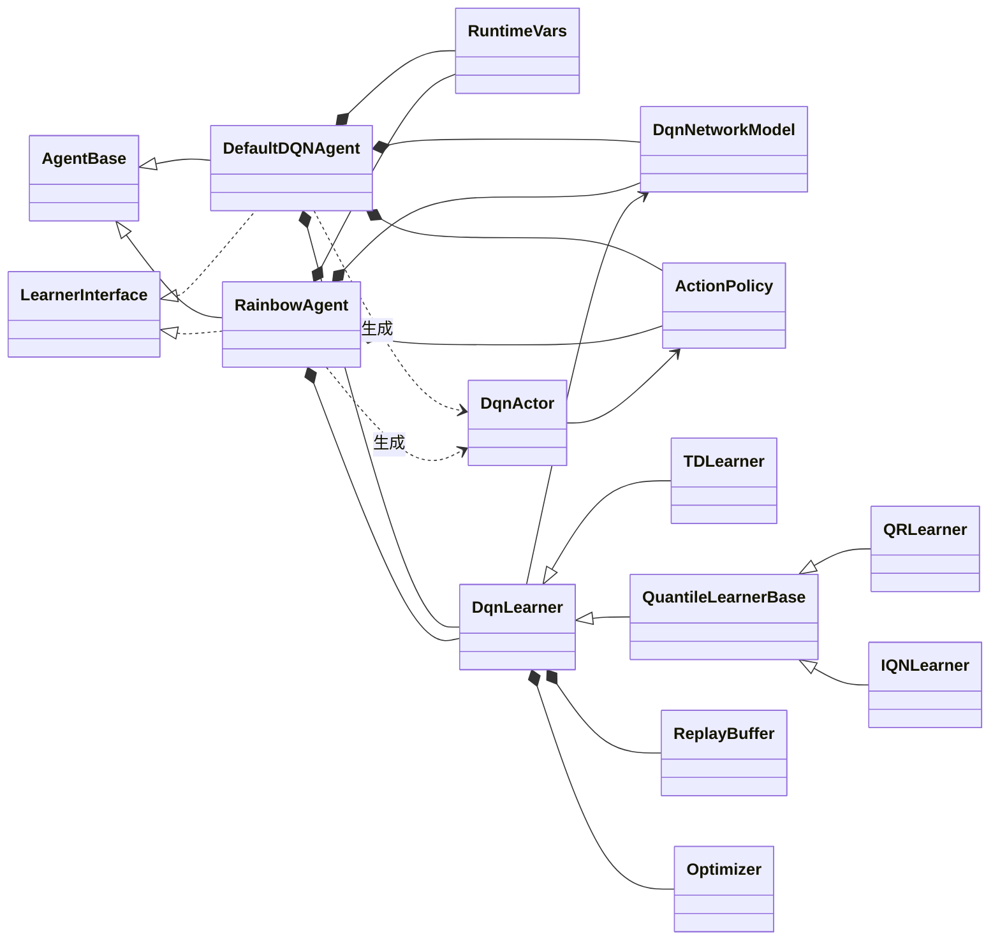
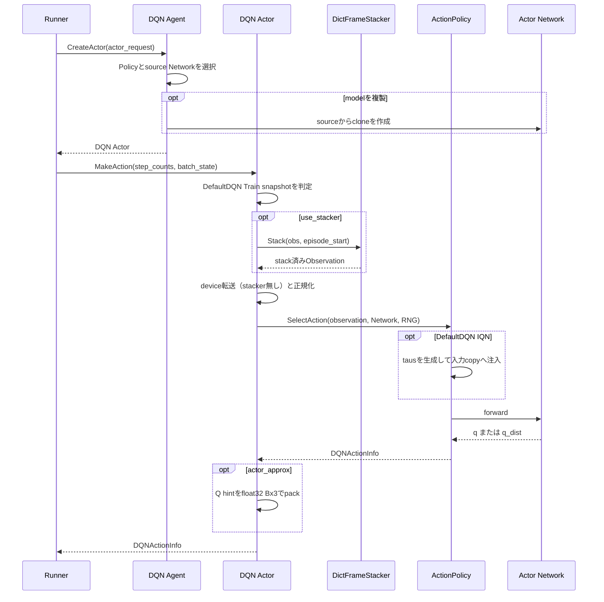
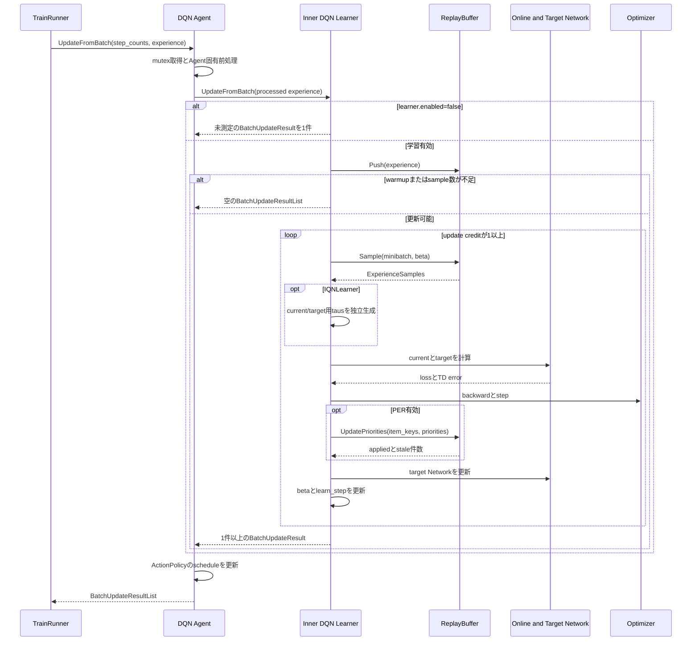
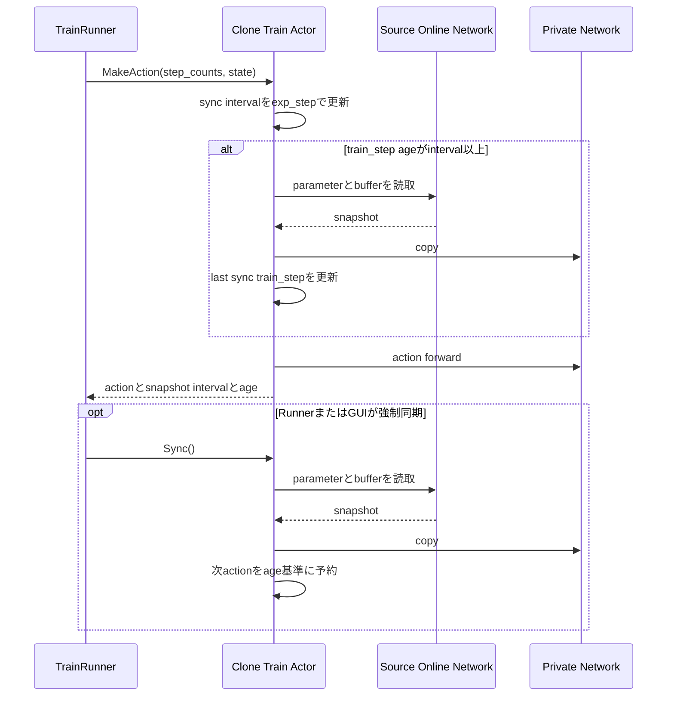

# DQN系Agent

> 主たる観点: 具象機能単位（DefaultDQNとRainbow。行動選択・学習・同期工程を時系列で併記）

## 1. はじめに

### 1.1 目的

本書は、ANETのDQN系Agentである`DefaultDQNAgent`と`RainbowAgent`の構成、行動選択、学習更新、model同期、保存契約を説明する。
共通Agent contractとDQN固有実装の境界を分け、新しいDQN系Agentまたは学習方式を追加するときの変更点を明確にする。

### 1.2 対象読者

- DefaultDQNまたはRainbowの設定・実装を変更する開発者
- DQNのActor、Policy、Learner、Network Headを追加する開発者
- snapshot同期、PER、checkpoint、metricの整合をレビューする担当者

### 1.3 記載範囲

現行の`DefaultDQNAgent`、`RainbowAgent`と、両者が合成する`anet::rl::dqn`内部componentを扱う。
Agent共通contractは[Agentと学習](110_agents_and_learning.jp.md)、ReplayBuffer共通内部は[ReplayBuffer](150_replay_buffer.jp.md)、Network moduleは[ニューラルネットワーク](130_neural_networks.jp.md)を参照する。

## 2. DQN系の概要と基本概念

### 2.1 実装レイヤー

`DefaultDQNAgent`と`RainbowAgent`は、どちらも`AgentBase`と共通`rl::Learner`を実装する具象Agentである。`CreateLearner()`は外側のAgent自身を返し、外側が共有mutexや前後処理を管理したうえで、内側の`dqn::Learner`へ更新を委譲する。

`dqn_based_agent.*`は、`NetworkModel`、`ActionPolicy`、`Actor`、`Learner`、`TDLearner`、`QRLearner`、`IQNLearner`などを提供する内部component群である。両具象Agentはこれらを合成しており、`DefaultDQNAgent`または`RainbowAgent`が内側の`dqn::Learner`を継承する構造ではない。

### 2.2 Online NetworkとTarget Network

`dqn::NetworkModel`はonline Networkとtarget Networkを保持する。Actorはカタログ項目の`network`設定に応じてonlineまたはtargetをsourceとして行動を選び、Learnerはonlineで現在値を計算し、targetをbootstrap値の計算に使う。targetは`soft_update_tau`または`hard_update_interval`に従って学習後に更新する。

HeadとLearnerは次を組み合わせる。

| 構成 | 出力 | Learner |
|---|---|---|
| 通常Q | Actionごとの`q` | `TDLearner` |
| QR-DQN | Action・quantileごとの`q_dist`と平均`q` | `QRLearner` |
| IQN | 注入したtausごとの`q_dist`と標本平均`q` | `IQNLearner` |
| Dueling | valueとadvantageを合成したQ | TD、QR、IQNと組合せ可能 |

Double DQN、N-step、PER、勾配clip、AMPなどはLearner設定で組み合わせる。すべての組合せを「Rainbow」という名称だけから暗黙に仮定せず、Runの解決済み設定を確認する。

### 2.3 ActionPolicyとDQNActionInfo

`ActionPolicy`はNetwork forwardとAction選択を担当し、Action、Q値、quantileなどを`DQNActionInfo`へまとめる。現行の共通部品にはepsilon-greedy、UQE、Thompson Samplingがある。DefaultDQNはTrain、Eval、target用Policyを分け、RainbowはAction用Policyと学習target用のgreedy Policyを構成する。

DefaultDQNのIQNでは、各Policyが`tau_rule`（`num_taus`と`random|fixed|stratified|systematic|antithetic`）に従ってtausを生成し、受領したObservationのshallow copyへ注入してからforwardする。`stratified`は各等幅層から独立に1点、`systematic`は行ごとに1つの位相を共有した等間隔点、`antithetic`は範囲中点に関する鏡映ペア（奇数本では末尾に独立点）を生成する。`fixed`は各等幅区間の中点へ固定配置する決定論的な方式で、RNGを消費しない。Trainの既定はrandom×32、Eval/targetはfixed×32である。UQEは減衰後の実効tauを下限とし、`uqe.use_tail_mean=true`では下限から1までの平均、`false`では全点を下限へ固定した`Zτ`をaction scoreにする。非spatial Thompsonは`[0,1]`、spatial Thompsonはlaneごとの下限を使う。tau配置方式と時間の値 `uqe.tau` は別の設定概念である。Thompsonの`uqe_tau`指標は常にNaNとなる。

IQN+UQEは任意の`full_distribution_query`を持つ。既定はdisabledで、enabled時はrisk tausとfull `[0,1]` tausを連結して1回だけforwardする。`q_values`/`uqe_values`/`q_quantiles`はrisk側、`full_q_values`/`full_q_quantiles`はfull側であり、Headが連結全体から返す平均`q`は使わない。point UQEのrisk側は同値なα 1本に縮約する。非IQN modeではenabled設定を休眠状態のまま保持して無視するため、quantile modeの切替時に同時変更する必要はない。IQNでenabledにしたままUQE以外のPolicyを選ぶ構成は設定エラーになる。

Actorは、構成に応じて`DictFrameStacker`によるframe stackとdevice転送（stacker無しではdevice転送のみ）を行い、Observation正規化、Policy呼出し、補助情報の付与へ進む。PolicyはLearnerへ依存せず、NetworkとRNGだけでActionを決定する。

`DefaultDQNAgent`のframe stackでは、`use_stacker=true`かつ`stack_count=S>1`のとき、stack対象ObservationのNetwork入力specをEnvSpecの特徴次元へ乗算せず、`[S, *original_shape]`として構築する。これによりdummy forward、Actor、Replay sampleの入力軸が一致する。`stack_keys`対象外のspecは変更せず、`stack_count==1`では追加のstack軸をNetwork specへ導入しない。このspec変換はDefaultDQN固有であり、EnvSpec、ObservationNormalizer、ReplayBuffer、`NetworkBuilder`、`RainbowAgent`のcontractは変更しない。moduleごとのshape変換と離散Gridのone-hot境界は[ニューラルネットワーク](130_neural_networks.jp.md#22-frame-stack入力の軸contract)を参照する。

ProfiledValueのrootの定数は `epsilon = 0.05` のようにbare値で指定し、`type` の既定は `constant` となる。実効typeがconstant以外の場合、bare値は `value` 欄に保持されるが、評価と型付きdumpには使われない。bare値だけで定数へ切り替えることはできないため、定数に戻す場合は `epsilon.type = constant` と意図するbare値を併記する。phase内の定数は `phase.[name].value` で指定する。

時間の値は `epsilon`・`uqe.epsilon`・`uqe.tau` のProfiledValueで指定する。spatial explorationは `spatial.enabled` で選択し、`spatial.scale=linear|log` と `spatial.epsilon.first/last`・`spatial.uqe.epsilon.first/last`・`spatial.uqe.tau.first/last` でlaneの両端を指定する。両端もProfiledValueである。`SpatialLadderSchedule`が両端を評価してラダーを生成し、定数両端ではTensorを再利用する。既存のlane割り当てを保ち、1 laneはfirstとなる。

logラダーは `max(端, 1e-4)` の列を指定端へ線形に伸縮する。clamp後の両端が等しければ指定端の線形補間を使う。両端とも下限以上なら従来の生成経路を維持する。DropMergeとLunarLanderのlast=0は0のまま扱い、中間laneも旧系列から変わる。`epsilon`・`uqe_epsilon`・`uqe_tau`は使用中のlane平均を返し、各値の `_lane_min`・`_lane_max`も取得できる。方策に使わない既知の指標はNaNとなる。

### 2.4 DQNとReplayBuffer

内側の`dqn::Learner`はCPU上の共通ReplayBufferを所有し、ExperienceをPushしてからwarmup、sample可能数、update creditを確認する。更新可能な間はminibatchをsampleし、学習deviceへ移してTDまたはquantile lossを計算する。N-step、frame stack、generation-aware item key、PER、prefetchの共通contractは[ReplayBuffer](150_replay_buffer.jp.md)を正本とする。

PERの初期priority modeが`actor_approx`の場合だけ、Train Actorは既存forwardからDQN固有の`float32[B,3]` hintを作る。列は次の順序である。

| 列 | 値 |
|---:|---|
| 0 | 実際に選択したActionのaction score |
| 1 | OFFでは`max_a` action score、Munchausen ONではsoft state value（TBO時はh空間） |
| 2 | Munchausen bonus（実空間）。OFFでは0 |

共通ReplayBufferはpayloadをopaqueな行として運び、DQNの`InitialPriorityEstimator`だけが`K = 3`を検証・decodeする。N-step確定後、確定収益へ開始hintのbonusを1回加え、bootstrap hintのstate valueと割引からLearner更新前のraw priorityを推定する。true terminalでもbonusを残し、bootstrapだけを使わない。TBO有効時はstate valueを実空間へ戻して合成し、完成targetをh空間へ変換する。

通常Q/QRでは既存の平均Q、IQN+UQEでは行動選択と同じrisk-biased action scoreからhintを作る。`uqe.use_tail_mean=true`はupper-tail mean、`false`は`Zτ`であり、full queryを有効にしてもActor Qヒントへfull分布平均は使わない。Munchausen ONでも追加forwardは行わず、この既存scoreのsoft化による近似である。`WithAction`は行動Qとbonusをauxから再gatherし、state valueを維持する。`ActorQHintConfig`は共通の`MunchausenConfig`を`munchausen`として保持し、TBO設定を併せて持つ。`munchausen.enabled`はMunchausen計算だけを制御し、ヒント全体の出力可否は`emit_actor_q_hint`が制御する。共通設定の`log_policy_mode`はLearner専用でActorは参照しない。RainbowはMunchausen OFFのまま同じK3 transportを使う。

学習側の `learning_rate`・`weight_decay`・`gamma`・`munchausen.alpha`・`munchausen.entropy_tau` と `model.soft_update_tau` は、`UpdateFromBatch`の先頭で`exp_step`から評価する。warmup中も評価し、全optimizer groupのlrと通常groupのdecayへ反映する。σ専用groupのdecayは固定の `noisy_weight_decay` を維持する。soft updateはその時点のτを受け取る。`per_beta`だけはstep 0の値で始め、各更新末尾に評価して次の抽選要求へ渡す。prefetchを含む抽選の要求順序は変えない。

`MunchausenConfig`は時間の値の宣言、`MunchausenValues`は評価済みの値である。Actorも自身の`exp_step`でγ・α・entropy_tauを評価し、`DQNActionInfo`へ保持する。`To`・`WithAction`はこの値を引き継ぐ。step診断は既存の`GetScalar`でこれらを受け取り、現在のヒント、収益、bootstrap割引を計算する。schedule γでは完成待ちの報酬列も保持し、bootstrap時のγと揃える。

`$agent`は `learning_rate`・`weight_decay`・`soft_update_tau`・`gamma`・`munchausen_alpha`・`munchausen_entropy_tau` を公開する。checkpointのoptimizer optionsの比較と上書き、RewardScalerの初期化、初期ホライズン表示はstep 0の値を使う。endpointはProfiledValueのboundsで検証する。spectral normを使うsoft updateでは定数の1を許すが、scheduleの全端点は[0,0.1]に限る。

## 3. コンポーネント定義

| コンポーネント | 定義 |
|---|---|
| `DefaultDQNAgent` | scaler、複数Policy、Train Actor snapshotなどを組み合わせる設定可能なDQN系Agent |
| `RainbowAgent` | QR、Dueling、Double DQN、N-step、PERを中心に構成するDQN系Agent |
| `RuntimeVars` | `learn_step`、PER betaなどDQN学習中に変化するState |
| `NetworkModel` | online/target Network、target更新、保存・読込をまとめるResource |
| `DQNActionInfo` | Action、Q補助情報、Replay初期priority hint、評価済みγ・Munchausen値、snapshot診断を運ぶActionInfo |
| `SpatialLadderSchedule` | 両端の時間の値と並べ方を所有し、laneのTensorと統計を保持する |
| `ActionPolicy` | Network出力からActionを選択する基底component |
| `dqn::Actor` | frame stacker、正規化、Policy、Network、RNG、同期StateをまとめるActor実装 |
| `dqn::Learner` | ReplayBuffer、optimizer、更新credit、target同期、PER更新をまとめる内部Learner |
| `TDLearner` | scalar TD targetとTD lossを計算するLearner |
| `QuantileLearnerBase` / `QRLearner` / `IQNLearner` | target quantileと方式別のquantile Huber lossを計算するLearner |
| `TauGenerator` | IQNの5種のtau配置方式を指定device上で生成するstateless component |
| `RewardScaler` / `ObservationNormalizer` | DefaultDQNのExperience前処理とNetwork入力正規化を担当するcomponent |

## 4. コードマップ

| 領域 | 主なファイル |
|---|---|
| DQN共通component | [dqn_based_agent.hpp](../../core/anet-core/src/dqn_based_agent.hpp)、[dqn_based_agent.cpp](../../core/anet-core/src/dqn_based_agent.cpp) |
| DQN Head | [dqn_based_heads.hpp](../../core/anet-core/src/dqn_based_heads.hpp)、[dqn_based_heads.cpp](../../core/anet-core/src/dqn_based_heads.cpp) |
| DefaultDQN | [default_dqn_agent.hpp](../../core/anet-core/include/anet/default_dqn_agent.hpp)、[default_dqn_agent.cpp](../../core/anet-core/src/default_dqn_agent.cpp) |
| Rainbow | [rainbow_agent.hpp](../../core/anet-core/include/anet/rainbow_agent.hpp)、[rainbow_agent.cpp](../../core/anet-core/src/rainbow_agent.cpp) |
| ReplayBuffer | [replay_buffer.hpp](../../core/anet-core/include/anet/replay_buffer.hpp)、[replay_buffer_impl.hpp](../../core/anet-core/src/replay_buffer_impl.hpp)、[replay_buffer_impl.cpp](../../core/anet-core/src/replay_buffer_impl.cpp) |
| Runner設定例 | [apps/runner/config](../../apps/runner/config) |
| DQN test | [dqn_based_agent_test.cpp](../../core/anet-core/src/dqn_based_agent_test.cpp)、[dqn_based_test.cpp](../../core/anet-core/src/dqn_based_test.cpp) |

## 5. 静的構造



`LearnerInterface`は共通`anet::rl::Learner`、`DqnLearner`は内部`anet::rl::dqn::Learner`を表す。外側AgentはRunから見えるLearner facadeであり、共有mutexを取得してから内側Learnerを呼ぶ。

## 6. 主要フロー

### 6.1 Actor生成と行動選択



共有Networkを使うActorはLearner更新との競合を避けるためshared lock内でPolicyを呼ぶ。clone Actorはprivate Networkを使い、forward中にsource Networkを参照しない。

### 6.2 Experience受入れと学習更新



DefaultDQNは外側AgentでRewardをscaleし、ObservationNormalizerの統計を更新してから生Observationとscale済みRewardを内側へ渡す。Rainbowはこの前処理を持たず、同じinner Learner contractへ直接委譲する。

`learner.enabled=false`は学習を完全に止めた評価専用Runのための設定である。既定は`true`。falseではReplayBufferを構築せず、Push、Sample、forward、backward、optimizer stepのいずれも呼ばない。Optimizerはcheckpointのpayload互換のため構築したままとする。**空のリストではなく、全診断keyが未成立=NaNの`BatchUpdateResult`を1件返す**。LEARNイベントは`update_results`が空だと発火せず、評価は`EpisodeEvalObserver::OnLearn`からしか駆動されないためである。この形で1 train stepが1 learn stepになり、`eval_schedule`の`interval`をそのままtrain step周期として使える。外側Agentの前処理（Reward scaleとObservationNormalizer統計、ActionPolicyのschedule）は無効時も従来どおり動くので、統計を凍結する場合は`obs_norm`と`reward_scaler`の設定で行う。`auto_load_file`を伴わない`learner.enabled=false`は初期重みの評価になるため、構築エラーにはせず1度だけWARNする。

### 6.3 Munchausen RL

DefaultDQNのTD / QR / IQNは`learner.munchausen.enabled=false`を既定とする。`log_policy_mode=target`、`alpha=0.9`、`entropy_tau=0.03`、`clip_value_min=-1`が既定値である。OFFでもmodeと値域を検証し、ONとDouble DQNまたは解決後のThompson targetとの併用は構築エラーにする。`use_optimistic_target`によるPolicyコピー後に判定する。

| mode | bonus用current出力 | next価値・方策用出力 |
|---|---|---|
| `target` | 正規化済みcurrent/nextを連結したtarget forwardの先頭B行 | 同じforwardの残りの終端行。skip無効時は全体2B、有効時はwindow終端を加えて3B |
| `online` | current train・target-valueの後のNoGrad / eval fresh online | skip無効時B、有効時はwindow終端を加えた2Bのtarget forward |
| `online_reuse` | 既存current train出力をdetach | skip無効時B、有効時はwindow終端を加えた2Bのtarget forward |

ONではhard action選択を呼ばない。IQNはcurrent N本、target M本、必要ならfresh online N本の順にtauを生成する。target modeのbonusはM本、他modeはN本を使う。OFFのforward順とRNG消費は維持する。target modeのplasticity captureはskip無効時`[2B,F]`、有効時`[3B,F]`を検証し、通常nextに対応するB〜2B行を返す。

方策・bonus・soft bootstrapはNoGrad・FP32実空間で計算する。TBO時は各分位点を個別に逆変換する。先頭状態のclip済みbonusをN-step returnへ1回加え、終端maskはbootstrapだけへ掛ける。TDはsoft state value、QR/IQNは各行動の全分布を方策確率で混合し、完成したtargetだけをh変換する。

`target_policy->GetRiskScoreSpec()`がUQEの現在tauとtail-mean設定を返す場合、`MakeRiskBiasedScore`で実空間分位点をソートして方策scoreを求める。他の対応Policyは分位点平均を使う。QR hard経路も同じ抽出計算を使うが、IQN softは既存tau集合の経験分位近似であり、hard IQNとの厳密一致は保証しない。helperはcurrent/next scoreと別にnext平均Qを受け取り、`soft_gap`を常に平均Q基準で求める。UQEのtau減衰StateはPolicyが所有する。

`forward_target`、`forward_munchausen_online`、`munchausen_target`を別々に計測する。後者は実空間化からtarget組立までを含む。初期化ログでmodeと平均/risk score源を確認できる。`@munchausen` agent profileはenabledとtarget mode、Double DQN OFFを設定し、Atariの`run.@munchausen`がIQN構成と診断購読を束ねる。

### 6.4 DefaultDQN Train Actor snapshot

`DefaultDQNAgent.actor.[key].clone_model=true`かつ`sync_interval.*`を宣言したActorがprivate Networkの定期snapshotを持つ。同期周期profileは`exp_step`で更新し、現在のageは`train_step`で測る。判定とcopyは`MakeAction()`のforward直前に行うため、Serial/Pipeline Runnerのどちらでも同じaction境界になる。



`Sync()`はstepを受け取らないため、強制同期後に最初に呼ばれたactionの`train_step`をage 0の基準にする。shared Actorと`sync_interval.*`未宣言のActorは定期snapshotを持たない。

DefaultDQNのprimary Headはboolの `head.use_dueling` で選び、既定trueはV + A − mean(A)である。初期化は `head.init.*`、射影は `head.projection.*` をAgentが読み取る。設定DTOも `head.init`・`head.projection`・`head.use_dueling` と同じ階層に揃え、固定キーの読み込みは `ANET_READ_CONFIG` を使う。skip側も `skip.head.*` に揃える。

### 6.5 DefaultDQNのskip方策

共通のskip設定はagent.txtの `DefaultDQNAgent.@baseline` に無効のまま `?=` で置く。共有網はnn.txtの `SkipFC1 > SkipReLU > SkipFC2 > SkipReLU` を使い、枝は `skip_context` をbindする。envは `skip.max_length ?= J` とIQNの融合済み `skip_context` を指定する。`run.@skip` はenabled・指標・Trace列・greedy評価を選び、Agentのチェーンを書き直さない。GridMazeはskip専用のepsilon-greedy（0.60→0.05）も選ぶ。feature_gradient・Dueling・action_in・層幅はCLIの葉で指定する。

`skip.enabled=false`が既定で、無効時はskip網を構築しない。設定値の型・列挙・範囲の検証は無効でも行う。Jの実装既定0は未指定を表し、有効時はJを必須とする。明示0以下は無効時も拒否し、明示1は許す。有効時はprimaryのonline／targetにskipのonline／targetを加え、同期を同じ時点で行う。skip targetはtargetを元にするActorだけが使い、Learnerのbootstrapはprimaryを使う。

`skip.net.*`は通常のNetworkと同じbranch・block・bind・body.output記法を使う。入力specはprimaryのBody公開出力、Observation、包含型の`action`、IQNの`taus`から、実際に参照する鍵だけを構築する。primaryのdummy出力でshapeを確定する。IQNはprimaryの融合済み特徴（[B,K,F]）か、skip網自身でtausと融合した特徴を使う。tausのbind自体は必須にせず、HeadがIQNでrank3、それ以外でrank2を要求する。`skip.network_mode=action_out`（既定）はactionのbindを禁止し、`action_in`はactionのbindを要求する。いずれもskip有効時のAgent構築で検証する。包含型のactionは離散specでone-hot化する。`skip.net.structure`と`skip.net.detail`を独立したGraphVizとして出す。GraphVizでは平均出力`skip_q`と、QRの固定K／IQNの可変K（-1）を持つ`skip_q_dist`を分けて示す。起動ログはskip網のパラメータ形を`skip.`付きで列挙し、online／targetのテンソル数にはskip分も含める。

Headは`features`を読み、TDでは`skip_q`、QR／IQNでは`skip_q_dist`と分位平均の`skip_q`を返す。既定の分離型は全action×Jを出し、`skip.network_mode=action_in`の包含型はJだけを出す。`skip.head.use_dueling=true`（既定false）はprimaryの選択actionの値をdetachし、`Q(s,a) + advantage(j) - advantage(1)`を分位ごとに組む。射影と初期化は`skip.head.projection.*`・`skip.head.init.*`で上書きでき、省略した項目はprimaryから継承する。

Actorはprimaryを毎step全laneで実行する。判断laneだけが選択actionと長さjを採用し、残りj−1回は同じactionを返す。episode開始は残り回数を破棄する。skipのforwardは継続laneを含めて1回行い、方策用RNGをprimaryと分ける。既定のskip方策は同じActionPolicyの現在のε・τ・spatial配置を使用する。`actor.[key].skip.policy.*`を指定すると独立したPolicyを構築する。greedy評価はskipもgreedyにする。

ActionPolicyはprimaryの特徴量と使用したtausをActorまで一時保持する。IQNの既定skip方策は同じrisk queryを使い、任意のfull query部分はscoreから除く。専用skip方策は自身のtau rule・現在tau・spatial配置でqueryを作り、primary queryの末尾へ加える。primaryとskipはこの同じtausを各1回のforwardで評価し、primaryの選択には元の領域、skipの選択には追加領域だけを使う。平均方策はfull range、UQEは指定分位またはtailをそのまま問い合わせる。Actorの返却infoは`decision`、auxは`skip_decision`・`skip_length`・`skip_q_values`を持つ。Actor近似PERのQヒントは継続による上書き後のactionから作る。

Learnerは同じReplay sampleからQのn-step targetとwindowのskip targetを作る。skip targetは窓の割引報酬にγ^kのprimary bootstrapを加え、doneではbootstrapを除く。Munchausenの先頭bonusは1回だけ加え、TBOの計算は実空間へ戻してから行う。target方式のMunchausen forwardはcurrent B・通常終端B・窓終端Bの3B、その他の終端評価は2Bをまとめる。

skip currentの入力特徴量は`learner.skip.feature_gradient=stop`でdetachし、`merge`ならprimaryへ勾配を返す。この2モードはQ lossと`learner.skip.loss_weight`倍のskip lossを一度だけbackwardし、primaryとskipを別々に同じ閾値でclipする。

`split`は同じforward・更新前のパラメータからQと重み付きskipの勾配を別々に求める。primaryのQ勾配・primaryのskip勾配・skip Networkの勾配を独立して同じ閾値でclipし、primaryには別々のAdam状態による更新の和を加える。追加optimizerはLearnerが所有し、primaryの通常・sigmaパラメータをまとめて扱う。lr・eps・betasとlrスケジュールはprimaryと同じ、weight decayは0とし、decayはQ側で一度だけ適用する。`loss_weight`はどのモードでもskip lossへの倍率であり、更新量の倍率ではない。policy churnは両step全体の前後を測る。GNSの入力はQ lossとprimary parameterだけである。skip有効時のFP16 AMPは非対応で構築時に拒否し、BF16またはAMPなしを使う。

`learner.skip.sample_weight=uniform`が既定で、`kmax`では行ごとのskip lossへ`max_lengths / mean(max_lengths)`を掛ける。重みの和はBで、IS重みと積にする。TD値自体は変えない。PERは`|δQ| + learner.skip.priority_lambda * |δskip| + ε`で、係数の既定は0。同じIS重みを両lossへ掛ける。

Actorは判断時の長さ別回数をdevice上で累積し、`Sync()`（定期snapshotの同期も含む）で消す。`GetScalar()`の`skip_session_decision_rate`は判断回数／lane step数、`skip_session_length_mean`は選択長の平均、`skip_session_length_rate.[j]`は判断回数中の長さjの割合である。初回読出し時だけCPUへ転送し、stepごとの同期を増やさない。skip無効・未成立はNaN、添字範囲外はfail-fast。判断がないsessionでは判断率0、長さの平均・割合はNaNになる。`$eval.[greedy] $actor @session_end`の購読は学習側の座標に記録される。

畳み込みまでの共有と完全非共有を比べる独立profile、数値例、checkpoint・設定移行・Run等価性の確認は[PRD103検証資材](../../core/anet-core/testdata/prd103/README.md)を参照する。これらのprofileは既定のNetwork構造を変えず、既定構造のcheckpointとは互換にしない。

## 7. DefaultDQNとRainbowの構成・設定

### 7.1 主な相違

| 観点 | `DefaultDQNAgent` | `RainbowAgent` |
|---|---|---|
| Policy | ActorカタログとLearner targetを個別構成。epsilon-greedy、UQE、Thompson Sampling | Actorごとのepsilon-greedyとLearner target用greedy |
| 前処理 | RewardScaler、ObservationNormalizer、frame stack | frame stackなし（device転送のみ）。専用scaler/normalizer設定なし |
| Head/Learner | TD/QR/IQN、Dueling有無を選択 | TD/QR、Dueling有無を選択 |
| Replay拡張 | N-step、PER、prefetch、replay ratio、TBOなど | N-step、PER。現行Configはprefetch、TBO、fused optimizerを無効化 |
| Actor clone | カタログの`clone_model`と任意の`sync_interval.*`で指定 | カタログの`clone_model`で指定。定期snapshotなし |
| spatial exploration | Actorごとに利用可能 | Actorごとに共通方策のspatial設定を利用可能 |
| 保存・読込 | 独自archive payloadと`auto_load_file`あり | 独自Save/Load overrideなし |

### 7.2 設定グループ

| グループ | 主な責務 |
|---|---|
| Network/Head | `quantile_mode=none|qr|iqn`、QR quantile数、Dueling、初期化、online/target同期 |
| ActionPolicy | Policy種類、epsilon、UQE tau減衰、IQN tau配置方式、Train/Eval/targetの選択 |
| Train Actor | shared/clone、snapshot同期周期 |
| Learner | 学習の有効化(`enabled`)、optimizer、update間隔・比率、AMP、Double DQN、N-step、PER、TBO |
| Replay | capacity、batch size、warmup、prefetch、priority mode |
| 前処理 | frame stack、Reward scale、Observation normalize |

全keyと既定値の正本は`DefaultDQNAgentConfig`、`RainbowAgentConfig`、`LearnerConfig`、`ActionPolicyConfig`と[apps/runner/config](../../apps/runner/config)である。本書へ設定一覧を複製せず、Runの`config/config_data.txt`と`config/<tag>.txt`で解決結果を確認する。

DefaultDQNでは`quantile_mode`の既定が`qr`、`qr.num_quantiles`の既定が51である。IQN learnerは勾配側`learner.iqn.current_taus`とtarget分布側`learner.iqn.target_taus`を独立に持ち、どちらも既定random×64でN≠Mを許す。target action選択はこの2系統とは別に`target_policy.tau_rule`を使う。旧DefaultDQN keyの`use_qr`と直下`num_quantiles`は現行契約に含めず、Rainbowの`use_qr`と`num_quantiles`は維持する。

IQN専用lossはcurrent側Nをsum、target側Mをmeanし、Huber項を`kappa`で除算する。`N = 1`では分散の不偏推定を使わず、`q_std`を明示的に0とする。分位数を持たない`quantile_mode=none`では`q_std`が成立しないため`NaN`を返し、0へ偽装しない。

`per_initial_priority_mode`は`fixed`、`max`、`actor_approx`を受け付ける。`max`と`actor_approx`はPER有効を要求し、priority、epsilon、clip値、profile構造などはConfig構築時に検証する。不正な組合せを暗黙に既定値へ戻さない。

### 7.3 DefaultDQN の Noisy 実行設定

`nn_forward.[key]` は不変な opaque 設定カタログ。`actor.[key].nn_forward_key` と `learner.current.nn_forward_key` / `learner.target.nn_forward_key` は解決済み設定を参照し、欠落・未知参照を設定読み込み時に拒否する。項目内容は利用する具象部品の準備時に検証し、未参照項目と部品が使わない設定群は検証しない。共通の `act_sample` は sample/call/batch、`mu_only` は評価用途。内容の具体型・解釈・検証はそれを利用する Body Linear と各 Head 内部に閉じ、Actor/Learner は解釈せず、初期化時は不透明な設定、実行時は呼び出し情報を渡す。

TD・QR・IQN と Dueling の最終射影は `head.projection.noisy.enabled=false` / `head.projection.noisy.sigma0=0.5` で選択する。Actor は専用箱1個と行動選択時計、Learner はcurrent用1個・target用途のonline用1個・target用1個の箱と実更新のlearn_stepを使う。named seed は acting・学習・τ の既存 RNG から独立する。target 計算の設定・箱・時計は全 forward で保持する。Munchausen target方式では、skip無効時の `[2B]` 入力に `[0..B-1,0..B-1]`、有効時の `[3B]` 入力に `[0..B-1,0..B-1,0..B-1]` の NetworkForwardRowMapping をCPU側で検証・確定して一度転送する。これにより同一遷移のcurrent・n-step終端・window終端が同じ ε を使う。online_reuse の sample/sample または μ-only/μ-only 可否は各計算部品が検証する。

Config DTO は設定値と nn_forward_key のみを持ち、カタログは ConfigData を保持する。Agent が選択済み搬送型を Resource として持ち、初期化時に用途別 NetworkForwardExecutor を準備する。Actor は専用実行オブジェクト、Learner は現在値／target 用を持つ。target用途のonline／targetは同じ設定・時計種別で独立したStateを持ち、network_forward.target_online／network_forward.targetのnamed seedを使う。probeのμ-only側は既定Forwardで、sample側だけが専用実行を持つ。CallInfo は別の文で生成し、時計を進める判断は Actor／Learner に残す。Learnerはcurrent実行器とtarget／診断の用途ペアを持ち、target captureは通常更新だけに渡す。ActionPolicyは実行器を参照で借用する。DQNの6射影Headは共通基底で準備・再利用検証・parameter列挙を行い、value→adv順と固有の計算を維持する。Double DQNとMunchausen onlineのsampleは箱の分離で乱数の割り当てが変わるが分布は同じである。

Learner の forward_resources は必須の初期化入力である。有効時は current/target の参照キーと対応する Resource を準備前に検証する。空キーを使う直接構築では既定 Resource を明示し、無効時は休眠契約を維持する。

通常/Fused AdamW は Noisy ON のとき σ 専用 group を使い、`learner.noisy_weight_decay=0` が既定。OFF は従来の単一 group と順序を維持する。μ-only の current は σ の gradient を作らず、σ を更新・decay しない。sample で成立した σ gradient は既存の全体 norm/clip に含まれる。checkpoint と snapshot の parameter に σ を含め、ε・時計・RNG は保存しない。checkpoint 引き継ぎ時は σ 専用 group にも現在の optimizer 設定を適用し、weight_decay は learner.noisy_weight_decay で決める。

Atari の `nz_learning` は既存の μ 初期化・AMP を継承する。`nz_reference` と `nz_reference_off` は4射影の default 初期化・σ0=0.5、Body2FCの force_fp32=true、既存チェーンのAMPと標準call/batchを揃え、Noisy enabled だけを変える。episode/sample は結合 Run の Actor 上書き条件として指定する。指定チェーン末尾へ profile を追加する実行例と受け入れ手順は [専用検証手順](../../core/anet-core/testdata/prd084/README.md)を参照する。

## 8. lifetime・同期・保存読込

### 8.1 ResourceとState

- 外側Agentが`RuntimeVars`、`NetworkModel`、Policy、inner Learner、scaler類、plasticity/policy churn probe用RNG Resourceのlifetimeを所有する。
- inner Learnerは外側の`NetworkModel`と`RuntimeVars`を参照し、OptimizerとReplayBufferを直接所有する。
- shared ActorはAgent所有Networkを参照し、clone Actorはprivate Networkを所有する。どちらもLearnerそのものは参照しない。
- epsilonとUQE tau減衰scheduleはActionPolicy、update creditとwarmup latch、policy churnのupdate単位request/probe/Qはinner Learner、snapshot intervalとlast sync stepはclone Actorが更新・所有するStateである。IQNのtau配置方式は設定であり、各forwardのtausはPolicyまたはLearnerが所有するRNGから生成する一時入力である。policy churnのfixed midpoint tausは乱数を使わず、同じupdateの最大3 forwardで共有する。
- outer Agentの共有mutexはLearner更新、shared Actor forward、clone/sync copyの境界を直列化する。

### 8.2 checkpoint

`split`のoptimizerは通常の4役割に`primary_skip`を加え、追加optimizerのmoment・stepを保存する。4役割のcheckpointからsplitへは追加状態を初期化して一度WARNし、5役割からstop／mergeへの読込は拒否する。復元後は追加optimizerにも現在のlr・eps・betasを適用し、weight decayは0に保つ。stop／mergeの保存形式は変更しない。

DefaultDQNAgent全体の保存形式は、第1版の `DefaultDQNAgent` と第2版の `DefaultDQNAgent-2` で識別する。識別子はdefault_dqn_agent.cpp内の `kCheckpointFormatV1` / `kCheckpointFormatV2` に一元化し、書込・読込・診断で共有する。skip無効時は既存の第1版、skip有効時はprimaryとskipのonline／targetの4 Networkを持つ第2版を保存する。識別子以外のバイト配置は変更しない。optimizer は primary通常・primaryσ・skip通常・skipσの役割名と状態を保存する。読み込み時は保存された役割でgroupを対応付け、momentとstepを復元してから現在のoptionsを役割ごとに適用する。空のσ groupも役割を保持する。

skip 無効の checkpoint は従来の header と2 Network・optimizer の形式を保持する。これを skip 有効で読むと primary とその optimizer 状態を引き継ぎ、skip を新規初期化して一度 WARN する。この分岐は基準 Run から skip 学習へ移るための現行契約である。skip 有効の checkpoint を無効の構成で読む場合は fail-fast する。Actor の継続状態と replay は保存しない。

現行`DefaultDQNAgent::Save()`はarchive header、Config文字列、NetworkModel、inner Learnerを保存する。NetworkModelは上記の有効・無効の形式に従い、inner `dqn::Learner::Save()`はOptimizerの状態と、有効時のgroup役割を保存する。`auto_load_file`はAgent構築中にこのpayloadを読み、NetworkとOptimizerへ復元する。

次は現行DefaultDQN checkpointへ保存・復元しない。

- ReplayBufferの内容、generation、priority、通常sample RNG、prefetch状態
- plasticity/policy churn probe RNGと、update途中のpolicy churn測定State
- `RuntimeVars`、update credit、warmup latch、PER betaなどの学習進行State
- RewardScalerとObservationNormalizerの統計
- RunのStepCountsとmetric系列
- Actor-private snapshot、同期周期runtime、last sync step、Actor RNG

したがってcheckpoint読込は旧Runの完全再開ではなく、新しいRunへNetworkとOptimizerを引き継ぐ操作である。Config文字列はarchiveから読み取ってlogへ出すが、現在のAgent Configを置換しない。Optimizer の moment と step は checkpoint から引き継ぎ、各 param group の options（lr、weight_decay、eps、betas、amsgrad）は現在の設定から生成した値で置き換える。checkpoint と異なる項目は group・対応する設定キー・保存値・設定値を WARN へ出し、適用後の lr・weight_decay・eps は group ごとに INFO へ出す。設定キーのない betas・amsgrad はキー表記を省く。同一設定なら差分 WARN は出ない。learner.enabled=false でも同じ規則を適用する。Network構成とOptimizer payloadが互換である必要がある。

`RainbowAgent`は現行コードで独自の`Save()` / `Load()`をoverrideせず、基底Agentのno-opを使う。DefaultDQNと同じcheckpoint対応があると仮定しない。

Rainbowの初期化設定も `head.init.*` の6葉を入れ子DTOと `ANET_READ_CONFIG` で読み、設定記録のキーをメンバのパスと一致させる。構築前に `ValidateWeightInitConfig` で検証する。RainbowのDueling設定は従来の `use_dueling_net` を使う。

ActorからReplayへ渡す判断のinfo鍵は `BatchActionInfo::kKeyDecision` で共有する。skip出力・行動入力・補助情報・GetScalarの鍵と分布modeはDQN側の所有型、optimizer role・Torch archive鍵・GraphViz tagは利用するcpp内の定数が持つ。書込・読込・比較・表示・診断で同じ定義を参照し、外部の文字列値と保存順は変えない。

NetworkのSN u/vはnamed bufferなので、DefaultDQN checkpointのonline/target Networkとともに保存・復元される。`Clone()`は構築seedを再利用して同じ構造を再構築してから、parameterとbufferを完全copyする。

## 9. 可観測性・性能・エラー

### 9.1 metric

- `DQNActionInfo`はAction、Q値・quantile補助情報、必要に応じてReplay初期priority hintを運ぶ。
- `episode_start_action_uqe_margin.[i]`と`episode_start_action_q_margin.[i]`は、episode開始laneだけを対象に、action `i`の値と最良の他actionとの差をbatch内平均する。UQE版はUQE値、Q版はnetwork出力のQ系scoreを使い、TBO有効時もh空間のまま扱う。IQN+UQEでは両者が同じrisk-biased action scoreになり、full-distributionの`E[Z]`ではない。episode開始laneがないstepは`NaN`を返し、scalar出力をskipする。
- DefaultDQNは`train_actor_snapshot_interval`と`train_actor_snapshot_age`をActionInfoから公開する。定期snapshotがないActorでは両値を`NaN`とし、同期したactionのageは0になる。
- Rainbowはsnapshot診断を設定しないため、同じkeyの取得は`std::nullopt`になる。
- `BatchUpdateResult`はloss、TD error、Q統計、勾配、PER更新結果などを公開し、inner Learnerは`replaybuffer.*` keyをReplayBufferへ委譲する。

IQN探索診断は、行動選択とloss計算に既に使ったTensorを再利用する。Policy側でrisk quantile数を`K`、UQE上位2行動を`a1,a2`とすると、`iqn_policy_margin_mc_ratio`は次である。標準偏差はfloat32の不偏標準偏差を使う。

```text
s[b,a] = std_k(risk_quantiles[b,a,k]) / sqrt(K)
ratio[b] = (uqe[b,a1] - uqe[b,a2]) / (sqrt(s[b,a1]^2 + s[b,a2]^2) + 1e-6)
```

`iqn_uqe_full_q_argmax_disagreement`はUQEとfull Qのargmax不一致率、`action_full_q_margin.[i]`は`mean_b(full_q[b,i] - max_{a != i}(full_q[b,a]))`である。full queryがない場合はfull依存値を`NaN`、IQN+UQE以外または`K < 2`ではmargin ratioを`NaN`とする。不正なaction indexは有効範囲を含めてfail-fastする。診断値は1本のdetached packed TensorとしてActionInfoへ渡し、複数keyの取得ではCPU materializeを1回だけ行う。診断用forwardやtau生成は追加しない。

Learner側では`z[b,i]`をcurrent quantile、`y[b,j]`をtarget quantile、`delta=y-z`、本数を`N,M`として次を使う。

```text
current_scale[b] = std_i(z[b,i]) / sqrt(N)
target_scale[b]  = std_j(y[b,j]) / sqrt(M)
priority_ratio[b] = abs(mean_i(z[b,i]) - mean_j(y[b,j]))
                    / (sqrt(current_scale[b]^2 + target_scale[b]^2) + 1e-6)
pair_abs_td[b] = mean_ij(abs(delta[b,i,j]))
cancellation[b] = clamp(1 - abs(mean_ij(delta[b,i,j])) / (pair_abs_td[b] + 1e-6), 0, 1)
```

`iqn_current_mc_scale`、`iqn_target_mc_scale`、`iqn_priority_mc_ratio`はbatch平均である。`iqn_first_*`は優先度sourceが`fixed_initial|max_initial|actor_initial`の初回Learner priority更新行だけを平均し、`iqn_first_quantile_loss_norm`は現行sample lossを`N`で除算する。初回行がない場合は`per_sample_initial_count=0`かつ`iqn_first_*=NaN`、PER無効時も同じ初回契約とする一方、一般scale/ratioは計算する。`N < 2`または`M < 2`では該当scaleと依存ratioを`NaN`にする。TBO有効時はpriorityと同じh空間で計測する。Learner診断は既存priority readbackへ同梱し、PER無効時も固定長pack 1本で回収する。

QR / IQN共通のtail診断は、tau順のquantile列`z[0..K-1]`を値で再sortせず、`h=floor(K/2)`、偶数時のmedianを`(z[h-1]+z[h])/2`、奇数時を`z[h]`とする。奇数時の中央要素は上下tailから除外し、次のQ値単位の幅を使う。

```text
upper_std = sqrt(mean_{i=K-h..K-1}((z[i] - median)^2))
lower_std = sqrt(mean_{i=0..h-1}((median - z[i])^2))
```

Policyの`policy_upper_truncated_std`と`policy_lower_truncated_std`は最終実行actionの幅をbatch平均する。`lower_risk_full_q_argmax_disagreement`は`mean(z)`と`mean(z)-lower_std`のargmax不一致率、`quantile_crossing_ratio`は全batch・action・隣接tauにおける`z[i] > z[i+1]`の割合である。`policy_selected_crossing_depth_p90_ratio`は最終実行actionについて`d[i]=max(z[i]-z[i+1],0)`をaction内rangeで正規化し、positive crossingだけのnearest-rank p90をlaneごとに求めてbatch平均する。crossingなし、またはrangeが0のlaneは`0`とする。QRは既存`q_quantiles`、IQNはfixedな`full_q_quantiles`だけを使う。5値はper-action幅、detached full quantile alias、global診断を共有payloadに保持し、最初のscalar参照時に最終actionをgatherして1本だけCPU materializeする。percentile sortもこの初回参照時だけ行う。`WithAction()`はpayloadを共有するがcacheは共有せず、差替え後actionへ追従する。

Learnerの`upper_tail_priority_spearman`は、経験actionのcurrent quantileから得たsample単位`upper_std`と、clip後かつ`per_alpha`適用前のraw PER priorityの平均順位Spearman相関である。QRはquantile index順、IQNは`current_taus`の昇順permutationをquantileにも適用する。tail値はPER有効時だけ既存priority readbackの末尾へ同梱し、pack先頭、clip件数、Replay更新順序、新しいwait境界なしという契約を維持する。PER無効、batch sizeが2未満、どちらかの順位列が定数、または`K < 2`では`NaN`とする。Policy側も必要なfull distributionがない場合と`K < 2`は`NaN`である。crossing深度p90はrangeで正規化した無次元量だが、TBO有効時は他のtail診断と同じくh空間内で算出し、real-spaceへ逆変換しない。すべてfloat32で学習graphからdetachする。

現在のsnapshot metricは[metrics_scalar.txt](../../apps/runner/config/metrics_scalar.txt)の`metrics.scalar.full`へ登録し、baselineには含めない。Event、step軸、targetの一般contractは[可観測性](140_observability.jp.md)を参照する。

### 9.2 性能

- 主要境界はActor forward、Replay sampleとH2D、online/target forward、loss、backward、optimizer、PER priority readbackである。
- shared Actorは追加Networkを持たないがLearnerのunique lockと競合する。clone Actorは追加memoryと同期copyを使う代わりにforwardを分離する。
- PipelineTrainRunnerとReplay prefetchは異なる1-deep overlapである。Runner、Replay、H2D、GPU学習のどこが隠れたかをprofileで分けて確認する。
- AMP/BF16、fused optimizer、prefetchはdevice対応と再現性を含めて同じ設定・seedで比較する。
- IQNはfusion以降とHeadの中間Tensorがtaus数Kに比例する。Policy用KとLearner用N/Mを分けてprofileし、追加の`E[Z]` forwardは行わない。

### 9.3 エラー境界

- shared ActorのdeviceがAgent deviceと異なる場合は、cloneを有効にするか同じdeviceを指定する。
- Action数、Observation shape、sample tensorのshape・dtype・deviceをAgent、Actor、Learner境界で検証する。
- `actor_approx`のhintは`float32[B,3]`を要求し、schema違反はfail-fastする。全列をfinite検証し、nonfiniteはDebug buildでfail-fastし、`NDEBUG` buildではmax初期化へfallbackする。
- 未知Policy、無効なPER mode、非finiteまたは範囲外設定、互換性のないcheckpointは処理を継続しない。
- DefaultDQNは未知`quantile_mode`、QRのquantile数不正、IQNのtau数・配置方式・Huber κ不正、IQN+UQE/spatial Thompsonで使用するtau下限の非finite・範囲外を構築時にfail-fastする。
- `model.soft_update_tau`は構成によらず全active値の有限性と`[0, 1]`を検証する。online/targetのどちらかにSNがあり、soft update構成（`model.hard_update_interval<=0`）の場合は、rootがconstantで値が1の例外を除き、全active端点の上限を0.1とする。hard updateではτを更新に使用しないが、profile宣言そのものは検証する。

既知事項: ActorのObservation正規化はAgent mutexの外で行われ、normalizer統計更新は`DefaultDQNAgent::UpdateFromBatch`のunique lock内で行われる。dynamic scaling時の潜在競合は未対処である。現用のRunner設定はいずれも`obs_norm.pass_through=true`のため、この競合は顕在化しない。

### 9.4 可塑性メトリクス

DQNは2チャネルを持つ。actualはonline/targetのTD計算で使ったtrain-mode/autocast forwardから`main_feature`等の指定branchを捕捉し、target更新前の特徴を同じ`BatchUpdateResult`へ載せる。probeはReplayBufferの一様・非復元sampleを既存obs正規化へ通し、NoGrad・eval mode・learnerと同じautocastで`ForwardOnlineUpTo`を実行してAgent最新値として公開する。

online actual、target actual、probeの有効化とcapture cadenceは、各plasticity scalar購読行の最小intervalで独立に決まる。さらに行ごとのintervalをObserverと同じbucket規則で評価し、そのlearn stepで発火する指標の和集合だけを計算する。このためdormant等のcadenceを維持したままsrank系だけを粗くでき、srank系が不要なstepではSVDを実行しない。同じstepのδ=0.01 / 0.05 / 0.20は1回のSVDを共有する。`final_feature_branch_key`は購読時だけ必須・branch存在検証し、購読ゼロならNoCareでcapture/sample/statsを行わない。baseline設定は`main_feature`を指定するが、DTOは未指定を空文字で保持し、設定不在を暗黙に補完しない。既知だがそのlearn stepで未計測のkeyは`NaN`、未知keyは`nullopt`である。probeは非capture stepやsample不足時に前回値を再利用しない。probe batch sizeは常に1以上を要求する。チャネル別の読み方は[Run分析ユーザーガイド](030_user_guide_analysis.jp.md)4.7節を参照する。

parameter側は、online networkを`final_feature_branch_key`の依存閉包でfeature/readoutへ分け、生weight norm 2値、SN適用後の実効weight norm 2値、各群の最大sigma 2値を持つ。activation captureとは独立した購読cadenceでupdate適用前に測定し、online/targetのSN validity sentinelとともに固定長8要素packとして同じ`BatchUpdateResult`へ載せる。6公開値のいずれかを初めて読むときだけpack全体をCPUへ移し、同じevent内でcacheする。sentinelが異常を示した場合だけNetworkを再walkし、online/targetと完全layer名を含めてfail-fastする。SN layerがない群のsigmaは`NaN`、実効normは生normと同じである。購読が無ければparameter列挙もD2Hも行わない。

### 9.5 Policy churnメトリクス

DefaultDQNは、ReplayBufferの一様・非復元probe上で1 learner updateによるonline expected Qとgreedy actionの変化を測り、target update後のonline/target差と合わせて`35_agent_churn`へ7 scalarを公開する。測定本体は共通`dqn::Learner`に置くが、config、購読、baseline公開はDefaultDQNだけであり、Rainbow、ImageClsは現行対象外である。NoisyNetを持つDefaultDQNでも、before / after / target を既定の μ-only として同じ条件で比較する。

測定順は次に固定する。

1. Q由来keyがその`learn_step`で発火した場合だけ、caller-owned `policy_churn_probe` RNGで完全なprobe batchを1回取得し、既存Observation正規化を適用する。
2. 通常学習のforward、backward、grad clipを完了する。
3. 実際のoptimizer step直前に`online-before`、直後に`online-after`を取得する。
4. 通常のhard copyまたはsoft updateを実行する。
5. target系keyが必要なら`target-after`を取得し、固定長7要素float32 CPU packを`BatchUpdateResult`へ確定する。

churn forwardは`NoGrad`、eval mode、autocast明示無効のFP32で行い、外側LearnerがBF16/FP16でも精度契約を変えない。TD/QRはNetworkの`q`を使う。IQNは`learner.policy_churn.iqn.num_taus`本の`(i+0.5)/K`をprobe batchへ展開し、同一Tensorをbefore/after/targetで共有して得た`q`をexpected Qとする。TBOの逆変換は行わずNetwork出力空間で差を取る。

online 4指標はaction churn率、全状態・行動のabsolute Q差平均、行動ごとの状態平均signed Q差の最大/最小である。target 2指標はtarget update後のgreedy不一致率とabsolute Q差平均である。`target_sync_age`はhard update後の`learn_step % hard_update_interval`、soft updateでは`NaN`とする。hard sync stepではonline/target指標が厳密に0となる。

購読はtrain scopeの`@learn $learn_step $update_result`だけを解釈し、keyごとの`IntervalGate`で発火を決める。online群はbefore+after、target群はafter+target、ageだけならsample/forwardなしとし、複合購読ではprobeとafterを共有する。購読ゼロではsample、forward、集計、payloadを作らない。完全なprobe batchを取得できない場合は縮小せずQ由来6値を`NaN`にする。7 keyは常に既知として扱い、未発火・未成立は`NaN`、未知keyだけを`nullopt`にする。

baselineは7行ともinterval 503である。hard update intervalを`C`、metrics intervalを`I`としたとき`C / gcd(C, I) == 1`なら、観測位相が`target_sync_age=0`へ固定されるため、intervalごとに1回だけWARNする。位相数2以上とsoft updateは許容し、警告しない。

### 9.6 Replay当てはまり診断

`metrics.scalar.@replay_fit`を明示選択すると、`46_agent_replay_fit`の13指標を既定503 learner updatesごとに観測する。既定のprofileには含めない。各行のIntervalGateで当該更新の要求を合成し、母数だけ、片群だけ、TDだけ、損失だけ、実PERだけの要求を分ける。PER無効時の実PER平均と選択比はNaNで、それらだけの要求では群も評価しない。

測定位置は既存plasticity/policy churn probeの後、`UpdateFromSamples`の前である。両Networkをeval・NoGrad・FP32で評価し、modeを例外時も復元する。学習capture・正規化統計・optimizer・PER更新へ触れない。IQNは固定midpointを使い、hard UQEのtail/point選択はPolicy所有のrisk Stateに従う。Policyの診断指定は内部autocast、補助full query、方策診断も制御する。

target組立は`MakeTarget`、サンプル別誤差は`ComputeElementError`を学習と共有する。IQNのtau生成関数は従来の生成位置で呼び、通常のRNG消費順序を保持する。診断のbatch次元は入力shapeから決める。TDは符号付き残差の絶対値、損失は方式別のIS適用前の値を使い、TD clipはTD系損失だけに適用する。QR/IQNのsum/mean・kappa規約は学習と同じである。

各群の件数は`learner.replay_fit.probe.batch_size=1024`、IQNの固定分位点数は`learner.replay_fit.iqn.num_taus=32`で、どちらも正整数。結果は更新ごとの`BatchUpdateResult`に保存し、未購読・非測定回・件数不足・ゼロ分母はNaN、未知keyだけnulloptを返す。uniform TDは母数加重平均、比は平均同士の比である。空群は加重和へ寄与せず、非空の不足群は全体平均をNaNにする。

学習有効時に解決済みtarget PolicyがThompsonSamplingであれば、購読設定時にfail-fastする。学習無効時は測定しない。採用理由と完全な指標表は[ADR 0039](../adr/0039-replay-fit-sampling-history-groups-not-holdout.md)と[PRD073](../memo/done/073_replay_fit_metrics_10prd.md)を参照する。

### 9.7 Noisy 診断

`metrics.scalar.@noisy` の `47_agent_noisy` は feature/readout×weight/bias の σ mean-abs / L2 ratio 8統計と、`noisy_q_abs_diff`、`noisy_action_disagreement_ratio`、`noisy_action_entropy` の3 probe 指標を更新前に測る。既定の購読間隔は503更新。対象のない feature 統計は正常な NaN であり、ratio の分母は対応する μ のみを使う。既知キーの未測定・不足・対象なしは NaN、未知キーだけ nullopt。

probe は `learner.noisy_probe.probe.batch_size=128`、`num_draws=32`、`iqn.num_taus=32` が既定。専用 RNG で一様非復元抽選した B 状態を FP32・eval・NoGrad、IQN は固定 midpoint τ で評価する。平均側は既定Forwardでμ-onlyを1回、sample側は専用の準備済み実行でsample/call/batchをR回評価する。反復内は全状態で ε 共有、反復間は独立。3指標の推論を共用し、Q差の絶対値平均、argmax 不一致率、状態毎の行動頻度 entropy の平均（nats）を逐次集計する。

統計だけの購読では probe を実行しない。probe は専用箱・時計・RNG と mode/精度 guard を使い、通常更新の ε・RNG・SN 等の永続 buffer を変えない。既存 probe は既定の μ-only、actual 指標は通常 forward の実際の出力を使う。追加の μ-only Q 統計は公開しない。

### 9.8 勾配ノイズスケール

TD / QR / IQN は autocast 内で計算した長さ B の重み付き要素損失と、その平均である既存の loss を `Optimize(primary_loss, weighted_element_loss, skip_loss)` へ渡す。測定は zero_grad 前に、同じグラフから k 個の小バッチの勾配を autograd::grad（retain_graph、allow_unused、create_graph=false）で取得する。forward・乱数抽選は増やさず、学習の .grad・optimizer state を変更しない。共通計算部は nn_util、購読と EMA State は Learner が所有する。単一損失・AdamW の用途に限定する。 skip有効でもGNSが使うのはQのweighted_element_lossだけであり、skip_lossは測定に含めない。

小バッチ勾配の二乗平均 s と平均勾配の二乗 b から、信号 `(k*b-s)/(k-1)`、分散 `(s-b)*B/(k-1)` を推定する。Adam 版は更新前の exp_avg_sq と step、所属 group の beta2、learner.adam_eps による固定前処理 `1/(sqrt(v_hat)+eps)` で測る。今回得た勾配だけで使用判定し、全小バッチ未使用は除外、一部未使用は0寄与とする。使用parameterのstate不足はその群とallだけを未成立にする。feature依存閉包・readoutの分類はweight normと共通だが、使用されたNoisy sigmaも計測対象に含む。

train scope の @learn / $update_result 購読をkey別IntervalGateで判定し、加算前learn_stepの発火点の和集合で1回測る。購読された版・群は測定点を共有し、成立した信号・分散のEMA対を1回更新する。有限の負の信号も取り込み、EMA信号が非正ならscale・ratioをNaNとする。未成立回はEMAを更新せず公開値を前回値で埋めない。空群はraw・scaleともNaNで、allへの寄与は0。各keyは自身の発火時だけ公開し、既知の未購読・未発火・未成立はNaN、未知だけnulloptとする。EMAはcheckpointに保存しない。

公開は49_agent_gradnoiseの15指標で、metrics.scalar.@gradnoise（全行interval 503）で明示購読する。num_micro_batchesの既定8はBを割り切る2以上、ema_alphaの既定0.05は有限の(0,1]。購読時だけ検証し、FP16は学習前にfail-fastする。FP32 / BF16は対象で、BF16の丸めを測定に含める。群別購読時だけfinal_feature_branch_keyを検証する。異なるintervalは許容し起動時1回WARNする。共有Noisy epsilonに条件付けた値であり、BatchNorm等のサンプル間結合では独立抽出の解釈を保証しない。

### 9.9 Attention エントロピー診断

DefaultDQNのTD/QR/IQN共通Learnerは、`attention_entropy.[n]`の`@learn $update_result`購読行から発火更新の和集合を求め、パラメータ更新前だけ測定する。`learner.attention_entropy.probe.batch_size`は既定256・1以上必須。Agent所有の専用RNG（named seed `attention_entropy_probe`）でReplayBufferから一様・非復元抽出し、不足時はその更新を未測定とする。正規化は適用のみで、eval・NoGrad・Learnerと同じautocastの既定Contextで`learner.final_feature_branch_key`まで部分forwardする。IQNのtausは不要であり、学習用RNG・PER統計・正規化統計・network bufferを変更しない。実行modeは例外時も復元する。

captureへ`TransformerEncoder/attention_entropy/`を要求し、実行順の各moduleの層数長Tensorを連結して全層まとめて1回CPUへ転送する。0始まりの通し番号で`BatchUpdateResult`へ格納し、再平均・再正規化しない。測らない更新とsample不足は`GetScalar`でNaNとなり、前回値は持ち越さない。非整数・負の番号は購読時、層数以上は最初の測定で鍵・層数・許容範囲・記入済み鍵ごとの層数を添えてfail-fastする。Transformer無しの閉包はcaptureの接頭辞未達で止まる。購読ゼロでは抽出・追加forward・エントロピー計算を行わない。

値は1つの層のhead・query・sampleの平均を`ln n`で正規化した0〜1の指標で、1が一様、0が1トークンへの集中である。層平均の集中度の推移と成績の時期を読むためのもので、一部headの集中の有無や成績低下との因果関係は判定しない。`metrics.scalar.@attention`（baseline外）は`48_agent_attention`へ4層分をinterval503で公開する。検証手順は[PRD093検証](../../core/anet-core/testdata/prd093/README.md)を参照する。

## 10. テストと拡張時の確認事項

skipの更新方式・重み・session指標・構造の腕を変えるときは[PRD103検証資材](../../core/anet-core/testdata/prd103/README.md)の数値、checkpoint、設定・Run比較を確認する。

PRD101の比較・実Run手順は[PRD101検証資材](../../core/anet-core/testdata/prd101/README.md)を参照する。

TempoRL の window・Actor・learner・checkpoint・指標を変える場合は、[PRD098検証資材](../../core/anet-core/testdata/prd098/README.md) の契約テスト、4環境の無効時等価性、smoke、Atari性能比較を実行する。長時間学習の合否は短い検証とは分けて記録する。

主なDQN testは[dqn_based_agent_test.cpp](../../core/anet-core/src/dqn_based_agent_test.cpp)と[dqn_based_test.cpp](../../core/anet-core/src/dqn_based_test.cpp)、Replay共通testは[replay_buffer_test.cpp](../../core/anet-core/src/replay_buffer_test.cpp)に置く。

DQN系Agentを追加・変更する場合は、少なくとも次を確認する。

1. 外側Agent、共通DQN component、ReplayBufferのどのlayerへ責務を置くかを明示する。
2. outer Agentが`CreateLearner()`で自身を返す場合、mutex取得と前後処理をinner Learner呼出しの外側へ保つ。
3. Actorカタログ項目ごとのPolicy、source Network、shared/clone、`Sync()`契約をtestする。
4. TD/QR/IQN、Dueling、Double DQN、N-step、PERの有効・無効組合せをConfigとshapeの両方で検証する。IQNはN≠M、N=1、入力Observation非汚染も確認する。
5. PER更新にはsample時のgeneration-aware `item_keys`を使い、物理indexを代用しない。
6. `actor_approx` schemaをDQN layerに閉じ、共通ReplayBufferへQ値の意味を持ち込まない。
7. 保存対象と非保存Stateを列挙し、互換checkpointと非互換checkpointの結果をtestする。
8. 追加metricのsource、step軸、未対応Agentでの`nullopt`または`NaN`条件を定義する。
9. policy churnを変更する場合は、zero update、online差分、hard/soft target、FP32 autocast境界、IQN fixed taus、購読ゲート、caller-owned probe RNGの非干渉を確認する。
10. 勾配ノイズ計測を変更する場合は、`Optimize`の第2引数の平均とlossの一致、推定式、群別の成立条件、購読の和集合と共有EMA、決定論環境のON/OFF非干渉を確認する。本線BF16 smoke・実時間/追加メモリ・値の未成立率を含む手順は [PRD092検証資材](../../core/anet-core/testdata/prd092/README.md) を参照する。

11. attention診断を変更する場合は、購読の和集合・更新前の層平均・captureの位置順・未測定NaN・RNG/統計/buffer/modeの非干渉を確認する。両smokeとGPU/性能受入の手順は [PRD093検証資材](../../core/anet-core/testdata/prd093/README.md) を参照する。

## 11. 関連文書

- [フレームワーク全体概要](010_framework_overview.jp.md)
- [実行基盤と設定](100_runtime_and_configuration.jp.md)
- [Agentと学習](110_agents_and_learning.jp.md)
- [ニューラルネットワーク](130_neural_networks.jp.md)
- [可観測性](140_observability.jp.md)
- [ReplayBuffer](150_replay_buffer.jp.md)
- [アプリケーションとツール](160_applications_and_tools.jp.md)
- [Agent実装の所有権ガイドライン](../ownership_guideline.md)
- [Actor Network Resource Policy ADR](../adr/0013-actor-network-resource-policy.md)
- [Actor priority近似 ADR](../adr/0010-actor-priority-mean-q-approx.md)
- [Replay初期priority completion ADR](../adr/0012-replay-initial-priority-hint-completion.md)
- [IQN bind積DAG ADR](../adr/0018-iqn-via-bind-product-dag.md)
- [IQN+UQE score ADR](../adr/0019-iqn-uqe-score-without-extra-forward.md)
