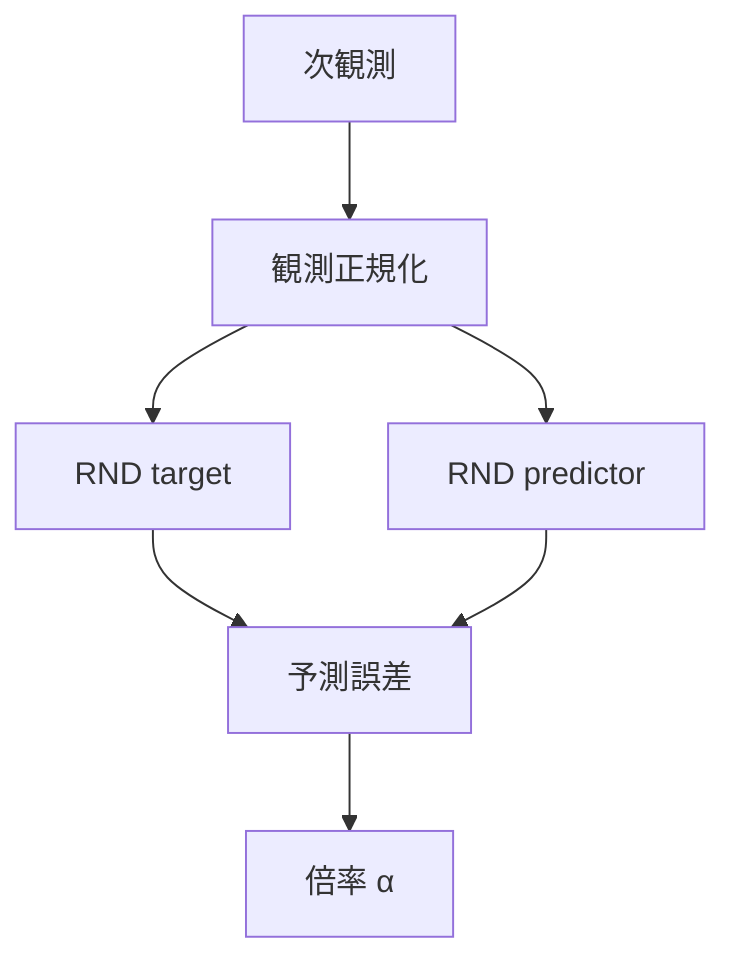
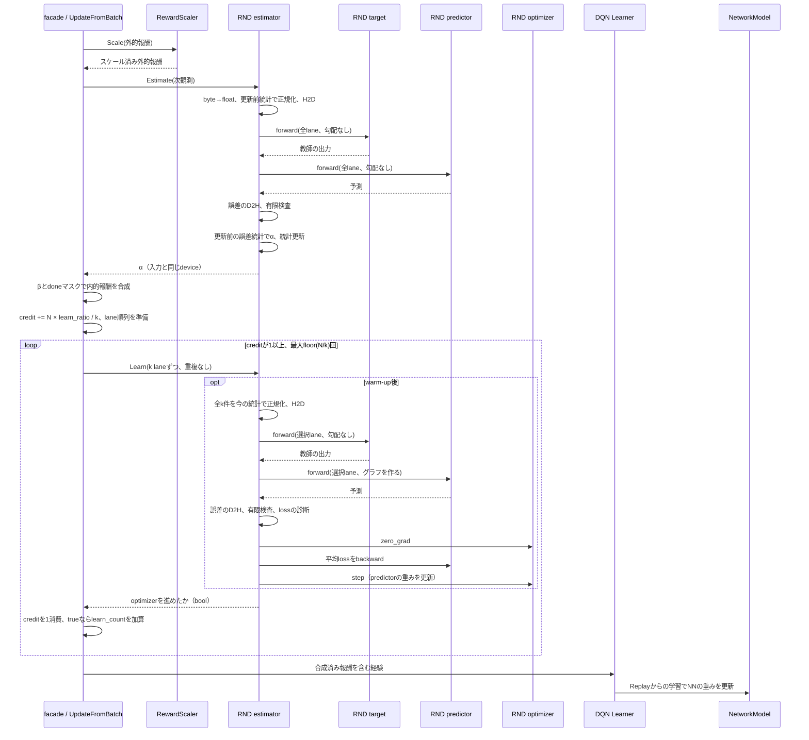

<!-- translated-from: 212_rnd_lifelong_novelty.jp.md blob:abe064e96656b01fbbff91ae54f55301a0bf4960 date:2026-11-07 progress:chapter 0/5 -->
<!-- Translation pending: the Japanese source now includes separate networks, selectable statistics/observations/multipliers, and checkpoint format 3. The body below retains the previously verified translation. -->
# Novelty Estimation and Intrinsic Reward with RND

> Primary perspective: connect basic concepts and algorithmic background to ANET's scoring, reward composition, auxiliary learning, and persistence.
>
> Scope: standalone RND intrinsic reward added to `DefaultDQNAgent`. This describes the implementation as of 2026-11-07.

RND **uses a small model that learns the answers to a fixed problem, giving an exploration bonus to observations whose answers it cannot yet reproduce well**. It adds a learning signal separate from the environment's score, encouraging visits to places not yet sufficiently experienced.

This document starts from the basics for readers unfamiliar with reinforcement learning or RND. See §2 for concepts, §3 for the connection between calculations and implementation, and §4 for configuration and metrics. The overall DQN specification is in [200 DQN Agents](200_dqn_agents.en.md).

## 1. Terminology

### 1.1 Reinforcement Learning Basics

| Term | Meaning |
| --- | --- |
| Reinforcement learning | Learning how to choose actions that earn more future reward, using actions and the rewards they produce. |
| Environment (Env) | The system in which actions execute, such as a game or maze. It produces observations and rewards in response to actions. |
| Observation / next observation | Information the Agent receives, such as an image or position. A next observation is obtained after executing an action. It need not expose the entire internal environment state. |
| Agent / policy | An Agent combines action selection and learning. A policy is a rule for selecting actions from observations. |
| Extrinsic reward | Scores or success/failure evaluations supplied by the environment, representing the task ultimately to be achieved. |
| Intrinsic reward / bonus | Additional evaluation computed by the Agent to encourage exploration. Here, a bonus is the nonnegative value actually added to training reward. |
| Training reward | Reward passed to the learner. Here it is scaled extrinsic reward plus the bonus. |
| Exploration / exploitation | Exploration investigates unknown outcomes; exploitation chooses actions already known to be good. |
| Episode | One continuous trial from environment start to end. It may also be truncated, for example by a time limit. |
| Q value / DQN | A Q value estimates future reward after choosing an action in a state. DQN (Deep Q-Network) learns this estimate with a neural network. |

### 1.2 RND and Computation

| Term | Meaning |
| --- | --- |
| Neural network / weights | A model mapping inputs to numerical outputs, and the numbers defining that mapping. Learning adjusts the weights. |
| Random / seed | Random values use a random-number generator. A seed is its initial value for reproducing a sequence. |
| Distillation | Training one model to reproduce another's outputs. In RND, the model being reproduced is randomly constructed. |
| RND | Random Network Distillation: predict a fixed random model's output and estimate observation novelty from the error. |
| RND target | The fixed teacher: a model mapping observations to numerical vectors that the predictor should reproduce. |
| RND predictor | A model trained to reproduce the RND target's output from the same input. |
| Feature vector | A numerical representation of an observation. Individual RND target outputs need not have human-readable meanings. |
| Prediction error / MSE | The difference between prediction and teacher output. MSE (mean squared error) squares the differences and averages over elements. |
| Loss / auxiliary learning | Loss is the quantity minimized by learning. Auxiliary learning here reduces predictor error separately from the main action-value learning. |
| Mean / standard deviation | The mean describes the center; standard deviation describes spread. The same difference is relatively larger when the usual spread is smaller. |
| Observation normalization | Aligning input scales. The current default subtracts each component's mean and divides using its standard deviation. |
| Clip / multiplier α | Clipping limits values to lower and upper bounds. Multiplier α is the novelty score constrained to `[1, L]`. |
| β / L | β controls bonus strength. L is the upper bound of multiplier α. |
| Warm-up | An initial period for collecting statistics. Here RND produces no bonus and does not update the predictor during this period. |
| NGU | Never Give Up: a method combining episodic and lifelong novelty and learning policies with different exploration strengths. |

### 1.3 ANET Implementation Terms

| Term | Meaning |
| --- | --- |
| Actor | The component selecting actions from observations. It does not call RND directly here. |
| Facade | The outer interface coordinating internal components. Here `DefaultDQNAgent::UpdateFromBatch` preprocesses rewards. |
| DQN Learner | The inner learner for Q values. It uses rewards composed by the facade. |
| ReplayBuffer | Stores experience for later learning. Experience includes observations, actions, rewards, and next observations. |
| Batch / lane | A batch is a set of observations processed together; a lane is one environment position within it. B is the lane count. |
| Intake / N / k / credit | An intake is the experience set received by the facade in one call. N is its lane count; k is the number supplied to one auxiliary-learning step. Credit accumulates fractional learning steps, with each unit allowing one step. |
| Tensor / shape / TensorDict | A tensor is a multidimensional numerical array; shape gives its axis lengths. TensorDict maps names such as `vector` and `grid` to tensors. |
| Body / Head | The Network's feature-extraction stage and final output stage. RND's Body is configurable; its Head linearly maps features to the specified dimension. |
| Network / NetworkModel | ANET's `Network` is a computational model with a Body and Head. DQN's `NetworkModel` groups Q-learning models and synchronization; it does not own RND. |
| Conv2d / MLP / fully connected layer / ReLU / Flatten | Conv2d handles local image patterns; an MLP stacks fully connected layers. Fully connected layers combine input components, ReLU sets negative values to zero, and Flatten merges axes within an observation. |
| Frame stacking | Combining observations from consecutive times into one model input, exposing motion and other information difficult to infer from one frame. |
| Forward / backward / gradient | Forward computes outputs from inputs; backward computes per-weight gradients from loss. A gradient describes how changing a weight changes loss. |
| Optimizer / AdamW | An optimizer updates weights using gradients. AdamW adjusts update magnitudes using past gradient statistics and also handles weight decay. |
| Computation graph | The connected operations performed during forward, retained for gradient computation during backward. |
| CPU / GPU / CUDA / FP32 | CPUs perform general computation; GPUs process many operations in parallel. CUDA is the NVIDIA GPU execution platform; FP32 is 32-bit floating point. |
| libtorch | PyTorch's C++ library. ANET uses it for tensor computation, Network training, and persistence. PyTorch provides these machine-learning operations. |
| GridMaze / LunarLander / Atari / Kung-Fu Master | GridMaze is a grid maze; LunarLander is a landing-control environment. Atari denotes the console and its games; Kung-Fu Master is the game used in this validation. |
| Checkpoint | Saved models and learning state for resuming training, beyond weights alone. |
| NaN / nullopt | NaN represents a value that is currently unavailable. `nullopt` means the requested metric itself is not provided. |
| Run / metrics | A Run is one experiment execution; metrics are measurements recorded during it. |
| ProfiledValue / exp_step | ProfiledValue specifies a constant or time-varying setting. `exp_step` counts experience collected for learning and is used here to evaluate β. |
| done / truncated | `done` marks termination; `truncated` marks truncation, for example by a time limit. This document refers to the values reaching the facade. |

## 2. Background: Why Reward Novelty?

### 2.1 Providing Direction Before Earning Points

Consider a maze that rewards only reaching the goal. Before the first success, both revisiting a dead end and entering a new passage give extrinsic reward 0. Reward-only learning has little evidence to distinguish them.

A small bonus for rarely experienced observations can help. If entering a new passage gives higher training reward, Q-value learning may make actions toward that passage more likely. RND approximates “not yet sufficiently experienced” through prediction difficulty.

This extra reward does not change the environment's goal. However, **it changes the reward optimized by the learner**. Exploration can reduce extrinsic scores, so check bonus production and improvement on the intended task separately.

### 2.2 Learning Fixed Answers

RND initializes the teacher's weights randomly and never updates them. The predictor takes an observation and reproduces the teacher's output. Errors should fall on sufficiently trained similar inputs and remain larger on inputs outside that training, serving as a novelty signal. This structure comes from [the RND paper, §2.2](https://arxiv.org/pdf/1810.12894).

In the maze example, the teacher defines exercises mapping each image to a numerical vector. The predictor practices on visited images. Progress is measurable without the Agent supplying environment-specific ground-truth labels.

If every teacher answer were the same constant, the predictor could simply output it, making it hard to distinguish practiced observations. A randomly initialized Network provides input-dependent answers. The teacher need not know game strategy; the predictor needs to learn the observation-dependent mapping.

What remains fixed is **the teacher's transformation of the same numerical input**. It does not generate a new random answer each time. Changing answers would leave persistent errors despite repeated practice, making insufficient experience hard to identify.

The predictor also does not predict the next screen. It already receives the observation obtained after the action and predicts the teacher's output for that observation. This differs from predicting future environmental changes.

### 2.3 Novelty Is Not a Visit Count

The implementation measures current predictor error, not a table of visit counts. Interpret it accordingly:

- **A first visit can score low.** Training on similar observations may already enable prediction.
- **A revisit can score high.** Training may be insufficient, or learning other observations may have changed the prediction.
- **Visual change need not help the task.** Numerically novel information need not lead toward the goal.
- **The same raw observation's error can change even with a fixed teacher.** Input-normalization statistics change alongside predictor weights.

Thus, high error means “hard for the current RND to predict,” not necessarily “unvisited,” “important,” or “a place that improves scores.”

### 2.4 Lifelong and Episodic Novelty Forget Different Things

Here, lifelong novelty refers to **learning history over the lifetime of one estimator**. Predictor weights and cumulative statistics are not reset at episode boundaries. All lanes of the same Agent share one estimator, so learning in one lane affects novelty in others. Restoring a checkpoint continues this history.

Episodic novelty can instead treat a location as not yet visited when a new trial begins. This difference matters when familiar passages must be crossed to reach unexplored regions.

NGU multiplies episodic reward by a lifelong-novelty factor. ANET does not currently implement that complete method. It borrows the multiplier form but adds `β × (α − 1)` to enable standalone RND comparisons. [NGU paper, §2, Equation (1)](https://arxiv.org/pdf/2002.06038)

| Aspect | Current ANET choice |
| --- | --- |
| Core RND mechanism | Error between a fixed teacher and a trainable predictor |
| Making error scale manageable | Measure relative magnitude using the historical error mean and standard deviation |
| Multiplier | NGU-style `[1, L]`; `alpha` in code is the clipped value |
| Training-reward composition | Add `β × (α − 1)` to scaled extrinsic reward |
| Episodic visit memory / a family of policies with different exploration strengths | Not included in this implementation |

## 3. Mechanism: Connecting Formulas and Code

### 3.1 Feeding the Same Input to Two Networks

First normalize the next observation specifically for RND, then pass the same input to target and predictor.

For one lane, let x be its normalized observation, f the teacher, g the predictor, and d the output dimension. The code uses this error:

$$
e(x)=\frac{1}{d}\sum_{j=1}^{d}\left(g(x)_j-f(x)_j\right)^2
$$

`j` indexes output-vector components; d defaults to 128. Squaring and averaging component differences produces one nonnegative value per lane.

| Location | Shape | Meaning |
| --- | --- | --- |
| Observation | `[B, ...]` | B observations; trailing axes depend on images, vectors, and other inputs |
| Body output `features` | `[B, F]` | Each observation converted into F features |
| Target / predictor output | `[B, d]` | Answers and predictions for each observation |
| Error after `mean(-1)`, multiplier | `[B]` | One value per lane |

`RndHeadFactory` checks during construction's trial calculation that Body output has two axes. An extra axis such as `[B, T, F]` would leave `[B, T]` after averaging the last axis, which cannot be used as per-lane reward.

The entry point is [`RndNoveltyEstimator::Estimate`](../../core/anet-core/src/intrinsic_rnd.cpp). Target and predictor have separate weights. Target gradient computation is disabled, and it uses a mode without training-state updates. Neither shares weights with the Q-value Network.

Both currently use the same Body configuration and output dimension but different named seeds for initialization. Teacher weights are not copied into the predictor: identical initial mappings would match before practice and eliminate error as a novelty signal.

### 3.2 Two Distinct Normalizations

RND maintains two statistics with different purposes.

| Statistics | Subject | Purpose |
| --- | --- | --- |
| Observation statistics | Each input component | Prevent coordinate, velocity, pixel, and other numerical scales from directly dominating prediction difficulty |
| Error statistics | Per-lane MSE | Interpret model- and training-dependent errors relative to their usual values |

Default observation normalization approximately computes `(value − mean) / standard deviation` per component, clipping to `[-5, 5]`. This adjusts component scales without removing intercomponent correlations. Statistics belong to RND, so changing Q-input normalization does not modify shared RND statistics.

The actual divisor is `sqrt(var) + epsilon` in [`RunningMeanStd::GetStd`](../../core/anet-core/src/scaler_impl.hpp). RND observation normalization also defaults to the common `epsilon=1.0`. Do not substitute a textbook formula assuming a tiny epsilon. Initial mean and variance are 0 and 1.

Noncategorical `uint8` observations, such as pixels, are converted to floating point inside RND before normalization. Categorical observations follow existing observation-specification and normalization handling.

Error statistics aggregate all lanes into one cumulative statistic. They retain information from all previously scored batches, not just a recent window. They use `epsilon=0`; zero standard deviation is handled specially as described next.

### 3.3 From Error to Multiplier to Bonus

Let e be current error, and μ_e and σ_e the error mean and standard deviation **before adding this batch**. After warm-up, when statistics are available, compute:

$$
\alpha=\operatorname{clip}\left(1+\frac{e-\mu_e}{\sigma_e},\ 1,\ L\right)
$$

This measures how many standard deviations the error exceeds its usual value, then adds 1.

- At or below the mean, the lower bound yields `α=1`.
- One standard deviation above the mean yields `α=2`.
- Even large errors cannot exceed L, which defaults to 5.
- During warm-up, without scoring history, or when `σ_e=0`, every lane gets `α=1`.

The facade converts the multiplier into a bonus:

$$
b_i=\begin{cases}
0 & \text{if lane }i\text{ has done = true}
\\
\beta\,(\alpha_i-1) & \text{otherwise}
\end{cases}
$$

$$
r_i^{\mathrm{learn}}=\operatorname{RewardScale}(r_i^{\mathrm{ext}})+b_i
$$

`i` is the lane index, `r_ext` the environment's extrinsic reward, and `RewardScale` the existing reward-scaling operation. Subtracting 1 makes the familiar-observation baseline `α=1` produce zero extra reward. With current β=0.1 and L=5, bonuses lie in `[0, 0.4]`. Extrinsic reward is not multiplied by α, so even zero-extrinsic-reward transitions can receive bonuses.

Lanes with `done` still participate in scoring, statistics updates, and auxiliary learning. Only **the amount added to reward** becomes zero. `truncated=true` alone does not zero it; when both are true, `done` makes it zero.

### 3.4 Score First, Become Familiar Later

Operation order changes the bonus from the same observation and is therefore part of the algorithm.

| Order | Operation | State used or updated |
| ---: | --- | --- |
| 1 | Scale extrinsic reward | Existing reward scaler |
| 2 | Normalize next observations | RND observation statistics before including current observations |
| 3 | Compute errors from target and predictor outputs | Predictor weights before updating |
| 4 | Compute multiplier α | Error statistics before adding current errors |
| 5 | Update cumulative observation/error statistics and scored-observation count | Add all current lanes |
| 6 | Evaluate β, mask done, and add bonuses | `counts.exp_step` and current α |
| 7 | Facade adds credit, selects k lanes per available learning step, and calls `Learn` | Observation statistics updated in step 5; normalize and forward all k inputs on each call, learning with a fresh graph |
| 8 | Pass experience with composed rewards to the inner Learner | Existing Q-learning and ReplayBuffer path |

Training the predictor first would score observations after becoming familiar with them. Adding current errors to the statistics first would let each observation alter its own comparison baseline. The implementation avoids both, scoring against prior state.

`Estimate` also performs step 5. It is not a read-only query, but retains no computation graph. `Learn` computes independently from supplied observations, reading current observation statistics without updating them. Consequently, the same raw observation can normalize differently during scoring and learning.

The facade calls `Estimate` once for all intake observations, then `Learn` zero or more times according to credit. The public API itself requires neither identical observations nor a fixed order or count. For example, two scoring calls can precede learning on different observations, and `Learn` alone can train when warm-up is absent or complete. `Learn` returns true if the optimizer advances and false during warm-up. The interface can also support future separation of action-time scoring and auxiliary learning from Replay observations.

### 3.5 Warm-up and Lane Sampling

Default `warmup_steps=12,800` counts **scored observations**. Scoring B observations adds B; through the facade, this uses the same unit as exp steps. N=128 takes 100 intakes and N=64 takes 200 to collect 12,800 observations. `Learn` cannot finish warm-up by itself because it does not update observation statistics. With zero warm-up, the first `Learn` call trains.

α uses the pre-scoring count, returning 1 for all lanes below the threshold while still updating statistics. `Learn` returns false when the post-scoring count is at or below the threshold, so the intake reaching exactly 12,800 does not advance the optimizer. Normal scoring and learning start with the next intake. A batch crossing the threshold is scored as a whole; learning eligibility uses the resulting count.

The facade owns learning cadence. Let k be `min(learn_batch_size,N)`; add `N × learn_ratio / k` to credit per intake. Each full unit permits one step on k observations, retaining fractional credit. At default ratio 0.25 and batch size 32, N=128 gives one step per intake, while N=64 gives one every two intakes: both train on 32 observations once per 128 experiences. If N is below batch size, construction warns once and shrinks the batch to N; equal step counts are then not guaranteed.

Sampling creates one lane permutation per intake and takes chunks of k. No lane repeats across steps, which are capped at `floor(N/k)`. If N is not divisible by k and the cap is reached, unspent credit, including its integer part, carries forward. Each `Learn` call consumes credit even if it returns false, preventing catch-up training after warm-up. Only successful true results increment `learn_count`.

All lanes are scored and included in statistics. RND `Learn` does no sampling: it normalizes all k supplied observations, forwards them through target and predictor, and backpropagates mean loss. Intakes without learning retain `predictor_loss` from the latest successful step; before any learning it is NaN.

### 3.6 Connection to DQN and the Two Targets

The diagram shows one intake with CPU observations and CUDA computation. H2D transfers CPU to GPU; D2H transfers GPU to CPU; CPU computation omits these transfers. CUDA inputs move to CPU before normalization, and multipliers return to the input device. The facade completes RND `Learn` calls before passing experience to the inner Learner. The Learner updates its NN only when existing Replay and update-interval conditions hold. RND auxiliary learning and DQN NN updates use separate weights and optimizers.

| Comparison | DQN target network | RND target |
| --- | --- | --- |
| Output | Action-value estimates | Feature vectors for the predictor to reproduce |
| Purpose | Construct Q-learning targets | Fix the exercises used to measure novelty |
| Weight changes | Updated from the Q-learning Network by the configured method | Fixed after initialization |
| Owner | DQN `NetworkModel` | `RndNoveltyEstimator` |

Despite the shared name, RND target must not enter DQN synchronization. Reducing predictor error and changing Q values using training rewards are separate learning processes and do not share an optimizer.

### 3.7 Bonuses Stored in Replay Are Not Rescored

Experience arriving at the facade receives extrinsic reward plus bonus, passed to ReplayBuffer as one reward. Later sampling does not recompute the bonus with a newer predictor.

For example, a transition receiving bonus 0.2 when collected retains that bonus in its stored training reward even after the location becomes familiar. It need not match the bonus for visiting now. Changing β also does not rewrite rewards already in Replay.

This avoids changing Replay's format but prevents later separate handling of extrinsic and intrinsic rewards. It is an implementation choice, not an inherent RND restriction.

### 3.8 Reading the Implementation

| Question | File or operation | Connection to the background |
| --- | --- | --- |
| What callers can access | `LifelongNoveltyEstimator` and Factory in [`intrinsic.hpp`](../../core/anet-core/include/anet/intrinsic.hpp) | Expose multiplier scoring, auxiliary learning, diagnostics, and persistence while hiding RND-specific composition |
| Where reward is added | `UpdateFromBatch` in [`default_dqn_agent.cpp`](../../core/anet-core/src/default_dqn_agent.cpp) | Add after existing reward scaling |
| Learning cadence and sampling | `UpdateFromBatch` in [`default_dqn_agent.cpp`](../../core/anet-core/src/default_dqn_agent.cpp) | Facade owns credit and RNG with named seed `intrinsic.learn`, supplying k observations at a time |
| What RND owns | [`intrinsic_rnd.hpp`](../../core/anet-core/src/intrinsic_rnd.hpp) | Target, predictor, optimizer, two statistics, and scored-observation count |
| Scoring and learning order | `Estimate` / `Learn` in [`intrinsic_rnd.cpp`](../../core/anet-core/src/intrinsic_rnd.cpp) | Update statistics after scoring; learning computes independently from supplied observations and current statistics |
| Exact normalization | [`scaler_impl.cpp`](../../core/anet-core/src/scaler_impl.cpp) and [`scaler_impl.hpp`](../../core/anet-core/src/scaler_impl.hpp) | Use shared normalization, cumulative statistics, and persistence |
| Contract verification | [`intrinsic_test.cpp`](../../core/anet-core/src/intrinsic_test.cpp) | Test fixed teacher, learning, update order, reward addition, and restoration through public paths |

DefaultDQN interprets `intrinsic.enabled`, `intrinsic.beta`, `intrinsic.learn_ratio`, and `intrinsic.learn_batch_size`. RND-specific settings go to the Factory and are interpreted by `RndNoveltyEstimatorConfig`. Reward composition and learning cadence are separated from novelty computation and auxiliary learning itself.

## 4. Examples: Reading Values, Settings, and Metrics

### 4.1 A Four-Lane Calculation

Assume warm-up has finished, historical error mean is 0.20, standard deviation is 0.10, L=5, and β=0.1. The following errors and rewards are illustrative, not Run measurements.

| Lane | Current error e | Unclipped `1+(e−0.20)/0.10` | α | done | Scaled extrinsic reward | Added bonus | Training reward |
| ---: | ---: | ---: | ---: | --- | ---: | ---: | ---: |
| 0 | 0.10 | 0 | 1 | false | 0 | 0 | 0 |
| 1 | 0.30 | 2 | 2 | false | −0.1 | 0.1 | 0 |
| 2 | 0.80 | 7 | 5 | false | 1 | 0.4 | 1.4 |
| 3 | 0.60 | 5 | 5 | true | −1 | 0 | −1 |

Lane 1 receives a positive bonus but training reward is zero after the extrinsic penalty cancels it. Lane 3 has high error but no bonus because it is done. Statistics updates use errors from all four lanes.

Here `bonus_mean` is `(0+0.1+0.4+0)/4=0.125` and `bonus_max` is 0.4. `clip_ratio` counts lanes with α equal to L, including done lane 3, so it is `2/4=0.5`.

### 4.2 Which Computations Settings Change

Keys below omit `DefaultDQNAgent.`. Defaults correspond to [`agent.txt`](../../apps/runner/config/agent.txt) and the RND configuration type.

| Key | Default | Effect and notes |
| --- | ---: | --- |
| `intrinsic.enabled` | false | False creates no estimator and does not interpret β or other RND settings |
| `intrinsic.beta` | 0.1 | Coefficient multiplying `α−1`; nonnegative ProfiledValue. Zero does not stop scoring or auxiliary learning |
| `intrinsic.rnd.output_dim` | 128 | Target/predictor vector dimension, at least 1 |
| `intrinsic.rnd.multiplier_max` | 5 | Multiplier upper bound L; finite and greater than 1 |
| `intrinsic.learn_ratio` | 0.25 | Auxiliary-learning observations per collected experience; finite, greater than 0 and at most 1 |
| `intrinsic.learn_batch_size` | 32 | Observations per auxiliary-learning step; integer at least 1. See §3.5 for shrinking to N |
| `intrinsic.rnd.warmup_steps` | 12,800 | Observation count for collecting statistics only; nonnegative |
| `intrinsic.rnd.learning_rate` | 0.0001 | Predictor learning rate; finite and positive |
| `intrinsic.rnd.weight_decay` | 0 | Predictor AdamW weight decay; finite and nonnegative |
| `intrinsic.rnd.obs_norm.clip_range` | 5 | Clipping range after observation normalization; separate from α upper bound L |
| `intrinsic.rnd.net.*` | Supplied by each environment's `run.@rnd` | RND inputs and Body; not a direct reuse of Q Network settings |

`learn_ratio` and `learn_batch_size` change optimizer-step counts and observations per step, affecting how quickly error falls. They are not merely speed settings. β changes reward magnitude for the same α; L changes the multiplier cap for large errors. Distinguish where each acts.

### 4.3 Structure Selected by `run.@rnd`

Appending `run.@rnd` to an existing Run chain jointly selects RND enablement, a dedicated Body, and nine metrics. It does not specify a complete environment and Q-learning configuration by itself. See [100 Runtime and Configuration](100_runtime_and_configuration.en.md) for configuration-chain semantics.

| Environment configuration | RND input | Default Body |
| --- | --- | --- |
| [Atari.txt](../../apps/runner/config/Atari.txt) | `grid` | `Conv2d_S > ReLU > Conv2d_M > ReLU > Flatten` |
| [GridMaze.txt](../../apps/runner/config/GridMaze.txt) | `vector` | `Flatten > MLP_FC1 > ReLU > MLP_FC2 > ReLU` |
| [LunarLander.txt](../../apps/runner/config/LunarLander.txt) | `vector` | Same as above |

`Conv2d_S` / `Conv2d_M` and `MLP_FC1` / `MLP_FC2` name configurations in the common layer catalog. The Body extracts image or vector features; RND appends a Head with `output_dim` outputs.

RND receives next observations directly from the environment, not Actor-preprocessed Q inputs. For Atari as well, distinguish Q-input frame stacking from RND input.

### 4.4 Reading Metrics Together

The following maps `GetScalar` keys to configured recording destinations. Prefix keys with `intrinsic.` and destinations with `56_agent_in/`.

| Key | Destination | Measurement |
| --- | --- | --- |
| `bonus_mean` | `01_bonus_mean` | Batch mean of the bonus actually added after done masking |
| `bonus_max` | `02_bonus_max` | Maximum of that bonus |
| `bonus_share` | `03_bonus_share` | Total bonus divided by total absolute extrinsic reward plus total bonus |
| `error_mean` | `11_error_mean` | Cumulative error mean after adding the current batch |
| `error_std` | `12_error_std` | Cumulative error standard deviation after adding the current batch |
| `error_step` | `13_error_step` | Current error mean over all lanes |
| `clip_ratio` | `21_clip_ratio` | Fraction of lanes whose current α equals L, before done masking |
| `predictor_loss` | `31_predictor_loss` | Pre-update mean error of the latest successful auxiliary-learning step; NaN before learning |
| `learn_count` | `32_learn_count` | Cumulative successful optimizer steps; warm-up false results do not count |

`bonus_share` uses the following ratio, not a mean of individual lane ratios:

$$
\mathrm{bonus\_share}=\frac{\sum_i b_i}{\sum_i |r_i^{\mathrm{scaled}}|+\sum_i b_i}
$$

A zero denominator yields NaN. In §4.1, it is `0.5/(2.1+0.5) ≈ 0.1923`. Absolute extrinsic rewards reduce instability caused by cancellation of positive and negative rewards.

Example interpretations:

- Falling `predictor_loss` and `error_step` indicate progress in predicting inputs. Their values usually differ because the former uses selected lanes and the latter all lanes.
- Low `bonus_mean` can reflect below-usual error, warm-up, small β, many done lanes, or other factors. Do not infer the cause from one metric alone.
- Persistently high `clip_ratio` means many observations receive the same capped multiplier. Check current errors, cumulative statistics, and input normalization together.
- `error_mean` / `error_std` are post-scoring statistics, unlike the old statistics used for current α. Substituting values from the same log row cannot exactly reproduce the score.

Disabled RND keys return `nullopt`. When enabled, `learn_count` starts at 0, and intakes without learning retain the latest loss. Scores before first scoring and losses before learning are NaN. This intentional unavailability differs from abnormally nonfinite computed errors, which stop processing when detected during scoring or learning. With N at least batch size and no intake-cap constraint, the post-warm-up incremental ratio of `learn_count / exp_step` is `learn_ratio / learn_batch_size`.

### 4.5 Saving and Resuming

Predictor weights alone cannot restore RND. Changing the teacher changes the answers; changing statistics changes relative novelty; changing sampling state changes which lanes are practiced.

After identifier `RndNoveltyEstimator-2`, RND saves target, predictor, optimizer, observation-normalization statistics, cumulative error statistics, and scored-observation count. The Agent then saves facade unspent credit, lane-sampling RNG state, and cumulative successful steps. RND comes first so its validation rejects incompatible formats. Outside an active call, saving/restoring is allowed before first scoring, between `Estimate` and `Learn`, or immediately after `Learn`. No computation graph carries over. Latest diagnostic loss is not saved and remains NaN after loading until the first successful step.

Agent checkpoints containing RND append `;intrinsic` to the existing identifier. Loading fails if the saved checkpoint has RND but the reader disables it, or vice versa. Disabled mode uses the previous format.

Loading restores predictor optimizer training state, then applies the current learning rate and weight decay. Resuming with changed values therefore differs from continuing identical training.

## 5. Current Status and Limitations

### 5.1 Computation Placement and Cost

RND target, predictor, and facade lane sampling use separate named seeds. Ordinary weight initialization currently uses the default CPU generator, so construction temporarily saves its state, seeds it, and restores the state afterward. Models are constructed on CPU and moved to the required device.

Inputs may reside on CPU or CUDA. RND moves observations to CPU for normalization, then sends them to the Factory's computation device. Finite-error checks and statistics run on CPU; returned α uses the input device. The facade selects lanes first, and `Learn` normalizes/transfers all k supplied observations. CUDA-input selection indices are sent asynchronously from pinned memory once per intake; there are no synchronous per-lane transfers.

RND owns independent FP32 models. Scoring performs two forwards on all N observations; each auxiliary step performs two forwards and one backward on k observations. After warm-up, without hitting the cap, average steps per intake are `N × learn_ratio / k`. Default N=128 gives one step on 32 observations. Learning needs fresh forwards because scoring graphs are not reused. Actual speed differences remain unmeasured, and observation-statistics updates still duplicate normalization through the existing API.

Scoring and auxiliary learning occur per batch independently of Q-learning step counts, so increasing the Q-update interval need not reduce RND cost proportionally. Profiling separates sampling, normalization, input transfer, target/predictor forward, error transfer, statistics, backward, and optimizer step.

With `learner.enabled=false`, scoring and auxiliary learning pause with one warning. If intrinsic reward is enabled, components still exist for persistence. Diagnostics use a value-transfer mechanism without adding a new learning-lock wait for display.

### 5.2 Verified Scope

When scoring and auxiliary learning were separated, the full Debug build and 21 tests / 998 assertions under `[prd116],[scaler]` passed, covering independent operations, different learning inputs, CPU/CUDA input and computation-device combinations, and persistence between operations. Validation of the 2026-11-07 cadence and batch-size changes is recorded separately in [22impl](../memo/116_rnd_lifelong_novelty_22impl.md).

For those changes, the full Debug build, 28 related tests / 1293 assertions, and 11 shipped-configuration tests / 2583 assertions passed. Checks covered four learning steps over eight observations from the same 32 experiences with N=2/4, post-learning weights for k nonrepeating CPU/CUDA inputs, credit consumption during warm-up, loss retention, and restoring fractional credit and sampling state. Full-key comparisons of seven configurations found only the intended 28 differences.

The following table records initial validation on 2026-11-06, before separating scoring and auxiliary learning. Details are in the [initial implementation record](../memo/116_rnd_lifelong_novelty_20impl.md), post-separation validation in the [public-API revision record](../memo/116_rnd_lifelong_novelty_21impl.md), and rerun entry points in [PRD116 validation assets](../../core/anet-core/testdata/prd116/README.md). Repeating disabled-mode checksums across four environments was deferred because it would conflict with an active Run; no smoke or performance measurements were made for the latest changes. Enabled-mode learning sequences differ from the earlier implementation.

| Check | Result and scope |
| --- | --- |
| Debug build and related tests | 28 tests / 3160 assertions passed, including RND, normalization, and shipped configuration |
| Fixed teacher and predictor | Confirmed unchanged target weights/outputs and predictor learning after 100 updates on identical input |
| Save/resume | Checked CPU/CUDA, normalization, scoring counts, sampling, and optimizer-setting handling |
| Disabled-mode equivalence | 105,682 training-metric points and metric definitions matched the previous implementation across GridMaze, LunarLander, Atari, and DropMerge |
| GridMaze short smoke | Completed 100,000 experiences; confirmed bonuses and a decreasing-error trend |
| Atari Kung-Fu Master short smoke | Completed 100,000 experiences; eight exposed metrics were finite, and multiplier `clip_ratio` peaked at 0.125 without sticking at 1 |
| Performance | Not measured because another Run was active; execution-speed impact remains unknown |

Whole-file bytes of disabled-mode checkpoints differ even between reruns of the old executable, owing to parameter-address information saved by existing libtorch. Validation compared header, configuration, and Network bytes, plus optimizer contents excluding address-related metadata. It does not claim whole-file byte equality.

### 5.3 What Remains Unproven

Short smoke runs establish the connection between computation, reward addition, learning, and recording. They do not demonstrate improved extrinsic performance, resolution of difficult-game exploration problems, or acceptable performance cost.

Motivation to revisit familiar paths, episodic novelty, separate extrinsic/intrinsic learning, and families of policies with different exploration strengths remain separate from this standalone RND implementation. Related options and open questions are in [PRD924](../memo/924_intrinsic_reward_novelty_10prd.md).

### 5.4 Sources and Related Documents

- [Burda et al., Exploration by Random Network Distillation](https://arxiv.org/pdf/1810.12894), §2.2: source for fixed-teacher/predictor novelty estimation.
- [Badia et al., Never Give Up: Learning Directed Exploration Strategies](https://arxiv.org/pdf/2002.06038), §2, Equation (1): source for lifelong novelty as a multiplier.
- [PRD116](../memo/116_rnd_lifelong_novelty_10prd.md), [initial implementation (20impl)](../memo/116_rnd_lifelong_novelty_20impl.md), [public-API revision (21impl)](../memo/116_rnd_lifelong_novelty_21impl.md), and [cadence/batch-size revision (22impl)](../memo/116_rnd_lifelong_novelty_22impl.md): adopted contracts, implementation decisions, and validation. See 21impl for independent Estimate/Learn and device/persistence contracts, and 22impl for credit, observation counts, and bool results.
- [200 DQN Agents](200_dqn_agents.en.md): Agent specification including the stages surrounding intrinsic-reward integration.
- [110 Agents and Learning](110_agents_and_learning.en.md), [130 Neural Networks](130_neural_networks.en.md), and [150 ReplayBuffer](150_replay_buffer.en.md): specifications of shared components used here.
