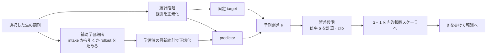

<!-- translated-from: 212_rnd_lifelong_novelty.jp.md blob:15e0599a079bdcf962f39332f82a0349422f4304 date:2026-11-27 progress:done -->
# Novelty Estimation and Intrinsic Reward with RND

RND trains a predictor to reproduce the output of a fixed Network. It gives intrinsic reward to observations with large prediction error, providing a cue for exploring rarely experienced states even before the environment yields any points. This document covers RND in DefaultDQNAgent.

## 1. Scoring and Auxiliary-Learning Flow



The estimator returns a multiplier for each lane. When scoring next observations with `use_done_mask` true, the Coordinator sets the value of done lanes to 0 and passes the values through the intrinsic reward scaler. The composed reward adds that value multiplied by β. In configurations with value decomposition, the value before β weighting is also passed to intrinsic value learning. Replay keeps the reward fixed at intake. [Value decomposition](214_value_decomposition.en.md)

## 2. Stages and Modes

The scopes below are written after `DefaultDQNAgent.intrinsic.`.

| Stage | Scope | Mode | Options under the mode |
| --- | --- | --- | --- |
| Statistics | `rnd.statistics` | `mode = whiten\|variance_feedback` | Observation normalization for whiten; observation clip and multiplier clip for feedback |
| Error | `rnd.error_norm` | `mode = standardize\|none` | Centering, error statistics, warm-up, and multiplier clip for standardize; warm-up and multiplier clip for none |
| Predictor | `rnd.predictor` | — | `warmup_steps` and the predictor's `net.*` |
| Auxiliary learning | `learn` | `mode = intake\|rollout` | Ratio and batch for intake; length, epochs, ratio, batch, and timing for rollout |

`observation` selects the raw observation from `next_state` or `state`. Configure the target structure with `rnd.target.net.*`, both Heads with `rnd.head.*`, and the predictor optimizer with `rnd.learning_rate`, `rnd.weight_decay`, and `rnd.adam_eps`. Reward composition is determined by `beta`, `use_done_mask`, `reward_scaler.*`, `value_mode`, and `value.head.*`.

## 3. Observations, Errors, and Multipliers

The normalized observation is fed to the same target and predictor. With output dimension $d$, each lane yields $e = \sum_{j=1}^{d}(g(x)_j-f(x)_j)^2/d$.

| Statistics | Error | Multiplier after the warm-up ends |
| --- | --- | --- |
| whiten | standardize | $1 + (e - \mu_e)/\sigma_e$. Without centering, $1 + e/\sigma_e$ |
| whiten | none | $1 + e$ |
| variance_feedback | Feedback formula | $1 + z$, where $z$ is obtained from error statistics updated recursively in lane order |

whiten reads the observation and error statistics as they were before scoring and updates them after scoring. With standardize, the multiplier is 1 when the error statistics are empty or the standard deviation is 0. Cumulative statistics use every error entered into the statistics. EMA multiplies the weight of the past by $1-1/\mathrm{ema\_steps}$ for each observation. none uses cumulative statistics of the errors after its warm-up ends as diagnostic values. With variance_feedback, `rnd.error_norm.*` plays no part in the multiplier formula in effect.

whiten observation normalization subtracts the per-component mean and divides by `sqrt(var) + epsilon`. The default `epsilon` is 1.0, and observations are clipped to ±5. Noncategorical byte observations are converted to floating point.

In feedback, the observation mean and error mean start at 0, the variance-like values of observations and errors at 1, and the count at 0. Continuous observations are normalized by subtracting the pre-update mean and dividing by the variance, and the clipped values are fed back into the observation statistics. On both the observation and error sides, let v be the value, n the count, and m and q the previous mean and variance-like value; updates proceed in the following order.

```text
n が今回の件数を含むとき
d = v - m
m = m + d / n
q = (q * n + d² * n / (n + 1)) / (n + 1)
```

On the error side, v is e, and z = (e − m) / q is computed from the updated values. The divisor differs from standardization, which uses the standard deviation.

Multiplier clipping limits the multiplier to `[1, multiplier_max]` when `use_clipping` in the corresponding namespace is true. The default is true for standardization (upper bound 5) and false for none and feedback. When clipping is false, the formula's value is used.

## 4. Warm-ups and Scaler Preparation

| Warm-up | Configuration key | Default | During the warm-up |
| --- | --- | ---: | --- |
| Error statistics | `rnd.error_norm.standardize.warmup_steps` | 12,800 | Multiplier 1. Updates to the error statistics are deferred |
| No-division formula | `rnd.error_norm.none.warmup_steps` | 12,800 | The multiplier follows the formula. Values are fed to the scaler, and the reward after the scaler is 0 |
| Predictor | `rnd.predictor.warmup_steps` | 0 | Multiplier 1. The predictor is not updated |

Counts are numbers of scored observations; 0 means active from the start. whiten waits while the count before scoring the batch is below the specified value. The feedback multiplier is judged by per-lane counts. `Learn` returns false while the predictor warm-up is positive and the post-scoring count is at or below it. For each positive warm-up used by the selected modes, the start and the end are each recorded once at INFO.

Once the standardization warm-up ends, errors are entered into the statistics even during the predictor warm-up. When the none and predictor warm-ups are used together, the multiplier is 1 during the predictor warm-up, so the value fed to the scaler is 0. Reward appears once all corresponding warm-ups have ended. The none warm-up works in the same order regardless of the scaler kind. In particular, with `return_std` the standard deviation of intrinsic returns can be estimated before rewards begin.

## 5. Predictor Auxiliary Learning

`intake` draws from the received lanes. With lane count $N$, ratio $r$, and $k$ observations per step, each intake adds $Nr/k$ to credit. While whole credit remains and unused groups remain in the current intake, it draws $k$ observations at a time without duplication. When learning is enabled, $k$ must not exceed the lane count.

`rollout` accumulates raw observations for all lanes over $L$ intakes. Each step learns from $k$ observations. The step count $S = N L r / k$ must be a positive integer divisible by the specified number of epochs $E$. Each epoch shuffles all $NL$ observations and takes $S/E$ groups from the front. An observation is drawn at most once per epoch and can be drawn again in a different epoch. Sampling uses the auxiliary-learning named seed `intrinsic.learn`.

- With `use_spread = false`, all $S$ steps run at once on the $L$-th intake.
- With `use_spread = true`, learning proceeds while the next rollout accumulates. By the end of its $i$-th intake, $\lfloor iS/L \rfloor$ steps on the previous rollout have been completed. The first rollout only accumulates.

`LaneTimeTensorStore` preserves the observation type and device and reads the required tensors by lane and time. Learning uses all $k$ observations normalized with the observation statistics at that time. A step for which `Learn` returns false because of a warm-up is consumed, and the success count `intrinsic.learn_count` is not incremented. In Runs with learning disabled, scoring, accumulation, and auxiliary learning are suspended.

| Quantity | Burda et al. Table 5 | 128-lane rollout default |
| --- | ---: | ---: |
| Rollout length | 128 | 128 |
| Epochs | 4 | 4 |
| Fraction used per epoch | 0.25 | 0.25 |
| Batches per epoch | 4 | 4 |
| Observations per batch | About 1,000 | 1,024 |

The public implementation splits minibatches by lane and keeps observations stochastically. ANET shuffles lane-time pairs and draws a fixed number. [Burda et al. paper](https://arxiv.org/abs/1810.12894)

## 6. Named Combinations

| Setting | Default RND (`run.@rnd`) | Taiga conditions (`run.@rnd_taiga`) | Configuration approaching the Burda conditions |
| --- | --- | --- | --- |
| Statistics and error | whiten, standardize | variance_feedback | whiten, none |
| Multiplier clip | true, 5 | false | false |
| Warm-up | Standardization 12,800; 200,000 for Atari and DropMerge | Predictor 0 | none 16,384 |
| Auxiliary learning | intake, 0.25, 32 | intake, 1, 1 | rollout, 128, 4, 1, 1,024 |
| Observation | next_state, done masked | state | next_state, done also used |
| Reward and value | Constant multiplier, combined | Constant multiplier, combined | return_std, decomposed, intrinsic discount factor 0.99, non-episodic |

To use the default RND, add `run.@rnd` to the Env's Run chain. Atari selects β = 0.03 and DropMerge β = 0.01. GridMaze and LunarLander use the Agent default β = 0.1.

To use the Taiga conditions on Atari, add `run.@rainbow_like > run.@rnd > run.@rnd_taiga` in this order to the existing Run chain. `run.@rainbow_like` selects the Q-side Nature structure and `AtariEnv.noop_max = 0`; `run.@rnd_taiga` sets the scoring and auxiliary learning in the table above plus β = 0.00005 and `DefaultDQNAgent.intrinsic.rnd.adam_eps = 1e-5`. This chain does not specify the lane count.

To approach the Burda conditions, specify the following in a Run with RND enabled. The warm-up below assumes 128 lanes.

```text
DefaultDQNAgent.intrinsic.rnd.error_norm.mode = none
DefaultDQNAgent.intrinsic.rnd.error_norm.none.warmup_steps = 16,384
DefaultDQNAgent.intrinsic.learn.mode = rollout
DefaultDQNAgent.intrinsic.use_done_mask = false
DefaultDQNAgent.intrinsic.reward_scaler.use_dynamic_scaling = true
DefaultDQNAgent.intrinsic.reward_scaler.dynamic_mode = return_std
DefaultDQNAgent.intrinsic.value_mode = decomposed
DefaultDQNAgent.learner.intrinsic.discount_mode = separate
DefaultDQNAgent.learner.intrinsic.gamma = 0.99
DefaultDQNAgent.learner.intrinsic.terminal_mode = non_episodic
```

## 7. Configuration List

The prefix is the same as in §2. Values for inactive modes are also read and validated for type and range. They are not used for learning or scoring, and no notification is issued. When learning is enabled, the combination with lanes is checked for the selected auxiliary-learning mode.

| Key | Type and range | Default | What changes |
| --- | --- | --- | --- |
| `rnd.statistics.mode` | whiten / variance_feedback | whiten | Observation statistics and the feedback formula |
| `rnd.statistics.whiten.obs_norm.*` | Observation-normalization settings; clip_range finite and positive | clip_range 5 | whiten observation normalization |
| `rnd.statistics.variance_feedback.obs_norm.clip_range` | Finite and positive | 5 | Upper bound of normalized observations in feedback |
| `rnd.statistics.variance_feedback.use_clipping` | Boolean | false | Multiplier clip in feedback |
| `rnd.statistics.variance_feedback.multiplier_max` | Finite and greater than 1 | 5 | Upper bound of the feedback multiplier |
| `rnd.error_norm.mode` | standardize / none | standardize | Error formula in whiten |
| `rnd.error_norm.standardize.use_centering` | Boolean | true | Whether to subtract the error mean |
| `rnd.error_norm.standardize.average_mode` | cumulative / ema | cumulative | How error statistics are computed |
| `rnd.error_norm.standardize.ema_steps` | Integer ≥ 1 | 1,000,000 | EMA weight |
| `rnd.error_norm.standardize.warmup_steps` | Integer ≥ 0 | 12,800 | Observations to wait before aggregating errors |
| `rnd.error_norm.standardize.use_clipping` | Boolean | true | Multiplier clip in standardize |
| `rnd.error_norm.standardize.multiplier_max` | Finite and greater than 1 | 5 | Upper bound of the standardize multiplier |
| `rnd.error_norm.none.warmup_steps` | Integer ≥ 0 | 12,800 | Observations during which the scaler is prepared and reward is 0 |
| `rnd.error_norm.none.use_clipping` | Boolean | false | Multiplier clip in none |
| `rnd.error_norm.none.multiplier_max` | Finite and greater than 1 | 5 | Upper bound of the none multiplier |
| `rnd.predictor.warmup_steps` | Integer ≥ 0 | 0 | Observations to wait before updating the predictor |
| `learn.mode` | intake / rollout | intake | How auxiliary-learning data is collected |
| `learn.intake.ratio` | Finite, $0 < r \le 1$ | 0.25 | Learning observations per experience |
| `learn.intake.batch_size` | Integer ≥ 1 | 32 | Observations per intake learning step |
| `learn.rollout.length` | Integer ≥ 1 | 128 | Intakes to accumulate |
| `learn.rollout.epochs` | Integer ≥ 1 | 4 | Rollout shuffle count |
| `learn.rollout.ratio` | Finite, $0 < r \le E$ | 1.0 | Learning observations per experience |
| `learn.rollout.batch_size` | Integer ≥ 1 | 1,024 | Observations per rollout learning step |
| `learn.rollout.use_spread` | Boolean | false | Run all at once, or spread over the next rollout |

## 8. Network Structure Diagrams

Runs with RND enabled record the following files in `dot/` at the same time as the primary structure diagrams. detail uses the same visualization settings as primary.

- `intrinsic.rnd.target.net.structure.dot`
- `intrinsic.rnd.target.net.detail.dot`
- `intrinsic.rnd.predictor.net.structure.dot`
- `intrinsic.rnd.predictor.net.detail.dot`

## 9. Background, Implementation, and Validation

### 9.1 Terminology

#### Reinforcement Learning Basics

| Term | Meaning |
| --- | --- |
| Reinforcement learning | Learning how to choose actions that earn more future reward, using actions and the rewards they produce. |
| Environment (Env) | The system in which actions execute, such as a game or maze. It produces observations and rewards in response to actions. |
| Observation / next observation | Information the Agent receives, such as an image or position. A next observation is obtained after executing an action. It need not expose the entire internal environment state. |
| Agent / policy | An Agent combines action selection and learning. A policy is a rule for selecting actions from observations. |
| Extrinsic reward | Scores or success/failure evaluations supplied by the environment, representing the task ultimately to be achieved. |
| Intrinsic reward / bonus | Evaluation computed by the Agent to encourage exploration and added to training reward. Nonnegative with the default clipping; can also be negative with clipping disabled. |
| Training reward | Reward passed to the learner. Here it is scaled extrinsic reward plus the bonus. |
| Exploration / exploitation | Exploration investigates unknown outcomes; exploitation chooses actions already known to be good. |
| Episode | One continuous trial from environment start to end. It may also be truncated, for example by a time limit. |
| Q value / DQN | A Q value estimates future reward after choosing an action in a state. DQN (Deep Q-Network) learns this estimate with a neural network. |

#### RND and Computation

| Term | Meaning |
| --- | --- |
| Neural network / weights | A model mapping inputs to numerical outputs, and the numbers defining that mapping. Learning adjusts the weights. |
| Random / seed | Random values use a random-number generator. A seed is its initial value for reproducing a sequence. |
| Distillation | Training one model to reproduce another's outputs. In RND, the model being reproduced is randomly constructed. |
| RND | Random Network Distillation: predict a fixed random model's output and estimate observation novelty from the error. |
| RND target | The fixed teacher: a model mapping observations to numerical vectors that the predictor should reproduce. |
| RND predictor | A model trained to reproduce the RND target's output from the same input. |
| Feature vector | A numerical representation of an observation. Individual RND target outputs need not have human-readable meanings. |
| Prediction error / MSE | The difference between prediction and teacher output. MSE (mean squared error) squares the differences and averages over elements. |
| Loss / auxiliary learning | Loss is the quantity minimized by learning. Auxiliary learning here reduces predictor error separately from the main action-value learning. |
| Mean / variance / standard deviation | The mean describes the center. Variance is the mean of squared deviations from the mean, and standard deviation is its square root. The same difference is relatively larger when the usual spread is smaller. whiten divides by the standard deviation and variance_feedback by the variance, so their multipliers differ. |
| Observation normalization | Aligning input scales. The current default subtracts each component's mean and divides using its standard deviation. |
| Clip / multiplier α | Clipping limits values to lower and upper bounds. Multiplier α is a score with baseline 1: the default clipping keeps it in `[1, L]`, while with clipping disabled it remains `1+z`. |
| β / L | β controls bonus strength. L is the upper bound of multiplier α. |
| Warm-up | A period of waiting from the start until a specified count. What waits is determined by the stage and the selected mode (§4). |
| NGU | Never Give Up: a method combining episodic and lifelong novelty and learning policies with different exploration strengths. |

#### ANET Implementation Terms

| Term | Meaning |
| --- | --- |
| Actor | The component selecting actions from observations. It does not call RND directly here. |
| Facade | The outer interface coordinating internal components. Here `DefaultDQNAgent::UpdateFromBatch` is the entry point and delegates intrinsic reward to `IntrinsicRewardCoordinator`. |
| `IntrinsicRewardCoordinator` | Private nested DefaultDQN component owning the estimator, beta schedule/latest value, credit, lane-selection RNG, successful learning count, and diagnostics; handles scoring, auxiliary learning, persistence, and Trace. |
| DQN Learner | The inner learner for Q values. It uses rewards composed by the facade. |
| ReplayBuffer | Stores experience for later learning. Experience includes observations, actions, rewards, and next observations. |
| Batch / lane | A batch is a set of observations processed together; a lane is one environment position within it. B is the lane count. |
| Intake / N / k / credit | An intake is the experience set received by the facade in one call. N is its lane count; k is the number supplied to one auxiliary-learning step. Credit accumulates fractional learning steps, with each unit allowing one step. |
| Tensor / shape / TensorDict | A tensor is a multidimensional numerical array; shape gives its axis lengths. TensorDict maps names such as `vector` and `grid` to tensors. |
| Body / Head | The Network's feature-extraction stage and final output stage. RND's Body is configurable; its Head linearly maps features to the specified dimension. |
| Network / NetworkModel | ANET's `Network` is a computational model with a Body and Head. DQN's `NetworkModel` groups Q-learning models and synchronization; it does not own RND. |
| Conv2d / MLP / fully connected layer / ReLU / Flatten | Conv2d handles local image patterns; an MLP stacks fully connected layers. Fully connected layers combine input components, ReLU sets negative values to zero, and Flatten merges axes within an observation. |
| Frame stacking | Combining observations from consecutive times into one model input, exposing motion and other information difficult to infer from one frame. |
| Forward / backward / gradient | Forward computes outputs from inputs; backward computes per-weight gradients from loss. A gradient describes how changing a weight changes loss. |
| Optimizer / AdamW | An optimizer updates weights using gradients. AdamW adjusts update magnitudes using past gradient statistics and also handles weight decay. |
| Computation graph | The connected operations performed during forward, retained for gradient computation during backward. |
| CPU / GPU / CUDA / FP32 | CPUs perform general computation; GPUs process many operations in parallel. CUDA is the NVIDIA GPU execution platform; FP32 is 32-bit floating point. |
| libtorch | PyTorch's C++ library. ANET uses it for tensor computation, Network training, and persistence. PyTorch provides these machine-learning operations. |
| GridMaze / LunarLander / Atari / Kung-Fu Master | GridMaze is a grid maze; LunarLander is a landing-control environment. Atari denotes the console and its games; Kung-Fu Master is the game used in this validation. |
| Checkpoint | Saved models and learning state, beyond weights alone, for transfer to a new Run. |
| NaN / nullopt | NaN represents a value that is currently unavailable. `nullopt` means the requested metric itself is not provided. |
| Run / metrics | A Run is one experiment execution; metrics are measurements recorded during it. |
| ProfiledValue / exp_step | ProfiledValue specifies a constant or time-varying setting. `exp_step` counts experience collected for learning and is used here to evaluate β. |
| done / truncated | `done` marks termination; `truncated` marks truncation, for example by a time limit. This document refers to the values reaching the facade. |

### 9.2 Background

#### Providing Direction Before Earning Points

Consider a maze that rewards only reaching the goal. Before the first success, both revisiting a dead end and entering a new passage give extrinsic reward 0. Reward-only learning has little evidence to distinguish them.

A small bonus for rarely experienced observations can help. If entering a new passage gives higher training reward, Q-value learning may make actions toward that passage more likely. RND approximates “not yet sufficiently experienced” through prediction difficulty.

This extra reward does not change the environment's goal. However, **it changes the reward optimized by the learner**. Exploration can reduce extrinsic scores, so check bonus production and improvement on the intended task separately.

#### Learning Fixed Answers

RND initializes the teacher's weights randomly and never updates them. The predictor takes an observation and reproduces the teacher's output. Errors should fall on sufficiently trained similar inputs and remain larger on inputs outside that training, serving as a novelty signal. This structure comes from [the RND paper, §2.2](https://arxiv.org/pdf/1810.12894).

In the maze example, the teacher defines exercises mapping each image to a numerical vector. The predictor practices on visited images. Progress is measurable without the Agent supplying environment-specific ground-truth labels.

If every teacher answer were the same constant, the predictor could simply output it, making it hard to distinguish practiced observations. A randomly initialized Network provides input-dependent answers. The teacher need not know game strategy; the predictor needs to learn the observation-dependent mapping.

What remains fixed is **the teacher's transformation of the same numerical input**. It does not generate a new random answer each time. Changing answers would leave persistent errors despite repeated practice, making insufficient experience hard to identify.

The predictor also does not predict the next screen. It already receives the observation obtained after the action and predicts the teacher's output for that observation. This differs from predicting future environmental changes.

#### Novelty Is Not a Visit Count

The implementation measures current predictor error, not a table of visit counts. Interpret it accordingly:

- **A first visit can score low.** Training on similar observations may already enable prediction.
- **A revisit can score high.** Training may be insufficient, or learning other observations may have changed the prediction.
- **Visual change need not help the task.** Numerically novel information need not lead toward the goal.
- **The same raw observation's error can change even with a fixed teacher.** Input-normalization statistics change alongside predictor weights.

Thus, high error means “hard for the current RND to predict,” not necessarily “unvisited,” “important,” or “a place that improves scores.”

#### Lifelong and Episodic Novelty Forget Different Things

Here, lifelong novelty refers to **learning history over the lifetime of one estimator**. Predictor weights and cumulative statistics are not reset at episode boundaries. All lanes of the same Agent share one estimator, so learning in one lane affects novelty in others. Restoring a checkpoint continues this history.

Episodic novelty can instead treat a location as not yet visited when a new trial begins. This difference matters when familiar passages must be crossed to reach unexplored regions.

NGU multiplies episodic reward by a lifelong-novelty factor. ANET does not currently implement that complete method. It borrows the multiplier form but adds `β × (α − 1)` to enable standalone RND comparisons. [NGU paper, §2, Equation (1)](https://arxiv.org/pdf/2002.06038)

| Aspect | Current ANET choice |
| --- | --- |
| Core RND mechanism | Error between a fixed teacher and a trainable predictor |
| Making error scale manageable | Default uses the historical mean and standard deviation; `variance_feedback` is selectable for comparison with Taiga et al. |
| Multiplier | The default with clipping follows NGU's `[1, L]`; with clipping disabled it returns `1+z` unchanged |
| Training-reward composition | Add `β × (α − 1)` to scaled extrinsic reward |
| Episodic visit memory / a family of policies with different exploration strengths | Not included in this implementation |

### 9.3 RND Network

The observation at the selected time point is passed as a single frame to both target and predictor. When used for auxiliary learning, it is normalized with the latest statistics at that time.

For one lane, let x be its normalized observation, f the teacher, g the predictor, and d the output dimension. The code uses this error:

$$
e(x)=\frac{1}{d}\sum_{j=1}^{d}\left(g(x)_j-f(x)_j\right)^2
$$

`j` indexes output-vector components; d defaults to 128 in the implementation and is 512 in Atari's `run.@rnd`. Squaring and averaging component differences produces one nonnegative value per lane.

| Location | Shape | Meaning |
| --- | --- | --- |
| Observation | `[B, ...]` | B observations; trailing axes depend on images, vectors, and other inputs |
| Body output `features` | `[B, F]` | Each observation converted into F features |
| Target / predictor output | `[B, d]` | Answers and predictions for each observation |
| Error after `mean(-1)`, multiplier | `[B]` | One value per lane |

`RndHeadFactory` checks during construction's trial calculation that Body output has two axes. An extra axis such as `[B, T, F]` would leave `[B, T]` after averaging the last axis, which cannot be used as per-lane reward.

The entry point is [`RndNoveltyEstimator::Estimate`](../../src/core/base/src/intrinsic_rnd.cpp). Target and predictor have separate weights. Target gradient computation is disabled, and it uses a mode without training-state updates. Neither shares weights with the Q-value Network.

Target and predictor are built separately from the required `intrinsic.rnd.target.net.*` and `intrinsic.rnd.predictor.net.*`. Their Body depth and feature counts may differ, but both project to the shared `head.output_dim` dimensions through a Head. Head initialization is selected by `intrinsic.rnd.head.init.*`, with xavier as the implementation default. Initialization uses different named seeds, and teacher weights are not copied into the predictor: identical initial mappings would match before practice and eliminate error as a novelty signal.

| Env selecting `run.@rnd` | Input | Body and Head |
| --- | --- | --- |
| [Atari](../../apps/runner/config/Atari.txt) | `grid` | Target uses a dedicated three-layer CNN and Flatten. The predictor adds two more pairs of 512-dimensional Linear and ReLU. Both use a 512-dimensional Head. |
| [GridMaze](../../apps/runner/config/GridMaze.txt), [LunarLander](../../apps/runner/config/LunarLander.txt) | `vector` | Both Bodies use `Flatten > MLP_FC1 > ReLU > MLP_FC2 > ReLU` from `net.branch.@RndMlp`, with the default 128-dimensional Head. |
| [DropMerge](../../apps/runner/config/DropMerge.txt) | `grid` | Three-layer `DMRnd*` CNN and Flatten. The predictor adds two pairs of `DMRndFC` and ReLU. Layering `run.@rnd_vec` also uses `vector`. |

Atari's three convolutional layers have output channels, kernel, and stride of (32, 8, 4), (64, 4, 2), and (64, 3, 1) in order, all with padding 0. A LeakyReLU (negative slope 0.2) follows each layer. The `1 × 84 × 84` input becomes 3,136 dimensions after Flatten. The Linear added to the predictor is `AtariRndFC`. Conv, FC, and Head use orthogonal initialization with gain √2 and bias 0. In total, the target has 1,677,984 parameters and the predictor 2,203,296.

### 9.4 Reading Metrics Together

The following maps `GetScalar` keys to configured recording destinations. Prefix keys with `intrinsic.` and destinations with `56_agent_in/`.

| Key | Destination | Measurement |
| --- | --- | --- |
| `bonus_mean` | `01_bonus_mean` | Batch mean of bonuses actually added; done is masked only for next_state with use_done_mask=true |
| `bonus_max` | `02_bonus_max` | Maximum of that bonus |
| `bonus_share` | `03_bonus_share` | Absolute bonus sum divided by absolute scaled-extrinsic plus absolute bonus sums |
| `bonus_min` | `04_bonus_min` | Minimum bonus actually added, possibly negative with clipping disabled |
| `bonus_pos_ratio` | `05_bonus_pos_ratio` | Fraction of lanes receiving a positive bonus |
| `error_mean` | `11_error_mean` | Error mean used for the next batch: cumulative or EMA in whiten, NaN while empty |
| `error_std` | `12_error_std` | Corresponding error standard deviation, NaN while empty |
| `error_step` | `13_error_step` | Current error mean over all lanes |
| `target_feature_var` | `14_target_feature_var` | Mean cumulative population variance over target-output dimensions; zero for the first observation |
| `target_feature_max` | `15_target_feature_max` | Maximum absolute target output in the current batch |
| `clip_ratio` | `21_clip_ratio` | Fraction of lanes whose current α equals L, before done masking; 0 with clipping disabled |
| `predictor_loss` | `31_predictor_loss` | Pre-update mean error of the latest successful auxiliary-learning step; NaN before learning |
| `learn_count` | `32_learn_count` | Cumulative steps the optimizer actually advanced; does not increase during the predictor warm-up |

`bonus_share` uses the following ratio, not a mean of individual lane ratios:

$$
\mathrm{bonus\_share}=\frac{\sum_i |b_i|}{\sum_i |r_i^{\mathrm{scaled}}|+\sum_i |b_i|}
$$

A zero denominator yields NaN. If the sum of absolute extrinsic rewards is 2.1 and the sum of absolute intrinsic bonuses is 0.5, it is `0.5/(2.1+0.5) ≈ 0.1923`.

Example interpretations:

- Falling `predictor_loss` and `error_step` indicate progress in predicting inputs. Their values usually differ because the former uses selected lanes and the latter all lanes.
- Low `bonus_mean` can reflect below-usual error, warm-up, small β, many done lanes, or other factors. Do not infer the cause from one metric alone.
- Persistently high `clip_ratio` means many observations receive the same capped multiplier. Check current errors, cumulative statistics, and input normalization together.
- `error_mean` / `error_std` are post-scoring statistics. Whiten's α uses the values before the update, while variance_feedback uses the updated mean and `err_v`. Even for the latter, the published std is the square root of the variance, so do not use the logged std directly as the divisor.

Known keys return `NaN` when RND is disabled or suspended because the learner is disabled. Only unknown keys return `nullopt`. When enabled, `learn_count` starts at 0, and intakes without learning retain the latest loss. Scores before first scoring and losses before learning are NaN. This intentional unavailability differs from abnormally nonfinite computed errors, which stop processing when detected during scoring or learning. With N at least batch size and no intake-cap constraint, the post-warm-up incremental ratio of `learn_count / exp_step` is `learn.intake.ratio / learn.intake.batch_size`.

The plasticity metrics under `34_agent_plasticity` measure the DQN online Network branch selected by `learner.final_feature_branch_key`. The RND target and predictor are outside this measurement.

### 9.5 Computation Placement and Cost

RND target, predictor, and Coordinator lane sampling use separate named seeds. Ordinary weight initialization currently uses the default CPU generator, so construction temporarily saves its state, seeds it, and restores the state afterward. Models are constructed on CPU and moved to the required device.

Inputs may reside on CPU or CUDA. Whiten moves observations to the Factory's computation device for conversion, normalization, and batch statistics for observations and target outputs. Cumulative statistics remain CPU doubles; finite-error checks, α computation, error statistics, and diagnostic assembly also remain on CPU. Returned α uses the input device. The Coordinator selects lanes first, and `Learn` transfers all k supplied observations before conversion and normalization. CUDA-input selection indices are sent asynchronously from pinned memory once per intake; there are no synchronous per-lane transfers.

RND owns independent FP32 models. Scoring performs two forwards on all N observations; each auxiliary step performs two forwards and one backward on k observations. After warm-up, without hitting the cap, average steps per intake are `N × learn.intake.ratio / k`. Default N=128 gives one step on 32 observations. Learning needs fresh forwards because scoring graphs are not reused. Existing GridMaze and Atari performance measurements are given in the next section. Stage 1 results for the statistics-only update interface and device placement, and Stage 2 performance comparisons for the main, secondary, and Taiga configurations after separating the statistics modes, are in the [RFD0130 implementation memo](../memo/0130_rnd_estimate_statistics_perf_20impl.md). Stage 2 used three rounds of alternating fixed executables for each configuration, and all three configurations met the acceptance criteria.

variance_feedback updates observation statistics on CPU in lane order, then forwards the results together. To accumulate target_feature_var, scoring returns the N×head.output_dim target outputs to CPU in addition to errors. The Taiga configuration uses k=1 and ratio=1, so it runs N backwards per intake, a cost very different from the default cadence. Transfer/synchronization estimates and the scope actually confirmed are recorded in [23impl](../memo/0116_rnd_lifelong_novelty_23impl.md). Performance comparison results for the Taiga configuration are in the RFD0130 implementation memo linked above.

Scoring and auxiliary learning occur per batch independently of Q-learning step counts, so increasing the Q-update interval need not reduce RND cost proportionally. Profiling separates sampling, normalization, input transfer, target/predictor forward, error transfer, statistics, backward, and optimizer step. Within scoring statistics, separate zones cover observation-statistics updates, subsequent target-output statistics, and diagnostic reads. Observation normalization separates statistics updates (batch aggregation, transfer, and cumulative merging) from normalization (refreshing statistics, division, postprocessing, and clipping). The scoring caller separates scoring, bonus computation, and diagnostic reads.

With `learner.enabled=false`, scoring and auxiliary learning pause with one INFO per Run. If intrinsic reward is enabled, components still exist for persistence. Aggregate diagnostics use a value-transfer mechanism. With a cloned Actor, Evaluation Trace copies the estimator and beta under the existing periodic synchronization lock, without adding another periodic lock wait. Opening the pane without a snapshot adds one synchronization and can wait for one training intake. An Actor sharing its network waits at each scoring step. This is a developer-approved exception to the UI-thread training-lock rule. If Actor synchronization is moved to training-side snapshot publication, move the estimator and beta with it.

### 9.6 Validation Records

Procedures for before/after comparisons of the configuration migration, loading old checkpoints, and measuring auxiliary-learning wall-clock time are in the [RFD0191 validation assets](../../src/core/base/testdata/rfd0191/README.md).

RFD0130 functional-validation and performance-measurement procedures are in the [validation assets](../../src/core/base/testdata/rfd0130/README.md); results and unperformed checks are in the [implementation memo](../memo/0130_rnd_estimate_statistics_perf_20impl.md). Performance figures below record the executables used at the time of each measurement.

See [RFD0121 validation assets](../../src/core/base/testdata/rfd0121/README.md) for value decomposition, intrinsic scaling, and dynamic-scaler save/restore checks.

See the [RFD0128 validation assets](../../src/core/base/testdata/rfd0128/README.md) for before/after comparisons after the structural separation, continuation from an old checkpoint, and Release performance.

Validation procedures for error statistics, warm-ups, centering, and terminal masking are in the [RFD0123 validation assets](../../src/core/base/testdata/rfd0123/README.md). They record before/after comparisons for the then-current setting that collected errors first, variance_feedback, and disabled RND, along with hand-calculated EMA and save/restore checks.

Validation of the 2026-11-07 changes that added the public-implementation form and options is in [23impl](../memo/0116_rnd_lifelong_novelty_23impl.md), with rerun entry points in [RFD0116 validation assets](../../src/core/base/testdata/rfd0116/README.md). For earlier validation, see [20impl](../memo/0116_rnd_lifelong_novelty_20impl.md), [21impl](../memo/0116_rnd_lifelong_novelty_21impl.md), and [22impl](../memo/0116_rnd_lifelong_novelty_22impl.md). Enabled-mode learning sequences differ from past Runs because of Network and configuration changes.

| Check | Result and scope |
| --- | --- |
| Debug build and related tests | Full build; 50 tests / 4,371 assertions passed. CNN CPU tests used OMP_NUM_THREADS=1 |
| Fixed teacher and predictor | Confirmed unchanged target weights/outputs and predictor learning after 100 updates on identical input |
| Statistics, inputs, and checkpoint save/restore | Confirmed three hand-calculated variance_feedback steps with N=1, sequential updates with N=2, preservation of categorical IDs (alone and mixed with continuous values; int64/uint8/float), scoring and learning with state, negative-bonus ratios, CPU/CUDA inputs for both modes, and checkpoint restoration plus rejection of mode mismatches |
| Shipped configuration | Parameter counts of both Atari Networks, the approximately 33.2 MB checkpoint increase, Conv1d/2d dimensions, and the eight Taiga keys matched |
| Run configuration resolution | Full-key comparison with a saved Montezuma baseline Run. The only differences from rainbow to taiga were 18 RND-setting keys and 13 diagnostic keys. Confirmed noop_max=0, the Nature structure, and the absence of Munchausen metrics |
| Disabled-mode equivalence | 105,682 points and metric definitions matched the previous implementation across GridMaze, LunarLander, Atari, and DropMerge |
| GridMaze smoke | Completed 100k experiences, with 5,448 post-learning points, a maximum recorded learn_count of 2,724, and no invalid nonfinite metric values, meeting the revised criteria of completion, finiteness, and auxiliary-learning progress. Because the observation is a normalized (x, y) pair on a fixed board, the default bonus becomes 0 once the predictor becomes familiar with the limited inputs and novelty is exhausted; sign and decrease are not judged |
| KFM smoke | Completed 100k experiences with the new three-layer CNN (r5, run with 32 lanes to satisfy the construction-time check that the auxiliary-learning batch of 32 must not exceed the lane count). clip_ratio over 2,723 post-learning points peaked at 0.344. bonus_share was absent at 402 points, all with bonus_mean 0, because metric output does not write the 0/0 NaN; the check now allows this gap. The 4,008 gaps in r1 have the same form |
| Montezuma smoke | Completed 100k experiences with the Taiga configuration. bonus_min was negative at all 6,233 recorded points, with no invalid nonfinite metric values, meeting the acceptance criteria |
| Performance | Ran three ABBA rounds on GridMaze with CPU, 256 lanes, and Release. The median for 165,632 experiences was 23.261 s without RND and 31.148 s with it (1.339×). Tracy on a separate Run showed RND-section forward 56.47%, backward plus optimizer 35.10%, and statistics 4.72%. The [experiment record](../experiments/default-dqn/gridmaze/2026-11-07_rnd_performance.md) keeps the configuration, variance, and breakdown of every Run. On Atari, three ABC→CBA rounds ran on Montezuma with 64 lanes, CUDA, and Release. The median for 89,984 experiences was 19.019 s without RND, 31.584 s with the default RND (1.661×), and 280.616 s with the Taiga configuration (14.754×). Tracy on separate Runs showed statistics at 62.66% for the default RND, and optimizer step plus backward at 64.63% for the Taiga configuration. The [experiment record](../experiments/default-dqn/atari/2026-11-12_rnd_performance.md) keeps the configuration, variance, and breakdown of every Run |

Whole-file bytes of disabled-mode checkpoints differ even between reruns of the old executable, owing to parameter-address information saved by existing libtorch. Validation compared header, configuration, and Network bytes, plus optimizer contents excluding address-related metadata. It does not claim whole-file byte equality.

#### Learning Effects and Reproduction Scope

Short smoke runs establish the connection between computation, reward addition, learning, and recording. They do not demonstrate improved extrinsic performance, resolution of difficult-game exploration problems, or acceptable performance cost.

Motivation to revisit familiar paths, episodic novelty, and families of policies with different exploration strengths remain separate from this standalone RND implementation. Related options and open questions are in [RFD0173](../memo/0173_intrinsic_reward_novelty_10rfd.md).

run.@rnd_taiga is not a complete reproduction of Taiga et al. either. Q uses IQN rather than C51, the CNN uses VALID rather than SAME padding, and Q embeddings, initialization, PER, the units used to count statistics, and the ALE version also differ. During auxiliary learning, inputs are renormalized with the updated statistics. The list of remaining differences is in the [23impl table](../memo/0116_rnd_lifelong_novelty_23impl.md#%E6%9C%AC%E5%AE%B6%E3%81%A8%E3%81%AE%E6%AE%8B%E3%82%8B%E5%B7%AE).

### 9.7 Saving and Checkpoint Restoration

RND saves the target, predictor, optimizer, observation and error statistics, target-output statistics, and scored-observation count. whiten EMA uses `RndNoveltyEstimator-4`; whiten cumulative, none, and variance_feedback use `RndNoveltyEstimator-3`. The format identifier and statistics mode are checked on load.

The error formula and warm-ups follow the settings in the new Run. A checkpoint saved with cumulative standardization can be read with none. Rollout observations and the position within learning are not saved, so the new Run accumulates observations from an empty store. Unconsumed auxiliary-learning credit, sampling RNG state, success count, and intrinsic reward scaler state are restored. The learning rate, weight decay, and Adam epsilon from the settings in the new Run are applied.

Agent checkpoints containing RND use the `;intrinsic` identifier, and loading checks that the reader's RND enablement matches. See [Value decomposition](214_value_decomposition.en.md) for the scaler and value-decomposition formats.

<a id="46-values-in-evaluation-trace"></a>

### 9.8 Values in Evaluation Trace

DefaultDQN run.@rnd outputs 235 rnd_bonus, 600 rnd_err, and 610 rnd_norm. The columns correspond to the intrinsic reward, the error e, and the pre-clip multiplier minus 1. With none, rnd_norm holds e. During the corresponding warm-ups, rnd_bonus is 0. Lanes with nonfinite errors are treated as unavailable.

Trace scores with the observation statistics and count of the estimator snapshot and reads the current statistics of the intrinsic reward scaler. It updates neither the statistics nor the counts. β uses the value at the Actor synchronization. Actors without a snapshot, such as evaluation-only Actors, read the training-side values. Changing the selected row does not rescore past rows. Measurement conditions and results are recorded in the [RFD0127 validation assets](../../src/core/base/testdata/rfd0127/README.md).

Dropout and DropPath consume shared randomness, so configurations containing them are outside the learning-invariance guarantee even with a cloned Actor. BatchNorm updates stay in a snapshot, but alter training statistics when the Actor does not clone; that case is also outside the guarantee. These layers are neither detected nor warned about. Shipped RND networks contain none of them.

See the [RFD0127 validation assets](../../src/core/base/testdata/rfd0127/README.md) for acceptance and measurement procedures. With KFM's real-time-priority configuration plus `run.@rnd` (128 lanes, CUDA, Release), and the same configuration with `run.@rainbow_like` and `run.@rnd_taiga` layered on top, the pane was measured closed and open three times each, alternating, while EvalPanel kept playing. Each state measured training exp steps/s over 90 seconds starting 25 seconds after the switch, followed by 12 seconds of Tracy zone timings.

| Configuration | Training exp steps/s, closed (median, range) | Open | Observe per call (mean, max) | Of which scoring (`EstimateWithoutUpdate`, mean) | Estimator and β copy per sync |
|---|---|---|---|---|---|
| Normal RND | 3,633 (3,303–3,666) | 3,164 (3,156–3,355) | 2.15–2.25 ms, max 8.9 ms | 1.35–1.39 ms | 166–176 ms |
| Taiga-style | 249 (241–249) | 233 (227–234) | 1.51–1.73 ms, max 12.0 ms | 1.23–1.40 ms | 152–189 ms |

Observe time includes the DQN step diagnostics it calls internally (mean 0.74–0.82 ms for normal RND, 0.26–0.33 ms for Taiga-style). About 50 rows were produced per second. A copy occurs once per periodic Actor sync (every 10 seconds by EvalPanel's default), and almost all of it is the RND estimator copy (`RndNoveltyEstimator::Clone`). With the pane closed, neither scoring nor copying ran. The copy time was about 50 times the few milliseconds estimated by [RFD0127](../memo/0127_eval_trace_intrinsic_reward_columns_10rfd.md).

### 9.9 Sources and Related Documents

- [Burda et al., Exploration by Random Network Distillation](https://arxiv.org/pdf/1810.12894), §2.2: source for fixed-teacher/predictor novelty estimation.
- [Badia et al., Never Give Up: Learning Directed Exploration Strategies](https://arxiv.org/pdf/2002.06038), §2, Equation (1): source for lifelong novelty as a multiplier.
- [RFD0116](../memo/0116_rnd_lifelong_novelty_10rfd.md), [initial implementation (20impl)](../memo/0116_rnd_lifelong_novelty_20impl.md), [public-API revision (21impl)](../memo/0116_rnd_lifelong_novelty_21impl.md), and [cadence/batch-size revision (22impl)](../memo/0116_rnd_lifelong_novelty_22impl.md): adopted contracts, implementation decisions, and validation. See 21impl for independent Estimate/Learn and device/persistence contracts, and 22impl for credit, observation counts, and bool results.
- [Options and Network fixes aligned with the public implementation (23impl)](../memo/0116_rnd_lifelong_novelty_23impl.md): implementation and validation of separate Networks, selection of statistics/observations/multipliers, Head initialization, Adam eps, diagnostics, and format 3.
- [200 DQN Agents](200_dqn_agents.en.md): Agent specification including the stages surrounding intrinsic-reward integration.
- [110 Agents and Learning](110_agents_and_learning.en.md), [130 Neural Networks](130_neural_networks.en.md), and [150 ReplayBuffer](150_replay_buffer.en.md): specifications of shared components used here.
