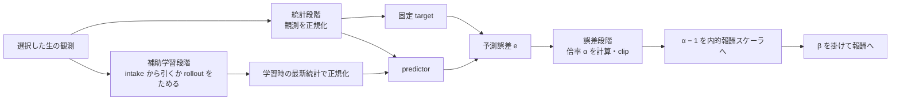

# RND による新しさの評価と内的報酬

RND は固定した Network の出力を predictor に学ばせる。予測誤差が大きい観測に内的報酬を与え、環境から点が得られる前にも、あまり経験していない状態を探索する手掛かりにする。対象は DefaultDQNAgent の RND である。

## 1. 採点と補助学習の流れ



推定器は lane ごとの倍率を返す。Coordinator は次観測で `use_done_mask` が真なら done の lane の値を 0 にし、内的報酬スケーラを通す。合成報酬にはその値へ β を掛けて足す。価値を分解する構成では、β を掛ける前の値を内的の価値の学習にも渡す。Replay は intake 時に確定した報酬を保持する。 [価値の分解](214_value_decomposition.jp.md)

## 2. 段階とモード

以下のスコープは `DefaultDQNAgent.intrinsic.` に続けて書く。

| 段階 | スコープ | モード | モードの下で選べるもの |
| --- | --- | --- | --- |
| 統計 | `rnd.statistics` | `mode = whiten\|variance_feedback` | whiten の観測正規化。feedback の観測 clip と倍率 clip |
| 誤差 | `rnd.error_norm` | `mode = standardize\|none` | standardize の中心化、誤差統計、待ち、倍率 clip。none の待ちと倍率 clip |
| predictor | `rnd.predictor` | — | `warmup_steps` と predictor の `net.*` |
| 補助学習 | `learn` | `mode = intake\|rollout` | intake の比率とバッチ。rollout の長さ、エポック、比率、バッチ、実行時機 |

`observation` で `next_state` または `state` の生の観測を選ぶ。target の構造は `rnd.target.net.*`、両方の Head は `rnd.head.*`、predictor の optimizer は `rnd.learning_rate`、`rnd.weight_decay`、`rnd.adam_eps` で設定する。報酬の合成は `beta`、`use_done_mask`、`reward_scaler.*`、`value_mode` と `value.head.*` が決める。

## 3. 観測、誤差と倍率

正規化した観測を同じ target と predictor に入れる。output の次元を $d$ とすると、lane ごとに $e = \sum_{j=1}^{d}(g(x)_j-f(x)_j)^2/d$ を得る。

| 統計 | 誤差 | 待ちが明けたあとの倍率 |
| --- | --- | --- |
| whiten | standardize | $1 + (e - \mu_e)/\sigma_e$。中心化を切ると $1 + e/\sigma_e$ |
| whiten | none | $1 + e$ |
| variance_feedback | feedback の式 | $1 + z$。lane 順に再帰更新した誤差の統計から $z$ を求める |

whiten は採点の前にあった観測統計と誤差統計を読み、採点後に更新する。standardize で誤差統計が空か標準偏差が 0 の場合、倍率は 1 になる。累積は統計に入れた全誤差を使う。EMA は観測 1 件ごとに過去の重みを $1-1/\mathrm{ema\_steps}$ 倍する。none は待ちが明けたあとの誤差の累積統計を診断値に使う。variance_feedback は `rnd.error_norm.*` が有効な倍率の式に関与しない。

whiten の観測正規化は成分ごとの平均を引き、`sqrt(var) + epsilon` で割る。既定の `epsilon` は 1.0、観測の clip は ±5。非カテゴリの byte 観測は浮動小数点に変換する。

feedback の観測平均と誤差平均は 0、観測と誤差の分散に相当する値は 1、件数は 0 から始める。連続観測は更新前の平均を引いて分散で割り、clip した値を観測統計に戻す。観測側と誤差側で、値を v、件数を n、直前の平均と分散に相当する値を m と q とすると、更新は次の順で行う。

```text
n が今回の件数を含むとき
d = v - m
m = m + d / n
q = (q * n + d² * n / (n + 1)) / (n + 1)
```

誤差側では v に e を用い、更新後の値で z = (e − m) / q を作る。これは標準化で標準偏差を使う場合と除数が異なる。

倍率の clip は、該当する名前空間の `use_clipping` が真のときに倍率を `[1, multiplier_max]` に制限する。標準化の既定は真（上限 5）で、none と feedback の既定は偽。clip が偽のときは式の値を使う。

## 4. 待ちとスケーラの準備

| 待ち | 設定キー | 既定 | 待っている間 |
| --- | --- | ---: | --- |
| 誤差の統計 | `rnd.error_norm.standardize.warmup_steps` | 12,800 | 倍率 1。誤差の統計の更新を待つ |
| 割らない式 | `rnd.error_norm.none.warmup_steps` | 12,800 | 倍率は式どおり。スケーラに値を入れ、スケーラを通したあとの報酬を 0 にする |
| predictor | `rnd.predictor.warmup_steps` | 0 | 倍率 1。predictor を更新しない |

件数は採点した観測数で、0 は開始から有効を表す。whiten では batch を採点する前の件数が指定値未満の間に待つ。feedback の倍率は lane ごとの件数で判定する。 `Learn` は、predictor の待ちが正で採点後の件数がその値以下の間、偽を返す。選んだモードが使う正の待ちは、始まりと終わりを INFO で一回ずつ記録する。

標準化の待ちが明ければ、predictor の待ちの間も誤差を統計に入れる。none と predictor の待ちを同時に使う場合、predictor の待ちの間は倍率が 1 なので、スケーラに入る値は 0 になる。対応する待ちがすべて明けると報酬が出る。none の待ちはスケーラの種類によらず同じ順序で働く。特に `return_std` では報酬の出始めまでに内的な収益の標準偏差を見積もれる。

## 5. predictor の補助学習

`intake` は受け取った lane の中から引く。lane 数 $N$、比率 $r$、1 step の件数 $k$ として、intake ごとに credit に $Nr/k$ を足す。整数の credit があり、今の intake に未使用の組が残っている間、重複なしで $k$ 件ずつ引く。学習が有効なときは $k$ を lane 数以下にする。

`rollout` は raw 観測を全 lane ぶんずつ $L$ intake ためる。各 step は $k$ 件を学ぶ。step 数 $S = N L r / k$ は正の整数で、指定したエポック数 $E$ で割り切る。毎エポック全 $NL$ 件をシャッフルして、先頭から $S/E$ 組を取る。同じ観測は同じエポックで最大 1 回、異なるエポックでは再び引ける。抽選は補助学習の名前付き seed `intrinsic.learn` から行う。

- `use_spread = false` では、$L$ 回目の intake で $S$ step を一括実行する。
- `use_spread = true` では、次の rollout をためながら学ぶ。その $i$ 回目の intake の終了までに、前の rollout で $\lfloor iS/L \rfloor$ step を済ませる。最初の rollout では蓄積だけを行う。

`LaneTimeTensorStore` が観測の型と device を保ち、lane と時間で必要な tensor を読み出す。学習はその時点の観測統計で正規化した全 $k$ 件を使う。待ちにより `Learn` が偽を返した step は消費し、成功回数 `intrinsic.learn_count` は増やさない。学習を無効にした Run では採点、蓄積、補助学習を休止する。

| 数え方 | Burda らの表 5 | 128 lane の rollout 既定 |
| --- | ---: | ---: |
| rollout の長さ | 128 | 128 |
| エポック | 4 | 4 |
| 1 エポックに使う割合 | 0.25 | 0.25 |
| 1 エポックのバッチ数 | 4 | 4 |
| 1 バッチの観測数 | 約 1,000 | 1,024 |

公開実装では lane でミニバッチを分け、観測を確率的に残す。ANET は lane と時間の組を並べ替え、決まった件数を引く。 [Burda らの論文](https://arxiv.org/abs/1810.12894)

## 6. 名前のある組み合わせ

| 設定 | 既定 RND（`run.@rnd`） | Taiga 条件（`run.@rnd_taiga`） | Burda 条件に寄せる構成 |
| --- | --- | --- | --- |
| 統計と誤差 | whiten・standardize | variance_feedback | whiten・none |
| 倍率 clip | 真・5 | 偽 | 偽 |
| 待ち | 標準化 12,800、Atari と DropMerge は 200,000 | predictor 0 | none 16,384 |
| 補助学習 | intake、0.25・32 | intake、1・1 | rollout、128・4・1・1,024 |
| 観測 | next_state、done をマスク | state | next_state、done も使う |
| 報酬と価値 | 定数倍・combined | 定数倍・combined | return_std・decomposed、内的の割引率 0.99、非エピソード |

既定の RND を使うには Env の Run 連鎖に `run.@rnd` を加える。Atari は β = 0.03、DropMerge は β = 0.01 を選ぶ。GridMaze と LunarLander は Agent の既定の β = 0.1 を使う。

Atari で Taiga 条件を使うには、既存の Run 連鎖に `run.@rainbow_like > run.@rnd > run.@rnd_taiga` の順で加える。`run.@rainbow_like` が Q 側の Nature 構造と `AtariEnv.noop_max = 0` を選び、`run.@rnd_taiga` が上の表の採点と補助学習に加えて β = 0.00005 と `DefaultDQNAgent.intrinsic.rnd.adam_eps = 1e-5` を設定する。lane 数はこの連鎖で指定しない。

Burda 条件へ寄せる場合は、RND を有効にした Run に次を指定する。以下の待ちは 128 lane の場合である。

```text
DefaultDQNAgent.intrinsic.rnd.error_norm.mode = none
DefaultDQNAgent.intrinsic.rnd.error_norm.none.warmup_steps = 16,384
DefaultDQNAgent.intrinsic.learn.mode = rollout
DefaultDQNAgent.intrinsic.use_done_mask = false
DefaultDQNAgent.intrinsic.reward_scaler.use_dynamic_scaling = true
DefaultDQNAgent.intrinsic.reward_scaler.dynamic_mode = return_std
DefaultDQNAgent.intrinsic.value_mode = decomposed
DefaultDQNAgent.learner.intrinsic.discount_mode = separate
DefaultDQNAgent.learner.intrinsic.gamma = 0.99
DefaultDQNAgent.learner.intrinsic.terminal_mode = non_episodic
```

## 7. 設定の一覧

前置きは §2 と同じ。無効なモード側の値も読み、型と値域を検証する。その値は学習と採点に使わず、通知も出さない。lane との組み合わせは学習が有効な場合に、選択した補助学習のモードで検査する。

| キー | 型・値域 | 既定 | 変わるもの |
| --- | --- | --- | --- |
| `rnd.statistics.mode` | whiten / variance_feedback | whiten | 観測の統計と feedback の式 |
| `rnd.statistics.whiten.obs_norm.*` | 観測正規化の設定。clip_range は有限で正 | clip_range は 5 | whiten の観測正規化 |
| `rnd.statistics.variance_feedback.obs_norm.clip_range` | 有限で正 | 5 | feedback の正規化済み観測の上限 |
| `rnd.statistics.variance_feedback.use_clipping` | 真偽 | 偽 | feedback の倍率 clip |
| `rnd.statistics.variance_feedback.multiplier_max` | 有限で 1 より大きい | 5 | feedback の倍率の上限 |
| `rnd.error_norm.mode` | standardize / none | standardize | whiten での誤差の式 |
| `rnd.error_norm.standardize.use_centering` | 真偽 | 真 | 誤差の平均を引くか |
| `rnd.error_norm.standardize.average_mode` | cumulative / ema | cumulative | 誤差統計の計算法 |
| `rnd.error_norm.standardize.ema_steps` | 整数 ≥ 1 | 1,000,000 | EMA の重み |
| `rnd.error_norm.standardize.warmup_steps` | 整数 ≥ 0 | 12,800 | 誤差の集計を待つ件数 |
| `rnd.error_norm.standardize.use_clipping` | 真偽 | 真 | standardize の倍率 clip |
| `rnd.error_norm.standardize.multiplier_max` | 有限で 1 より大きい | 5 | standardize の倍率の上限 |
| `rnd.error_norm.none.warmup_steps` | 整数 ≥ 0 | 12,800 | スケーラを準備して報酬を 0 にする件数 |
| `rnd.error_norm.none.use_clipping` | 真偽 | 偽 | none の倍率 clip |
| `rnd.error_norm.none.multiplier_max` | 有限で 1 より大きい | 5 | none の倍率の上限 |
| `rnd.predictor.warmup_steps` | 整数 ≥ 0 | 0 | predictor の更新を待つ件数 |
| `learn.mode` | intake / rollout | intake | 補助学習のデータの集め方 |
| `learn.intake.ratio` | 有限で $0 < r \le 1$ | 0.25 | 1 経験あたりの学習件数 |
| `learn.intake.batch_size` | 整数 ≥ 1 | 32 | intake 学習の 1 step の件数 |
| `learn.rollout.length` | 整数 ≥ 1 | 128 | ためる intake 数 |
| `learn.rollout.epochs` | 整数 ≥ 1 | 4 | rollout のシャッフル回数 |
| `learn.rollout.ratio` | 有限で $0 < r \le E$ | 1.0 | 1 経験あたりの学習件数 |
| `learn.rollout.batch_size` | 整数 ≥ 1 | 1,024 | rollout 学習の 1 step の件数 |
| `learn.rollout.use_spread` | 真偽 | 偽 | 一括実行か次の rollout への分散か |

## 8. Network の構造図

RND が有効な Run は、primary の構造図と同じ時機に `dot/` へ次のファイルを記録する。detail は primary と同じ可視化設定を使う。

- `intrinsic.rnd.target.net.structure.dot`
- `intrinsic.rnd.target.net.detail.dot`
- `intrinsic.rnd.predictor.net.structure.dot`
- `intrinsic.rnd.predictor.net.detail.dot`

## 9. 背景、実装と検証

### 9.1 用語

#### 強化学習の基本

| 用語 | 意味 |
| --- | --- |
| 強化学習 | 行動と、その結果得られる報酬を使い、将来にわたって多くの報酬を得る行動の選び方を学ぶ方法。 |
| 環境（Env） | 行動を実行する相手。ゲーム、迷路などで、行動に応じて観測と報酬を生成する。 |
| 観測・次観測 | Agent が環境から取得する情報。画面や位置などで、次観測は行動の実行後に得たものを指す。環境の内部状態すべてが見えるとは限らない。 |
| Agent・方策 | Agent は行動選択と学習をまとめる主体。方策は、観測から行動を選ぶ規則。 |
| 外的報酬 | 環境が与える点数や成功・失敗の評価。最終的に達成したい課題を表す。 |
| 内的報酬・ボーナス | 探索を促すためにAgent側で計算し、学習報酬へ加算する評価。既定のclip を使う方式では非負、clip を切った方式では負の値も取る。 |
| 学習報酬 | 学習器に渡す報酬。今回の実装では、スケール済みの外的報酬とボーナスの和。 |
| 探索・活用 | 探索は未知の結果を調べる行動、活用は既に分かっている良い行動を選ぶこと。 |
| エピソード | 環境の開始から終了までの一続きの試行。途中で制限時間などにより打ち切ることもある。 |
| Q 値・DQN | Q 値は、ある状態で行動を選んだ後に得る将来の報酬の見込み。DQN（Deep Q-Network）は、その見込みをニューラルネットワークで学ぶ方式。 |

#### RND と計算の用語

| 用語 | 意味 |
| --- | --- |
| ニューラルネットワーク・重み | 入力を数値の出力へ変換するモデルと、その変換を決める数値。学習は重みを調整すること。 |
| ランダム・seed | ランダムは乱数を使って値を決めること。seed は乱数列を再現するための初期値。 |
| 蒸留（distillation） | あるモデルの出力を別のモデルに再現させる学習。RND では、再現対象がランダムに作ったモデルになる。 |
| RND | Random Network Distillation の略。固定したランダムなモデルの出力を予測し、その誤差から観測の新しさを見積もる方法。 |
| RND target | RND の固定教師。観測から、predictor が再現すべき数値の並びを作るモデル。 |
| RND predictor | RND target と同じ入力から、その出力を再現するよう学習するモデル。 |
| 特徴ベクトル | 観測を数値の並びとして表したもの。RND target の各出力に、人間が読める意味を割り当てる必要はない。 |
| 予測誤差・MSE | 予測値と教師の値の差。MSE（平均二乗誤差）は、差を二乗し、要素について平均したもの。 |
| 損失・補助学習 | 損失は学習で小さくしたい値。補助学習は、行動の価値を学ぶ主学習とは別に、ここでは predictor の誤差を小さくする学習。 |
| 平均・分散・標準偏差 | 平均は値の中心。分散は平均からのずれを2乗して平均したもので、標準偏差はその平方根。同じ差でも、普段のばらつきが小さければ相対的に大きな差となる。whitenは標準偏差、variance_feedbackは分散で割るため、両者の倍率は異なる。 |
| 観測正規化 | 入力の尺度をそろえる処理。今回の既定は、成分ごとに平均を引き、標準偏差を使って割る。 |
| clip・倍率 α | clipは範囲外の値を上下限へ制限すること。倍率αは1を基準とする採点結果で、既定のclip を使う方式は `[1, L]`、clip を切った方式は `1+z` のままとする。 |
| β・L | β はボーナスの強さを決める係数。L は倍率 α の上限。 |
| warm-up | 開始から指定件数まで待つ期間。待つ処理は段階と選んだモードで決まる（§4）。 |
| NGU | Never Give Up。エピソード内の新しさと学習全体での新しさを組み合わせ、探索の強さが異なる方策を学ぶ手法。 |

#### ANET の実装用語

| 用語 | 意味 |
| --- | --- |
| Actor | 観測から行動を選ぶ部品。今回、RND を直接呼ぶ役割は持たない。 |
| facade | 内側の部品をまとめる外側の窓口。ここでは `DefaultDQNAgent::UpdateFromBatch` が入口となり、内的報酬の処理を `IntrinsicRewardCoordinator` へ委ねる。 |
| `IntrinsicRewardCoordinator` | DefaultDQN の private な入れ子。推定器、βの予定と直近値、credit、lane抽選の乱数、累計学習回数、診断値を持ち、採点・補助学習・保存・Traceを担当する。 |
| DQN Learner | Q 値を学習する内側の学習器。facade が合成した報酬を使う。 |
| ReplayBuffer | 過去の経験を保存し、後から学習用に取り出す部品。経験には観測、行動、報酬、次観測などが含まれる。 |
| batch・lane | batch はまとめて処理する観測の組、lane はその中の1つの環境の位置。B は lane 数。 |
| intake・N・k・credit | intakeはfacadeが1回に受け取る経験の組。Nはそのlane数、kは補助学習1 stepに渡す件数。creditは学習回数を小数で貯める値で、1貯まると1回学習できる。 |
| tensor・shape・TensorDict | tensor は多次元の数値配列、shape は各軸の長さ。TensorDict は `vector` や `grid` などの名前と tensor の対応を持つ。 |
| Body・Head | Network の前段の特徴抽出部と、最後の出力部。RND の Body は設定で選び、Head は特徴を指定次元へ線形変換する。 |
| Network・NetworkModel | ANET の `Network` は Body と Head を持つ計算モデル。DQN の `NetworkModel` は Q 学習用のモデルと同期などをまとめる部品で、RND の所有者ではない。 |
| Conv2d・MLP・全結合層・ReLU・Flatten | Conv2d は画像の局所的な模様を扱う畳み込み層、MLP は全結合層を重ねたモデル。全結合層は入力の各成分を組み合わせて出力を作り、ReLU は負値を0にし、Flatten は観測内の軸をまとめる。 |
| フレーム積層 | 連続する複数時点の観測を1つのモデル入力にまとめる処理。1枚では分かりにくい動きなどを入力へ含める。 |
| 順伝播・逆伝播・勾配 | 順伝播は入力から出力を計算すること。逆伝播は損失から重みごとの勾配を計算すること。勾配は、重みを変えたときに損失がどう変わるかを表す。 |
| optimizer・AdamW | optimizer は勾配を使って重みを更新する処理。AdamW は更新の大きさを過去の勾配の統計から調整し、重みの減衰も扱う方式。 |
| 計算グラフ | 順伝播で行った演算のつながり。逆伝播で勾配を計算するために保持する。 |
| CPU・GPU・CUDA・FP32 | CPU は汎用の演算装置、GPU は多数の演算を並列に処理する装置。CUDA は NVIDIA GPU を利用する実行基盤、FP32 は32ビット浮動小数点数。 |
| libtorch | PyTorch の C++ 向けライブラリ。ANET は tensor 計算、Network の学習や保存に使う。PyTorch はこれらの計算を提供する機械学習基盤。 |
| GridMaze・LunarLander・Atari・Kung-Fu Master | GridMaze は格子状の迷路、LunarLander は着陸制御の環境。Atari はゲーム機とそのゲーム群を指し、Kung-Fu Master は今回の検証に使ったゲーム名。 |
| checkpoint | 学習を再開するために保存したモデルや学習状態。単なる重みの保存より広い。 |
| NaN・nullopt | NaN は「この値は現在成立していない」を表す浮動小数点値。`nullopt` は、問い合わせた指標自体が提供されないことを表す。 |
| Run・メトリクス | Run は1つの実験実行、メトリクスは実行中に記録する指標。 |
| ProfiledValue・exp_step | ProfiledValue は定数や時間変化として指定できる設定値。`exp_step` は学習用に集めた経験数を表すカウンタで、今回 β の評価に使う。 |
| done・truncated | `done` は終端のフラグ、`truncated` は時間制限などによる打ち切りのフラグ。本書では facade に届いた値を基準に説明する。 |

### 9.2 背景

#### 点数を得る前にも、試す方向を作りたい

例えば、ゴールに到着したときだけ点数が付く迷路を考える。ゴールを一度も見つけていない間は、行き止まりを往復しても、新しい通路へ入っても、外的報酬は同じ0である。点数だけを使う学習には、この2つの行動を区別する材料が乏しい。

そこで、あまり経験していない観測に小さなボーナスを付ける。新しい通路へ入る行動の学習報酬が高くなれば、Q 値の学習を通じて、その通路へ向かう行動が選ばれやすくなる可能性がある。RND はこの「まだ十分に経験していない」を、予測の難しさで近似する。

この追加報酬は、環境のゴールを変更するものではない。ただし、**学習器が最適化する報酬は変わる**。探索に熱中して外的な点数が下がることもあり得るため、ボーナスが出たことと、目的の課題が改善したことは別に確認する。

#### 固定した答えを学ばせる

RND の教師は、初期化時にランダムに重みを作り、その後は更新しない。predictor は、観測を入力して教師の出力を再現する。似た入力を十分に学習すれば誤差が小さくなり、学習が及んでいない入力では誤差が大きくなることを、新しさの目安にする。この基本構造は [RND 原論文 §2.2](https://arxiv.org/pdf/1810.12894) による。

迷路の例なら、教師は「この画面にはこの数値の並び」という練習問題を作る。predictor は実際に訪れた画面の問題を練習する。Agent が環境の正解ラベルを用意しなくても、練習の進み具合を測れる。

教師の答えがすべて同じ定数なら、predictor はその定数を出すだけでよく、どの観測を練習したかを区別しにくい。ランダムに初期化した Network を教師にすることで、入力によって答えが変わる問題を用意する。ここで必要なのは教師がゲームの攻略法を知っていることではなく、predictor が観測に応じた対応を学ぶことである。

固定しているのは、**同じ数値入力に対する教師の変換**である。毎回新しい乱数の答えを作るわけではない。答えが毎回変われば、何度練習しても誤差が残り、経験の不足との区別が難しくなる。

また、predictor は「次にどんな画面になるか」を予測していない。行動後に得た観測を既に入力として持ち、その観測に対する教師の出力を予測する。未来の環境の変化を当てる問題とは異なる。

#### 新しさは訪問回数そのものではない

今回の実装が測るのは、訪問回数の表ではなく、predictor の現在の誤差である。このため、次のように読む必要がある。

- **初訪問でも低いことがある。** 似た観測を既に学習していれば、その観測も予測できる。
- **再訪問でも高いことがある。** まだ十分に学習できていない場合や、他の観測の学習によって予測が変わった場合がある。
- **画面の変化が課題に有益とは限らない。** 数値として新しくても、ゴールへ近づく情報とは限らない。
- **固定教師でも、同じ生の観測の誤差は変わる。** predictor の重みに加え、入力の正規化統計も更新されるためである。

したがって、「error が高い」は「現在の RND にとって予測しにくい」を意味する。「未訪問である」「重要である」「そこへ行けば点数が上がる」と同じ意味にはしない。

#### 「一生」と「1エピソード」は、何を忘れるかが違う

今回の「一生の新しさ」は、**1つの estimator が続いている間の学習履歴**を指す。エピソードが終わっても predictor や累積統計をリセットしない。同じ Agent の全 lane が1つの estimator を共有し、どこかの lane で学んだことが他の lane の新しさにも影響する。checkpoint から再開した場合は、その履歴を引き継ぐ。

一方、エピソード内の新しさなら、次の試行が始まったときに「この試行ではまだ訪れていない」を再び評価できる。慣れた通路を通らないと別の未知領域へ到達できない場面では、この違いが重要になる。

NGU はエピソード内の報酬に一生の新しさの倍率を掛ける。現在の ANET は、その全体を実装したものではない。倍率の形を参考にしつつ、RND 単独で比較できるように `β × (α − 1)` を加える設計になっている。[NGU 原論文 §2・式(1)](https://arxiv.org/pdf/2002.06038)

| 比較する部分 | 現在の ANET の選択 |
| --- | --- |
| RND の核となる仕組み | 固定教師と学習する predictor の誤差を使う |
| 誤差を扱いやすい尺度にする方法 | 既定は過去の平均・標準偏差。Taiga比較用に `variance_feedback` を選べる |
| 倍率の扱い | 既定の `clip を使う方式` はNGUに倣う `[1, L]`。`clip を切った方式` は `1+z` をそのまま返す |
| 学習報酬への合成 | `β × (α − 1)` をスケール済み外的報酬へ加える |
| エピソード別の訪問記憶・探索の強さが異なる方策の組 | 今回の実装には含めない |

### 9.3 RND の Network

観測は、選んだ時点の 1 フレームを target と predictor の両方に渡す。補助学習で使うときには、その時点の最新の統計で正規化する。

1 lane の正規化済み観測を `x`、教師を `f`、predictor を `g`、出力の次元を `d` とすると、コードが使う誤差は次の値である。

$$
e(x)=\frac{1}{d}\sum_{j=1}^{d}\left(g(x)_j-f(x)_j\right)^2
$$

`j` は出力ベクトルの成分番号で、実装の既定の `d` は128、Atariの `run.@rnd` は512。各成分のずれを二乗して平均するので、各laneに1個の非負の値ができる。

| 場所 | shape | 意味 |
| --- | --- | --- |
| 観測 | `[B, ...]` | B個の観測。後ろの軸は画像やベクトルなどで変わる |
| Body の出力 `features` | `[B, F]` | 各観測を F 個の特徴へ変換したもの |
| target / predictor の出力 | `[B, d]` | 各観測の答えと予測 |
| `mean(-1)` 後の誤差、倍率 | `[B]` | 各 lane に1つの値 |

`RndHeadFactory` は構築時の試し計算で Body の出力が2軸であることを確認する。余分な軸を残した `[B, T, F]` では、最後の軸を平均しても `[B, T]` となり、lane ごとの報酬として扱えないためである。

コードの入口は [`RndNoveltyEstimator::Estimate`](../../src/core/base/src/intrinsic_rnd.cpp)。target と predictor は別の重みを持ち、target の勾配計算を止め、学習時の状態更新をしないモードに置く。Q 値を計算する Network とは共有しない。

targetとpredictorは、それぞれ必須の `intrinsic.rnd.target.net.*` と `intrinsic.rnd.predictor.net.*` から別々に組む。Bodyの深さや特徴数は異なってよいが、どちらもHeadで共通の `head.output_dim` 次元へ射影する。Headの初期値は `intrinsic.rnd.head.init.*` で選び、実装の既定はxavierである。初期重みには別の名前付きseedを使い、教師の重みをpredictorへコピーしない。同じ変換を初めから持たせれば、練習前から答えが一致し、誤差を新しさの手掛かりにできなくなるためである。

| `run.@rnd` を選ぶ Env | 入力 | Body と Head |
| --- | --- | --- |
| [Atari](../../apps/runner/config/Atari.txt) | `grid` | target は専用の3層 CNN と Flatten。predictor にはさらに512次元の Linear と ReLU を2組足す。両方とも512次元の Head を使う。 |
| [GridMaze](../../apps/runner/config/GridMaze.txt)、[LunarLander](../../apps/runner/config/LunarLander.txt) | `vector` | 両方の Body で `net.branch.@RndMlp` の `Flatten > MLP_FC1 > ReLU > MLP_FC2 > ReLU` を使い、既定の128次元の Head を付ける。 |
| [DropMerge](../../apps/runner/config/DropMerge.txt) | `grid` | `DMRnd*` の3層 CNN と Flatten。predictor に `DMRndFC` と ReLU を2組足す。`run.@rnd_vec` を重ねると `vector` も使う。 |

Atari の3つの畳み込み層は、出力チャネル数・kernel・stride が順に (32, 8, 4)、(64, 4, 2)、(64, 3, 1) で、padding はすべて0。各層の後に LeakyReLU（negative slope 0.2）を置く。入力の `1 × 84 × 84` は Flatten 後に3,136次元になる。predictor に足す Linear は `AtariRndFC`。Conv・FC・Head は直交初期化で gain は √2、bias は0。全体で target は1,677,984、predictor は2,203,296パラメータを持つ。

### 9.4 メトリクスを一緒に読む

`GetScalar` のキーと、設定が登録する記録先の対応は次のとおり。キーの前には `intrinsic.`、記録先の前には `56_agent_in/` が付く。

| キー | 記録先 | 何を測るか |
| --- | --- | --- |
| `bonus_mean` | `01_bonus_mean` | 実際に加えたボーナスのbatch平均。next_state かつ use_done_mask=true でdoneをmaskする |
| `bonus_max` | `02_bonus_max` | 同じボーナスの最大値 |
| `bonus_share` | `03_bonus_share` | ボーナスの絶対値合計が、外的・内的報酬の絶対値合計に占める比率 |
| `bonus_min` | `04_bonus_min` | 実際に加えたボーナスの最小値。clip を切った方式では負にもなる |
| `bonus_pos_ratio` | `05_bonus_pos_ratio` | 正のボーナスを加えたlaneの割合 |
| `error_mean` | `11_error_mean` | 次の batch の採点に使う誤差の平均。whiten は選択した累積か EMA。統計が空なら NaN |
| `error_std` | `12_error_std` | 同じ誤差の標準偏差。統計が空なら NaN |
| `error_step` | `13_error_step` | 今回の全 lane の誤差の平均 |
| `target_feature_var` | `14_target_feature_var` | targetの出力の次元ごとの累積母分散の平均。1 laneずつでも履歴を蓄積し、初回は0 |
| `target_feature_max` | `15_target_feature_max` | 今回のtargetの出力の絶対値の最大 |
| `clip_ratio` | `21_clip_ratio` | 今回のαが上限Lに等しいlaneの割合。done mask前。clip を切った方式では0 |
| `predictor_loss` | `31_predictor_loss` | 直近に成功した補助学習stepの更新前の誤差平均。未学習ならNaN |
| `learn_count` | `32_learn_count` | optimizer が実際に進んだ累計 step 数。predictor の待ちの間は増えない |

`bonus_share` は次の式であり、個々の lane の比率を平均するのではない。

$$
\mathrm{bonus\_share}=\frac{\sum_i |b_i|}{\sum_i |r_i^{\mathrm{scaled}}|+\sum_i |b_i|}
$$

分母が 0 なら NaN とする。外的報酬の絶対値の和が 2.1 で、内的ボーナスの絶対値の和が 0.5 なら `0.5/(2.1+0.5) ≈ 0.1923` になる。

読み方の例:

- `predictor_loss` と `error_step` が下がるなら、入力に対する予測が進んでいる。ただし前者は選択 lane、後者は全 lane なので、値は通常一致しない。
- `bonus_mean` が低い理由は、誤差が普段より小さい、warm-up 中、β が小さい、done が多い、などで変わる。1本の指標だけで原因を決めない。
- `clip_ratio` が高い状態が続くなら、多くの観測が同じ上限の倍率になっている。現在の誤差と累積統計、入力正規化を合わせて確認する。
- `error_mean` / `error_std` は採点後の統計である。whitenのαは更新前の値を使い、variance_feedbackは更新後の平均と `err_v` を使う。後者も公開するstdは分散の平方根なので、ログのstdをそのまま除数にしない。

RND無効時とlearner停止による休止中も、既知キーは`NaN`を返す。未知キーだけを`nullopt`で表す。有効時の `learn_count` は0から始まり、学習しないintakeでも直近lossを保持する。初回採点前の採点値や未学習のlossはNaNになる。NaNは意図された未成立値であり、計算結果の異常な非有限誤差とは区別する。後者は採点時と補助学習時に検出して処理を止める。Nがbatch size以上でintake上限が制約しなければ、warm-up後の `learn_count / exp_step` の増分比は `learn.intake.ratio / learn.intake.batch_size` になる。

### 9.5 計算する場所と費用

名前付きseedは、RNDのtarget・predictorとCoordinatorのlane抽選で分ける。現在の通常の重み初期化はCPUの既定乱数生成器を使うため、構築中だけその状態を退避してseedを指定し、終了時に復元する。CPUで構築したモデルを必要なdeviceへ移す。

入力はCPUでもCUDAでも受け取る。whiten は観測を Factory の計算 device へ送り、変換・正規化・観測と target 出力の batch の集計を行う。累積統計は CPU・倍精度のままで、誤差の有限検査、α の計算、誤差の統計と診断値の組み立ても CPU に残す。返す α は入力と同じ device に置く。Coordinatorは先にlaneを選び、`Learn` は渡された全k件を転送してから変換・正規化する。CUDA入力の選択番号はintakeごとに1回、pinnedメモリから非同期で送る。laneごとの同期転送は置かない。

RNDはFP32で独立したモデルを持つ。採点は全N観測にforwardを2回、補助学習は各k件にforwardを2回とbackwardを1回行う。warm-up後、上限に当たらない場合の平均step数はintakeあたり `N × learn.intake.ratio / k`。既定のN=128なら1回・32件となる。採点のグラフを再利用しないため学習時にもforwardが要る。GridMazeとAtariの既存の性能測定は次節に記す。統計更新専用の口と device 配置を変更したステージ 1 の結果と、統計方式を分けたステージ 2 の主・副・Taiga 設定の性能比較結果は [RFD0130 実装メモ](../memo/0130_rnd_estimate_statistics_perf_20impl.md) にある。ステージ 2 は固定した実行体の交互比較を各条件で 3 巡行い、3 条件とも受入を満たした。

variance_feedbackの観測統計はCPUでlane順に更新し、その結果をまとめてforwardする。target_feature_varを蓄積するため、採点時は誤差に加えてN×head.output_dimのtarget出力をCPUへ戻す。Taiga設定ではk=1・ratio=1なのでintakeあたりN回backwardし、既定の刻みとは費用が大きく異なる。転送・同期の見積もりと実際に確認した範囲は [23impl](../memo/0116_rnd_lifelong_novelty_23impl.md) に記録する。Taiga 設定の性能比較結果は上記の RFD0130 実装メモにある。

Q学習の回数とは別にbatchごとに採点・補助学習するため、Qの更新間隔を大きくしてもRNDの費用が同じ比率で減るとは限らない。計測区間は抽選、正規化、入力転送、target / predictorの順伝播、誤差転送、統計、backward、optimizerのstepを区別する。採点の統計の区間は、内側の観測の統計の更新と、続くtargetの出力の統計、診断値の読み出しを別の区間で測れる。観測の正規化の部品は、統計の更新（batchの集計、転送、累積への合流）と、正規化（統計の作り直し、割り算、後処理、clip）を区別する。採点を呼ぶ側は、採点、ボーナスの計算、診断値の読み出しを区別する。

`learner.enabled=false` ではRunに1回INFOを出して採点と補助学習を休止する。有効設定なら保存状態を扱うための部品は構築される。集約診断の読み取りは値の受け渡し専用の仕組みを使う。Evaluation Traceで写しを持つActorを使うときは、定期の同期と同じロックの中で推定器とβも写すので、定期同期のロック待ちの回数は増えない。paneを開いて写しが無いときは同期が1回入り、学習の入口1回の終わりを待つ。写しを持たないActorではstepごとに待つ。これはUIスレッドの学習ロック禁止規約の、開発者が決めた例外である。Actorの同期全体を学習側が写しを公開する形へ移すときは、推定器とβも一緒に移す。

### 9.6 検証の記録

設定の移行前後の比較、旧 checkpoint の読み込み、補助学習の実時間の測定手順は [RFD0191 検証資材](../../src/core/base/testdata/rfd0191/README.md) にある。

RFD0130 の機能検証と性能測定の手順は [検証資材](../../src/core/base/testdata/rfd0130/README.md)、実施結果と未実施の範囲は [実装メモ](../memo/0130_rnd_estimate_statistics_perf_20impl.md) に置く。以下の性能値は、それぞれの測定当時の実行体による記録である。

価値の分解・内的スケーラ・動的スケーラの保存復元の検証は[RFD0121検証資材](../../src/core/base/testdata/rfd0121/README.md)に置く。

構造の分離後の前後比較、旧checkpointの継続、Releaseの速度は [RFD0128検証資材](../../src/core/base/testdata/rfd0128/README.md)を参照する。

誤差統計・待ち・中心化・終端の mask の検証手順は [RFD0123 検証資材](../../src/core/base/testdata/rfd0123/README.md) にある。当時の誤差を先に集める設定、variance_feedback、RND 無効の前後比較と、EMA の手計算・保存復元を記録している。

公開実装の形と選択肢を追加した2026-11-07の検証は [23impl](../memo/0116_rnd_lifelong_novelty_23impl.md)、再検証の入口は [RFD0116 検証資材](../../src/core/base/testdata/rfd0116/README.md) に置く。過去の検証は [20impl](../memo/0116_rnd_lifelong_novelty_20impl.md)、[21impl](../memo/0116_rnd_lifelong_novelty_21impl.md)、[22impl](../memo/0116_rnd_lifelong_novelty_22impl.md) を参照する。有効時の学習系列はNetworkと設定の変更により過去のRunと異なる。

| 確認 | 結果と範囲 |
| --- | --- |
| Debug ビルド・関連テスト | 全体ビルド、50 tests /4,371 assertions成功。CNNのCPUテストはOMP_NUM_THREADS=1 |
| 固定教師と predictor | 同一入力100回更新後の target 重み・出力の固定と、predictor の学習を確認 |
| 統計・入力・保存再開 | variance_feedbackのN=1手計算3step、N=2逐次更新、カテゴリIDの保持（単独/連続値との混合、int64/uint8/float）、stateの採点と学習、負ボーナスの比率、両モードのCPU/CUDA入力、保存継続とモード不一致拒否を確認 |
| 出荷設定 | Atariの両Networkのパラメータ数と約33.2MBのcheckpoint増分、Conv1d/2dの寸法、Taigaの8 件が一致 |
| Runの設定解決 | 保存済みMontezuma基準Runと全キー比較。rainbowからtaigaへの差はRND設定18 件と診断13 件だけ。noop_max=0、Nature構造、Munchausen指標の不在を確認 |
| 無効時の同一性 | GridMaze・LunarLander・Atari・DropMergeの105,682点と指標定義が変更前と一致 |
| GridMazeのsmoke | 100k経験で完走、学習後5,448点、記録したlearn_countの最大値2,724、指標の不正な非有限値なしで、完走・有限性・補助学習の進行という改訂後の条件を満たす。観測が正規化した(x, y)の2値で盤面固定のため、限られた入力に慣れて新しさが尽きると既定のbonusは0になり、符号と減少は判定しない |
| KFMのsmoke | 新しい3層CNNで100k経験を完走（r5。補助学習のバッチ32がlane数を超えると構築時に止まる検査に合わせ、32 laneで回した）。学習後2,723点のclip_ratioは最大0.344。bonus_shareは402点で欠けたが、すべてbonus_meanが0の点で、0/0のNaNをメトリクスの出力が書かないためである。判定はこの欠けを許す形に直した。r1の4,008点の欠けも同じ形 |
| Montezumaのsmoke | Taiga設定で100k経験を完走。記録6,233点すべてでbonus_minが負、指標の不正な非有限値なしで受入条件を満たす |
| 性能測定 | GridMazeのCPU・256 lane・ReleaseでABBA3巡を実施。165,632経験の中央値はRNDなし23.261秒、あり31.148秒（1.339倍）。別RunのTracyではRND区間のforward56.47%、backward＋optimizer35.10%、統計4.72%。[実験記録](../experiments/default-dqn/gridmaze/2026-11-07_rnd_performance.md)に全Runの設定・ばらつき・内訳を保存。AtariはMontezuma・64 lane・CUDA・ReleaseでABC→CBAを3巡。89,984経験の中央値はRNDなし19.019秒、既定RND 31.584秒（1.661倍）、Taiga設定280.616秒（14.754倍）。別RunのTracyでは、既定RNDは統計が62.66%、Taiga設定はoptimizer stepとbackwardが64.63%。[実験記録](../experiments/default-dqn/atari/2026-11-12_rnd_performance.md)に全Runの設定・ばらつき・内訳を保存 |

無効時 checkpoint のファイル全体のバイト列は、既存の libtorch が保存するパラメータのアドレス情報により、同じ旧実行体の再実行同士でも一致しない。検証では header・設定・Network のバイトと、アドレス等の付随情報を除いた optimizer の内容を比較した。「ファイル全体の完全一致」とは報告しない。

#### 学習効果と再現の範囲

短期動作確認は、計算・報酬加算・学習・記録がつながっていることを確かめるものである。外的な成績が改善すること、難しいゲームの探索問題を解決すること、性能上の費用が許容できることまでは示していない。

特に、一度慣れた経路を再び探索する動機、エピソードごとの新しさ、探索の強さが異なる方策の組は、今回の RND 単独実装とは別の論点である。関連する選択肢と未決は [RFD0173](../memo/0173_intrinsic_reward_novelty_10rfd.md) にある。

run.@rnd_taigaもTaigaらの完全な再現ではない。QはC51でなくIQN、CNNはSAMEでなくVALID paddingであり、Qの埋め込み・初期値・PER・統計を数える単位・ALEの版も異なる。補助学習時には更新後の統計で入力を正規化し直す。残る差の一覧は [23implの表](../memo/0116_rnd_lifelong_novelty_23impl.md#本家との残る差) にある。

### 9.7 保存と再開

RND は target、predictor、optimizer、観測と誤差の統計、target 出力の統計、採点観測数を保存する。whiten の EMA は `RndNoveltyEstimator-4`、whiten の累積・none・variance_feedback は `RndNoveltyEstimator-3` を使う。書式の識別子と統計のモードは読込時に確認する。

誤差の式と待ちは再開時の設定に従う。標準化の累積で保存した checkpoint は none で読める。rollout の観測と学習途中の位置は保存しないため、再開時は空の置き場からため直す。補助学習の未消費 credit、抽選の乱数の状態、成功回数、内的報酬スケーラの状態は復元する。学習率・重み減衰・Adam の epsilon は再開時の設定を適用する。

RND を含む Agent checkpoint には `;intrinsic` の識別子を使い、読込側の RND の有無が一致することを確認する。スケーラと価値分解の書式は [価値の分解](214_value_decomposition.jp.md) を参照する。

<a id="46-evaluation-trace-で読む値"></a>

### 9.8 Evaluation Trace で読む値

DefaultDQN の run.@rnd は 235 rnd_bonus、600 rnd_err、610 rnd_norm を出す。各列は内的報酬、誤差 e、倍率から 1 を引いた clip 前の値に対応する。none では rnd_norm に e が入る。対応する待ちの間、rnd_bonus は 0 になる。誤差が非有限な lane は未成立として扱う。

Trace は推定器の写しの観測統計と件数で採点し、内的報酬スケーラの現在の統計を読む。どちらの統計や件数も更新しない。β は Actor 同期時点の値を使う。評価専用などで写しを持たない Actor は、学習側の値を読む。開いている行を変更しても過去の行を採点し直さない。計測条件と結果は [RFD0127 の検証資材](../../src/core/base/testdata/rfd0127/README.md) に記録している。

forwardで乱数を引くdropout・droppathは共有乱数列を進めるので、Actorが写しを持つ場合も学習不変性の保証外である。BatchNormの更新は写しの中に閉じるが、写しを持たないActorでは学習側の統計も変わる。この場合も保証外である。これらの層は検出もWARNもしない。出荷のRND構成には含まれない。

受入と費用の測定手順は[RFD0127検証資材](../../src/core/base/testdata/rfd0127/README.md)に置く。KFMの実時間優先＋`run.@rnd`（128 lane、CUDA、Release）と、それに`run.@rainbow_like`・`run.@rnd_taiga`を重ねた構成で、EvalPanelを再生したまま、paneを閉じた状態と開いた状態を交互に3回ずつ測った。各状態は、切り替えの25秒後から90秒の学習exp step/sと、続く12秒のTracyの区間時間である。

| 構成 | 学習exp step/s、閉じた状態（中央値、範囲） | 開いた状態 | Observe 1回（平均、最大） | うち採点（`EstimateWithoutUpdate`、平均） | 推定器とβの写し 1回 |
|---|---|---|---|---|---|
| 通常RND | 3,633（3,303〜3,666） | 3,164（3,156〜3,355） | 2.15〜2.25 ms、最大8.9 ms | 1.35〜1.39 ms | 166〜176 ms |
| Taiga式 | 249（241〜249） | 233（227〜234） | 1.51〜1.73 ms、最大12.0 ms | 1.23〜1.40 ms | 152〜189 ms |

Observeの時間は、内側で呼ぶDQNのstep診断（通常RNDで平均0.74〜0.82 ms、Taiga式で0.26〜0.33 ms）を含む。行は1秒に約50行できた。写しは定期のActor同期（EvalPanelの既定で10秒ごと）のたびに1回入り、ほぼ全部がRNDの推定器の写し（`RndNoveltyEstimator::Clone`）だった。paneを閉じた状態では、採点も写しも行われなかった。写しの時間は、[RFD0127](../memo/0127_eval_trace_intrinsic_reward_columns_10rfd.md)が見積もった数ミリ秒の約50倍だった。

### 9.9 出典と関連文書

- [Burda ら, Exploration by Random Network Distillation](https://arxiv.org/pdf/1810.12894), §2.2。固定教師と predictor による新しさ評価の出典。
- [Badia ら, Never Give Up: Learning Directed Exploration Strategies](https://arxiv.org/pdf/2002.06038), §2・式(1)。一生の新しさを倍率として使う考え方の出典。
- [RFD0116](../memo/0116_rnd_lifelong_novelty_10rfd.md)、[初回実装記録（20impl）](../memo/0116_rnd_lifelong_novelty_20impl.md)、[公開API見直しの実装記録（21impl）](../memo/0116_rnd_lifelong_novelty_21impl.md)、[刻み・件数見直しの実装記録（22impl）](../memo/0116_rnd_lifelong_novelty_22impl.md)。採用した契約、実装時の判断、検証結果。Estimate/Learnの独立化とdevice・保存の契約は21impl、credit・観測件数・bool結果は22implを参照する。
- [公開実装に合わせた選択肢とNetwork修正（23impl）](../memo/0116_rnd_lifelong_novelty_23impl.md)。別々のNetwork、統計・観測・倍率の選択、Head初期値、Adam eps、診断と書式3の実装・検証。
- [200 DQN 系 Agent](200_dqn_agents.jp.md)。内的報酬が入る前後を含めた Agent の仕様。
- [110 Agent と学習](110_agents_and_learning.jp.md)、[130 ニューラルネットワーク](130_neural_networks.jp.md)、[150 ReplayBuffer](150_replay_buffer.jp.md)。利用する共通部品の仕様。
