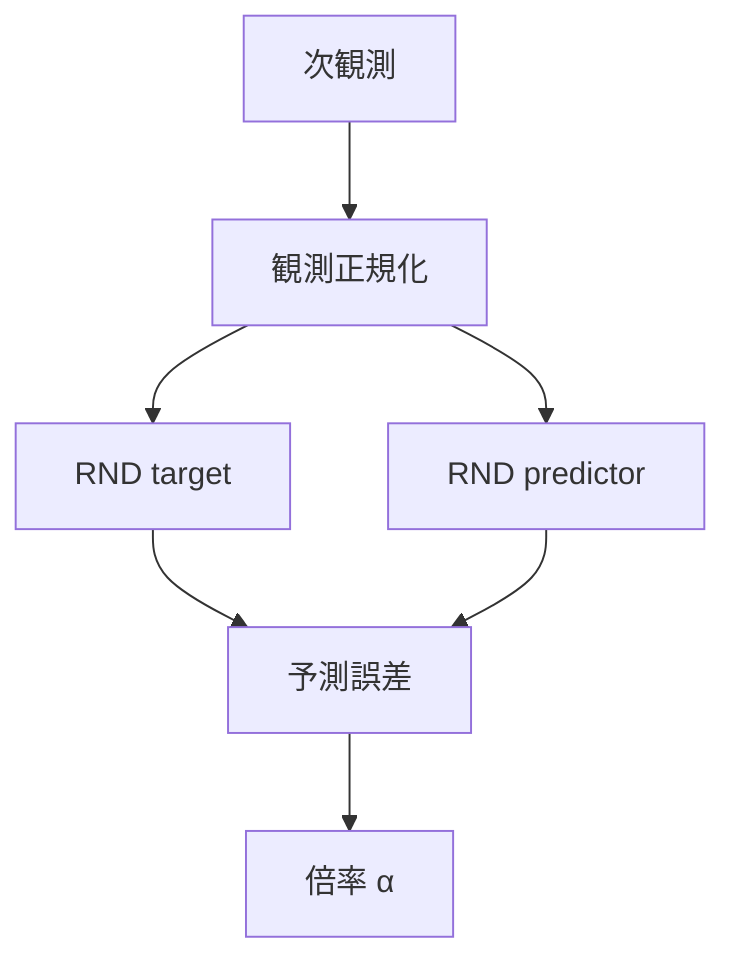
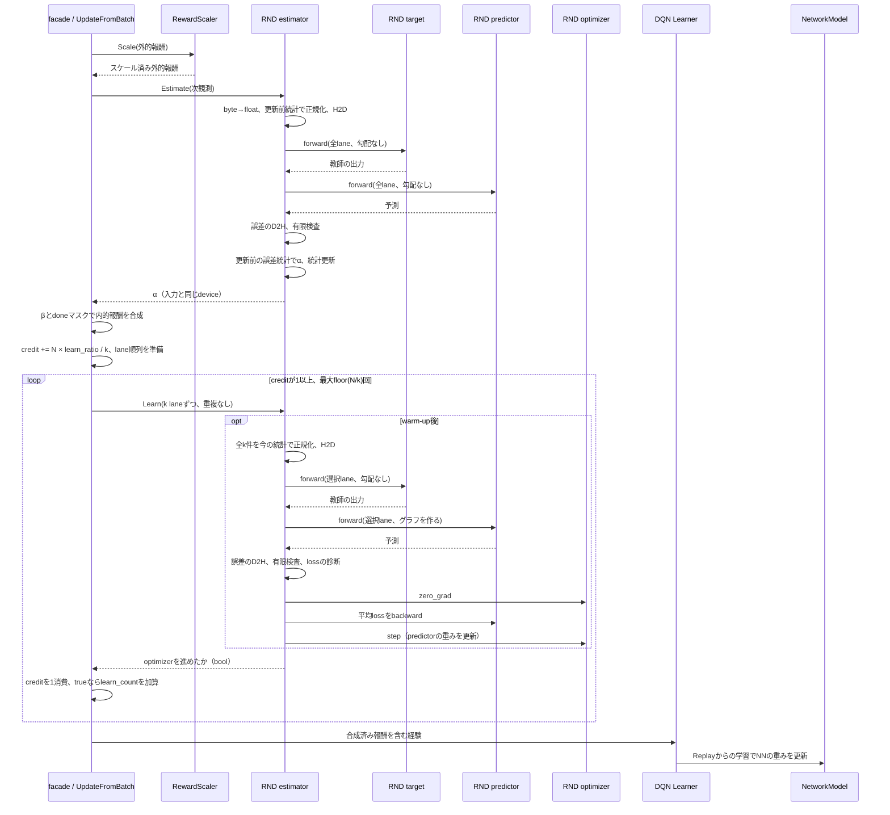

# RND による新しさの評価と内的報酬

> 主たる観点: 基本概念とアルゴリズムの背景から、ANET の採点・報酬合成・補助学習・保存へつなぐ。
>
> 対象: `DefaultDQNAgent` に追加した RND 単独の内的報酬。2026-11-07 時点の実装を説明する。

RND は、**固定した問題の答えを学習する小さなモデルを持ち、「まだ答えをうまく再現できない観測」に探索のボーナスを与える仕組み**である。環境の点数とは別の手掛かりを学習へ加え、まだ十分に経験していない場所へ向かう動機を作る。

本書は、強化学習や RND に詳しくない読者が基本から読めるように構成した。概念を知りたい場合は §2、計算と実装の関係を追いたい場合は §3、設定や指標を読みたい場合は §4 を参照する。DQN 全体の仕様は [200 DQN 系 Agent](200_dqn_agents.jp.md) にある。

## 1. 用語

### 1.1 強化学習の基本

| 用語 | 意味 |
| --- | --- |
| 強化学習 | 行動と、その結果得られる報酬を使い、将来にわたって多くの報酬を得る行動の選び方を学ぶ方法。 |
| 環境（Env） | 行動を実行する相手。ゲーム、迷路などで、行動に応じて観測と報酬を生成する。 |
| 観測・次観測 | Agent が環境から取得する情報。画面や位置などで、次観測は行動の実行後に得たものを指す。環境の内部状態すべてが見えるとは限らない。 |
| Agent・方策 | Agent は行動選択と学習をまとめる主体。方策は、観測から行動を選ぶ規則。 |
| 外的報酬 | 環境が与える点数や成功・失敗の評価。最終的に達成したい課題を表す。 |
| 内的報酬・ボーナス | 探索を促すために Agent 側で計算する追加の評価。本書のボーナスは、実際に学習報酬へ加算する非負の値。 |
| 学習報酬 | 学習器に渡す報酬。今回の実装では、スケール済みの外的報酬とボーナスの和。 |
| 探索・活用 | 探索は未知の結果を調べる行動、活用は既に分かっている良い行動を選ぶこと。 |
| エピソード | 環境の開始から終了までの一続きの試行。途中で制限時間などにより打ち切ることもある。 |
| Q 値・DQN | Q 値は、ある状態で行動を選んだ後に得る将来の報酬の見込み。DQN（Deep Q-Network）は、その見込みをニューラルネットワークで学ぶ方式。 |

### 1.2 RND と計算の用語

| 用語 | 意味 |
| --- | --- |
| ニューラルネットワーク・重み | 入力を数値の出力へ変換するモデルと、その変換を決める数値。学習は重みを調整すること。 |
| ランダム・seed | ランダムは乱数を使って値を決めること。seed は乱数列を再現するための初期値。 |
| 蒸留（distillation） | あるモデルの出力を別のモデルに再現させる学習。RND では、再現対象がランダムに作ったモデルになる。 |
| RND | Random Network Distillation の略。固定したランダムなモデルの出力を予測し、その誤差から観測の新しさを見積もる方法。 |
| RND target | RND の固定教師。観測から、predictor が再現すべき数値の並びを作るモデル。 |
| RND predictor | RND target と同じ入力から、その出力を再現するよう学習するモデル。 |
| 特徴ベクトル | 観測を数値の並びとして表したもの。RND target の各出力に、人間が読める意味を割り当てる必要はない。 |
| 予測誤差・MSE | 予測値と教師の値の差。MSE（平均二乗誤差）は、差を二乗し、要素について平均したもの。 |
| 損失・補助学習 | 損失は学習で小さくしたい値。補助学習は、行動の価値を学ぶ主学習とは別に、ここでは predictor の誤差を小さくする学習。 |
| 平均・標準偏差 | 平均は値の中心、標準偏差はばらつきの大きさ。同じ差でも、普段のばらつきが小さければ相対的に大きな差となる。 |
| 観測正規化 | 入力の尺度をそろえる処理。今回の既定は、成分ごとに平均を引き、標準偏差を使って割る。 |
| clip・倍率 α | clip は範囲外の値を上下限へ制限すること。倍率 α は、新しさを `[1, L]` に収めた採点結果。 |
| β・L | β はボーナスの強さを決める係数。L は倍率 α の上限。 |
| warm-up | 開始直後に統計を集める期間。今回の RND では、この間はボーナスも predictor の更新も行わない。 |
| NGU | Never Give Up。エピソード内の新しさと学習全体での新しさを組み合わせ、探索の強さが異なる方策を学ぶ手法。 |

### 1.3 ANET の実装用語

| 用語 | 意味 |
| --- | --- |
| Actor | 観測から行動を選ぶ部品。今回、RND を直接呼ぶ役割は持たない。 |
| facade | 内側の部品をまとめる外側の窓口。ここでは `DefaultDQNAgent::UpdateFromBatch` が報酬の前処理を担当する。 |
| DQN Learner | Q 値を学習する内側の学習器。facade が合成した報酬を使う。 |
| ReplayBuffer | 過去の経験を保存し、後から学習用に取り出す部品。経験には観測、行動、報酬、次観測などが含まれる。 |
| batch・lane | batch はまとめて処理する観測の組、lane はその中の1つの環境の位置。B は lane 数。 |
| intake・N・k・credit | intakeはfacadeが1回に受け取る経験の組。Nはそのlane数、kは補助学習1 stepに渡す件数。creditは学習回数を小数で貯める値で、1貯まると1回学習できる。 |
| tensor・shape・TensorDict | tensor は多次元の数値配列、shape は各軸の長さ。TensorDict は `vector` や `grid` などの名前と tensor の対応を持つ。 |
| Body・Head | Network の前段の特徴抽出部と、最後の出力部。RND の Body は設定で選び、Head は特徴を指定次元へ線形変換する。 |
| Network・NetworkModel | ANET の `Network` は Body と Head を持つ計算モデル。DQN の `NetworkModel` は Q 学習用のモデルと同期などをまとめる部品で、RND の所有者ではない。 |
| Conv2d・MLP・全結合層・ReLU・Flatten | Conv2d は画像の局所的な模様を扱う畳み込み層、MLP は全結合層を重ねたモデル。全結合層は入力の各成分を組み合わせて出力を作り、ReLU は負値を0にし、Flatten は観測内の軸をまとめる。 |
| フレーム積層 | 連続する複数時点の観測を1つのモデル入力にまとめる処理。1枚では分かりにくい動きなどを入力へ含める。 |
| 順伝播・逆伝播・勾配 | 順伝播は入力から出力を計算すること。逆伝播は損失から重みごとの勾配を計算すること。勾配は、重みを変えたときに損失がどう変わるかを表す。 |
| optimizer・AdamW | optimizer は勾配を使って重みを更新する処理。AdamW は更新の大きさを過去の勾配の統計から調整し、重みの減衰も扱う方式。 |
| 計算グラフ | 順伝播で行った演算のつながり。逆伝播で勾配を計算するために保持する。 |
| CPU・GPU・CUDA・FP32 | CPU は汎用の演算装置、GPU は多数の演算を並列に処理する装置。CUDA は NVIDIA GPU を利用する実行基盤、FP32 は32ビット浮動小数点数。 |
| libtorch | PyTorch の C++ 向けライブラリ。ANET は tensor 計算、Network の学習や保存に使う。PyTorch はこれらの計算を提供する機械学習基盤。 |
| GridMaze・LunarLander・Atari・Kung-Fu Master | GridMaze は格子状の迷路、LunarLander は着陸制御の環境。Atari はゲーム機とそのゲーム群を指し、Kung-Fu Master は今回の検証に使ったゲーム名。 |
| checkpoint | 学習を再開するために保存したモデルや学習状態。単なる重みの保存より広い。 |
| NaN・nullopt | NaN は「この値は現在成立していない」を表す浮動小数点値。`nullopt` は、問い合わせた指標自体が提供されないことを表す。 |
| Run・メトリクス | Run は1つの実験実行、メトリクスは実行中に記録する指標。 |
| ProfiledValue・exp_step | ProfiledValue は定数や時間変化として指定できる設定値。`exp_step` は学習用に集めた経験数を表すカウンタで、今回 β の評価に使う。 |
| done・truncated | `done` は終端のフラグ、`truncated` は時間制限などによる打ち切りのフラグ。本書では facade に届いた値を基準に説明する。 |

## 2. 背景 ― なぜ新しさを報酬にするのか

### 2.1 点数を得る前にも、試す方向を作りたい

例えば、ゴールに到着したときだけ点数が付く迷路を考える。ゴールを一度も見つけていない間は、行き止まりを往復しても、新しい通路へ入っても、外的報酬は同じ0である。点数だけを使う学習には、この2つの行動を区別する材料が乏しい。

そこで、あまり経験していない観測に小さなボーナスを付ける。新しい通路へ入る行動の学習報酬が高くなれば、Q 値の学習を通じて、その通路へ向かう行動が選ばれやすくなる可能性がある。RND はこの「まだ十分に経験していない」を、予測の難しさで近似する。

この追加報酬は、環境のゴールを変更するものではない。ただし、**学習器が最適化する報酬は変わる**。探索に熱中して外的な点数が下がることもあり得るため、ボーナスが出たことと、目的の課題が改善したことは別に確認する。

### 2.2 固定した答えを学ばせる

RND の教師は、初期化時にランダムに重みを作り、その後は更新しない。predictor は、観測を入力して教師の出力を再現する。似た入力を十分に学習すれば誤差が小さくなり、学習が及んでいない入力では誤差が大きくなることを、新しさの目安にする。この基本構造は [RND 原論文 §2.2](https://arxiv.org/pdf/1810.12894) による。

迷路の例なら、教師は「この画面にはこの数値の並び」という練習問題を作る。predictor は実際に訪れた画面の問題を練習する。Agent が環境の正解ラベルを用意しなくても、練習の進み具合を測れる。

教師の答えがすべて同じ定数なら、predictor はその定数を出すだけでよく、どの観測を練習したかを区別しにくい。ランダムに初期化した Network を教師にすることで、入力によって答えが変わる問題を用意する。ここで必要なのは教師がゲームの攻略法を知っていることではなく、predictor が観測に応じた対応を学ぶことである。

固定しているのは、**同じ数値入力に対する教師の変換**である。毎回新しい乱数の答えを作るわけではない。答えが毎回変われば、何度練習しても誤差が残り、経験の不足との区別が難しくなる。

また、predictor は「次にどんな画面になるか」を予測していない。行動後に得た観測を既に入力として持ち、その観測に対する教師の出力を予測する。未来の環境の変化を当てる問題とは異なる。

### 2.3 新しさは訪問回数そのものではない

今回の実装が測るのは、訪問回数の表ではなく、predictor の現在の誤差である。このため、次のように読む必要がある。

- **初訪問でも低いことがある。** 似た観測を既に学習していれば、その観測も予測できる。
- **再訪問でも高いことがある。** まだ十分に学習できていない場合や、他の観測の学習によって予測が変わった場合がある。
- **画面の変化が課題に有益とは限らない。** 数値として新しくても、ゴールへ近づく情報とは限らない。
- **固定教師でも、同じ生の観測の誤差は変わる。** predictor の重みに加え、入力の正規化統計も更新されるためである。

したがって、「error が高い」は「現在の RND にとって予測しにくい」を意味する。「未訪問である」「重要である」「そこへ行けば点数が上がる」と同じ意味にはしない。

### 2.4 「一生」と「1エピソード」は、何を忘れるかが違う

今回の「一生の新しさ」は、**1つの estimator が続いている間の学習履歴**を指す。エピソードが終わっても predictor や累積統計をリセットしない。同じ Agent の全 lane が1つの estimator を共有し、どこかの lane で学んだことが他の lane の新しさにも影響する。checkpoint から再開した場合は、その履歴を引き継ぐ。

一方、エピソード内の新しさなら、次の試行が始まったときに「この試行ではまだ訪れていない」を再び評価できる。慣れた通路を通らないと別の未知領域へ到達できない場面では、この違いが重要になる。

NGU はエピソード内の報酬に一生の新しさの倍率を掛ける。現在の ANET は、その全体を実装したものではない。倍率の形を参考にしつつ、RND 単独で比較できるように `β × (α − 1)` を加える設計になっている。[NGU 原論文 §2・式(1)](https://arxiv.org/pdf/2002.06038)

| 比較する部分 | 現在の ANET の選択 |
| --- | --- |
| RND の核となる仕組み | 固定教師と学習する predictor の誤差を使う |
| 誤差を扱いやすい尺度にする方法 | 過去の誤差の平均・標準偏差から相対的な大きさを求める |
| 倍率の扱い | NGU に倣う `[1, L]` の形。コード中の `alpha` は制限した後の値 |
| 学習報酬への合成 | `β × (α − 1)` をスケール済み外的報酬へ加える |
| エピソード別の訪問記憶・探索の強さが異なる方策の組 | 今回の実装には含めない |

## 3. 仕組み ― 数式とコードをつなぐ

### 3.1 同じ入力を2つの Network に入れる

まず次観測を RND 専用に正規化し、同じ入力を target と predictor に渡す。

1 lane の正規化済み観測を `x`、教師を `f`、predictor を `g`、出力の次元を `d` とすると、コードが使う誤差は次の値である。

$$
e(x)=\frac{1}{d}\sum_{j=1}^{d}\left(g(x)_j-f(x)_j\right)^2
$$

`j` は出力ベクトルの成分番号で、既定の `d` は128。各成分のずれを二乗して平均するので、各 lane に1個の非負の値ができる。

| 場所 | shape | 意味 |
| --- | --- | --- |
| 観測 | `[B, ...]` | B個の観測。後ろの軸は画像やベクトルなどで変わる |
| Body の出力 `features` | `[B, F]` | 各観測を F 個の特徴へ変換したもの |
| target / predictor の出力 | `[B, d]` | 各観測の答えと予測 |
| `mean(-1)` 後の誤差、倍率 | `[B]` | 各 lane に1つの値 |

`RndHeadFactory` は構築時の試し計算で Body の出力が2軸であることを確認する。余分な軸を残した `[B, T, F]` では、最後の軸を平均しても `[B, T]` となり、lane ごとの報酬として扱えないためである。

コードの入口は [`RndNoveltyEstimator::Estimate`](../../core/anet-core/src/intrinsic_rnd.cpp)。target と predictor は別の重みを持ち、target の勾配計算を止め、学習時の状態更新をしないモードに置く。Q 値を計算する Network とは共有しない。

現在の target と predictor は同じ Body 設定と出力次元から作るが、初期重みには別の名前付き seed を使う。教師の重みを predictor へそのままコピーするわけではない。同じ変換を初めから持たせれば、練習前から答えが一致し、誤差を新しさの手掛かりにできなくなるためである。

### 3.2 2種類の正規化を分けて考える

RND には、目的が異なる2つの統計がある。

| 統計 | 対象 | 必要な理由 |
| --- | --- | --- |
| 観測の統計 | 入力の各成分 | 座標、速度、画素などの数値の尺度が、そのまま予測の難しさを支配することを抑える |
| 誤差の統計 | 各 lane の MSE | モデルや学習時期で変わる誤差を、普段との差として読む |

観測正規化の既定は、成分ごとに概ね `(値 − 平均) / 標準偏差` を計算し、`[-5, 5]` に制限する。これは成分ごとの尺度調整であり、成分どうしの相関まで取り除く処理は行わない。RND 専用の統計を持つので、Q 入力の正規化設定を変えても、RND の統計を共有して変えることにはならない。

実際の除数は [`RunningMeanStd::GetStd`](../../core/anet-core/src/scaler_impl.hpp) の `sqrt(var) + epsilon` である。RND の観測正規化も共通設定の `epsilon=1.0` を既定で使う。小さい数を仮定した教科書的な式で実装を読み替えないこと。初期状態は平均0・分散1から始まる。

画素などの非カテゴリの `uint8` 観測は、RND 内で浮動小数点へ変換してから正規化する。カテゴリを表す観測は、既存の観測仕様・正規化機構の扱いに従う。

一方、誤差の統計は全 lane の値を1つの累積統計へ集約する。直近だけの窓ではなく、これまで採点した全 batch の情報を引き継ぐ。こちらは `epsilon=0` で構築し、標準偏差が0の場合には次節の特別扱いをする。

### 3.3 誤差を倍率へ、倍率をボーナスへ変える

現在の誤差を `e`、**今回の batch を入れる前**の誤差の平均を `μ_e`、標準偏差を `σ_e` とする。warm-up が終わり、統計が利用可能なら、倍率を次のように計算する。

$$
\alpha=\operatorname{clip}\left(1+\frac{e-\mu_e}{\sigma_e},\ 1,\ L\right)
$$

読み方は、「普段より何個分の標準偏差だけ誤差が大きいか」を求め、それを1へ足す、となる。

- `e` が平均以下なら、下限により `α=1`。
- 平均より標準偏差1個分だけ大きければ `α=2`。
- 大きな誤差でも上限 L を超えない。既定は `L=5`。
- warm-up 中、採点履歴が無いとき、または `σ_e=0` のときは、全 lane で `α=1`。

facade は、この倍率からボーナスを作る。

$$
b_i=\begin{cases}
0 & \text{lane }i\text{ の done が true}
\\
\beta\,(\alpha_i-1) & \text{それ以外}
\end{cases}
$$

$$
r_i^{\mathrm{learn}}=\operatorname{RewardScale}(r_i^{\mathrm{ext}})+b_i
$$

`i` は lane 番号、`r_ext` は環境の外的報酬、`RewardScale` は既存の報酬スケール処理である。`α` から1を引くため、慣れた観測の基準値 `α=1` は追加報酬0になる。現在の β が0.1、Lが5なら、ボーナスは `[0, 0.4]` である。外的報酬を α 倍する式ではないので、外的報酬0の遷移にもボーナスを付けられる。

`done` の lane も採点と統計更新・補助学習の対象には含まれる。0にするのは**報酬へ足す値**である。`truncated=true` だけでは0にしない。両方が true なら `done` が効いて0になる。

### 3.4 先に採点し、後から慣れる

処理順は、同じ観測から得るボーナスを変えるため、アルゴリズムの一部である。

| 順番 | 処理 | 使う状態・更新する状態 |
| ---: | --- | --- |
| 1 | 外的報酬をスケールする | 既存の reward scaler |
| 2 | 次観測を正規化する | 今回の観測を入れる前の RND 観測統計 |
| 3 | target と predictor の出力から誤差を計算する | 更新前の predictor の重み |
| 4 | 倍率 α を求める | 今回の誤差を入れる前の誤差統計 |
| 5 | 観測・誤差の累積統計と採点した観測の件数を更新する | 今回の全 lane を加える |
| 6 | β を評価し、done をマスクしてボーナスを加える | `counts.exp_step` と今回の α |
| 7 | facadeがcreditを加算し、学習可能な回数だけk laneずつ選んで `Learn` を呼ぶ | 手順5で更新した観測統計。各呼び出しで全k件を正規化・順伝播し、新しいグラフで学習する |
| 8 | 合成済み報酬を含む経験を内側の Learner へ渡す | Q 学習と ReplayBuffer の既存経路 |

先に predictor を学習させてから誤差を測ると、「今回の観測に慣れた後」の点数になる。先に誤差統計へ今回の値を加えると、その観測自身が比較基準を動かす。現行実装は、いずれも避けて、今回の採点を過去の状態に照らして決める。

`Estimate` は採点だけでなく手順5まで実行する。読み取り専用の問い合わせではないが、計算グラフは保持しない。`Learn` は渡された観測から独立して計算し、その時点の観測統計を読むだけで、統計を更新しない。このため、同じ生の観測でも採点時と学習時では正規化後の値が異なることがある。

現在のfacadeはintakeの全観測で `Estimate` を1回呼び、creditに応じて0回以上 `Learn` を呼ぶ。公開API自体は同じ観測・順序・回数を要求しない。例えば2回採点してから別の観測を学習してもよく、warm-upが無い、または終わっていれば `Learn` だけでも学習できる。`Learn` はoptimizerを進めたらtrue、warm-up中ならfalseを返す。将来、行動時の採点とReplayの観測を使う補助学習を分けても、この口を利用できる。

### 3.5 warm-up と lane の抽選

既定の `warmup_steps=12,800` は、**採点した観測の件数**である。B個まとめて採点すればB件を加え、facadeから呼ぶ場合はexp stepと同じ単位になる。N=128なら100 intake、N=64なら200 intakeで同じ12,800件を集める。`Learn` は観測統計を更新しないため、単独ではwarm-upを終えられない。0なら初回の `Learn` から学習する。

αは採点前の件数で判定し、閾値未満なら全laneで1を返す。統計はその間も更新する。`Learn` は採点後の件数が閾値以下ならfalseを返すので、ちょうど12,800件までのintakeではoptimizerを進めない。次のintakeから通常の採点と補助学習になる。閾値をまたぐbatchは一括して採点し、その後の件数で学習の可否を決める。

学習の刻みはfacadeが持つ。kを `min(learn_batch_size,N)` とし、intakeごとにcreditへ `N × learn_ratio / k` を足す。creditが1以上ならk件で1 step、1未満の端数は次へ残す。既定のratio=0.25・batch size=32なら、N=128では毎intakeに1 step、N=64では2 intakeに1 stepとなり、どちらも128経験あたり32件を1回学習する。Nがbatch sizeより小さいときは構築時に1回警告し、N件に縮めるため、同じ回数になる保証の対象外である。

抽選は1 intakeにつき1つのlane順列を作り、k件ずつ切り出す。同じlaneを複数stepで使わず、step数は `floor(N/k)` が上限になる。Nがkで割り切れず上限に当たった場合は、整数部分を含む未消費creditも次へ残す。`Learn` を呼んだ分のcreditはfalseでも消費し、warm-up明けのまとめ学習は行わない。成功したtrueだけを `learn_count` に数える。

採点と統計更新は全laneに行う。RNDの `Learn` は抽選をせず、渡されたk件をすべて正規化してtarget・predictorへ渡し、平均損失をbackwardする。学習の無いintakeでは `predictor_loss` を直近の成功stepの値に保ち、まだ一度も学習していなければNaNとする。

### 3.6 DQN へのつながりと、2種類の target

図はCPU観測・CUDA計算の場合の1回の処理順を示す。H2DはCPUからGPU、D2HはGPUからCPUへの転送であり、CPU計算なら省かれる。CUDA入力は正規化の前にCPUへ移し、倍率を入力deviceへ戻す。facadeではRNDの `Learn` を終えてから内側のLearnerへ経験を渡す。LearnerのNN更新は既存のReplay・更新間隔の条件が成立したときに行う。RNDの補助学習とDQNのNN更新は別々の重み・optimizerを使う。

| 比較 | DQN の target network | RND target |
| --- | --- | --- |
| 何を出すか | 行動の価値の見積もり | predictor が再現する特徴ベクトル |
| 何のためか | Q 学習の目標を作る | 新しさを測る練習問題を固定する |
| 重みは変わるか | Q の学習側 Network から所定の方法で更新する | 初期化後は固定する |
| 所有する場所 | DQN の `NetworkModel` | `RndNoveltyEstimator` |

名前が同じ target でも、RND target を DQN の同期処理へ入れてはいけない。また、predictor の誤差を小さくする学習と、学習報酬を使って Q 値を変える学習は別であり、optimizer も共有しない。

### 3.7 Replay に保存したボーナスは採点し直さない

現在の実装は、経験が facade に来た時点で外的報酬とボーナスを合成し、1本の報酬として ReplayBuffer へ渡す。後から同じ経験を取り出しても、新しい predictor でボーナスを再計算しない。

例えば、収集時に珍しくてボーナス0.2が付いた遷移は、その場所に慣れた後の学習でも、保存された0.2を含む報酬を使う。現在その場所を訪れたときのボーナスとは一致しなくてよい。β を途中で変えても、Replay に既に入った報酬までは書き換わらない。

この方法なら Replay の形式を変えずに導入できるが、外的・内的報酬を後から別々に扱えない。これは現在の実装の選択であり、RND という手法に必須の制約ではない。

### 3.8 実装を読む順番

| 確かめたいこと | ファイル・操作 | 背景との対応 |
| --- | --- | --- |
| 呼び出し側に何を公開するか | [`intrinsic.hpp`](../../core/anet-core/include/anet/intrinsic.hpp) の `LifelongNoveltyEstimator` と Factory | 倍率の採点、補助学習、診断、保存を公開し、RND 固有の構成を隠す |
| 報酬をどこで加算するか | [`default_dqn_agent.cpp`](../../core/anet-core/src/default_dqn_agent.cpp) の `UpdateFromBatch` | 既存の報酬スケール後に加算する |
| 学習の刻みと抽選 | [`default_dqn_agent.cpp`](../../core/anet-core/src/default_dqn_agent.cpp) の `UpdateFromBatch` | creditと名前付きseed `intrinsic.learn` の乱数をfacadeが持ち、k件ずつ渡す |
| RND が何を所有するか | [`intrinsic_rnd.hpp`](../../core/anet-core/src/intrinsic_rnd.hpp) | target、predictor、optimizer、2種類の統計、採点した観測の件数を持つ |
| 採点・学習の順番 | [`intrinsic_rnd.cpp`](../../core/anet-core/src/intrinsic_rnd.cpp) の `Estimate` / `Learn` | 採点後に統計を更新し、学習は渡された観測と現在の統計から独立して計算する |
| 正規化の具体的な計算 | [`scaler_impl.cpp`](../../core/anet-core/src/scaler_impl.cpp) と [`scaler_impl.hpp`](../../core/anet-core/src/scaler_impl.hpp) | 共通の正規化・累積統計・保存処理を使う |
| 契約をどう確かめるか | [`intrinsic_test.cpp`](../../core/anet-core/src/intrinsic_test.cpp) | 固定教師、学習、更新順序、報酬加算、保存再開などを公開経路から検証する |

DefaultDQN側が解釈するのは `intrinsic.enabled`・`intrinsic.beta`・`intrinsic.learn_ratio`・`intrinsic.learn_batch_size`。RND固有の設定はFactoryへ渡し、`RndNoveltyEstimatorConfig` が解釈する。報酬の合成・学習の刻みを担当する側と、新しさの計算・補助学習そのものを担当する側を分けている。

## 4. 具体例 ― 値・設定・指標を読む

### 4.1 4 lane を手計算する

warm-up 後で、過去の誤差の平均が0.20、標準偏差が0.10、L=5、β=0.1だったとする。今回の誤差と報酬を次のように仮定する。これは計算を説明するための例であり、Run の測定値ではない。

| lane | 今回の誤差 e | 制限前の `1+(e−0.20)/0.10` | α | done | スケール済み外的報酬 | 加算ボーナス | 学習報酬 |
| ---: | ---: | ---: | ---: | --- | ---: | ---: | ---: |
| 0 | 0.10 | 0 | 1 | false | 0 | 0 | 0 |
| 1 | 0.30 | 2 | 2 | false | −0.1 | 0.1 | 0 |
| 2 | 0.80 | 7 | 5 | false | 1 | 0.4 | 1.4 |
| 3 | 0.60 | 5 | 5 | true | −1 | 0 | −1 |

lane 1 は正のボーナスを得ても、外的なペナルティと相殺して学習報酬0になる。lane 3 は誤差が大きいが、done のため加算しない。この batch で新しい統計を作る際は、4 lane すべての誤差を使う。

この例の `bonus_mean` は `(0+0.1+0.4+0)/4=0.125`、`bonus_max` は0.4。`clip_ratio` は α が L に等しい lane の割合なので、done の lane 3 も含めて `2/4=0.5` となる。

### 4.2 設定値がどの計算を変えるか

以下は `DefaultDQNAgent.` を省略したキーである。既定値は [`agent.txt`](../../apps/runner/config/agent.txt) と RND の設定型に対応する。

| キー | 既定 | 変わるもの・注意点 |
| --- | ---: | --- |
| `intrinsic.enabled` | false | false なら estimator を作らず、β と RND の他の設定も解釈しない |
| `intrinsic.beta` | 0.1 | `α−1` に掛ける係数。0以上の ProfiledValue。0にしても採点・補助学習は止まらない |
| `intrinsic.rnd.output_dim` | 128 | target / predictor が出すベクトルの次元。1以上 |
| `intrinsic.rnd.multiplier_max` | 5 | α の上限 L。有限で1より大きい値 |
| `intrinsic.learn_ratio` | 0.25 | 収集1経験あたりの補助学習件数。有限で0より大きく1以下 |
| `intrinsic.learn_batch_size` | 32 | 補助学習1 stepの件数。整数で1以上。N件への縮小は§3.5参照 |
| `intrinsic.rnd.warmup_steps` | 12,800 | 統計だけを集める観測の件数。0以上 |
| `intrinsic.rnd.learning_rate` | 0.0001 | predictor の学習率。有限で正の値 |
| `intrinsic.rnd.weight_decay` | 0 | predictor の AdamW の重み減衰。有限で0以上 |
| `intrinsic.rnd.obs_norm.clip_range` | 5 | 観測正規化後の制限範囲。α の上限 L とは別 |
| `intrinsic.rnd.net.*` | 各環境の `run.@rnd` が指定 | RND の入力と Body。Q Network の設定をそのまま流用する意味ではない |

`learn_ratio` と `learn_batch_size` はoptimizerの進む回数と1回の件数を変え、誤差が減る速度にも影響する。単なる高速化の設定として扱わない。βは同じαに対する報酬の大きさ、Lは大きな誤差の倍率上限を変える。作用する位置を分けて読む。

### 4.3 `run.@rnd` が選ぶ構造

既存の Run 設定の連鎖へ `run.@rnd` を加えると、RND の有効化、専用 Body、9つの指標をまとめて選べる。`run.@rnd` 単独では、環境や Q 学習の設定一式を指定したことにはならない。設定の連鎖の一般的な意味は [100 実行基盤と設定](100_runtime_and_configuration.jp.md) を参照する。

| 環境設定 | RND の入力 | Body の既定構造 |
| --- | --- | --- |
| [Atari.txt](../../apps/runner/config/Atari.txt) | `grid` | `Conv2d_S > ReLU > Conv2d_M > ReLU > Flatten` |
| [GridMaze.txt](../../apps/runner/config/GridMaze.txt) | `vector` | `Flatten > MLP_FC1 > ReLU > MLP_FC2 > ReLU` |
| [LunarLander.txt](../../apps/runner/config/LunarLander.txt) | `vector` | 同上 |

`Conv2d_S` / `Conv2d_M` と `MLP_FC1` / `MLP_FC2` は、共通の層カタログにある設定名である。Body は画像またはベクトルから特徴を作り、その後ろに RND が `output_dim` 次元の Head を付ける。

RND の入口は環境から来た次観測であり、Actor 側で Q 入力用に加工したものを横取りしない。Atari の場合も Q 入力のフレーム積層と RND 入力は区別して読む。

### 4.4 メトリクスを一緒に読む

`GetScalar` のキーと、設定が登録する記録先の対応は次のとおり。キーの前には `intrinsic.`、記録先の前には `56_agent_in/` が付く。

| キー | 記録先 | 何を測るか |
| --- | --- | --- |
| `bonus_mean` | `01_bonus_mean` | done のマスク後に実際に加えたボーナスの batch 平均 |
| `bonus_max` | `02_bonus_max` | 同じボーナスの最大値 |
| `bonus_share` | `03_bonus_share` | ボーナス合計が、外的報酬の絶対値合計とボーナス合計の和に占める比率 |
| `error_mean` | `11_error_mean` | 今回の batch を加えた後の、誤差の累積平均 |
| `error_std` | `12_error_std` | 今回の batch を加えた後の、誤差の累積標準偏差 |
| `error_step` | `13_error_step` | 今回の全 lane の誤差の平均 |
| `clip_ratio` | `21_clip_ratio` | 今回の α が上限 L に等しい lane の割合。done マスク前 |
| `predictor_loss` | `31_predictor_loss` | 直近に成功した補助学習stepの更新前の誤差平均。未学習ならNaN |
| `learn_count` | `32_learn_count` | optimizerが実際に進んだ累計step数。warm-upのfalseは数えない |

`bonus_share` は次の式であり、個々の lane の比率を平均するのではない。

$$
\mathrm{bonus\_share}=\frac{\sum_i b_i}{\sum_i |r_i^{\mathrm{scaled}}|+\sum_i b_i}
$$

分母が0なら NaN とする。§4.1 の例では `0.5/(2.1+0.5) ≈ 0.1923`。外的報酬が負でも絶対値を使うため、正負の相殺で比率が不安定になりにくい。

読み方の例:

- `predictor_loss` と `error_step` が下がるなら、入力に対する予測が進んでいる。ただし前者は選択 lane、後者は全 lane なので、値は通常一致しない。
- `bonus_mean` が低い理由は、誤差が普段より小さい、warm-up 中、β が小さい、done が多い、などで変わる。1本の指標だけで原因を決めない。
- `clip_ratio` が高い状態が続くなら、多くの観測が同じ上限の倍率になっている。現在の誤差と累積統計、入力正規化を合わせて確認する。
- `error_mean` / `error_std` は採点後の統計であり、今の α の計算に使った古い統計とは異なる。ログの同じ行の値を式へ入れても、採点結果の厳密な再現にはならない。

RND無効時のキーは `nullopt`。有効時の `learn_count` は0から始まり、学習しないintakeでも直近lossを保持する。初回採点前の採点値や未学習のlossはNaNになる。NaNは意図された未成立値であり、計算結果の異常な非有限誤差とは区別する。後者は採点時と補助学習時に検出して処理を止める。Nがbatch size以上でintake上限が制約しなければ、warm-up後の `learn_count / exp_step` の増分比は `learn_ratio / learn_batch_size` になる。

### 4.5 保存して再開するとき

RND は predictor の重みだけでは再開できない。教師が変われば「答え」が変わり、統計が変われば「普段との差」が変わり、抽選の状態が変われば「どの lane で練習するか」が変わるためである。

RND本体は `RndNoveltyEstimator-2` の識別子に続けて、target、predictor、optimizer、観測正規化の統計、誤差の累積統計、採点した観測の件数を保存する。Agentはその後ろにfacadeの未消費credit、lane抽選の乱数状態、累計成功回数を保存する。RND本体を先に置き、異なる書式を本体の検査で拒否する。呼び出しの途中を除き、初回採点前、`Estimate` と `Learn` の間、`Learn` の直後のいずれでも保存・復元できる。計算グラフは持ち越さない。診断の直近lossは保存対象外で、読込後の最初の成功stepまではNaNとなる。

RND を含む Agent checkpoint は、従来の識別子へ `;intrinsic` を付けて区別する。保存側に RND があるのに読み込み側が無効、またはその逆の場合はエラーにする。無効時は従来の保存形式を使う。

読み込みでは predictor の optimizer の学習状態を復元したうえで、学習率と重み減衰を現在の設定へ合わせる。したがって、それらを変更した再開は、同じ学習をそのまま継続する場合とは区別する。

## 5. 現在の状態と限界

### 5.1 計算する場所と費用

名前付きseedは、RNDのtarget・predictorとfacadeのlane抽選で分ける。現在の通常の重み初期化はCPUの既定乱数生成器を使うため、構築中だけその状態を退避してseedを指定し、終了時に復元する。CPUで構築したモデルを必要なdeviceへ移す。

入力はCPUでもCUDAでも受け取る。RND内部では観測をCPUへ移して正規化し、Factoryで指定した計算deviceへ送る。誤差の有限検査と統計はCPUで扱い、返すαは入力と同じdeviceに置く。facadeは先にlaneを選び、`Learn` は渡された全k件を正規化・転送する。CUDA入力の選択番号はintakeごとに1回、pinnedメモリから非同期で送る。laneごとの同期転送は置かない。

RNDはFP32で独立したモデルを持つ。採点は全N観測にforwardを2回、補助学習は各k件にforwardを2回とbackwardを1回行う。warm-up後、上限に当たらない場合の平均step数はintakeあたり `N × learn_ratio / k`。既定のN=128なら1回・32件となる。採点のグラフを再利用しないため学習時にもforwardが要る。実際の速度差は未測定であり、観測正規化の統計更新時には既存APIによる正規化の二重計算も残る。

Q学習の回数とは別にbatchごとに採点・補助学習するため、Qの更新間隔を大きくしてもRNDの費用が同じ比率で減るとは限らない。計測区間は抽選、正規化、入力転送、target / predictorの順伝播、誤差転送、統計、backward、optimizerのstepを区別する。

`learner.enabled=false` では一度警告して採点と補助学習を休止する。有効設定なら保存状態を扱うための部品は構築される。診断値の読み取りは値の受け渡し専用の仕組みを使い、画面表示のために新しい学習ロック待ちを追加しない。

### 5.2 確認済みの範囲

採点と補助学習の独立化時点では、Debug全体ビルドと `[prd116],[scaler]` の21 tests /998 assertionsが成功した。操作の独立、異なる学習入力、CPU/CUDA入力と計算deviceの組合せ、操作間の保存再開を含む。2026-11-07の刻み・件数の変更の検証は [22impl](../memo/116_rnd_lifelong_novelty_22impl.md) に分けて記録する。

刻み・件数の変更では、Debug全体ビルド、関連28 tests /1293 assertions、出荷設定11 tests /2583 assertionsが成功した。N=2/4の同じ32経験で4学習step・計8観測、CPU/CUDA入力での重複なしk件の学習後の重み、warm-upでのcredit消費、loss保持、端数creditと抽選状態の保存再開を確認した。設定7種類の全キー比較は意図した28差分だけだった。

下表は2026-11-06の初回実装時の検証結果であり、採点と補助学習を独立化する前の記録である。詳細は [初回実装記録](../memo/116_rnd_lifelong_novelty_20impl.md)、独立化後の検証は [公開API見直しの実装記録](../memo/116_rnd_lifelong_novelty_21impl.md)、再検証の入口は [PRD116 検証資材](../../core/anet-core/testdata/prd116/README.md) に置く。今回の無効時4環境checksum再測定は実行中Runとの競合により保留し、smokeと性能測定は行っていない。有効時の学習系列は変更前と異なる。

| 確認 | 結果と範囲 |
| --- | --- |
| Debug ビルド・関連テスト | 28 tests / 3160 assertions 成功。RND、正規化、配布設定を含む |
| 固定教師と predictor | 同一入力100回更新後の target 重み・出力の固定と、predictor の学習を確認 |
| 保存再開 | CPU / CUDA、正規化、採点回数、抽選、optimizer 設定の扱いを確認 |
| 無効時の同一性 | GridMaze・LunarLander・Atari・DropMerge の学習指標105,682点と指標定義が変更前と一致 |
| GridMaze の短期動作確認 | 10万経験で完走。ボーナスと誤差の減少傾向を確認 |
| Atari の Kung-Fu Master の短期動作確認 | 10万経験で完走。公開された8指標は有限、倍率の clip_ratio は最大0.125で1への張り付き無し |
| 性能測定 | 別の Run が動作中のため未実施。実行速度への影響は未確定 |

無効時 checkpoint のファイル全体のバイト列は、既存の libtorch が保存するパラメータのアドレス情報により、同じ旧実行体の再実行同士でも一致しない。検証では header・設定・Network のバイトと、アドレス等の付随情報を除いた optimizer の内容を比較した。「ファイル全体の完全一致」とは報告しない。

### 5.3 まだ言えないこと

短期動作確認は、計算・報酬加算・学習・記録がつながっていることを確かめるものである。外的な成績が改善すること、難しいゲームの探索問題を解決すること、性能上の費用が許容できることまでは示していない。

特に、一度慣れた経路を再び探索する動機、エピソードごとの新しさ、外的報酬と内的報酬を分離した学習、探索の強さが異なる方策の組は、今回の RND 単独実装とは別の論点である。関連する選択肢と未決は [PRD924](../memo/924_intrinsic_reward_novelty_10prd.md) にある。

### 5.4 出典と関連文書

- [Burda ら, Exploration by Random Network Distillation](https://arxiv.org/pdf/1810.12894), §2.2。固定教師と predictor による新しさ評価の出典。
- [Badia ら, Never Give Up: Learning Directed Exploration Strategies](https://arxiv.org/pdf/2002.06038), §2・式(1)。一生の新しさを倍率として使う考え方の出典。
- [PRD116](../memo/116_rnd_lifelong_novelty_10prd.md)、[初回実装記録（20impl）](../memo/116_rnd_lifelong_novelty_20impl.md)、[公開API見直しの実装記録（21impl）](../memo/116_rnd_lifelong_novelty_21impl.md)、[刻み・件数見直しの実装記録（22impl）](../memo/116_rnd_lifelong_novelty_22impl.md)。採用した契約、実装時の判断、検証結果。Estimate/Learnの独立化とdevice・保存の契約は21impl、credit・観測件数・bool結果は22implを参照する。
- [200 DQN 系 Agent](200_dqn_agents.jp.md)。内的報酬が入る前後を含めた Agent の仕様。
- [110 Agent と学習](110_agents_and_learning.jp.md)、[130 ニューラルネットワーク](130_neural_networks.jp.md)、[150 ReplayBuffer](150_replay_buffer.jp.md)。利用する共通部品の仕様。
