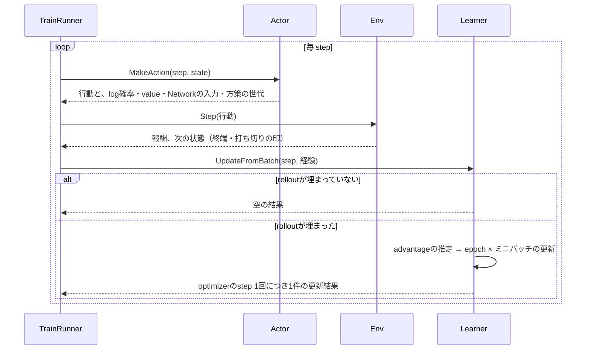

# PPO系Agent

> 主たる観点: PPO系Agent（PPOAgent）の部品構成、Network、行動選択、rolloutと更新、設定、メトリクス、保存。

## 1. はじめに

### 1.1 目的と範囲

本書は、方策ベースのAgentの系統「PPO系」と、その最初のAgentである`PPOAgent`を説明する。`PPOAgent`は、離散行動のPPO（Proximal Policy Optimization）を実装する。

PPO系は、DQN系と並ぶAgentの系統である。DQN系が行動の価値（Q）を学んで行動を選ぶのに対し、PPO系は方策（状態から行動の確率への対応）を直接学ぶ。経験はReplayにためず、今の方策で集めた経験のまとまり（rollout）を1回の更新で使い切る。

Agent・Actor・Learnerの共通の契約は[Agentと学習](110_agents_and_learning.jp.md)、PPO系が使うcoreの部品（行動の分布、advantageの推定、Headの合成）は[方策ベースの学習の共通部品](115_on_policy_learning.jp.md)、Networkの組み立てと設定の書き方は[ニューラルネットワーク](130_neural_networks.jp.md)、メトリクスの行の書き方は[可観測性](140_observability.jp.md)を参照する。

### 1.2 責任の境界

- PPO系は`src/algo/ppo`（ライブラリ`anet-algo-ppo`、名前空間`anet::rl::ppo`）に置く。coreにだけ依存し、DQN系など兄弟の系統に依存しない。
- 公開するのは、初期化関数`anet::rl::algo::InitPpo()`（[ppo.hpp](../../src/algo/ppo/include/anet/algo/ppo.hpp)）だけである。Runnerが起動時に呼び、`PPOAgentFactory`を登録する。
- `PPOAgent`は、Runnerの種類（SerialかPipelineか）と、評価の間隔を知らない。Runnerが渡す経験を受け取り、更新結果を返すだけである。
- 損失の式と更新の進め方はPPO系が持つ。行動の分布、advantageの推定、Headの合成は、coreの部品を使う。

### 1.3 PPOの考え方

方策の勾配法は、「良かった行動の確率を上げ、悪かった行動の確率を下げる」向きに方策を動かす。良し悪しはadvantage（その行動が、その状態の平均よりどれだけ良かったか）で測る。

経験を集めるのは時間がかかるので、1つのrolloutを何度も使って更新したい。しかし、同じ経験で方策を大きく動かすと、経験を集めた方策から離れてしまい、advantageの見積もりが当たらなくなる。PPOは、新旧の方策の確率の比`r = π_new(a|s) / π_old(a|s)`を`[1 − ε, 1 + ε]`にclipした目的関数を使い、1つのrolloutで方策が動く幅を抑える。これで、1つのrolloutを複数のepochに使える。

## 2. 部品の構成

### 2.1 部品と持ち主

| 部品 | 役割 | 持ち主 |
|---|---|---|
| `PPOAgent` | ActorとLearnerの生成、資源の所有、保存と読込 | Run |
| `NetworkModel` | 方策と価値のNetworkの組み立て、写し、方策の世代 | Agent（ActorとLearnerが共有） |
| `Actor` | 行動選択。Learnerがrolloutにためる値を、行動の情報に載せる | Runner（生成はAgent） |
| `Learner` | rolloutの蓄積、advantageの推定、複数epochの更新、optimizer | Agent |
| `UpdateResult` | optimizerのstep 1回ぶんの更新結果。統計を返す | 更新結果の一覧 |
| `PPOAgentConfig` | 設定の読み取りと検証 | Agent |
| 損失と統計の関数（`ppo_math`） | 方策の損失、valueの損失、approx KLなどの純粋な計算 | — |

Networkは、Agentが持つResourceである。Learnerが重みを更新し、学習のActorは同じNetworkを共有する。評価のActorは写しを持ち、`Sync()`で写し直す。rolloutの器とoptimizerは、Learnerが持つ。

### 2.2 コードマップ

| 領域 | 主なファイル |
|---|---|
| 初期化 | [ppo.hpp](../../src/algo/ppo/include/anet/algo/ppo.hpp)、[ppo.cpp](../../src/algo/ppo/src/ppo.cpp) |
| 設定 | [ppo_config.hpp](../../src/algo/ppo/src/ppo_config.hpp)、[ppo_config.cpp](../../src/algo/ppo/src/ppo_config.cpp) |
| Network | [ppo_network_model.hpp](../../src/algo/ppo/src/ppo_network_model.hpp)、[ppo_network_model.cpp](../../src/algo/ppo/src/ppo_network_model.cpp) |
| 損失と統計 | [ppo_math.hpp](../../src/algo/ppo/src/ppo_math.hpp)、[ppo_math.cpp](../../src/algo/ppo/src/ppo_math.cpp) |
| 行動選択 | [ppo_actor.hpp](../../src/algo/ppo/src/ppo_actor.hpp)、[ppo_actor.cpp](../../src/algo/ppo/src/ppo_actor.cpp) |
| 学習 | [ppo_learner.hpp](../../src/algo/ppo/src/ppo_learner.hpp)、[ppo_learner.cpp](../../src/algo/ppo/src/ppo_learner.cpp) |
| Agentとfactory | [ppo_agent.hpp](../../src/algo/ppo/src/ppo_agent.hpp)、[ppo_agent.cpp](../../src/algo/ppo/src/ppo_agent.cpp) |
| 出荷の設定 | [agent.txt](../../apps/runner/config/agent.txt)（`PPOAgent.@baseline`）、[nn.txt](../../apps/runner/config/nn.txt)（`PPO_FC1`・`PPO_FC2`・`Tanh`）、[metrics_scalar.txt](../../apps/runner/config/metrics_scalar.txt)（`metrics.scalar.@ppo`）、[CartPole_ppo.txt](../../apps/runner/config/CartPole_ppo.txt) |

## 3. Network

### 3.1 方策と価値のHead

Networkは1つで、Headが2つの出力を返す。

| 出力のキー | 形 | 中身 |
|---|---|---|
| `logits` | `[行, 行動数]` | 方策の、行動ごとのlogits。softmaxで確率になる |
| `value` | `[行, 1]` | 状態のvalue（その状態から先の、割引した収益の見積もり） |

Headは、coreの`CompositeHeadFactory`で、Linear 1層のHeadを2つ並べたものである。方策のHead（名前`policy`）はBodyの出力のキー`policy_feature`を、価値のHead（名前`value`）は`value_feature`を受け取る。

### 3.2 Bodyの共有と分離

方策と価値でBodyを共有するか、完全に分けるかは、設定で2つのキーを向けるbranchだけで決まる。コードは変わらない。

```text
# 完全に別（出荷の CartPole の設定）
PPOAgent.net.branch.[policy_body].bind = vector
PPOAgent.net.branch.[policy_body].structure = Flatten > PPO_FC1 > Tanh > PPO_FC2 > Tanh
PPOAgent.net.branch.[value_body].bind = vector
PPOAgent.net.branch.[value_body].structure = Flatten > PPO_FC1 > Tanh > PPO_FC2 > Tanh
PPOAgent.net.body.output.[policy_feature] = policy_body
PPOAgent.net.body.output.[value_feature] = value_body

# 共有層あり（2 つのキーを同じ branch に向ける）
PPOAgent.net.branch.[shared_body].bind = vector
PPOAgent.net.branch.[shared_body].structure = Flatten > PPO_FC1 > Tanh > PPO_FC2 > Tanh
PPOAgent.net.body.output.[policy_feature] = shared_body
PPOAgent.net.body.output.[value_feature] = shared_body
```

- 幹だけを共有し、その先を分ける形は、`shared_body`を`bind`するbranchを2本足して、2つのキーをそれぞれへ向ける。
- 方策と価値に別の観測を渡す形は、2つのbranchの`bind`に別の観測キーを書く。
- 共有すると、valueの損失の勾配が方策のBodyにも流れる。`learner.value_coef`が、その強さを決める。

### 3.3 Networkの入力

Networkの入力は、deviceへ移した観測の各キーに、長さ1のstack軸を足したものである（形は`[lane, 1, …]`）。PPO系は観測を重ねないが、stack軸を持つ形にそろえてある。Bodyの各branchは、stack軸を畳むmodule（`Flatten`など）で始める。

Headの出力が`[行, 行動数]`と`[行, 1]`にならないNetworkの設定（stack軸を畳まないBodyなど）は、構築時に止まる。

### 3.4 初期化

Headの初期化は`head.policy.init.*`と`head.value.init.*`で決める。出荷の既定は直交初期化で、方策のHeadはgain 0.01、価値のHeadはgain 1.0である。方策のHeadを小さく始めると、学習の初めの行動の確率がほぼ一様になり、探索が偏らない。Bodyの初期化はblockの設定（`net.block.[名前].init.*`）で決める。

## 4. 1 stepの流れ



rolloutの長さ（`rollout.length`）は、経験の受け入れ（intake）の数である。1つのrolloutは`rollout.length × lane数`の遷移を持つ。

## 5. 行動選択

`Actor::MakeAction`は、毎stepに次を行う。勾配は作らない。

1. 観測をdeviceへ移し、Networkの入力にする。
2. Networkを1回通して、logitsとvalueを得る。
3. logitsから作った分布で、行動を選ぶ。`action_mode = sample`は分布から抽選し、`greedy`は確率が最大の行動を選ぶ。
4. 強制行動の指定があれば、方策の選択のあとに反映する。
5. Learnerへ運ぶ値を、行動の情報（`BatchActionInfo`のinfo）に載せる。

| infoの鍵 | 形と置き場 | 中身 |
|---|---|---|
| `log_prob` | `[lane]`。device | 実行される行動の、選んだ時点のlog確率。更新で、新旧の方策の比の分母になる |
| `value` | `[lane]`。device | 選んだ時点の観測のvalue。advantageの推定と、valueのclipの基準になる |
| `policy_version` | スカラー（int64）。CPU | 行動を選んだ方策の世代 |
| `input.<観測キー>` | `[lane, 1, …]`。device | Networkへ渡した入力。Learnerは、これをrolloutにためる |

- 強制行動を反映したlaneの`log_prob`は、強制した行動のlog確率である。実行された行動と、記録したlog確率が食い違わない。
- 学習のActor（`clone_model = false`）は、LearnerとNetworkを共有する。評価のActor（`clone_model = true`）は写しを持ち、評価のRunnerが評価の初めに呼ぶ`Sync()`で、今の重みと方策の世代を写す。
- Networkを共有するActorは、Agentと同じdeviceで作る。

## 6. rolloutとadvantage

### 6.1 蓄積

Learnerは、経験を2つの器にためる。

| 器 | 置き場 | ためる値 |
|---|---|---|
| deviceの器 | Agentのdevice | Networkの入力、行動、log確率、value（Actorがdeviceの上で作った値。転送は起きない） |
| CPUの器 | CPU | 報酬・終端の印・打ち切りの印をまとめた1本（rolloutの終わりに、1回でdeviceへ送る） |

Learnerは、経験の観測をdeviceへ送り直さない。Actorが行動の情報に載せた、Networkの入力そのものをためる。収集時のlog確率と、更新で計算し直すlog確率が、同じ入力から作られる。

行動の情報にPPO系のActorが載せる値が無い経験（ほかの系統のActorの行動など）は、そのintakeで止まる。報酬・終端と打ち切りの印・log確率・valueが、laneごとに1つの値（`[lane数]`）でない経験と、Actorが載せた値がAgentのdeviceと別の種類のdevice（CPUとCUDA）にある経験も、器に入れる前に止まる。

### 6.2 次の観測のvalue

advantageの推定（[ComputeGae](115_on_policy_learning.jp.md#3-advantageの推定)）は、stepごとに「次の観測のvalue」と、終端・episodeの終わりの印を受け取る。Learnerは、これを次の表で決める。行は上から順に当て、最初に条件を満たした行で扱う。

| # | 条件 | 次の観測のvalue | 終端の印 | episodeの終わりの印 |
|---|---|---|---|---|
| 1 | そのstepの`next_state.done`が真 | 使わない（0） | 真 | 真 |
| 2 | `next_state.truncated`が真で、`learner.truncation_mode = bootstrap` | Resetの前の観測（`next_state.obs`）のvalue | 偽 | 真 |
| 3 | `next_state.truncated`が真で、`learner.truncation_mode = terminal` | 使わない（0） | 真 | 真 |
| 4 | rolloutの最後のstep | 次の観測（`next_state.obs`）のvalue | 偽 | 偽 |
| 5 | そのほか | 次のstepでためたvalue | 偽 | 偽 |

- `done`と`truncated`が両方真のstepは、行1に当たる。
- 打ち切り（時間切れなど）で終わったepisodeは、本当は続くはずだった。`bootstrap`は、Resetの前の観測のvalueで先を見積もる。終端と同じに扱う（`terminal`）と、打ち切りの近くの状態のvalueの目標が低く偏る。
- 行2と行4のvalueは、Learnerが、その時点のNetworkで計算する。行2は打ち切りのlaneがあるstepだけ、行4はrolloutに1回である。

### 6.3 方策の世代と古さ

`NetworkModel`は方策の世代を数える。1つのrolloutの更新を終えるたびに、1進む。Actorは、行動を選んだ世代を行動の情報に載せる。

Learnerは、rolloutを更新に使う前に、経験ごとの方策の古さ（今の世代と、行動を選んだ世代の差）を数える。

| 構成 | 古さ |
|---|---|
| SerialのRunnerと、Networkを共有するActor | 全部0 |
| PipelineのRunnerと、Networkを共有するActor | rolloutの最初の1 stepだけ1（更新の前に選ばれた行動が、次のrolloutに入る） |
| 写しを持つActorを、学習の行動選択に使った | 更新のたびに増える |

古さの最大が2以上のrolloutは、学習に使わずに止める。学習のRunnerは`Sync()`を呼ばないので、写しを持つActorを学習に使うと、重みが古いままになる。古さが1の経験は、記録したlog確率が行動を選んだ方策の値なので、比の計算が成り立つ。古さの平均は`policy_lag`に出る。

## 7. 更新

### 7.1 進め方

rolloutが埋まると、Learnerは次を行う。Tはrolloutの長さ、Nはlane数、Kは`learner.epochs`、Mは`learner.minibatch_count`である。

1. 方策の古さを確かめる（§6.3）。
2. 報酬と印をdeviceへ1回で送り、advantageとvalueの目標を作る（§6.2）。
3. rolloutを、時刻とlaneの区別の無い`T × N`個の遷移の並びにする。
4. 時間の値（`learner.learning_rate`・`learner.ratio_clip_range`・`learner.entropy_coef`）を、そのintakeにRunnerが渡したexp stepで1回読み、このrolloutの全部のstepに同じ値を使う。
5. K回のepochを回す。epochごとに遷移を並べ替え、M個の同じ大きさのミニバッチに分けて、全部の遷移を1回ずつ使う。ミニバッチごとに、損失 → 勾配 → 勾配のclip → optimizerのstepを行う。
6. 方策の世代を1進め、器を空にする。

`T × N`が`M`で割り切れない組み合わせは、構築時に止まる。端数を捨てたり、丸めたりしない。

### 7.2 損失

ミニバッチごとに、今の重みでlog確率・entropy・valueを計算し直し、次の損失を最小にする。

```text
L = L_policy − c_entropy · H + c_value · L_value
```

**方策の損失**（`ComputeClippedPolicyLoss`）

```text
r        = exp(log π_new(a|s) − log π_old(a|s))
L_policy = −mean( min( r · A, clip(r, 1 − ε, 1 + ε) · A ) )
```

- `A`はadvantage、`ε`は`learner.ratio_clip_range`である。
- 比が`[1 − ε, 1 + ε]`を出て、目的が良くなる向きでは、clipした側が選ばれて勾配が0になる。目的が悪くなる向きでは、clipしない側が選ばれて、戻す勾配が残る。
- `learner.advantage_norm_mode = minibatch`は、ミニバッチごとにadvantageを平均0・標準偏差1にそろえる。advantageの大きさは報酬の尺度と学習の進みで変わるので、そろえると勾配の大きさが安定する。1ミニバッチが2件未満になる組み合わせは、構築時に止まる。

**valueの損失**（`ComputeValueLoss`）

```text
基本      L_value = 0.5 · mean( (V_new − V_target)² )
clipあり  V_clip  = V_old + clip(V_new − V_old, −c, +c)
          L_value = 0.5 · mean( max( (V_new − V_target)², (V_clip − V_target)² ) )
```

- `V_target`はadvantageの推定が作るvalueの目標、`V_old`は収集時のvalue、`c`は`learner.value_clip_range`である。
- `learner.use_value_clip = true`は、1つのrolloutでvalueが大きく動くのを抑える。

**entropy**

`H`は方策のentropyの平均である。引いて（最大にして）、行動の確率が早く偏りすぎるのを防ぐ。`learner.entropy_coef`が大きいほど、探索が残る。

### 7.3 勾配のclipとoptimizer

- `learner.use_grad_clip = true`は、全部のparameterの勾配の全体のノルムを、`learner.grad_clip_max_norm`以下に収める。まれな大きな勾配で方策が壊れるのを防ぐ。
- optimizerは、方策と価値で1つのAdamWである。`learner.weight_decay`が0なら、Adamと同じ更新になる。`learner.adam_eps`の出荷の既定は1e-5である。
- `learner.use_fused_optimizer = true`は、fusedのAdamWを使う。

### 7.4 KLで止める

`learner.kl_stop.mode = epoch`は、epochの最後のミニバッチのapprox KLが`learner.kl_stop.epoch.threshold`を超えたら、残りのepochをやめる。方策が収集時から離れすぎたrolloutを、それ以上使わない。判定はepochの終わりにだけ行うので、epochの途中では切れない。

```text
approx_kl = mean( (r − 1) − log r )
```

各遷移で0以上になる、KL(π_old ‖ π_new)の近似である。`none`では、判定をしない。

### 7.5 更新結果とlearn step

1つのrolloutの更新は、実行したoptimizerのstep 1回につき、更新結果を1件返す。

| 設定 | 返る件数 |
|---|---|
| `kl_stop.mode = none` | `K × M` |
| `kl_stop.mode = epoch`で、途中でやめた | 実行したepochの数 `× M` |

learn stepは、返した件数だけ進む。rolloutが埋まるまでのintakeは空の結果を返すので、learn stepは進まず、`LearnEvent`も出ない。

## 8. 設定

接頭辞は`PPOAgent`である。出荷の既定は[agent.txt](../../apps/runner/config/agent.txt)の`PPOAgent.@baseline`にあり、参照実装（CleanRLの`ppo.py`）の既定に合わせてある。時間の値は、定数か、exp stepに対するscheduleである。

| 設定キー | 型と値域 | 出荷の既定 | 意味 |
|---|---|---|---|
| `rollout.length` | 整数、1以上 | 128 | rolloutの長さ（intakeの数） |
| `learner.epochs` | 整数、1以上 | 4 | 1つのrolloutを一巡する回数 |
| `learner.minibatch_count` | 整数、1以上 | 4 | 1 epochのミニバッチの数 |
| `learner.gamma` | 実数、[0, 1] | 0.99 | 割引率 |
| `learner.gae_lambda` | 実数、[0, 1] | 0.95 | GAEのλ |
| `learner.learning_rate` | 時間の値、0以上 | 2.5e-4 | 学習率 |
| `learner.adam_eps` | 実数、0より大きい | 1e-5 | optimizerのeps |
| `learner.weight_decay` | 実数、0以上 | 0 | 重み減衰 |
| `learner.use_fused_optimizer` | 真偽 | true | fusedのAdamWを使うか |
| `learner.ratio_clip_range` | 時間の値、0より大きい | 0.2 | 比のclipの幅 |
| `learner.use_value_clip` | 真偽 | true | valueの損失でclipを使うか |
| `learner.value_clip_range` | 実数、0より大きい | 0.2 | valueの変化のclipの幅 |
| `learner.entropy_coef` | 時間の値、0以上 | 0.01 | entropyの項の係数 |
| `learner.value_coef` | 実数、0以上 | 0.5 | valueの損失の係数 |
| `learner.use_grad_clip` | 真偽 | true | 勾配の全体のノルムをclipするか |
| `learner.grad_clip_max_norm` | 実数、0より大きい | 0.5 | 勾配のノルムの上限 |
| `learner.advantage_norm_mode` | `none`・`minibatch` | `minibatch` | advantageの標準化 |
| `learner.truncation_mode` | `bootstrap`・`terminal` | `bootstrap` | 打ち切りの扱い（§6.2） |
| `learner.kl_stop.mode` | `none`・`epoch` | `none` | KLで残りのepochをやめるか |
| `learner.kl_stop.epoch.threshold` | 実数、0より大きい | 0.015 | `epoch`のときの閾値 |
| `head.policy.init.*` | 初期化の設定 | 直交、gain 0.01 | 方策のHeadの初期化 |
| `head.value.init.*` | 初期化の設定 | 直交、gain 1.0 | 価値のHeadの初期化 |
| `actor.[<Actorキー>].action_mode` | `sample`・`greedy` | `[train]`・`[eval_sample]`は`sample`、`[eval]`・`[eval_panel]`は`greedy` | 行動の選び方 |
| `actor.[<Actorキー>].clone_model` | 真偽 | `[train]`はfalse、評価はtrue | Networkの写しを持つか |
| `net.*` | Networkの設定 | envの設定が書く | Bodyの配線。`body.output.[policy_feature]`と`[value_feature]`が要る |
| `nn_viz.*` | 図の設定 | DQN系と同じ | Networkの図 |
| `auto_load_file` | 文字列 | 空 | 起動時に読む保存ファイル |

- 型・値域に反した値は、構築時に止まる。メッセージは、完全キー・指定値・期待する範囲を含む。
- 使わない側の設定キー（`use_value_clip = false`のときの`value_clip_range`など）も読み、値域を検証する。モードを切り替えるだけで動かせる。
- Envの行動が離散でない、行動数が2未満のときは、構築時に止まる。
- 学習率を学習の長さに合わせて0へ下げるscheduleは、envの設定が書く。出荷のCartPoleの設定は、exp step 500,000で、2.5e-4から0へ線形に下げる。

```text
A1.learner.learning_rate.type = linear
A1.learner.learning_rate.start = 2.5e-4
A1.learner.learning_rate.end = 0
A1.learner.learning_rate.steps = 500,000
```

## 9. メトリクス

### 9.1 プロファイル

出荷のプロファイル`metrics.scalar.@ppo`（[metrics_scalar.txt](../../apps/runner/config/metrics_scalar.txt)）が、PPO系のメトリクスを1つにまとめる。PPOのenvの設定が`metrics.scalar.$`で選ぶ。`@baseline`はDQN系の鍵を含むので、PPO系とは重ねない。

横軸はexp stepである。更新結果を読む行は、1つのrolloutのミニバッチの値を平均した1点になる。

### 9.2 更新結果の鍵

「単位」が「ミニバッチ」の鍵は、ミニバッチごとの値である。「rollout」の鍵は、そのrolloutの全部の更新結果が同じ値を持つ。成立しない値はNaNを返す。

| tag | 鍵 | 単位 | 中身と読み方 |
|---|---|---|---|
| `78_agent_ppo/01_loss_total` | `loss_total` | ミニバッチ | 合計の損失 |
| `78_agent_ppo/02_loss_policy` | `loss_policy` | ミニバッチ | 方策の損失 |
| `78_agent_ppo/03_loss_value` | `loss_value` | ミニバッチ | valueの損失（係数を掛ける前） |
| `78_agent_ppo/11_approx_kl` | `approx_kl` | ミニバッチ | 収集時の方策からの離れ。0.01〜0.02を大きく超え続けるなら、更新が大きすぎる |
| `78_agent_ppo/12_kl_first_epoch` | `kl_first_epoch` | rollout | 最初のepochの`approx_kl`の平均 |
| `78_agent_ppo/13_kl_last_epoch` | `kl_last_epoch` | rollout | 実行した最後のepochの`approx_kl`の平均 |
| `78_agent_ppo/14_epochs_run` | `epochs_run` | rollout | 実行したepochの数 |
| `78_agent_ppo/15_ratio_clip_fraction` | `ratio_clip_fraction` | ミニバッチ | 比がclipの幅を出た割合。clipがどれだけ効いているか |
| `78_agent_ppo/16_value_clip_fraction` | `value_clip_fraction` | ミニバッチ | valueの変化がclipの幅を超えた割合（valueのclipが無効ならNaN） |
| `78_agent_ppo/17_ratio_mean` | `ratio_mean` | ミニバッチ | 比の平均 |
| `78_agent_ppo/18_ratio_std` | `ratio_std` | ミニバッチ | 比の標準偏差 |
| `78_agent_ppo/19_ratio_max` | `ratio_max` | ミニバッチ | 比の最大 |
| `78_agent_ppo/20_first_ratio_deviation` | `first_ratio_deviation` | rollout | 最初のミニバッチの、比と1の差の最大。方策の古さが0なら0に近い。大きければ、収集時と違う方策で計算し直している |
| `78_agent_ppo/31_explained_variance` | `explained_variance` | rollout | valueが目標のばらつきを説明する割合。1に近いほど良く、0以下は平均を出すのと同じかそれ以下（目標の分散が0ならNaN） |
| `78_agent_ppo/32_value_mean` | `value_mean` | rollout | 収集時のvalueの平均 |
| `78_agent_ppo/33_value_std` | `value_std` | rollout | 収集時のvalueの標準偏差 |
| `78_agent_ppo/34_value_target_mean` | `value_target_mean` | rollout | valueの目標の平均 |
| `78_agent_ppo/35_value_target_std` | `value_target_std` | rollout | valueの目標の標準偏差 |
| `78_agent_ppo/36_value_error_std` | `value_error_std` | rollout | 目標とvalueの差の標準偏差 |
| `78_agent_ppo/37_bootstrap_value_mean` | `bootstrap_value_mean` | rollout | rolloutの最後の、次の観測のvalueの平均 |
| `78_agent_ppo/41_advantage_mean` | `advantage_mean` | rollout | 標準化の前のadvantageの平均 |
| `78_agent_ppo/42_advantage_std` | `advantage_std` | rollout | 標準化の前のadvantageの標準偏差 |
| `78_agent_ppo/43_advantage_norm_abs_max` | `advantage_norm_abs_max` | ミニバッチ | 損失に使ったadvantageの絶対値の最大 |
| `78_agent_ppo/51_grad_norm` | `grad_norm` | ミニバッチ | clipの前の、勾配の全体のノルム |
| `78_agent_ppo/52_grad_norm_shared` | `grad_norm_shared` | ミニバッチ | 方策と価値の両方のHeadへ届くparameterの勾配のノルム（Bodyを分ける設定ではNaN） |
| `78_agent_ppo/53_grad_norm_policy` | `grad_norm_policy` | ミニバッチ | 方策のHeadと、方策のHeadにだけ届くparameterの勾配のノルム |
| `78_agent_ppo/54_grad_norm_value` | `grad_norm_value` | ミニバッチ | 価値のHeadと、価値のHeadにだけ届くparameterの勾配のノルム |
| `78_agent_ppo/55_grad_clipped` | `grad_clipped` | ミニバッチ | 勾配がclipされたら1、されなければ0。平均は、clipされたミニバッチの割合になる（勾配のclipが無効ならNaN） |
| `78_agent_ppo/61_learning_rate` | `learning_rate` | rollout | そのrolloutに使った学習率 |
| `78_agent_ppo/62_ratio_clip_range` | `ratio_clip_range` | rollout | そのrolloutに使った比のclipの幅 |
| `78_agent_ppo/63_entropy_coef` | `entropy_coef` | rollout | そのrolloutに使ったentropyの係数 |
| `79_agent_policy/01_entropy` | `entropy` | ミニバッチ | 方策のentropyの平均 |
| `79_agent_policy/02_entropy_ratio` | `entropy_ratio` | ミニバッチ | entropyをlog（行動数）で割った値。1は一様、0は1つの行動に決まった方策 |
| `79_agent_policy/03_max_prob_mean` | `max_prob_mean` | ミニバッチ | 確率が最大の行動の確率の平均 |
| `79_agent_policy/31_terminated_ratio` | `terminated_ratio` | rollout | rolloutの遷移のうち、終端の割合 |
| `79_agent_policy/32_truncated_ratio` | `truncated_ratio` | rollout | rolloutの遷移のうち、打ち切りの割合（終端でもある遷移は、終端に数える） |
| `79_agent_policy/33_episode_end_count` | `episode_end_count` | rollout | rolloutの中で終わったepisodeの数 |
| `79_agent_policy/34_policy_lag` | `policy_lag` | rollout | 方策の古さの平均（§6.3） |

### 9.3 行動ごとの鍵

`action_prob_<n>`（行動nの確率の平均）と`action_freq_<n>`（ミニバッチの行動のうち、行動nの割合）は、ミニバッチごとの値である。nが0以上、行動数未満のときに値を返し、行動数以上ならNaNを返す。nが数字の並びでない鍵は、表に無い鍵と同じく、値なしを返す。

行動の数はenvで決まるので、tagはenvの設定が書く。出荷のCartPoleの設定は、`79_agent_policy/10_action_prob_0`・`11_action_prob_1`・`20_action_freq_0`・`21_action_freq_1`を書く。

### 9.4 購読と計算

- 統計は、TrainのLEARNの購読に、§9.2の表か行動ごとの鍵のどれかがあるときだけ計算する。購読が無ければ、deviceの上の統計を作らず、鍵はNaNを返す。
- 勾配の内訳（`grad_norm_shared`・`grad_norm_policy`・`grad_norm_value`）は、その鍵の購読があるときだけ計算する。
- 時間の値・`policy_lag`・`epochs_run`は、CPUで分かっている値なので、購読が無くても返す。
- 統計は、deviceの上で1本にまとめ、そのrolloutの更新結果が最初に読まれたときに、1回だけCPUへ写す。

### 9.5 成績

成績は、Runnerの鍵で読む。プロファイルは、Greedyの評価（`[eval]`）と、抽選の評価（`[eval_sample]`）の2本を持つ。

| tag | 中身 |
|---|---|
| `21_eval/11_return_greedy`・`12_return_sample` | 評価のepisodeのreturnの平均 |
| `21_eval/21_ep_steps_greedy`・`22_ep_steps_sample` | 評価のepisodeのstepの数の平均 |
| `20_eps/…`・`10_train/…` | 学習側のepisodeのreturnとstepの数、episodeの数 |
| `90_perf/…` | exp stepの速さと経過時間 |

Greedyの評価は方策の中心（確率が最大の行動）を、抽選の評価は学習中の方策そのものを見る。

## 10. 評価の発火

評価は、rolloutの更新が返る`LearnEvent`でだけ発火しうる。`run.eval_schedule.[tag].interval`はlearn stepで数え、間隔の区切りをまたいだ最初の`LearnEvent`で1回発火する。

learn stepは、rolloutの更新1回でまとめて進む（§7.5）。それより小さい間隔を書いても、発火はrolloutの更新1回につき、多くても1回である。`kl_stop.mode = none`で、評価をrolloutの更新の数で等間隔にしたいときは、`K × M`の倍数を書く。

PPO系はtargetのNetworkを持たない。PPOのenvの設定は、`[eval_target]`の評価を休止にする（`run.eval_schedule.[eval_target].interval = 0`）。

## 11. deviceと同期の転送

Agentのdeviceは、CPUとCUDAのどちらでも動く。CUDAのとき、PPO系が行うdevice間の同期の転送は次のとおりである。CPUのときは、どれも起きない。

| 経路 | 向き | 頻度 | 中身 |
|---|---|---|---|
| Actorの行動選択 | CPU → device | 毎stepに1回 | 観測（lane数ぶん） |
| Envのstep | device → CPU | 毎stepに1回 | 行動（lane数ぶん） |
| 打ち切りのvalue | CPU → device | 打ち切りのlaneがあるstepだけ | Resetの前の観測と、打ち切りの印（`truncation_mode = terminal`なら無い） |
| rolloutの終わり | CPU → device | rolloutに1回 | 報酬と印をまとめた1本と、最後の次の観測 |
| 更新結果の読み出し | device → CPU | rolloutに1回 | 統計をまとめた1本（購読が無ければ無い） |
| KLで止める判定 | device → CPU | `kl_stop.mode = epoch`のとき、epochに1回 | `approx_kl` 1個 |

- laneや行を回すループの中に、同期の転送は無い。
- ミニバッチの並べ替えの番号と、行動の抽選は、deviceの上で作る。
- 小さなNetworkと少ないlaneでは、毎stepに行動選択の転送が2回入るので、CPUのほうが速い見込みである（測っていない）。

## 12. 排他

- 共有するNetworkは、通常evalにする。Learnerは、ミニバッチ1つのforwardからoptimizerのstepまでの区間ごとに、Agentの排他のロックを持って、trainにする。ロックを、rolloutの更新の全体では持たない（評価のActorの`Sync()`を、長く待たせない）。
- Networkを共有するActorは、forwardの間、共有のロックを持つ。写しを持つActorは、`Sync()`の間だけ共有のロックを持って重みを写す。
- Actorは、行動選択の中でevalとtrainを切り替えない。

## 13. 保存と読込

`PPOAgent`は、形式の名前（`PPOAgent-1`）、設定の文字列、Network、optimizerを保存する。`auto_load_file`があれば、構築時に同じ形式からNetworkとoptimizerを読む。

| 保存するもの | 保存しないもの |
|---|---|
| Networkの重み、optimizerの状態（Adamのmoment） | 途中までたまったrollout、方策の世代、乱数の状態、step |

- 読み込んだあとは、空のrolloutから始まる。方策の世代は0から数え直す。
- 形式の名前が違うファイルと、無い・開けないファイルは、構築時に止まる。
- Runnerのcheckpointの引き継ぎで`PPOAgent`を続ける使い方は、確かめていない。

## 14. テスト

`anet-algo-ppo-test`で確かめる。deviceを受けるテストは、CPUとCUDAの両方で走る（CUDAが使えない環境では、CUDAの分を飛ばす）。

| タグ | 確かめること |
|---|---|
| `[ppo]` | 既定のスイートに入る全部。下の行のタグを含む |
| `[ppo_math]` | 損失と統計の式が手計算と合う。形の違う入力で止まる |
| `[ppo_network]` | 設定だけで、Bodyの共有と分離が切り替わる。入力のstack軸。不正な設定で止まる |
| `[ppo_actor]` | 抽選とGreedy、行動の情報に載る値、強制行動、写しの`Sync()` |
| `[ppo_learner]` | rolloutと更新の進み方、打ち切りの扱い、方策の古さ、KLで止める、メトリクスの鍵 |
| `[ppo_config]` | 設定の既定と、不正な値で止まること |
| `[ppo_save]` | 保存と`auto_load_file`での読込（optimizerの状態を含む） |
| `[ppo_runner]` | 製品のTrain Runner（SerialとPipeline）を通して、rolloutごとにLearnEventが出て、方策の古さがSerialで0、Pipelineで1 stepぶんになる |
| `[ppo_learning]` | 小さな課題で、学習の終わりのreturnが初めより高い |
| `[shipped_config]` | 出荷の`PPOAgent.@baseline`の既定と、`metrics.scalar.@ppo`の鍵 |
| `[ppo_learn]`（hidden） | 小さな課題を、seed 3つのすべてで解く（Debugで3分ほど） |
| `[ppo_shipped_cartpole]`（hidden） | 出荷の`CartPole_ppo.txt`でAgentを組み、rolloutを1つ更新して、メトリクスの鍵が値を返す |

```powershell
out\test\Debug\anet-algo-ppo-test.exe "[ppo]"
```

```powershell
out\test\Debug\anet-algo-ppo-test.exe "[ppo_learn]"
```

```powershell
out\test\Debug\anet-algo-ppo-test.exe "[ppo_shipped_cartpole]"
```

小さな課題は、テストの補助（[ppo_fixture_test.hpp](../../src/algo/ppo/src/ppo_fixture_test.hpp)の`CorridorEnv`）にある。長さ8の一本道で、右端に着くと報酬1で終端、20 stepで打ち切りになる。Envのライブラリには依存しない。

## 15. 関連文書

- [Agentと学習](110_agents_and_learning.jp.md)
- [方策ベースの学習の共通部品](115_on_policy_learning.jp.md)
- [ニューラルネットワーク](130_neural_networks.jp.md)
- [可観測性](140_observability.jp.md)
- [DQN系Agent](200_dqn_agents.jp.md)
- [用語集](../../CONTEXT.md)
