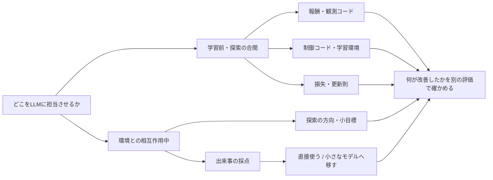

# LLMを活用したRL：47論文の読み方と研究上の問い

調査日: 2026-11-07（JST）  
位置づけ: 11冊の調査報告への案内と、そこから整理した研究上の問い。新しい実験結果、採用済みの設計、実装計画ではない。  
範囲: 2025〜2026年を中心に、比較の起点となる2023〜2024年の研究を含む。47論文の一次資料と、選んだ公開実装を確認した。全文未確認の論文は個別に明記した。  
検証: 文書のリンク・書式と小さな数式例を確認。RL学習、モデル取得、有料API呼び出しは行っていない。

## 目次

1. [1. 最初に読む場所](#1-最初に読む場所)
2. [2. 47論文の索引](#2-47論文の索引)
   - [2.1 本文の21論文](#21-本文の21論文)
   - [2.2 制御と学習環境の5論文](#22-制御と学習環境の5論文)
   - [2.3 小型モデルと費用の4論文](#23-小型モデルと費用の4論文)
   - [2.4 探索に渡す情報の2論文](#24-探索に渡す情報の2論文)
   - [2.5 更新則発見の3論文](#25-更新則発見の3論文)
   - [2.6 言葉と環境の対応の3論文](#26-言葉と環境の対応の3論文)
   - [2.7 小目標と振り返りの4論文](#27-小目標と振り返りの4論文)
   - [2.8 行動助言の3論文](#28-行動助言の3論文)
   - [2.9 蒸留と先読みの2論文](#29-蒸留と先読みの2論文)
3. [3. 今回の証拠から分けられる研究上の問い](#3-今回の証拠から分けられる研究上の問い)
4. [4. 費用を比較するための計算](#4-費用を比較するための計算)
5. [5. 結果を過大に読まないための区別](#5-結果を過大に読まないための区別)
6. [6. 今回の調査で更新した判断](#6-今回の調査で更新した判断)

## 1. 最初に読む場所

関心が「Atariの特定の難所を突破したい」なら、LLM-Explorerの平均スコアより先に、何をLLMへ見せているかを確認するとよい。現在状態を入力しない探索分布の提案と、画面を見て動作を選ぶ制御では、解決できる問題が違う。関心が「新しいRLアルゴリズムを探りたい」なら、更新則の生成と評価を扱う別冊から入る方が直接的である。

| 知りたいこと | 最初に読む冊子 | 次に読む冊子 |
|---|---|---|
| 分野全体の入口 | [再サーベイ本文](llm_assisted_rl_resurvey_2026-11-07.md) | 興味を持った方式の別冊 |
| Atariの探索に何を渡すか | [探索に渡す情報](llm_rl_exploration_information_2026-11-07.md) | [言葉と環境の対応](llm_rl_language_grounding_2026-11-07.md) |
| 小さなモデルで成り立つか | [小型モデルと費用](llm_rl_small_models_and_costs_2026-11-07.md) | [公開実装の再現条件](llm_assisted_rl_reproducibility_2026-11-07.md) |
| 報酬整形の保証はどこまでか | [保証と目標切り替え](llm_reward_shaping_guarantees_2026-11-07.md) | [本文の失敗例](llm_assisted_rl_resurvey_2026-11-07.md#7-比較条件と失敗を調べる) |
| 制御器・環境をコードで作る方法 | [生成した制御と環境](llm_generated_control_and_environments_2026-11-07.md) | [更新則発見](llm_rl_algorithm_discovery_2026-11-07.md) |
| 新しい学習則の探し方 | [更新則発見](llm_rl_algorithm_discovery_2026-11-07.md) | [本文の比較研究](llm_assisted_rl_resurvey_2026-11-07.md#7-比較条件と失敗を調べる) |
| 小目標と失敗の説明をどう使うか | [小目標と振り返り](llm_rl_goals_and_reflection_2026-11-07.md) | [報酬整形の保証](llm_reward_shaping_guarantees_2026-11-07.md) |
| 助言を無視する余地はどこに残るか | [行動助言の接続先](llm_rl_action_advice_2026-11-07.md) | [言葉と環境の対応](llm_rl_language_grounding_2026-11-07.md) |
| 助言を重みや先読みにどう使うか | [蒸留と世界モデル](llm_rl_distillation_and_planning_2026-11-07.md) | [行動助言の接続先](llm_rl_action_advice_2026-11-07.md) |

11冊のうち、公開実装の冊子と保証の冊子は、ほかの冊子に含む論文を深掘りしている。これらを足して論文数を水増ししていない。前回の2026-10-18調査を含む全期間の文献総数ではなく、今回新たに確認・再確認した本体論文が47本である。

この図は調査者の分類であり、特定の論文の図の転載ではない。同じ研究が複数の枝にまたがることもある。

## 2. 47論文の索引

下表は参照先を探すための索引であり、性能順位ではない。各リンク先に、一次資料、書誌、評価条件、限界がある。「隣接」は外部RLの補助そのものから少し外れるが、比較のために含めた研究を示す。

### 2.1 本文の21論文

| No. | 研究 | 主に読む観点 | 詳細 |
|---|---|---|---|
| 1 | Eureka | 報酬コード生成の起点 | [本文2.1](llm_assisted_rl_resurvey_2026-11-07.md#21-eureka) |
| 2 | R* | 報酬構造と係数の探索 | [本文2.2](llm_assisted_rl_resurvey_2026-11-07.md#22-r) |
| 3 | PoRSE | 状態の抽象化と探索 | [本文2.3](llm_assisted_rl_resurvey_2026-11-07.md#23-porse) |
| 4 | LIMEN | 報酬・観測の同時生成 | [本文2.4](llm_assisted_rl_resurvey_2026-11-07.md#24-limen) |
| 5 | EvoNav | 候補評価とLLM推論への費用配分 | [本文2.5](llm_assisted_rl_resurvey_2026-11-07.md#25-evonav) |
| 6 | RL-VLM-F | 画像の選好から報酬学習 | [本文3.1](llm_assisted_rl_resurvey_2026-11-07.md#31-rl-vlm-f) |
| 7 | RoboReward | 専用の小型視覚報酬モデル | [本文3.2](llm_assisted_rl_resurvey_2026-11-07.md#32-roboreward) |
| 8 | Large Reward Models | 完了・進捗・比較の分離 | [本文3.3](llm_assisted_rl_resurvey_2026-11-07.md#33-large-reward-models) |
| 9 | Dopamine-Reward / Dopamine-RL | 動画報酬の事前学習と実機適応 | [本文3.4](llm_assisted_rl_resurvey_2026-11-07.md#34-dopamine-rewardとdopamine-rl) |
| 10 | Robometer | 失敗例を含む視覚報酬学習 | [本文3.5](llm_assisted_rl_resurvey_2026-11-07.md#35-robometer) |
| 11 | LEACL | 学習課題の順序 | [本文4.1](llm_assisted_rl_resurvey_2026-11-07.md#41-leacl) |
| 12 | LLM-Explorer | 状態を見ない探索分布 | [本文5.1](llm_assisted_rl_resurvey_2026-11-07.md#51-llm-explorer) |
| 13 | Exploration with Foundation Models | VLMの探索能力の条件 | [本文5.2](llm_assisted_rl_resurvey_2026-11-07.md#52-exploration-with-foundation-models) |
| 14 | TextAtari | 隣接：言語エージェントの評価 | [本文5.3](llm_assisted_rl_resurvey_2026-11-07.md#53-textatari) |
| 15 | Generative Code Optimization | 物体情報から制御コード | [本文5.4](llm_assisted_rl_resurvey_2026-11-07.md#54-generative-code-optimization) |
| 16 | ULPS | 計画器由来のラベルとRL | [本文5.5](llm_assisted_rl_resurvey_2026-11-07.md#55-ulps) |
| 17 | Evolutionary Discovery of RL Algorithms | 既存の更新原理を禁止した探索 | [本文6.1](llm_assisted_rl_resurvey_2026-11-07.md#61-evolutionary-discovery-of-rl-algorithms) |
| 18 | BIRD | 報酬発見法の比較条件 | [本文7.1](llm_assisted_rl_resurvey_2026-11-07.md#71-bird) |
| 19 | Diagnostic-Driven Refinement | 診断フィードバックの追加効果 | [本文7.2](llm_assisted_rl_resurvey_2026-11-07.md#72-diagnostic-driven-refinement) |
| 20 | Policy-Invariant Reward Shaping from LLM Feedback | 理論と実装pilotの切り分け | [本文7.3](llm_assisted_rl_resurvey_2026-11-07.md#73-policy-invariant-reward-shaping-from-llm-feedback) |
| 21 | CriticHack | 成功率と特定失敗の同時増加 | [本文7.4](llm_assisted_rl_resurvey_2026-11-07.md#74-critichack) |

### 2.2 制御と学習環境の5論文

| No. | 研究 | 主に読む観点 | 詳細 |
|---|---|---|---|
| 22 | Code to Control | 制御コード生成と数値調整 | [制御・環境2](llm_generated_control_and_environments_2026-11-07.md#2-code-to-control構造と数値を分けて制御器を作る) |
| 23 | ESBM | 説明の検証と方策の更新 | [制御・環境3](llm_generated_control_and_environments_2026-11-07.md#3-esbm得点以外の検証を方策の更新に使う) |
| 24 | Memento 3 | 文章・コードで保持する世界知識 | [制御・環境4](llm_generated_control_and_environments_2026-11-07.md#4-memento-3世界モデルを文章とコードで保持する) |
| 25 | PDE | 方策への言語条件を探索 | [制御・環境5](llm_generated_control_and_environments_2026-11-07.md#5-pde言語条件を変えて行動の候補を広げる) |
| 26 | PlayTrain | 隣接：学習環境のコード生成 | [制御・環境6](llm_generated_control_and_environments_2026-11-07.md#6-playtrain学習するゲーム自体を生成する) |

### 2.3 小型モデルと費用の4論文

| No. | 研究 | 主に読む観点 | 詳細 |
|---|---|---|---|
| 27 | VLM-AR3L | 小型VLMから軽い報酬モデル | [小型モデル2](llm_rl_small_models_and_costs_2026-11-07.md#2-vlm-ar3l小型vlmの判定を軽い報酬モデルへ移す) |
| 28 | SCOUT | 隣接：軽い方策の経験でLLMを育てる | [小型モデル3](llm_rl_small_models_and_costs_2026-11-07.md#3-scout軽いrl方策で集めた経験をllmへ渡す) |
| 29 | EARS | 実軌跡を直接収集しない報酬設計 | [小型モデル4](llm_rl_small_models_and_costs_2026-11-07.md#4-ears報酬を作る段階の環境サンプリングを省く) |
| 30 | DERL | 報酬提案器を学習 | [小型モデル5](llm_rl_small_models_and_costs_2026-11-07.md#5-derl小さな報酬提案器も学習させる) |

### 2.4 探索に渡す情報の2論文

| No. | 研究 | 主に読む観点 | 詳細 |
|---|---|---|---|
| 31 | iLLM | 内発報酬と補助学習 | [探索の情報2](llm_rl_exploration_information_2026-11-07.md#2-illm予測誤差と補助学習の両方を使う) |
| 32 | Intelligent Go-Explore | 隣接：戻る状態と行動の選択 | [探索の情報4](llm_rl_exploration_information_2026-11-07.md#4-intelligent-go-explore戻る場所もllmで選ぶ) |

### 2.5 更新則発見の3論文

| No. | 研究 | 主に読む観点 | 詳細 |
|---|---|---|---|
| 33 | How Should We Meta-Learn RL Algorithms? | 更新式の発見と探索seed | [更新則2](llm_rl_algorithm_discovery_2026-11-07.md#2-how-should-we-meta-learn単純な式と大きな更新器の違い) |
| 34 | Discovering Multiagent Learning Algorithms | 隣接：表形式のゲーム解法の発見 | [更新則4](llm_rl_algorithm_discovery_2026-11-07.md#4-multiagent-learning生成後の人による絞り込み) |
| 35 | DiscoGen | 発見課題と評価条件の生成 | [更新則5](llm_rl_algorithm_discovery_2026-11-07.md#5-discogen発見する課題を生成する) |

### 2.6 言葉と環境の対応の3論文

| No. | 研究 | 主に読む観点 | 詳細 |
|---|---|---|---|
| 36 | ONI | 非同期注釈とオンライン報酬学習 | [言葉と環境2](llm_rl_language_grounding_2026-11-07.md#2-oni採点を待たずに学習を進める) |
| 37 | Informing RL Agents by Grounding Language to MDPs | 助言を形式言語へ翻訳 | [言葉と環境4](llm_rl_language_grounding_2026-11-07.md#4-rlang助言を報酬以外にも翻訳する) |
| 38 | DECKARD | 依存関係の提案と経験での修正 | [言葉と環境5](llm_rl_language_grounding_2026-11-07.md#5-deckard依存関係を経験で確かめる) |

### 2.7 小目標と振り返りの4論文

| No. | 研究 | 主に読む観点 | 詳細 |
|---|---|---|---|
| 39 | ELLM | 目標の提案と文章化器の前提 | [小目標2](llm_rl_goals_and_reflection_2026-11-07.md#2-ellm有用そうな目標を探索の報酬にする) |
| 40 | SGRL | 再利用する目標コードと行動の制約 | [小目標3](llm_rl_goals_and_reflection_2026-11-07.md#3-sgrl目標生成をコードにし行動を制約する) |
| 41 | LLM-TALE | 候補姿勢の選択と残差制御 | [小目標4](llm_rl_goals_and_reflection_2026-11-07.md#4-llm-tale候補の姿勢を選び制御器を補正する) |
| 42 | LAGEA | 小型VLMの振り返りと報酬学習 | [小目標5](llm_rl_goals_and_reflection_2026-11-07.md#5-lagea失敗の説明を各stepの学習信号へ変える) |

### 2.8 行動助言の3論文

| No. | 研究 | 主に読む観点 | 詳細 |
|---|---|---|---|
| 43 | Efficient RL with LLM Priors | 候補集合、価値更新、cacheの条件 | [行動助言2](llm_rl_action_advice_2026-11-07.md#2-llm-priors候補の中で価値を学ぶ) |
| 44 | LLM-Augmented Observations | 推奨行動を観測へ足す | [行動助言3](llm_rl_action_advice_2026-11-07.md#3-観測ヒント従うかどうかを方策が学ぶ) |
| 45 | Agent-Specific Prompt Engineering | 行動効果の事前学習。PDF全文は未確認 | [行動助言4](llm_rl_action_advice_2026-11-07.md#4-apm行動の直後の効果を学んで文章にする) |

### 2.9 蒸留と先読みの2論文

| No. | 研究 | 主に読む観点 | 詳細 |
|---|---|---|---|
| 46 | LVLM2P | 教師分布の蒸留と公開PPO分岐の不一致 | [蒸留2–3](llm_rl_distillation_and_planning_2026-11-07.md#2-lvlm2p行動分布を小さな方策へ移す) |
| 47 | PriorZero | MCTSの根での助言とLLMの再学習 | [先読み4](llm_rl_distillation_and_planning_2026-11-07.md#4-priorzero先読みの入口だけを言語で補う) |

隣接研究を含む47本のすべてが「LLMを追加するとDQNの成績が上がった」と報告するわけではない。結果の種類を混ぜないために含めている。

## 3. 今回の証拠から分けられる研究上の問い

以下は本調査の考察である。優先順位は、求める成果によって変わる。既存手法の再現を目的にするか、新しい学習の原理を探るかでも、選ぶ入口が異なる。

| 問い | 読む起点 | 分離すると分かりやすい比較 | 期待できる知見 |
|---|---|---|---|
| 事前知識が探索の偏りを改善するか | LLM-Explorer、iLLM | 同じ情報を持つ非LLMの偏り／無関係な知識／補助損失だけ | 知識の内容が必要だったか |
| 何を観測へ含めると有用か | LIMEN、PoRSE | 観測だけ／報酬だけ／両方 | 認識しやすくした効果と目的を変えた効果 |
| 学習則のどこならLLMで探索しやすいか | How Should We Meta-Learn、DiscoGen | 係数だけ／構造も変更／非LLM探索 | 関数の入力・状態・自由度の影響 |
| 遅い意味判断を少数だけ使えるか | ONI、VLM-AR3L | 直接検索／蒸留／注釈をしない場合 | 注釈の少なさと一般化の釣合い |
| 間違った助言を実経験で直せるか | DECKARD、RLang翻訳 | 正しい語彙／欠けた語彙／誤った依存関係 | 文章の正しさと環境との対応の寄与 |
| 助言が行動候補を狭めすぎないか | LLM Priors、観測ヒント | 行動選択だけ／更新も限定／参考情報だけ | 探索の偏りと目的の変更、回復できる条件 |
| 採点の改善が行動改善につながるか | RoboReward、Robometer、CriticHack | 固定軌跡での採点／その報酬で最適化した方策 | 報酬の弱点を方策が増幅するか |

ある比較で正の結果が出たとしても、そのまま次の問いまで解けたことにはならない。たとえば「補助損失だけでも改善する」なら、内発報酬の工夫を追加する前に、表現学習や正則化としての説明を残す価値がある。これはiLLMの結果の読み方であり、anet-labで同じ結果が出たという意味ではない。

同様に、コード生成は学習の高速化だけでなく、考える候補を広げる用途も持つ。生成後にLLMを使わないという利点は、生成に掛かった費用が消えることでも、小型モデルが同じ候補を再発見できることでもない。[制御と環境の限界](llm_generated_control_and_environments_2026-11-07.md#9-調査の限界と残る問い)

## 4. 費用を比較するための計算

この節は論文値の再集計ではなく、比較のための計算方法を示す。数値例はすべて説明用の仮定であり、論文や手元GPUの測定値ではない。

**GPU時間と実時間は別である。** 2枚のGPUを同時に1時間使えば、経過した実時間は1時間だが、使用量は2 GPU時間になる。1枚でRLとLLMを共有した場合、専用GPUの各速度をそのまま足して速度を予測することはできない。競合があるため、共有状態で測った所要時間が必要になる。

**探索費用と再利用時の費用を分ける。** 一度の生成・探索費用を \(C_s\)、従来法の1 runの費用を \(C_b\)、生成物を使う1 runの費用を \(C_g\) とする。同じ費用単位で \(n\) 回使うなら、

\[
C_{\mathrm{generated}}(n)=C_s+nC_g,\qquad
C_{\mathrm{baseline}}(n)=nC_b.
\]

\(C_b>C_g\) のときだけ、\(n>C_s/(C_b-C_g)\) が費用の逆転条件となる。たとえば探索に20 GPU時間掛かり、1 runにつき0.1 GPU時間節約できるなら、200 runで同額、整数回数では201 runから節約となる。生成物が別の課題にもそのまま使えるという前提が必要で、課題ごとに再探索するならその費用を再び足す。

\(C_b\leq C_g\) なら、非負の探索費用を回収する有限の回数はこの式にはない。それでも成績が上がるなら、費用と成績の交換条件として評価する。速度だけの勝敗に押し込めない。

**環境stepは全用途を数える。** 候補の学習、修復した候補の再学習、選別の評価、最終評価、状態への復帰のための再生を分けて記録する。同じstepを二重計上しないように、用途別の互いに重ならない値を持つ。IGEで確認した復帰の行動再生は、新規探索stepだけを比べると見えなくなる。[IGEの固定実装](llm_rl_exploration_information_2026-11-07.md#5-公開実装における環境への戻り方)

**非同期にしても、情報は無制限に増えない。** 新しい注釈候補が届く速さが注釈器の処理速度を上回るなら、全候補を有限の遅延で処理し続けることはできない。重複を除く、捨てる、選ぶ、待たせる、いずれかが必要になる。直近を優先すれば、現在の方策に近い出来事を採点できる一方、古い候補は後回しになる。この一般的な処理量の制約を、ONIの成功率から消して考えない。

**問い合わせ数は価格でも実時間でもない。** 同じ1回でも、画像・動画の枚数、入力長、出力長、モデル、batchの大きさで費用が変わる。モデルの価格を固定した比較でも、失敗した応答や再試行を除くと総費用を過小評価する。今回の論文中のドル値は、報告当時の条件として保存した。

## 5. 結果を過大に読まないための区別

| よく似て見える二つの結果 | 区別する理由 | 本調査での具体例 |
|---|---|---|
| 正しいラベル／よい方策 | 方策が採点の弱点を利用しうる | CriticHack |
| 軌跡のよい順位／RLの改善 | 固定データの相関だけでは最適化後が分からない | EARS |
| 生成物の再生／生成からの再現 | 探索時モデルと費用が残る | Code to Control |
| 同じゲーム名／同じ環境 | wrapper、clone、物体情報、操作が異なる | ESBM、PlayTrain、ALE |
| 方策の複数seed／発見の複数seed | 最良式を再学習しても探索の再現性は分からない | How Should We Meta-Learn |
| 既存法に追加した効果／情報量を増やした効果 | 一方だけに状態・専門家・操作を追加する場合がある | DECKARD、RLang翻訳 |
| 使用モデルが小さい／総費用が小さい | 教師の注釈と候補学習が必要な場合がある | VLM-AR3L、DERL |
| 未見環境の成績／無調整の転用 | 評価先で学習率を選べば情報を使っている | How Should We Meta-Learn |
| 有効な形式／有効な意味 | 存在しない語や欠けた条件でも文章は解析できる | RLang翻訳、ローカルMiniGrid pilot |
| タイトルの予算／実施した評価予算 | 対応可能な長さを測定済みと読んでしまう | TextAtariの100Kと実験1,000 step |
| 学習seed／未見の環境配置 | 初期重みを変えても評価配置は同じ場合がある | PriorZero公開BabyAI設定 |

これらは特定手法を失格にする基準ではない。その結果がどの問いへ答えているかを正確に読むための区別である。情報や事前学習を使うこと自体は研究の価値を否定しないが、使わない手法との比較ではその違いを残す。

## 6. 今回の調査で更新した判断

**小型モデルを候補から外す理由は弱くなった。** iLLMの補足資料には280M・4-bitとAtari比較があり、ONIには8Bの非同期注釈の実証がある。ただし、用途・入力・GPU構成は異なる。「小型LLMは無理」も「小型LLMを載せれば改善する」も、今回の証拠からは支持しない。[iLLM補足資料の照合](llm_rl_exploration_information_2026-11-07.md#3-illmの補足資料で更新された実行条件)、[ONI](llm_rl_language_grounding_2026-11-07.md#2-oni採点を待たずに学習を進める)

追加のLAGEAには、3B VLMと単一RTX 4090による報告がある。平均実時間はわずかに短縮する一方で課題別には遅くなる例もある。目標画像と環境の成功ラベルを使う条件なので、単一GPUでの実現例と、任意の画像環境への転用を区別する。[小目標と振り返り §5–6](llm_rl_goals_and_reflection_2026-11-07.md#5-lagea失敗の説明を各stepの学習信号へ変える)

**アルゴリズム探索の対象を、報酬生成だけに絞る必要はない。** 観測、更新式、制御器、学習環境、言語条件を探索する研究を確認した。どれが最良かは未確定だが、何を固定して何を発見させるかという比較軸は増えた。[本文](llm_assisted_rl_resurvey_2026-11-07.md)、[更新則](llm_rl_algorithm_discovery_2026-11-07.md)、[制御・環境](llm_generated_control_and_environments_2026-11-07.md)

**LLMの説明より、環境との接続と独立した評価を重く見る。** 語彙の欠落、ラベルの解析、目標切り替え、対象の取り違えは、意味が分かる文章を生成できても残る問題である。報酬の採点値と元の課題の成績を別々に確認する根拠が増えた。[言葉と環境](llm_rl_language_grounding_2026-11-07.md)、[保証の反例](llm_reward_shaping_guarantees_2026-11-07.md)、[CriticHack](llm_assisted_rl_resurvey_2026-11-07.md#74-critichack)

KungFuMasterのボス攻略とQbert第8面を直接改善した証拠は、今回の検索・精読範囲でも未確認である。この未確認を、技術的に不可能という意味へ広げない。どの方式をanet-labへ採用するか、どの実験を開始するかは、本調査では決めていない。

最後の照合で、TextAtariのv2評価手順が1,000 interaction stepであることと、公開READMEと論文でObscuring条件の意味が異なることを確認した。長い課題に対応するベンチマークの提案と、実際にその長さで比較した証拠を分ける。[TextAtariの原典・コード照合](llm_assisted_rl_resurvey_2026-11-07.md#53-textatari)
